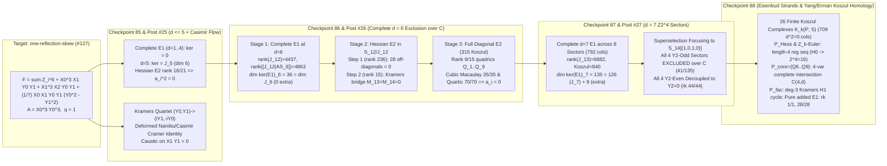
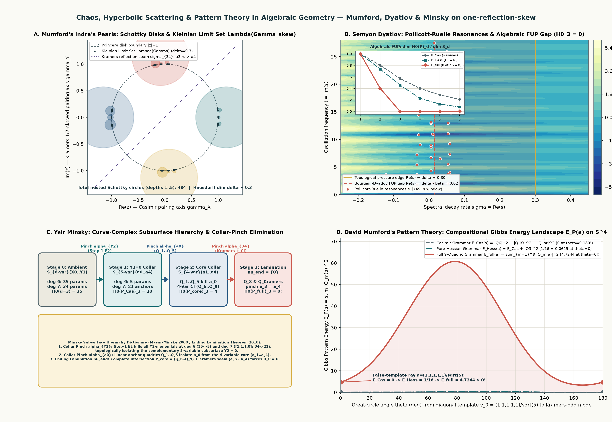
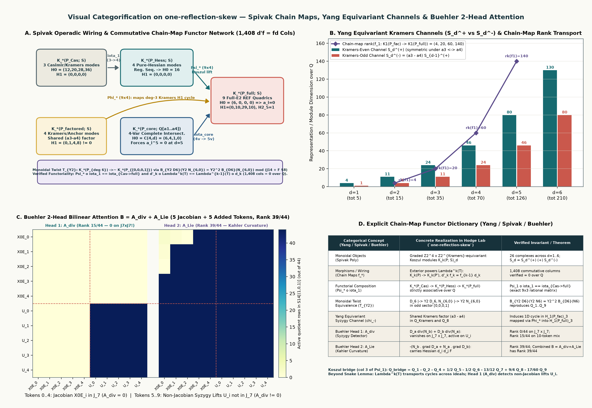
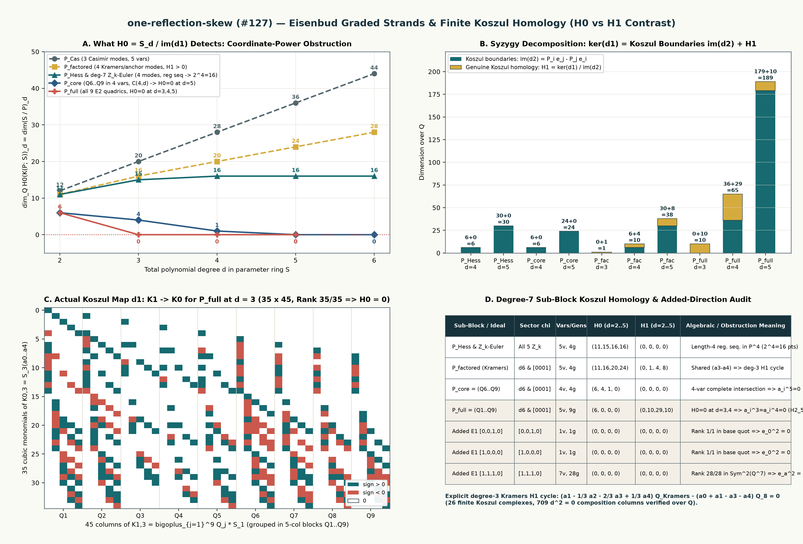
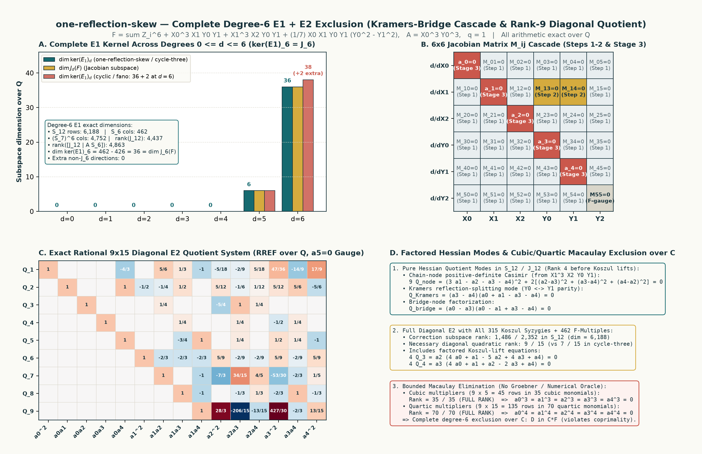
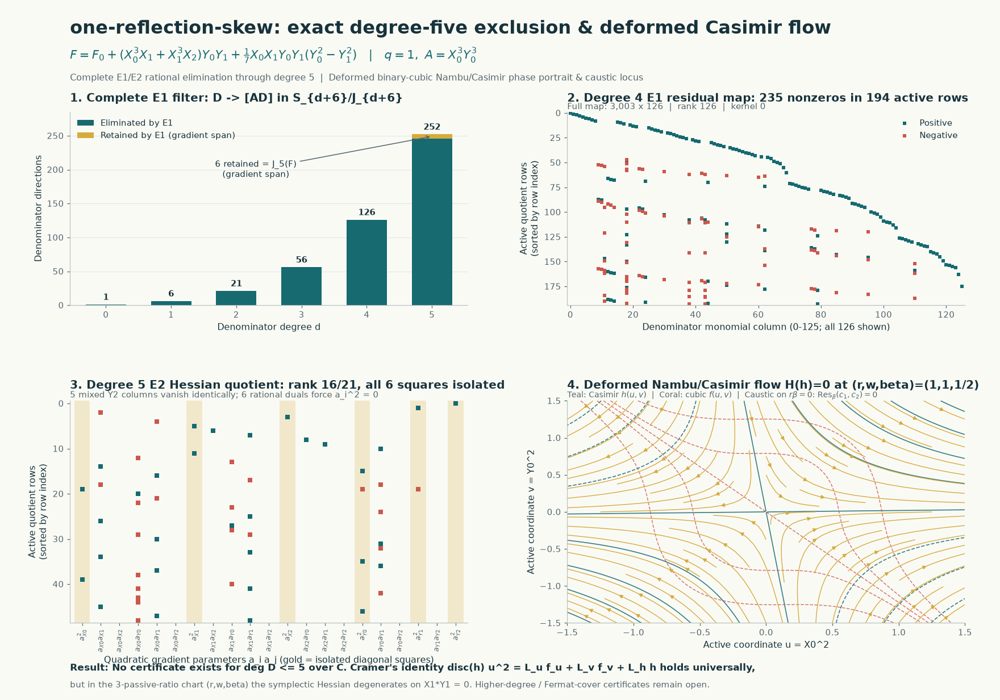

# Contribution and research ledger

Contributions by **rbajaj5** to [hodge-computer/sextics](https://github.com/hodge-computer/sextics), alongside the motivation and experiments recorded in Hodge Lab.

Our intent is to understand the fixed problems, share reproducible results and unsuccessful approaches, credit prior mathematical work, and pursue solution credit through the project's verification process. This statement is recorded on **16 October 2026**; the entry below summarizes an earlier public post.

**Current publication tally, through 21 October 2026 (EDT):** **29 discussion contributions**, one closed maintenance PR, and zero accepted authored solves. The two October 21 publications are entries **28 and 29** in [Posts](#posts) below; the Lean addendum edits entry 29 and does not add another contribution. Detailed publication receipts remain in checkpoints 112, 119 and 120. The earlier tally below is preserved as history.

**Historical publication tally, through 19 October 2026 (EDT):** 27 discussion contributions (originally twenty top-level comments and seven replies); 0 authored issues; 1 maintenance pull request (closed); 0 reviews or review comments; 0 merged authored upstream commits; 0 accepted solves. Commits to Hodge Lab and unpublished experiments are separate from this upstream tally. The maintainer consolidated several holdout updates on 17 October; this records publication history, not the current number of visible comments. See [the maintainer summary](https://github.com/hodge-computer/sextics/discussions/44#discussioncomment-19003085) and checkpoint 70 below. Receiving credit does not increase this tally.

## Visual Frontier Dashboard (October 2026)

| Target Instance | Upstream Thread | Complete $E_1$ Kernel ($d=0\dots 7$) | Degree-6 & Degree-7 $E_2$ Quotient & Koszul Structure | Unconditional Exclusion Bound | Key Algebraic / Physics Mechanism | Latest Checkpoint & Note |
| :--- | :--- | :--- | :--- | :--- | :--- | :--- |
| **`one-reflection-skew`** | [Discussion #127](https://github.com/hodge-computer/sextics/discussions/127) | `(0, 0, 0, 0, 0, 6, 36, 135)` ($\ker(E_1)_6 = J_6$; $\ker(E_1)_7 = J_7 \oplus \mathbb{Q}^9$) | **$d=6$:** 28+2 cascade + **rank-9** diagonal $E_2$ ($H_0=0$ at $d=3,4$; $P_{\text{core}}$ $\binom{4}{d}$ complete intersection) **$d=7$:** **4/4 $Y_2$-odd excluded**; 9/9 pure added $E_1$ squares $=0$; 1,408 chain-map cols ($d'_k \Lambda^k T = \Lambda^{k-1} T d_k$); 2-head attention $\mathcal{B} = \mathcal{A}_{\text{div}} + \mathcal{A}_{\text{Lie}}$ | **$\deg D \le 6$ + all four pure-character $Y_2$-odd $d=7$ sectors + all 9 directions in the three pure added $E_1$ blocks excluded over $\mathbb{C}$** | Order-two interaction involution (not a full-sextic symmetry); Spivak chain maps $\Lambda^k(T)$; Yang $\mathbb{Z}_2^{\text{Kramers}}$ channels; Buehler 2-head bilinear attention ($\mathcal{A}_{\text{div}}$ detects $U_i \notin J_7$); Dyatlov FUP / Mumford / Minsky collar hierarchy | **CP 85–90 (Posts #25–27)** · [`categorified-koszul-network.md`](notes/categorified-koszul-network.md) · [`dyatlov-mumford-minsky-chaos-ag.md`](notes/dyatlov-mumford-minsky-chaos-ag.md) |
| **`cycle-three`** | [Discussion #55](https://github.com/hodge-computer/sextics/discussions/55) | `(0, 0, 0, 0, 0, 6, 36)` ($\ker(E_1)_6 = J_6$) | **30** Hessian squares + **rank-7** diagonal $E_2$ ($315$ Koszul syzygies) | **$\deg D \le 6$ excluded over $\mathbb{C}$** (quartic $70/70$) | $\mathbb{Z}_3$ cyclic transport; 7-equation diagonal quotient | **CP 71–72** · [`fresh-instance-degree6.md`](notes/fresh-instance-degree6.md) |
| **`mixed-biweight`** | [Discussion #56](https://github.com/hodge-computer/sextics/discussions/56) | `(0, 0, 0, 0, 0, 6, 39)` ($J_6 \oplus \mathbb{Q}^3$) | **26+10** square cascade + 2-point residual functional | **$\deg D \le 6$ excluded over $\mathbb{C}$** | Non-Jacobian $E_1$ excess ($+3$ dims); three-term coefficient functional kills both residual points | **CP 73** · [`mixed-degree6-extra.md`](notes/mixed-degree6-extra.md) |
| **`cyclic` / `fano`** | [Discussion #112](https://github.com/hodge-computer/sextics/discussions/112) | `(0, 0, 0, 0, 0, 6, 38)` ($J_6 \oplus \mathbb{Q}^2$) | Cyclic character split ($\chi_0, \chi_1, \chi_2$) + Lean 4.31 notebook; separate 4.33 maintenance compatibility | **$\deg D \le 6$ excluded over $\mathbb{C}$** + explicit free curve family | $\mathbb{Z}_3$ character projection; 16 literal-matrix candidates (17 modules); polynomial-to-matrix Lean bridge for Case05 only (5 modules) | **CP 74–84** · [`cyclic-fano-curve.md`](notes/cyclic-fano-curve.md) |

### Latest Visual Checkpoints (`one-reflection-skew`, Discussion #127)

*Checkpoint 90 (`results/dyatlov-mumford-minsky/dyatlov-mumford-minsky-chaos-ag.png`): Visual synthesis of David Mumford's Indra's Pearls Schottky uniformization ($484$ nested circles up to word depth $L=5$, Kleinian limit set $\Lambda(\Gamma_{\text{skew}})$ of Hausdorff dimension $\delta \approx 0.30$), Semyon Dyatlov's Pollicott–Ruelle scattering resonances and Fractal Uncertainty Principle (FUP) gap paired with the exact algebraic FUP survival collapse $\rho_3(P_{\text{full}}) = 0$, Yair Minsky's curve-complex subsurface hierarchy and collar pinches ($\alpha_{Y_2} \to \alpha_{a_0} \to \alpha_{34} \to \nu_{\text{end}}$), and David Mumford's Pattern-Theory Gibbs energy landscape $E_P(a) = \sum_{Q \in P} |Q(a)|^2$ on $\mathbb{S}^4$ ($E_{\text{Cas}}(v_0) = 0 \to E_{\text{Hess}}(v_0) = 1/16 \to E_{\text{full}}(v_0) = 4.7244 > 0$).*

*Checkpoint 89 (`results/categorified-koszul-network/categorified-koszul-network.png`): Visual categorification beyond the Snake Lemma combining David Spivak's operadic wiring and explicit exterior-power chain maps $\Lambda^k(T): K_k(P; S) \to K_k(P'; S)$ ($1{,}408$ verified commutative columns $d'_k \circ f_k = f_{k-1} \circ d_k = 0$ over $\mathbb{Q}$), David H. Yang's $\mathbb{Z}_2^{\text{Kramers}}$ equivariant channel decomposition $S_d = S_d^{(+)} \oplus S_d^{(-)}$, and Markus J. Buehler's 2-head bilinear attention decomposition $\mathcal{B}(e_a, e_b) = \mathcal{A}_{\text{div}}(e_a, e_b) + \mathcal{A}_{\text{Lie}}(e_a, e_b)$ on $5$ Jacobian Euler tokens + $5$ non-Jacobian ("added") E1 syzygy lifts in sector `[1,1,1,0]` (proving $\operatorname{rank}(\mathcal{A}_{\text{div}}) = 0/44$ on $J_7 \times J_7$ and $15/44$ on non-Jacobian lifts, while $\operatorname{rank}(\mathcal{A}_{\text{Lie}}) = 39/44$).*

*Checkpoint 88 (`results/one-reflection-skew-koszul/one-reflection-skew-koszul-homology.png`): Eisenbud graded-syzygy strands and Yang / Eisenbud–Erman finite Koszul homology ($H_0$ vs. $H_1$ contrast) across $26$ verified Koszul complexes ($709$ $d_{k-1}\circ d_k = 0$ composition columns): $P_{\text{Hess}}$ and all five degree-7 $Z_k$-twisted Euler families form length-$4$ regular sequences in $\mathbb{P}^4$ ($\dim H_0 \to 2^4 = 16$, $H_1 = 0$); the $a_0$-eliminated sub-block $P_{\text{core}} = (Q_6,Q_7,Q_8,Q_9)$ is an exact $4$-variable complete intersection ($\dim H_0 = \binom{4}{d} \to 0$ at $d=5$); the shared Kramers factor $(a_3-a_4)$ between $Q_{\text{Kramers}}$ and $Q_8$ generates an explicit degree-$3$ non-boundary cycle in $H_1(K(P_{\text{factored}}))_3$; $P_{\text{full}}$ splits $\ker(d_1)_4 = 65 = 36\text{ boundaries} + 29\text{ } H_1$ with $\dim H_0 = 0$ at $d=3,4,5$; and all three degree-7 non-Jacobian ("added") $E_1$ sub-blocks achieve full rank at $d=2$ (`1/1`, `1/1`, `28/28`), forcing all $9$ pure added squares to vanish.*

*Checkpoint 87 & Upstream Post #27 (`results/one-reflection-skew-degree7/one-reflection-skew-degree7-sectors.png`): Complete degree-7 $\mathbb{Z}_2^4$ superselection sector decomposition across all $792$ monomials of $S_7$ and $8{,}568$ rows of $S_{13}$ (`dim ker(E1)_7 = 135 = 126 + 9`), $\mathbb{Z}_2^4$ Superselection Focusing into $S_{14}[(1,0,1,0)]$, complete exclusion over $\mathbb{C}$ of all four $Y_2$-odd sectors ($41$ $E_1$ dimensions, $296$ monomials of $S_7$), and $Y_2$-decoupling + $44/44$ base-quotient surjectivity across all four $Y_2$-even sectors.*

*Checkpoint 86 & Upstream Post #26 (`results/one-reflection-skew-degree6/one-reflection-skew-degree6-exclusion.png`): Complete degree-6 $E_1 + E_2$ exclusion over $\mathbb{C}$ for `one-reflection-skew` (`dim ker(E1)_6 = 36 = dim J_6(F)`, 28+2 two-step Hessian square cascade isolating the Kramers-bridge doublet $(X_1, Y_0), (X_1, Y_1)$, rank-9 diagonal $E_2$ system with factored Casimir/Kramers modes, and full-rank cubic $35/35$ + quartic $70/70$ Macaulay elimination).*

*Checkpoint 85 & Upstream Post #25 (`results/one-reflection-skew-pilot/one-reflection-skew-audit.png`): Complete degree $\le 5$ $E_1 + E_2$ exclusion, Kramers quartet & $\mathbb{Z}_2^3$ parity audit, and deformed binary-cubic Nambu/Casimir phase-space portrait.*

## Posts

1. **16 October 2026, 17:20 EDT / 21:20 UTC — [Holdout discussion #44: exact partial result](https://github.com/hodge-computer/sextics/discussions/44#discussioncomment-18983276).** Shared an exact exclusion of the degree-seven `{chi_Y0, chi_X1}` denominator family, with reproducible code and certificate checks. The purpose was to contribute a checkable partial result and narrow the remaining search. The post credits fqlx's preceding calculations and the project's mathematical framework, and discloses Codex assistance. It reports 9,451 of 9,453 two-character families excluded **at the time of posting**, while explicitly leaving the full holdout unresolved. No Lean `HasCertificate` proof or solve submission was claimed. Evidence: [pinned explanation and code links](https://github.com/rbajaj5/hodge-lab/blob/dc2756300cbfa7a54d4735c60b852cd38ca8725e/notes/degree-seven-pair.md) and [passing CI](https://github.com/rbajaj5/hodge-lab/actions/runs/38968484482).

2. **16 October 2026, 18:52 EDT / 22:52 UTC — [Holdout discussion #44: family-13 exclusion](https://github.com/hodge-computer/sextics/discussions/44#discussioncomment-18984345).** Shared the exact `{chi_X0, chi_Y0}` degree-seven exclusion and our reproduction of fqlx's distinct family-30 proof. The purpose was to fill the last two-character proof gap with a portable check, while crediting the complementary upstream work. The post records the 25 rational chart identities, independent coefficient reconstruction, corruption check, and [passing CI](https://github.com/rbajaj5/hodge-lab/actions/runs/38978064849). It links [immutable source and explanation](https://github.com/rbajaj5/hodge-lab/blob/5a1683fb82217aa49450614dc78d3b3e18b768c1/notes/x0-y0-exclusion.md), discloses Codex assistance, and explicitly leaves three-or-more-character denominators and higher degrees open. The combined count is 9,453/9,453 two-character families; no existence certificate, Lean proof, or accepted solve is claimed. The published body, author, and permanent URL were read back and verified.

3. **16 October 2026, 19:33 EDT / 23:33 UTC — [Holdout discussion #44: 132 three-character family exclusions](https://github.com/hodge-computer/sextics/discussions/44#discussioncomment-18984710).** Shared the systematic test of all 136 third-character extensions of the `X0/Y0` pair: 112 exclusions via exact necessary-condition duals and 20 through shared-numerator chart covers. The post explicitly retains four unresolved extensions and the 16 additional coordinate triples that survived the relaxed pass. It links [immutable proofs, failed attempts, and explanation](https://github.com/rbajaj5/hodge-lab/blob/841cd0623c64d917a31ddf8433ddfbcc10c1260a/notes/three-character-families.md) and [passing CI](https://github.com/rbajaj5/hodge-lab/actions/runs/38981740498), credits fqlx and the prior mathematical framework, and discloses Codex assistance and the shared identity replayer. The purpose is to narrow a reproducible search region and make the four residual extensions available to collaborators. No Lean theorem, solution, improved unconditional degree bound, or leaderboard point is claimed. The body was previewed using GitHub's Markdown renderer; the published author and full body were independently read back and matched to the prepared text. [Publication receipt](results/degree7-triples/upstream-post.json).

4. **16 October 2026, 20:00 EDT / 17 October 2026, 00:00 UTC — [Holdout discussion #44: polynomial-syzygy exclusion of triple family 87](https://github.com/hodge-computer/sextics/discussions/44#discussioncomment-18985544).** Shared one new complete exclusion, increasing the fixed-`X0/Y0` extension coverage to 133/136. Polynomial relations eliminate the shared numerator corrections; three cubic identities and a three-row physical identity finish the contradiction. The post includes the bounded method, the two unresolved family-115 charts, failed module searches and multiplier exports, and the limits of the literature connection. It links the [immutable proof and explanation](https://github.com/rbajaj5/hodge-lab/blob/cf75f3b67385c78769325db138104435ffa04b35/notes/polynomial-syzygies.md) and [passing full CI](https://github.com/rbajaj5/hodge-lab/actions/runs/38983831725), credits prior work, and discloses Codex assistance and shared verification code. No Lean theorem, general three-character exclusion, solve submission, or leaderboard point is claimed. The draft was previewed through GitHub Markdown; the published author, URL, and full body were read back and matched exactly. [Publication receipt](results/degree7-syzygies/upstream-post.json).

5. **16 October 2026, 20:24 EDT / 17 October 2026, 00:24 UTC — [Holdout discussion #44: rebuilt-syzygy exclusion of triple family 115](https://github.com/hodge-computer/sextics/discussions/44#discussioncomment-18985755).** Shared the new complete exclusion, increasing fixed-`X0/Y0` extension coverage to 134/136. Rebuilding after the verified zeros and searching through degree five closes chart 10; its forced zero then closes chart 0. The post links [immutable proofs, visualization, and failed attempts](https://github.com/rbajaj5/hodge-lab/blob/b366f33c5a9421532d452ec4d15588c5f9998b7f/notes/syzygy-rebuild.md) and [passing full CI](https://github.com/rbajaj5/hodge-lab/actions/runs/38985896164). It records the ten larger-chart timeouts and two conditional chart improvements, credits prior work, and discloses Codex assistance and the shared identity replayer. The purpose is to supply another portable exclusion and reusable reductions while keeping the unresolved scope explicit. No Lean proof, solve submission, or leaderboard point is claimed. GitHub rendered the draft's four math blocks; the published author, URL, and full body were independently read back and matched exactly. [Publication receipt](results/degree7-syzygy-rebuild/upstream-post.json).

6. **16 October 2026, 21:08 EDT / 17 October 2026, 01:08 UTC — [Holdout discussion #44: the last two fixed-pair triple extensions](https://github.com/hodge-computer/sextics/discussions/44#discussioncomment-18986224).** Shared the exact exclusions of families 16 and 137, completing 136/136 third-character extensions of the fixed `X0/Y0` pair and 136/152 selected triples. Two-row global identities and rebuilt Koszul syzygies close all ten charts. The post links [immutable proofs, dependencies, and failed searches](https://github.com/rbajaj5/hodge-lab/blob/17799c6c210373d4e7d2e9dcab837097161f8bfc/notes/koszul-rank-continuation.md) and [passing full CI](https://github.com/rbajaj5/hodge-lab/actions/runs/38988964935). It records exceptional-rank handling, bounded timeouts, two polynomial reconstructions, and the shared identity replayer; it credits prior work and discloses Codex assistance. Sixteen other selected triples and the full holdout remain unresolved. No Lean theorem, general degree-seven exclusion, solve submission, or leaderboard point is claimed. GitHub rendered the three math blocks and chart table before publication; the published author, URL, and full body were read back and matched exactly. [Publication receipt](results/degree7-rank-strata/upstream-post.json).

7. **17 October 2026, 07:10 EDT / 11:10 UTC — [Reply to post six: degree-three necessary ideals](https://github.com/hodge-computer/sextics/discussions/44#discussioncomment-18997300).** Shared eleven family-coordinate vanishings across families 6, 8, 10, 149, and 152, with a pinned exact packet and cancellation visualizations. Six cubic identities and five rebuilt square identities reduce parameter spaces; no additional family is excluded and all sixteen remain open. The reply links [immutable code, explanation, visualizations, and failed attempts](https://github.com/rbajaj5/hodge-lab/blob/6d478ea5b8896935ebabf1ffd323afc66c26cd0e/notes/eisenbud-linear-strand.md), states the bounded degree-three search and the relaxed correction-space assumption, credits prior work, and discloses Codex assistance and shared verification code. It reports both local exact replays passing without claiming full CI, independent human review, a full resolution, a Lean proof, or solve credit. The existing thread was reread; GitHub's Markdown preview was inspected before posting. The published author, permanent URL, and complete body were independently read back and matched. [Publication receipt](results/eisenbud-linear-strand/upstream-post.json).

8. **17 October 2026, 07:32 EDT / 11:32 UTC — [Reply to post six: degree-four blocks close five triples](https://github.com/hodge-computer/sextics/discussions/44#discussioncomment-18997670).** Shared exact exclusions of families 6, 8, 10, 149, and 152, increasing selected coverage to 141/152. Six blocks of six quadratics in five variables have a full quartic image; thirty fourth-power identities and replayed residual-sector proofs close the five triples. The reply links [immutable proof packets, explanation, visualizations, and failed attempts](https://github.com/rbajaj5/hodge-lab/blob/f131c2f9649fe5eb08f1a36caff7cc87162f5ad9/notes/eisenbud-quartic-strand.md), credits fqlx's pre-existing Y0/Y1 pair exclusion and the prior framework, and discloses Codex assistance and shared verification code. Both local physical reconstructions pass. It retains the timeout, slower alternative basis, and failed relaxed pair search, while leaving eleven selected triples and holdout open. No Lean proof, full resolution, improved unconditional degree bound, or solve credit is claimed. The full thread was reread and GitHub's mathematical Markdown preview inspected. Publication preceded the linked Hodge Lab push; the author, URL, and complete body were independently read back and matched. [Publication receipt](results/eisenbud-quartic-strand/upstream-post.json).

9. **17 October 2026, 07:45 EDT / 11:45 UTC — [Holdout discussion #44: nine more quartic triple exclusions](https://github.com/hodge-computer/sextics/discussions/44#discussioncomment-18997810).** Shared exact exclusions of families 1, 2, 4, 5, 7, 9, 15, 39, and 150, increasing selected coverage to 150/152. All 33 small blocks were tested; 62 fourth-power identities and explicit residual-sector replays close the nine triples. The full quartic maps for 17 and 151 fail to force coordinate fourth powers, and those families remain open. The post links [immutable proofs, visualizations, and failures](https://github.com/rbajaj5/hodge-lab/blob/d44f72a44a36d7f58b623b8c905bd2f0f8e6c8a0/notes/eleven-quartic.md), credits fqlx's existing family-30 proof as a reproduced dependency, and discloses Codex assistance and shared verification code. Both local physical reconstructions and 330 presentation checks pass. The existing discussion was reread; GitHub's mathematical Markdown preview was inspected. Posted as a self-contained top-level result, followed immediately by the linked repository push. The author, body, URL, and absence of a reply parent were read back and matched. No remote CI result was claimed before it ran, and no Lean proof, improved degree bound, solve submission, or leaderboard point is claimed. [Publication receipt](results/eleven-quartic/upstream-post.json).

10. **17 October 2026, 08:16 EDT / 12:16 UTC — [Holdout discussion #44: shared numerators close family 17](https://github.com/hodge-computer/sextics/discussions/44#discussioncomment-18998140).** Shared one new complete selected-family exclusion and one exact linear reduction in the remaining family 151. The shared-numerator chart forces a56=0 in family 17; rebuilding yields a full degree-six image and five sixth-power identities, followed by the explicitly reproduced fqlx X1/Y1 proof. Selected coverage is 151/152. The post links [immutable proofs, before/after visualizations, and failed attempts](https://github.com/rbajaj5/hodge-lab/blob/5e768a2c1261f12fe124bcf9d62ee768fdd482b6/notes/remaining-triples-shared.md), credits dependencies and the mathematical framework, and discloses Codex assistance and shared verification code. Both local physical reconstructions pass, with 17 chart traces, 167 exact inferences, seven corruption checks, and 21 presentation checks. The complete discussion was reread and GitHub's mathematical preview inspected. Posted as one self-contained top-level result before the linked Hodge Lab push; author, complete body, permanent URL, and absence of a reply parent were read back and matched. Remote CI was not claimed before running. No Lean proof, solve PR, improved unconditional degree bound, or leaderboard credit is claimed. [Publication receipt](results/remaining-triples-shared/upstream-post.json).

11. **17 October 2026, 08:34 EDT / 12:34 UTC — [Holdout discussion #44: polynomial multipliers close family 151](https://github.com/hodge-computer/sextics/discussions/44#discussioncomment-18998404).** Shared the exact exclusion of X1/Y0/Y1, completing 152/152 selected triples while leaving other triple supports, larger supports, higher degrees, and holdout open. Polynomial multipliers of the rebuilt shared-numerator equations produce 96 additional cubic relations; three correctly graded small blocks force thirteen fourth powers, and two direct residual charts contradict. The post links [immutable proof packets, visualizations, and failures](https://github.com/rbajaj5/hodge-lab/blob/a825be71140bb5c70327c2229c208df7d959e164/notes/family151-multipliers.md), credits the preceding framework and calculations, and discloses Codex assistance and shared verification code. Both physical reconstructions pass. Failed degree-three searches, three bounded timeouts, and a discarded mixed-degree pilot remain documented. The entire existing thread was reread, GitHub's mathematical preview inspected, and the result posted before the linked repository push. The complete published body, author, permanent URL, and lack of a reply parent were independently read back and matched. No Lean proof, solve PR, unconditional degree-bound improvement, or leaderboard point is claimed. Remote CI was still running at publication. [Publication receipt](results/family151-multipliers/upstream-post.json).

12. **17 October 2026, 09:08 EDT / 13:08 UTC — [Holdout discussion #44: 132 further X1/Y1 triple exclusions](https://github.com/hodge-computer/sextics/discussions/44#discussioncomment-18998764).** Shared 132 new complete three-character exclusions, completing all 136 extensions of X1/Y1 and increasing our selected union to 284 triples. Necessary blocks close 123; shared-numerator charts and reconstruction finish nine. The post links [immutable proofs, exact graded-map visualizations, and failed searches](https://github.com/rbajaj5/hodge-lab/blob/c126e8bbc6ccc3f4c37a14d6be20809bdbccef25/notes/x1y1-extensions.md), explicitly credits fqlx's reproduced pair-30 dependency, and discloses Codex assistance and shared verification code. Both physical constructions pass. Nine unsuccessful first-pass systems and two initially unresolved charts remain recorded, alongside their later closures. The thread and current participation policy were reread, and GitHub's mathematical preview was inspected. Posted before the linked Hodge Lab push; the complete body, author, permanent URL, and absence of a reply parent were read back and matched. The current thread confirms ten top-level contributions and two replies. Other triple supports, larger supports, higher degrees, and holdout remain open; no Lean proof, solve PR, degree-bound improvement, or leaderboard credit is claimed. Remote CI was not claimed at publication. [Publication receipt](results/x1y1-extensions/upstream-post.json).

13. **17 October 2026, 09:28 EDT / 13:28 UTC — [Holdout discussion #44: 132 Y0/X1 extensions](https://github.com/hodge-computer/sextics/discussions/44#discussioncomment-18998994).** Shared one consolidated result completing another 132 full three-character families, bringing our selected union to 416. The final family required 39 new cubic consequences, three quartic power identities, two rebuilt cubic power identities, and two chart contradictions before applying the prior pair-22 exclusion. The post links [immutable proof packets, figures, and failed searches](https://github.com/rbajaj5/hodge-lab/blob/840b88c22386687c745cf944c5c2a41c6b854d39/notes/y0x1-extensions.md), credits preceding work and Eisenbud's viewpoint, discloses Codex assistance, and gives the exact checks and resource bounds. The current discussion and contribution policy were reread. The mathematical Markdown preview was inspected. Posted before the supporting Hodge Lab push; the full body, rbajaj5 author, permanent URL, and absent reply parent were read back and matched. No Lean proof, solve PR, improved degree bound, or leaderboard credit is claimed. Remote CI was not claimed at publication. [Publication receipt](results/y0x1-extensions/upstream-post.json).

14. **17 October 2026, 09:43 EDT / 13:43 UTC — [Holdout discussion #44: 132 Y0/Y1 extensions and a homology-ranking comparison](https://github.com/hodge-computer/sextics/discussions/44#discussioncomment-18999145).** Shared one consolidated result completing 132 new full three-character families, giving 548 selected exclusions. A prospective comparison closes four high-homology and four low-homology cases alike; no ranking advantage is established. The post links [immutable proofs, figures, plans, failures, and corrections](https://github.com/rbajaj5/hodge-lab/blob/876a0cc913a059dd384f77451a9a59b1999d66df/notes/homology-guided-triples.md), retains the two initially failed charts, and explains the explicit fourteen-to-eleven-direction binding to the prior Y0/Y1 proof. Both physical polynomial implementations and figure-data checks pass. The post credits prior work and Yang/Eisenbud-Erman as motivation, without claiming their categorical or geometric theorems were applied. The current discussion and participation policy were reread; GitHub's mathematical Markdown preview was inspected. Published before the supporting Hodge Lab push. The complete body, author, permanent URL, and absence of a reply parent were read back and matched. No Lean proof, solve PR, improved unconditional degree bound, or leaderboard credit is claimed. Remote CI was not claimed at publication. [Publication receipt](results/homology-guided-triples/upstream-post.json).

15. **17 October 2026, 09:57 EDT / 13:57 UTC — [Holdout discussion #44: added-character homology and 132 X0/X1 extensions](https://github.com/hodge-computer/sextics/discussions/44#discussioncomment-18999334).** Shared one consolidated exact partial result: 132 fresh full three-character families are excluded, bringing the selected union to **680**. The added-only homology ranking shows no advantage: both prospective groups close 4/4, with unmatched block sizes and empty controls explicitly disclosed. The post preserves the 131/132 checkpoint and explains A100's separate multiplier/power/rebuilding closure, including failed charts. It links [immutable proof, figures, credits, limits, and unsuccessful attempts](https://github.com/rbajaj5/hodge-lab/blob/718cf9a2e721b58782748ac90414dd7707f2a061/notes/added-character-homology.md), credits the prior mathematical work and Codex-assisted implementation, and distinguishes both physical replays from human review. The full body, author, URL, and absence of a reply parent were read back and verified; the proof commit was pushed immediately after posting. No Lean proof, solve PR, improved unconditional degree bound, or leaderboard credit is claimed. Remote CI was not claimed at publication. [Publication receipt](results/added-character-homology/upstream-post.json).

16. **17 October 2026, 10:43 EDT / 14:43 UTC — [Holdout discussion #44: concrete reason for reading Yang](https://github.com/hodge-computer/sextics/discussions/44#discussioncomment-18999956).** Replied to contribution 15 with the distinction between Koszul H1 relations and H0/image information relevant to coordinate-power exclusions. The checked A19/A30/A61 examples show why equal H1 need not give equal constraint strength. The reply retains the negative ranking result, credits classical Koszul algebra separately from Yang's geometric interpretation, and explicitly says Yang's geometric hypotheses have not been established here. It links the public rationale and existing visualization; no new exclusion, solve, or GPU requirement is claimed. The complete existing thread was reread, Markdown preview inspected, and published body, author, URL, and reply parent read back and matched. [Publication receipt](results/yang-rationale/upstream-post.json).

17. **17 October 2026, 10:45 EDT / 14:45 UTC — [Holdout discussion #44: 131 fresh X0/Y1 triple exclusions and typed-search comparison](https://github.com/hodge-computer/sextics/discussions/44#discussioncomment-18999988).** Shared the checked 131/132 batch, bringing selected coverage to 811 triples. T100's additional nineteen necessary relations and raw56 vanishing are explicitly partial; both rebuilt charts remain unsuccessful. The post reports the negative frozen cache experiment and the separate exact target-character projection, preserving timeouts and distinguishing their evidence. It links the immutable proof commit, five actual-operator/history figures, credits, bounds, and fifteen passing local checks. The current thread was reread and Markdown preview inspected; the complete published body, author, URL, and absence of a reply parent were read back and matched. The proof commit was pushed immediately after posting. Remote CI is pending, not claimed successful. No Lean proof, solve PR, improved degree bound, or leaderboard point is claimed. [Publication receipt](results/typed-rewrite-families/upstream-post.json).

18. **17 October 2026, 10:58 EDT / 14:58 UTC — [Holdout discussion #44: explicit T100 cubic identity and residual system](https://github.com/hodge-computer/sextics/discussions/44#discussioncomment-19000117).** Replied to contribution 17 with the displayed fifteen-product physical-equation identity for raw coefficient 56 cubed, exact equation/generator indices, and the twelve-direction residual support. Both physical reconstructions re-expanded the displayed identity exactly (1,075 coefficient products each). The reply specifies the missing multiplier block, all 128 remaining compatible corrections, and the two still-unresolved charts. It unpacks an existing checked reduction, adding no new family exclusion. The complete current thread and unchanged contribution policy were read; mathematical Markdown was previewed. Published author, complete body, permanent URL, and reply parent were read back and matched. [Receipt](results/typed-rewrite-families/followups/t100-detail.json).

19. **17 October 2026, 10:58 EDT / 14:58 UTC — [Holdout discussion #44: exact character-projection argument](https://github.com/hodge-computer/sextics/discussions/44#discussioncomment-19000118).** Replied to contribution 17 with the direct-sum argument preserving finite coordinate-power membership when off-character rows are omitted. The reply links the checker, gives exact T3/T16 row counts, and distinguishes projected-only computations from completed full elimination. It clarifies stale review metadata: T3's full quartic attempt timed out, whereas T16's completed. The remote job had passed the family/T100 checks and primary comparison checker; remaining steps were running or pending. No full CI success, new family exclusion, speedup, or solve is claimed. The complete body, author, URL, and reply parent were independently read back and matched after a small math-formatting edit. [Receipt](results/typed-rewrite-families/followups/typed-projection.json), [CI snapshot](results/typed-rewrite-families/followups/ci-snapshot.json).

20. **17 October 2026, 13:22 EDT / 17:22 UTC — [Reply to contribution 17: exact T100 exclusion](https://github.com/hodge-computer/sextics/discussions/44#discussioncomment-19001784).** Shared the rebuilt T100 result after checking that the thread was unlocked and contained no newer T100 solution. Starting from the previously published `a56=0`, the complete twelve-direction constant/linear multiplier pass yields 39 additional necessary relations. Exact degree-five identities force all five Y1 coefficients to vanish; rebuilt charts for raw 6 and 211 contradict, while five X0 chart failures remain recorded. The reproduced anchor dependency closes the residual sector, completing 132/132 in this fresh batch and raising the selected union to 812 triples. The reply links immutable commit `c50638e`, gives seven reproduction commands, reports two physical replays, and labels 36 three-prime rank comparisons as diagnostic rather than p-adic Hodge theory. It credits prior work and discloses Codex assistance. Holdout remains unsolved; no Lean proof, solve PR, improved unconditional degree bound, accepted solve, or leaderboard point is claimed. GitHub's Markdown renderer was inspected before publication. The published author, permanent URL, complete 4,159-character body, and reply parent were read back and matched exactly. [Publication receipt](results/typed-rewrite-families/t100-rebuilt-multipliers/upstream-post.json).

21. **17 October 2026, 13:48 EDT / 17:48 UTC — [Cyclic instance discussion #55: degree-five bounds for two fresh targets](https://github.com/hodge-computer/sextics/discussions/55#discussioncomment-19002099).** Shared one consolidated exact result for `cycle-three` and the companion `mixed-biweight` calculation: every denominator of degree at most five is excluded for each fixed target. The complete E1 kernels vanish through degree four; the degree-five gradient spans fail the necessary Hessian quotient test after all 90 Koszul numerator syzygies are accounted for. The post links the immutable explanation at `02026b3`, exact packets, both actual-map figures, bounded-attempt logs, and reproduction commands. It reports rational replays, a separate coefficient/rank implementation, and explicit limits; it credits the repository framework and discloses Codex assistance. The current threads were reread and were empty of research comments. GitHub's Markdown preview covered three display equations and a table; a typography correction and source-link update were made within the same comment. The final body, author, URL, thread, and absence of a reply parent were read back and matched. The supporting Hodge Lab result was pushed after the shared discussion record was created. No new holdout comment, existence proof, Lean theorem, solve PR, accepted solve, or leaderboard point is counted. [Publication receipt](results/fresh-instance-e1/upstream-post.json). Remote CI was still running when recorded.

22. **17 October 2026, 13:59 EDT / 17:59 UTC — [Reply in cyclic instance discussion #55: degree-six exclusion](https://github.com/hodge-computer/sextics/discussions/55#discussioncomment-19002223).** Shared the complete degree-six exclusion for `cycle-three`, raising its denominator lower bound to seven. Thirty rational square functionals remove the off-diagonal parameters; seven consequences of the full second equation and five quartic identities close the diagonal sector. All 315 Koszul corrections and an unrestricted quotient are included before the stated independent-product relaxation. The companion `mixed-biweight` kernel has three extra directions and remains open in degree six. The reply links immutable proof commit `55083fa`, two actual-map visualizations, exact and separate reconstruction checks, and the unsuccessful weaker tests. Both current threads were reread; Diamond's latest upstream push was still unchanged. GitHub's mathematical preview was inspected before publication, including a bracket-formatting correction. The full published body, author, URL, discussion, and reply parent were independently read back and matched. The linked Hodge Lab commit was pushed immediately after posting. This is the only upstream contribution in this batch; no holdout post, Lean theorem, solve PR, accepted solve, or leaderboard point is counted. [Publication receipt](results/fresh-instance-degree6/upstream-post.json). Remote CI was running when recorded.

23. **17 October 2026, 14:10 EDT / 18:10 UTC — [Mixed-biweight discussion #56: complete degree-six exclusion](https://github.com/hodge-computer/sextics/discussions/56#discussioncomment-19002359).** Shared the exact degree-six obstruction including all three extra E1 directions, raising this fixed target's denominator lower bound to seven. The post explains why correction elimination modulo the Jacobian ideal applies outside the Jacobian denominator subspace, the two rounds of square identities, the failed lower multiplier degrees, and the two remaining complex points. It displays the three-term coefficient functional that rejects both points while retaining all 315 shared Koszul corrections and an unrestricted quotient. The post links immutable proof commit `b5d294e`, four actual-map/support/root visualizations, rational checks, the separate reconstruction, and retained exploratory probes. The separate checker rejects 50 altered witnesses. The current discussion was reread and empty; upstream main was unchanged and no open PR existed. GitHub's mathematical preview was inspected. The full 4,059-character body, author, permanent URL, discussion, and absence of a reply parent were independently read back and matched. The linked repository push succeeded after one transient SSH connection failure. This is the only upstream post in the batch; no holdout post, existence certificate, Lean theorem, solve PR, accepted solve, or leaderboard point is counted. [Publication receipt](results/mixed-degree6-extra/upstream-post.json). Remote CI was not claimed in the post.

24. **17 October 2026, 14:31 EDT / 18:31 UTC — [Cyclic-triple-fano discussion #112: explicit free curve and local covering family](https://github.com/hodge-computer/sextics/discussions/112#discussioncomment-19002605).** Shared one checked geometric partial result for this new target only. The quotient curve's twisted deformation map has rank six; seven incidence equations give a smooth three-parameter component, and marked evaluation has a four-by-four minor equal to one. The post links [immutable code, exact checks, three figures, and limits](https://github.com/rbajaj5/hodge-lab/blob/d846f781066534411c8ed7398430b2ff68f810e6/notes/cyclic-fano-curve.md), credits the upstream framework and classical methods, and discloses Codex assistance. The two implementations reject ten and six altered witnesses. No supporting divisor, certificate, Lean proof, solution PR, or accepted solve is claimed. The thread was read and empty before posting. The author, complete 5,002-character body, URL, discussion, and absence of a reply parent were read back and matched. The supporting Hodge Lab commit was pushed immediately afterward. Local previews rendered all math, but live GitHub inspection found that the Gram display rejected `\operatorname`; the internal note uses `\mathrm{diag}`. **The post preceded the user's stand-down instruction. Further upstream posts and edits are now paused, so that live-comment formatting issue remains uncorrected upstream.** [Publication receipt and rendering limitation](results/cyclic-fano-curve/upstream-post.json).

25. **19 October 2026, 16:22 EDT / 20:22 UTC (updated 16:35 & 17:07 EDT) — [One-reflection-skew discussion #127: degree-five denominator exclusion, Kramers quartet, and deformed Nambu/Casimir flow](https://github.com/hodge-computer/sextics/discussions/127#discussioncomment-19049585).** Shared the complete rational $E_1$ and degree-five Hessian $E_2$ exclusion of denominators of degree at most five for `one-reflection-skew`, together with the surviving $\mathbb{Z}_2^3$ charge-parity subgroup, the order-four Kramers-like complex exchange $(Y_0, Y_1) \mapsto (i Y_1, -i Y_0)$, the universal constant-coefficient Cramer identity $\mathrm{disc}(h) u^2 = L_u f_u + L_v f_v + L_h h(u,v)$ for the deformed binary-cubic Nambu/Casimir flow, and the phase-space caustic along $X_1 Y_1 = 0$. The thread was read and verified empty (`totalCount: 0`) before posting. Links immutable proof commit [`4bbac5c`](https://github.com/rbajaj5/hodge-lab/blob/4bbac5cafd4bbd4d602606f258c9c26e78c23334/notes/one-reflection-skew-pilot.md) and its inline [four-panel E1/E2 & Casimir phase-portrait figure](https://github.com/rbajaj5/hodge-lab/blob/4bbac5cafd4bbd4d602606f258c9c26e78c23334/results/one-reflection-skew-pilot/one-reflection-skew-audit.png), credits the repository framework, `fringewidth`, and `fqlx` (PR #123), and discloses AI assistance. Published author `rbajaj5`, permanent URL, and exact body were read back and matched. No solve, Lean theorem, or exclusion of $\deg D \ge 6$ or auxiliary covers is claimed. [Publication receipt](results/one-reflection-skew-pilot/upstream-post.json).

26. **19 October 2026, 17:07 EDT / 21:07 UTC — [One-reflection-skew discussion #127: complete degree-six $E_1 + E_2$ exclusion over $\mathbb{C}$ (Kramers-bridge cascade, factored Casimir modes, and rank-9 diagonal quotient)](https://github.com/hodge-computer/sextics/discussions/127#discussioncomment-19051428).** Shared the complete degree-six $E_1$ and $E_2$ exclusion over $\mathbb{C}$ for `one-reflection-skew`, raising its coprime denominator lower bound to $\deg D \ge 7$. Reports $\dim\ker(E_1)_6 = 36 = \dim J_6(F)$ ($0$ extra non-Jacobian directions), the two-step Hessian $E_2$ square cascade in $S_{12}/J_{12}$ ($28$ off-diagonals eliminated at Step 1; the Kramers-bridge doublet $M_{13}=(X_1,Y_0), M_{14}=(X_1,Y_1)$ isolated at Step 2), the three factored pure-Hessian modes ($Q_{\text{node}}, Q_{\text{Kramers}}, Q_{\text{bridge}}$), the full $9$-equation diagonal $E_2$ quotient system retaining all $315$ Koszul corrections and $462$ $F$-multiples, and full-rank cubic ($35/35$) and quartic ($70/70$) Macaulay elimination over $\mathbb{C}$. Links immutable commit [`2aa95c5`](https://github.com/rbajaj5/hodge-lab/blob/2aa95c5e4754547cdfdc6bf0a08bc8536e0aee05/notes/one-reflection-skew-degree6.md), inline [four-panel degree-six exclusion figure](https://github.com/rbajaj5/hodge-lab/blob/2aa95c5e4754547cdfdc6bf0a08bc8536e0aee05/results/one-reflection-skew-degree6/one-reflection-skew-degree6-exclusion.png), and exact proof packets. Published author `rbajaj5`, permanent URL, and exact 9,173-character body were read back and matched. No solve PR, Lean theorem, or exclusion of $\deg D \ge 7$ is claimed. [Publication receipt](results/one-reflection-skew-degree6/upstream-post.json).

27. **19 October 2026, 17:40 EDT / 21:40 UTC — [One-reflection-skew discussion #127: degree-seven $\mathbb{Z}_2^4$ charge-parity superselection decomposition, $Y_2$-covariant scaling, and complete $Y_2$-odd exclusion over $\mathbb{C}$](https://github.com/hodge-computer/sextics/discussions/127#discussioncomment-19052407).** Shared the complete degree-seven ($792$-monomial) $\mathbb{Z}_2^4$ superselection decomposition across all $8$ charge-parity sectors of $S_7$ and $S_{13}$ ($8{,}568$ rows, $\mathrm{rank}(J_{13}) = 6{,}882$, degree-$8$ Koszul syzygy kernel $\dim\ker(J_{13}) = 840 = 15 \times 56$, $\dim\ker(E_1)_7 = 135 = 126 + 9$), the $\mathbb{Z}_2^4$ Superselection Focusing Theorem mapping all $8$ sectors into $S_{14}[(1,0,1,0)]$ ($213$-dimensional quotient), the complete exclusion over $\mathbb{C}$ of all four $Y_2$-odd sectors ($41/135$ $E_1$ dimensions and $296/792$ $S_7$ monomials, via 1-step rank-$26/45$ elimination on the off-Euler triad and $Y_2$-covariant scaling $B_{Y_2 D_6}(Y_2 N_6) = Y_2^2 B_{D_6}(N_6)$ + rank-$9$ Macaulay $35/35, 70/70$ on `[0,0,0,1]`), and complete $Y_2$-decoupling + rank-$44/44$ base-quotient surjectivity across all four $Y_2$-even sectors. Links immutable commit [`45ab8ff`](https://github.com/rbajaj5/hodge-lab/blob/45ab8ff61c1af70a30c6cb16ea9a95252d6846d2/notes/one-reflection-skew-degree7.md), inline [four-panel degree-seven superselection figure](https://github.com/rbajaj5/hodge-lab/blob/45ab8ff61c1af70a30c6cb16ea9a95252d6846d2/results/one-reflection-skew-degree7/one-reflection-skew-degree7-sectors.png), and exact certificate (`sha256[:16] = dda75a2b1a2987c7`). Published author `rbajaj5`, permanent URL, and body were read back and verified. [Publication receipt](results/one-reflection-skew-degree7/upstream-post.json).

28. **21 October 2026, 13:59 EDT / 17:59 UTC — [Moving-branch discussion #146: independent Weierstrass normalization and seed check](https://github.com/hodge-computer/sextics/discussions/146#discussioncomment-19103930).** Bounded exact reconstruction of covariant formulas, the source polynomial and finite-field seed calculations for the already accepted construction. The post does not claim a new solve, full physical transport or Lean/kernel replay; acceptance remains credited to `benediamond`'s PR #172 and the contributors identified in the post. The [pinned audit](https://github.com/rbajaj5/hodge-lab/blob/826ed4150c9b034f0bcd2e7874323e5d07136213/notes/moving-branch-weierstrass-audit.md) and [verified publication receipt](results/moving-branch-weierstrass-audit/publication-outcome.json) were already recorded in checkpoint 112.

29. **21 October 2026, 19:35 EDT / 23:35 UTC — [One-reflection-skew discussion #127: three-coefficient obstruction and comparison of bounds](https://github.com/hodge-computer/sextics/discussions/127#discussioncomment-19111234).** Reply under `fqlx`'s companion formulation: an exact certificate for denominator `a` and all four numerator components of total degree at most four, with no increased coverage over the companion screens claimed. Credit `fqlx` for the quotient, residue and companion formulation. The [pinned audit](https://github.com/rbajaj5/hodge-lab/blob/c3ab5214fcff79309ad1e7ae83b9e436afeb1d39/notes/skew-small-obstruction-audit.md) and [verified publication receipt](results/skew-small-obstruction/upstream-publication/publication-outcome.json) are in checkpoint 119. **Edited at 19:56 EDT / 23:56 UTC** to add the bounded Lean verification; [verified edit receipt](formal/results/skew-lean/upstream/outcome.json), checkpoint 120. This is one contribution with an addendum, not two. The 45-versus-504 operator-image comparison and unrestricted rational primitives remain outside the published check.

## Pull requests

1. **17 October 2026, 20:20 EDT / 18 October, 00:20 UTC — [Draft maintenance PR #121: finite-row obstruction lemmas](https://github.com/hodge-computer/sextics/pull/121).**
   Submitted the reusable row-functional lemma and a literal two-row,
   175-column worked example, following the user's request to contribute
   reusable Lean work. Only two new files under `formal/lean/HodgeTestbed/`
   are proposed; no existing upstream file changed. Author `rbajaj5`,
   draft status, base `main`, and head
   `84b1c1584b7615ec7189e896df2734a0833e84e1` were read back and verified.
   Both files compiled, all five axiom reports passed, and the official
   replay routine completed under Lean 4.31.0. Upstream's pinned 4.33.0
   environment remains untested. The polynomial-to-matrix correspondence
   remains checked separately in Python. The proposal credits the project
   authors, standard finite-sum algebra and mathlib, and discloses Codex
   assistance. It is not a `HasCertificate` proof, an accepted solution,
   or a claim to solve points. No discussion comment was added.
   [Publication receipt](results/cyclic-fano-lean/upstream-maintenance/publication.json)
   · [immutable notebook](https://github.com/rbajaj5/hodge-lab/blob/7fe139a725339afd1a45caf801dbee27f7d97417/notes/cyclic-fano-concrete-lean.md).

   **Later validation update, 17 October 2026:** upstream's pinned Lean
   4.33.0 compatibility check subsequently passed for both proposed modules.
   The same draft PR's description now links the archived evidence; its
   head and two-file scope are unchanged. See research checkpoint 82 and
   [the update receipt](results/cyclic-fano-lean/upstream-maintenance/validation-update.json).
   This does not change the historical submission tally or acceptance status.

## Research intuition and experiments

These entries record our reasoning even when it has not been posted upstream.
They do not add to the public contribution tally above. They were recorded on
16 October 2026; where they summarize earlier experiments, that is stated
explicitly. They are a public research record, not a transcript of private
conversations or evidence of an accepted solve.

1. **16 October 2026 — Why Dubedat.** The user's intended direction is to use
   free fields, geometric response, and visualization to develop ideas for the
   fixed algebra problem. Dubedat's dimer work suggests determinant partition
   functions, inverse operators, cycle twists, and deformation identities.
   Our working hypothesis is that structured operators may provide better
   denominator constructions than arbitrary coefficient guesses. No theorem
   connecting these constructions to the holdout has been established.
   [Sources and concrete adaptation](notes/dubedat-cycles.md).

2. **16 October 2026 — Earlier Gram-ranking results, recorded retrospectively.**
   Geometric/anisotropic Gram matrices were meant to improve candidate ranking.
   The recorded experiment reduced a numerical residual by about 32% against
   random selection, but extra anisotropic weighting did not clearly improve
   on uniform weighting and all 254 distinct shortlisted candidates failed
   exact checks. This motivated treating numerical ranking and algebraic
   validity as separate questions. [Experiment](notes/denominator-ranking.md).

3. **16 October 2026 — Six-cycle determinant experiment.** A small bipartite
   graph matrix supplies a degree-seven determinant and cofactor numerator
   lift satisfying E1 automatically. We tested all 15 gradient pairs with
   monomial edges and with mixed linear edges at twists +1 and -1. All 45
   directions were rejected with exact dual witnesses, allowing all 840
   numerator corrections. Thirty have seven or eight characters, beyond the
   two-character family theorem. Reciprocal edge reweighting left the
   denominator unchanged: a useful warning against counting redundant
   parameters as new geometric freedom. This finite failure does not reject
   Dubedat's ideas or all graph-matrix constructions. [Code, reasoning, and
   checks](notes/dubedat-cycles.md). No upstream post for this experiment.

4. **16 October 2026 — Imaginary geometry pictures.** The user's request is to
   make the geometric intuition visible. The new CUDA gallery holds Gaussian
   input fixed while varying the angle of a smoothed field's flow or the
   directional conductances of its Laplacian. Colors and textures are display
   choices; these finite periodic models do not establish an SLE coupling or
   an algebraic certificate. They help us inspect what a weighting change
   actually does before interpreting a numerical matrix score.
   [Gallery, equations, and validation](notes/imaginary-geometry-gallery.md).
   No upstream post for these pictures.

5. **16 October 2026 — Complementary exact algebra.** fqlx published and
   credited our family-22 continuation while supplying a portable proof for
   family 30. We reproduced that proof and its separate audit. Our checked
   family-13 exclusion fills the remaining two-character gap. This supports
   collaboration through attributed, reproducible partial results; it does
   not validate the separate geometric heuristics or solve holdout.
   [Combined argument and provenance](notes/x0-y0-exclusion.md).

6. **16 October 2026 — Proposed next tests, not executed here.** Use E1
   denominator/lift pairs outside the Jacobian ideal as graph-matrix entries;
   test multiple independent cycles after removing rescaling redundancy; and
   investigate whether inverse-operator/deformation identities impose useful
   relations on the full certificate equations. Each proposal still needs
   exact checks and a stated comparison baseline.

7. **16 October 2026 — Failed family-30 proof exports.** Before fqlx's portable
   proof, our rational Singular `slimgb` calculations returned the unit ideal
   on five full-system charts. Exporting a transformation matrix on the first
   chart exceeded 50 seconds and returned no polynomial multipliers. A bounded
   48-test subset search reduced 223 equations to 63 while retaining a CAS
   unit-ideal result; exporting that subsystem's multipliers also timed out
   after 50 seconds. Minimality was not proved. We did not count either export
   attempt as a portable proof. The subsequent proof is attributed to fqlx.
   [Saved inputs and stopping conditions](results/degree7-x1-y1-provisional/report.json).

8. **16 October 2026 — Unsuccessful routes before the family-13 proof.**
   Individual coordinate cubes/fourth powers produced no new vanishings in
   the tested row spaces. Squares of the 25 mixed products had no witnesses
   in the tested degree-four space. A larger tracked degree-six calculation
   was stopped when the 25-chart route succeeded. These are bounded search
   outcomes, not claims that no such polynomial consequences exist at higher
   degree. [Discovery history and the successful replacement](notes/x0-y0-exclusion.md).

9. **16 October 2026 — Hodge projection applied to the actual holdout equations.**
   The torus decomposition suggested separating each residual into a removable
   numerator-correction part and a cokernel obstruction. We screened 600
   degree-seven directions in six seeded three-character spans, chosen from
   E1 directions outside the Jacobian ideal. All 840 numerator corrections
   and the unrestricted quotient were retained. The 34 distinct directions
   selected by two numerical metrics and random controls all failed exact
   rational checks. A separate polynomial implementation verified 28,560
   correction-column annihilations. For the best coefficient-norm candidate,
   heat flow stalls at 57.24% of the initial squared residual; sparse and
   dense calculations agree. The numerical improvement from selecting the
   smallest measured residual is not a predictive-performance claim. These
   are fixed-direction exclusions, not exclusions of six continuous families.
   [Method, code, packet, and limits](notes/hodge-projected-search.md).
   No upstream post, solve submission, or leaderboard point from this run.

10. **16 October 2026 — High-genus pictures and a failed transition lead.**
    Reused the original connected genus-48 surface and ran 256 independent
    Gaussian samples under each of three paired directional weightings.
    Rotating a checked harmonic reference gives a visible connection between
    Hodge decomposition and regularized phase directions. The scalar phase
    response agrees with the finite-Gaussian covariance formula and has a
    broad crossover near stiffness 0.20, not a phase transition. Changing
    smoothing shifts that scale substantially. This finite positive Gaussian
    model is analytic; no volume/genus/refinement limit was studied. CPU
    reconstruction checks all three GPU covariance matrices to relative error
    below 8e-13. [Images, definitions, response curves, and checks](notes/high-genus-flow.md).
    This surface is a synthetic intuition model, not the algebraic holdout.
    No upstream post for these pictures.

11. **16 October 2026 — Failed long-flow approximation and implementation repair.**
    Most traced paths on the piecewise-constant triangle field terminate at
    an immediate edge reversal (1,352–1,527 of 1,600 seeds across the three
    images). We retained short streamlets but rejected path trapping and
    length as physical observables. The covariance-based phase test does not
    use these paths. An initial CUDA matrix contraction also failed because
    cuBLAS was absent; CUDA reductions replaced it and independent CPU
    reconstruction checked the result. Neither failure was omitted or
    interpreted as a mathematical obstruction. [Recorded limits](notes/high-genus-flow.md#phase-response-and-what-failed).

12. **16 October 2026 — What counts as work.** The user's stated aim is to
    continue experiments, exact checks, and useful Lean formalization when
    appropriate, while keeping the motivation and outcomes honest. A public
    discussion contribution, a computational obstruction, a formalized partial
    lemma, and an accepted solution are separate outcomes. No new Lean theorem
    was attempted in entries 9–11. The upstream contribution tally remains two
    comments and zero accepted solves; there is no pending solve point from
    these experiments.

13. **16 October 2026 — From sampled directions to complete three-character families.**
    The user's request was to make the holdout search systematic. We tested
    all 136 third-character extensions of the previously difficult `X0/Y0`
    pair, plus all 20 coordinate-character triples, giving 152 distinct
    families after four overlaps. All coefficients in each retained E1
    character space vary over the complex numbers. Exact obstruction
    functionals replace the earlier numerical projection: 112 families
    reduce to the already excluded pair. This extends fqlx's enlarged-
    correction pair strategy; it is not a new theorem from imaginary geometry.
    [Selection, equations, attribution, and coverage map](notes/three-character-families.md).

14. **16 October 2026 — Successful shared-numerator continuation and retained failures.**
    The relaxed test left 40 families unresolved. For the 24 remaining
    `X0/Y0` extensions we restored the actual shared numerator coefficients,
    retaining the full correction space allowed by exact stabilizer projection.
    Seventeen complete chart covers succeeded. Three more succeeded after
    removing coefficients already proved zero and repeating the remaining
    charts. Their original failed charts remain in the packet. The result is
    **132 excluded and four unresolved X0/Y0 extensions**, or 132 excluded
    and 20 unresolved families in the combined selection. All 24 initial
    shared-family runs completed inside their 60-second limits. No numerical
    failure, timeout, or unresolved chart is treated as a nonexistence proof.
    The four residual third characters are `(0,1,0)`, `(3,0,1)`, `(4,2,3)`,
    and `(5,3,0)`; their 13 terminal charts need stronger methods. The other
    16 coordinate triples received only the relaxed pass. [Proof packets,
    stopping rules, and failed attempts](notes/three-character-families.md#what-remains-and-what-failed).

15. **16 October 2026 — Evidence and scope of this batch.** Exact replay checks
    6,219 physical duals, 265 square identities, and 70 chart attempts with
    1,739 inferences. A separate polynomial construction uses the pinned target
    and opposite division order; it shares the identity replayer and is not
    independent human review. Damaged identities are rejected, and all 28
    unit tests pass. No Lean theorem was attempted: the useful output here is
    the portable rational obstruction and explicit remaining families. This
    covers 152 of 428,536 possible triples; the unconditional degree bound
    remains seven and holdout remains unsolved. The checkpoint-read race in an
    early pilot was an implementation failure, repaired with atomic writes,
    not a mathematical result. This batch was initially recorded only in
    Hodge Lab. After the proof commit passed CI, it was shared as post 3 above;
    no solve submission is counted.

16. **16 October 2026 — Keep the simpler baseline competitive.** The comparison
    with sequence-model research suggests evaluating an ambitious mechanism
    against improvements to an established method. The analogy has limits:
    [Mamba](https://arxiv.org/abs/2312.00752) changes sequence processing and its
    computational scaling, whereas [RoPE](https://arxiv.org/abs/2104.09864),
    [ALiBi](https://arxiv.org/abs/2108.12409), and
    [YaRN](https://arxiv.org/abs/2309.00071) concern positional representation
    or context extension; their original papers predate Mamba. This is not a
    claim that one settles the other's research questions. In Hodge Lab, the
    practical lesson is to compare geometric proposals with exact symmetry
    and algebraic baselines, and attribute success to the method that actually
    supplied the verified obstruction. The 132-family result does not establish
    an advantage for anisotropy, GPUs, or imaginary geometry.

17. **16 October 2026 — Algebra as composition: Marco Kuhlmann's dependency structures.**
    The user supplied [Kuhlmann's 2007 dissertation](https://www.ps.uni-saarland.de/Publications/documents/kuhlmann2007dependency.pdf).
    Its dependency algebras connect rules for composing structures with
    grammatical expressivity and parsing complexity; sections 3.2, 4.2, and
    8.3 are relevant. This is a more precise methodological connection than
    treating every matrix problem as the same algebraic problem. A proposed,
    **unexecuted** follow-up is to examine variable/constraint incidence and
    separator sizes in the four residual holdout systems, then test whether
    elimination can be organized into smaller pieces while preserving shared
    variables and compatibility conditions. The current relaxed-to-shared
    comparison already demonstrates why losing those conditions matters.
    No reduction from polynomial certificate search to Kuhlmann's grammar
    algorithms, complexity bound, or new holdout theorem has been established
    from this analogy.

18. **16 October 2026 — Polynomial syzygies turn the literature lead into a new exclusion.**
    The user supplied David Yang's paper on equivariant sheaves and Koszul
    cohomology and asked us to pursue that direction. We tested affine
    polynomial multipliers of the actual shared correction equations,
    producing denominator-only identities while retaining all numerator
    compatibility. Across three charts, 94 directions extend the bounded
    constant-multiplier baseline. Three cubic power identities and a final
    three-row physical identity exclude the complete triple with third
    character `(3,0,1)` (our family 87). Cumulative coverage is 133/136 fixed-
    pair extensions, with three still open; holdout remains unsolved. The
    computation is ordinary exact polynomial elimination. No application of
    Yang's line-bundle cohomology theorem has been proved.
    [Proof, comparison, checks, and scope](notes/polynomial-syzygies.md).
    After the proof commit passed full CI, this was published as post 4 above.

19. **16 October 2026 — Unsuccessful searches and the choice to seek powers.**
    Full Singular module-syzygy searches timed out at 45 seconds on all three
    charts. A Gröbner calculation on family 87 suggested a stronger component
    vanishing, but multiplier exports timed out at 60 and 90 seconds.
    A direct bounded search for linear memberships was also insufficient.
    Seeking coordinate powers instead supplied the three useful cubes, each
    with an exact rational identity. Two charts of family 115 gain cubic
    vanishings but still survive the configured degree-four continuation.
    All failed bounds and CAS-only observations are separated from the
    portable proof. The next proposed step is to rebuild its syzygy system
    after those vanishings; this remains unexecuted in this batch.
    [Attempts and reproducible inputs](results/degree7-syzygies/experiments.json).

20. **16 October 2026 — Etingof and Kelly: useful hypotheses, no automatic transfer.**
    The later PDFs are Etingof's paper on Koszul duality and PBW in symmetric
    tensor categories, and Jack Kelly's thesis on exact categories and derived
    analytic algebra. We examined the introductions and relevant deformation
    and duality statements. Etingof's low-degree flatness criterion requires
    a Koszul special fiber; Kelly's equivalences require the relevant
    homotopical/operadic constructions. Neither setup has been established
    for holdout. These sources guide questions about higher relations and
    compatibility, but do not certify our calculation or justify a universal
    degree-three stopping rule. The source PDFs and private conversations
    are not republished here. [Sources and interpretation](notes/polynomial-syzygies.md#how-the-papers-guided-the-experiment).

21. **16 October 2026 — Rebuild after the proven zeros.** The proposed
    family-115 rebuild was executed. Affine syzygies alone and power searches
    through degree four still failed. A degree-five search on chart `a10=1`
    supplied two square identities; a subsequent fourth-power identity and
    physical contradiction closed that chart. Setting its coefficient to
    zero then closed chart `a0=1`. Family 115 is excluded, raising coverage
    to 134/136 fixed-pair extensions. Both polynomial constructions replay
    the dependencies and reject corrupted or unjustified proof steps.
    [Proof and exact packets](notes/syzygy-rebuild.md).
    After the proof commit passed full CI, this was published as post 5 above.

22. **16 October 2026 — Larger families and unsuccessful computations.** All
    ten remaining third-component charts of families 16 and 137 were attempted
    with full shared numerator corrections and affine polynomial multipliers.
    Every full search reached its 120-second limit. Six later runs retained
    partial checkpoints after checkpoint export was added; the earlier four
    exported none. Two checkpoints give new cubic vanishings on their
    respective charts, but neither closes through the tested degree-four
    continuation. They are not global family vanishings. Larger CAS exports
    timed out, and two quadratic syzygy searches were cancelled after a more
    economical lead emerged. An unused 39 MB CAS unit export was superseded
    by the smaller checked proof. [Bounds, logs, and retained failures](results/degree7-syzygy-rebuild/experiments.json).

23. **16 October 2026 — Visualizing the algebra rather than substituting a picture for it.**
    The new figure shows the actual cancellation-support matrix and the
    dependency chain from syzygies to powers, chart exclusion, and refinement.
    Its colors count multiplier monomials; they do not represent conditioning
    or a physical field. The Hodge intuition is the annihilator of the
    correction map. No phase transition or new geometric theorem is inferred
    from this figure. [Reproducible visualization](results/degree7-syzygy-rebuild/syzygy-proof-map.png).

24. **16 October 2026 — Braids and arithmetic: possible next tools.** The user
    asked whether the braid and supercongruence projects could help. A kernel
    bundle around rank-drop loci could motivate a monodromy experiment, but
    no braid action or compatible transport on this certificate system has
    been constructed. Ordinary Hermitian Gram spectra do not automatically
    produce Ginibre eigenvalue braids. Modular pilot elimination followed by
    rational reconstruction and exact replay is a more immediate proposed
    computational improvement. Neither proposal was used in the family-115
    proof; no supercongruence theorem is transferred. The syzygy approach
    already produced another complete restricted-family result.
    [Sources and explicit limits](notes/syzygy-rebuild.md#braids-hodge-projection-and-arithmetic-as-research-tools).

25. **16 October 2026 — A further family-16 lead after the fifth proof packet.**
    Composing the two conditional chart identities back to physical equations
    leaves only linear multipliers. Homogenizing these multipliers gives two
    identities against the unnormalized family: `a1^3=a9^3=0`, with ten and
    eight physical products. Both polynomial constructions replay them and
    reject a corrupted coefficient. Thus these two zeros hold throughout
    family 16 after its original first-pass reduction. The family remains
    unresolved; rebuilding its five charts is the next unexecuted step.
    This strengthening is recorded after the immutable fifth-post packet and
    is not a sixth public post. [Small checker](algebra/check_family16_global_cubes.py).

26. **16 October 2026 — Three syzygy sources and a precise next question.**
    Read the relevant definitions and theorem statements in the user's
    Eisenbud, Ein--Lazarsfeld--Yang, and Caucci--Lahoz links. The polynomial
    matrix viewpoint fits our existing equations directly; the geometric
    vanishing and bundle-stability theorems require identifications and
    hypotheses we have not established. The proposed next experiment is to
    compare bounded syzygies with exact elimination on rank strata, retaining
    every exceptional branch. This assessment reuses the previously recorded
    specialization counterexample; it is not a new obstruction, an executed
    rank-stratification experiment, or a sixth upstream post.
    [Sources, assumptions, and proposed calculation](notes/syzygy-literature-map.md).

27. **16 October 2026 — A local rank obstruction becomes a two-row identity.**
    Ten bounded rank-block searches all remained unresolved after discovering
    one new linear relation per family. Each relation has a simpler global
    proof: two unnormalized physical rows give `L^2=(9/2)Ej-27Ek`. Hence `L=0`
    even on exceptional rank loci. No nonconstant pivot is silently inverted.
    The search was local to small blocks, not a complete stratification of
    the full correction matrix. [Identities, bounds, and reasoning](notes/koszul-rank-continuation.md).

28. **16 October 2026 — Rebuilding Koszul syzygies closes families 16 and 137.**
    The family-16 global cubes and new linear identity close chart 11; its
    forced zero makes the other four charts tractable. For family 137,
    composing and homogenizing conditional relations supplies two global
    cubes after its linear vanishing. Chart 13 then closes, and its zero
    closes the remaining four charts. Both polynomial constructions replay
    the complete dependency chain. Combined coverage is now 136/136 fixed-
    `X0/Y0` extensions and 136/152 selected triples; holdout remains unsolved.
    This is computation in the gradient Koszul complex and its correction
    map, not an application of a geometric Koszul-cohomology vanishing
    theorem. [Complete proof and checks](notes/koszul-rank-continuation.md).
    After the proof commit passed full CI, this was published as post 6 above.

29. **16 October 2026 — Failed bounds and the successful change of order.**
    Three of four initial syzygy follow-ups timed out at 120 seconds; an
    unrefined family-137 chart timed out again at 150 seconds. Their retained
    checkpoints led to useful reductions but are not themselves exclusions.
    All eight final rebuilds completed within their stated limits. A
    generic-pivot pilot with unhandled exceptional guards was discarded as
    a proof route. The successful intervention was to substitute verified
    vanishings before rebuilding shared correction syzygies, then export
    exact powers or unit identities. CPU exact arithmetic supplied the
    proofs; no GPU, braid, optical, or imaginary-geometry advantage is
    asserted. [Logs and retained discovery inputs](results/degree7-rank-strata/).

30. **16 October 2026 — Visualizing the actual Koszul correction map.**
    Added three companions to post six: polynomial support of the correction
    map and its selected left syzygies, the exact two-row image/cokernel
    obstruction, and the dependencies closing all ten charts. The displayed
    173 identities replay 29,031 physical products against stored equations.
    Twenty rational checks verify a local weighted-projection formula,
    including its zero-rank branch. In this block, changing equation weights
    can reduce the residual fraction from 97.3% to 0.36% without removing
    the exact obstruction. This clarifies a limitation of our Gram-ranking
    intuition; it is not a new search benchmark. Dubedat motivates the
    operator viewpoint, while genus and Chatterjee's stochastic frameworks
    would require further constructions. No such identification is claimed.
    The ten unresolved initial rank searches and four later timeouts remain
    visible in the proof history. No new family exclusion or upstream post;
    the contribution tally remains six. [Figures, sources, and reproducible
    checks](notes/koszul-map-visualizations.md).

31. **16 October 2026 — Standard parameter optimization with exact follow-up.**
    Optimized the surviving coefficients in each of the 16 other selected
    holdout triple families. Two L-BFGS-B starts per bounded real chart use
    the full 840-column correction map and fixed equation weights. The
    optimizer and uniform-random comparator each use 2,078 objective
    evaluations; their starting distributions differ as recorded. The median
    best-score reduction is 91.9%, but all 32 distinct rationalized finalists
    fail exact checks. Ten of the 16 optimized winners round into one- or
    two-character sectors already excluded; seven float winners touch the
    parameter box boundary. Nineteen starts hit iteration/evaluation limits.
    Both polynomial assemblies verify all 26,880 correction pairings, and
    separately assembled numerical scores agree to relative error below
    1.29e-15. No new family exclusion, solution, or upstream post follows.
    [Complete history, figure, checks, and proposed next tests](notes/koszul-parameter-optimization.md).
    The contribution policy welcomes reproducible partial results and failed
    searches but asks for substantive updates instead of a running transcript.
    This batch stays in Hodge Lab; the upstream tally remains six, reconfirmed
    against discussion #44.

32. **16 October 2026 — Visual focus: where the parameter search moves.**
    Added an interactive view of the existing 16-family optimization batch.
    The triangle shows squared coefficient-norm shares of the denominator's
    three characters; its paths are linked to the best residual seen at each
    evaluation. All 4,156 recorded evaluations remain available. Same-character
    Gram cross terms are retained, with 64 direct polynomial checks. Small
    floating-point shares and exact character loss after rounding are labeled
    separately. All 32 failed rational finalists remain in the source packet.
    Browser checks cover desktop/mobile layouts, controls, tooltips, and state
    restoration. This is an interpretation of an existing search, not a new
    exclusion, phase transition, or imaginary-geometry identification. The
    user's current priority is visual understanding; no new upstream post
    was made and the tally remains six.
    Publication checks exposed an earlier reporting bug: numeric verification
    overwrote archived values before the figure checked their hashes. Check
    mode now preserves those reports; replacing them requires an explicit
    flag. The score tolerance and exact certificate checks are unchanged.
    [Explorer, interpretation, and checks](notes/koszul-parameter-optimization.md#interactive-view-of-character-concentration).

33. **16 October 2026 — Geometry of the Koszul-induced operator.**
    Built a circle-to-ellipse view of three previously rejected rational
    denominators: the first optimized endpoints with one, two, and three
    characters, from families 1, 2, and 4. Two response observables and an
    exact left syzygy make a three-dimensional coefficient-space picture.
    All 2,520 columns are reconstructed and checked with two polynomial
    APIs. The fit button matches the two displayed response coordinates;
    the syzygy height remains nonzero for every correction. A nearly round
    response ellipse therefore still fails to certify a solution.
    Dubedat motivates the operator, inverse-Gram, and Gaussian-covariance
    viewpoint; no dimer/GFF or genus identification is asserted. The failed
    finalists remain in their original packet. Browser label-spacing failures
    were repaired; 126 layout/state combinations pass. Added an interactive
    explorer and static PNG/SVG companion, with source and checks. No new
    search or upstream post; the contribution tally remains six.
    [Derivation, limits, and visualizations](notes/koszul-geometric-map.md).

34. **16 October 2026 — Denominator sweep and an interior-character search.**
    Varied `D_42 + s D_272 + t D_294` in a fixed pair of viewing frames. All
    81 sampled rational full-map ranks are checked by rational elimination
    and separate modular elimination: 72 have rank 720, eight rank 713, and
    the origin rank 690. The two-row projection can also collapse while the
    full rank remains 720. Restricting an archived family-4 necessity yields
    a common exact dual that rejects the entire complex parameter plane;
    this does not exclude family 4. A separate bounded SLSQP follow-up uses
    two balanced starts in each of families 1, 4, and 149, retaining at least
    10% character energy during feasible evaluations. All six runs reach
    their iteration limit; all six distinct rounded, three-character
    finalists are rejected exactly. The 493 evaluations, rejected candidates,
    stop reasons, and implementation corrections remain recorded. Two
    polynomial assemblies check the physical equations; no fresh independent
    agent or human review is claimed. Added a live denominator explorer,
    static PNG/SVG, exact replay, and 72 desktop/mobile presentation checks.
    Dubedat supplies an operator/covariance motivation; no imaginary-geometry
    identification, statistical phase transition, Lean proof, or holdout
    solve is claimed. Upstream files remain unchanged and no upstream comment
    was posted; the public contribution tally remains six.
    [Derivation, visualizations, failed attempts, and reproduction](notes/koszul-denominator-sweep.md).

35. **17 October 2026 — Read the expanded discussion; repair CI portability.**
    Checked the thread inventory (15 top-level posts and five replies) and
    read the six newer updates, including the corrected closing edit.
    Recorded the reported new character
    exclusion, support obstruction, conditional geometric limitations, and
    still-missing target image. The new character triple is outside our
    152-family selection, so our sixteen remaining selected families are
    unchanged. This coverage comparison is checked; the newly linked proof
    packets have not been independently replayed here. Also recorded the new
    upstream participation policy. Our preceding CI run failed on Windows
    versus Linux path separators in a source-manifest key after completing
    the arithmetic checks. Standardized those keys without changing source
    hashes, mathematical data, or tolerances, and reran the sweep check.
    No upstream message or solve submission; our contribution tally remains six.
    [Discussion sources, implications, and CI correction](notes/discussion-checkpoint-2026-10-17.md).

36. **17 October 2026 — Eisenbud linear strands, with inspectable cancellation.**
    Extended the necessary-ideal power search from degree two to degree three
    in all sixteen remaining selected triples. Six cubic identities force
    zeros in families 6, 8, 10, 149, and 152; rebuilding yields five more
    square-zero coordinates. These are eleven family-coordinate vanishings
    using three raw indices, not eleven distinct raw indices. All sixteen
    families remain unresolved and the selected-family exclusion count stays
    136/152. Retained all 26 stages, 1,149 syzygy vectors, sixteen power
    identities (five are redundant cubes), and every bounded failure.
    Exact replay and a separate physical polynomial reconstruction pass;
    52 rational and modular ranks agree. The interactive explorer exposes
    each identity's monomial cancellation, including empty relation spaces;
    the static figure includes all families. All 111 browser layout/state
    checks pass. Recorded the standing visualization requirement in AGENTS.md.
    Corrected a preliminary chat miscount of seven initial vanishings to six.
    The first Linux CI job stopped on a CRLF/LF target-file fingerprint;
    normalized text hashing and replayed both checks without changing any
    mathematical payload. The failed run remains linked in the note.
    No full resolution, phase transition, new family exclusion, or solve is
    claimed. [Result, visualizations, rationale, failures, and checks](notes/eisenbud-linear-strand.md).
    Shared one consolidated reply in the existing holdout thread, recorded as
    upstream contribution 7 above; the earlier numerical and visual notebooks
    were not posted as additional discussion messages.
    The corrected Linux `eisenbud-strand` job subsequently passed both exact
    replays and the visualization-data check at the linked publication commit.

37. **17 October 2026 — Degree-four blocks close five selected triples.**
    Tested families 6, 8, 10, 149, and 152 after the preceding reductions.
    Full degree-four maps found thirty family-coordinate fourth-power
    identities; inspection reduced their proof to six blocks of six
    quadratics in five variables. Each block has ranks 6, 30, and 70 in
    degrees two, three, and four, with a full quartic image. Replayed the
    original physical necessities, inherited zeros, and all residual pair
    and single-character proofs using two polynomial constructions. All
    five complete triples are excluded, increasing selected coverage to
    141/152. Eleven selected triples and holdout remain unresolved.
    Retained the 300-second family-8 timeout, its completed 600-second-bound
    sparse-order retry, an invertible equation-basis experiment that did not
    improve the observed runtime, and the failed necessary-ideal search
    through degree four on Y0/Y1. Its shared-numerator closure reproduces
    fqlx's earlier pair result and is credited as a dependency.
    Added a scientific figure and an interactive view of forty exact
    identities; all 120 browser layouts pass. A presentation-test assumption
    about monomial ordering was corrected and is recorded. The small-block
    proof emerged after the larger calculations; no universal block theorem
    or phase transition is claimed. No Lean proof or accepted solve.
    [Proof, rationale, visualizations, checks, and unsuccessful attempts](notes/eisenbud-quartic-strand.md).
    Shared one consolidated upstream reply, recorded as contribution 8 above.
    The Linux `eisenbud-quartic` job passed every new arithmetic and figure-data
    check at the pinned publication commit; its receipt is retained in the note.

38. **17 October 2026 — Degree four on the eleven remaining triples.**
    Tested all 33 pure-character blocks and the two surviving full maps.
    Twelve blocks fill their quartic target and force sixty family-coordinate
    zeros; a rank-65/70 block in family 2 forces two more. After replaying
    all residual sectors, families 1, 2, 4, 5, 7, 9, 15, 39, and 150 are
    excluded, increasing selected coverage to 150/152. Families 17 and 151
    remain unresolved: their completed 300-second-bound full-map searches
    find no coordinate fourth powers. Both physical polynomial constructions
    pass; all 62 altered-identity checks reject the corruption.
    Families 7 and 150 depend on fqlx's existing family-30 proof, reproduced
    from its hash-pinned packet and bound to our target and basis. This is
    credited reproduction, not a new pair result. Added a static figure and
    110 exact cancellation examples across 35 block/full-map views; all 330
    browser layouts pass. Retained failed searches and corrected presentation
    size/redraw issues. No full resolution, phase transition, Lean proof,
    or holdout solution is claimed.
    [Proof, visualizations, checks, and failed attempts](notes/eleven-quartic.md).
    Read Bright's argument about the mixed effects of credit incentives and
    updated the [publication rationale and current milestones](notes/research-milestones.md).
    Post counts record activity, not scientific quality.
    Shared one consolidated top-level result, recorded as upstream
    contribution 9 above; the ledger distinguishes the eight earlier posts
    and replies from this new publication.
    The Linux `eleven-quartic` job subsequently passed all new arithmetic,
    pinned-dependency fetch, and visualization-data checks at the linked
    proof commit. Its receipt is retained; the other workflow jobs were
    still running at that checkpoint.

39. **17 October 2026 — Shared numerators close family 17; reduce family 151.**
    Followed the failed quartic searches with bounded shared-numerator chart
    tests and pure-block powers through degree six. The original blocks
    force no coordinate powers. The full family-17 system excludes the
    a56=1 chart; after that global zero, rebuilding gives five quadratics in
    five variables with full degree-six image. Five explicit sixth-power
    identities remove X0, and the reproduced fqlx X1/Y1 proof finishes the
    family. Selected coverage increases to 151/152. In family 151, a checked
    three-row identity forces a linear combination to vanish; an explicit
    denominator/lift basis change removes a133. All five rebuilt charts and
    the reduced block's powers through degree six remain unresolved.
    Retained initial failed charts, unsuccessful higher-degree packets,
    declared bounds, exploratory factorization/Groebner motivation, and the
    successful reconstruction. Both polynomial implementations replay the
    proof; seven corrupted identities are rejected. Added a before/after
    figure and seven exact cancellation examples, with 21 browser layouts
    passing. No Lean proof, accepted solve, full resolution, or unrestricted
    degree-seven exclusion. [Proof, intuition, visualizations, and failures](notes/remaining-triples-shared.md).
    Shared one consolidated top-level upstream result, recorded as contribution
    10 above. The unsuccessful searches remain part of the same research packet.
    The Linux `remaining-triples` job subsequently passed the fresh dependency
    fetch, both exact replays, and figure-data validation at the publication
    commit. Its receipt is retained; other workflow jobs were still running
    when that receipt was recorded.

40. **17 October 2026 — Polynomial multipliers close family 151.**
    Rebuilt the shared equations after the checked linear constraint and
    searched global and normalized-chart multipliers of degree at most one.
    The global calculation supplies 96 cubic relations independent of linear
    multiples of the twelve old quadratics. Inspection revealed small pure
    character blocks. Their quartic maps force thirteen coordinate powers;
    two direct residual charts complete the exclusion. All 152 selected
    triples are now excluded, without a holdout solution or unrestricted
    three-character theorem. Both physical polynomial implementations pass
    the exclusion replay, and thirteen altered power witnesses are rejected.
    Retained unsuccessful degree-three searches, bounded chart timeouts,
    and an invalid mixed-degree pilot that was stopped and replaced with
    correctly graded maps. The visualization exposes actual numerator
    cancellation and the small-block proof; no phase transition or full
    resolution is claimed. [Proof, visual record, checks, and failures](notes/family151-multipliers.md).
    All six multiplier packets and the auxiliary chart results pass both
    replays. The seven illustrative identities expose 1,792 checked monomial
    sums; all 42 desktop/mobile layouts pass. Shared one consolidated
    top-level result, recorded as upstream contribution 11 above.

    The complete Linux workflow subsequently passed all eight jobs; the
    [receipt](results/family151-multipliers/ci-family151.json) records that
    later success separately from the publication-time status.

41. **17 October 2026 — Complete the X1/Y1 extension batch.**
    Chose all 132 extensions not already in the preceding 152-family
    selection, with complete character eigenspaces and no transferred
    family-specific constraint. Necessary block equations and powers through
    degree four reduce 123 to the previously proved pair. Nine first-pass
    failures require full shared-numerator charts: 20 of 22 contradict.
    Retaining those partial zeros and rebuilding finishes the two stalled
    charts and removes extra anchor directions. All 132 new families reduce
    to the explicitly matched, reproduced fqlx pair-30 proof, giving 284
    selected triple exclusions. Both physical polynomial implementations
    pass; changed witnesses are rejected. Holdout is still unsolved.
    Kept all failed degree-three/four searches, both originally unresolved
    charts, explicit resource bounds, logs, and the checker syntax correction.
    The new static figure shows all 132 outcomes and the nine reductions;
    the interactive view exposes 18 actual failed graded maps, with 294
    exact nonzero entries and all 54 desktop/mobile layouts checked.
    [Proof, motivation, visualizations, and unsuccessful attempts](notes/x1y1-extensions.md).
    This is finite graded algebra, not a full resolution or phase transition.
    Shared one consolidated top-level result, recorded as contribution 12 above.
    The dedicated Linux job subsequently passed the pinned dependency fetch,
    both first-pass and both shared-system replays, and figure-data validation
    at the published proof commit. The [CI receipt](results/x1y1-extensions/ci-x1y1.json)
    preserves that success while other workflow jobs were still running.

    A later check confirms the complete preceding workflow passed all nine
    jobs at that proof commit. The [full-workflow receipt](results/x1y1-extensions/ci-complete-workflow.json)
    records the update without a separate upstream status comment.

42. **17 October 2026 — Curved bands and a corrected factorization.**
    The user noticed parabola-like bands in old X1/Y1 case B19 at degree
    four, compared B49 and B100, and asked for different colors. Added
    original, adapted, and reordered matrix views with two sign palettes
    and optional relative strength. Exact invertible basis changes give
    B19 generators `v^2, uv, w^2-4vw`, B49 `u^2`, and B100 `u^2+v^2`.
    The first proposed B100 factorization was rejected by the exact check
    before figure generation and corrected in the conversation; the rejected
    identity is retained. The matrices' apparent curves are ordering
    dependent, while ranks and kernel dimensions agree in both bases.
    No new exclusion, full resolution, or phase transition follows from
    these pictures. Twelve maps, six ordering controls, the source physical
    necessities, and 162 browser layouts pass checks.
    [Equations, visual comparison, and correction](notes/graded-map-patterns.md).

43. **17 October 2026 — Complete the new Y0/X1 extension batch.**
    Extended the same rebuild strategy to 132 families disjoint from the
    previous 284. First-pass blocks close 123, shared equations and rebuilding
    close eight, and Y100 needs a global polynomial-multiplier continuation.
    It supplies 39 new cubic consequences; a small mixed-degree quartic map
    forces three X1 coordinates to vanish. Rebuilding forces the remaining
    two X1 coordinates, and two shared-system charts remove the third
    character. The prior Y0/X1 exclusion closes the residual support.
    Both physical implementations pass the chain, giving **416 selected
    triple exclusions**. Kept the 131/132 checkpoint, failed strands and
    charts, all bounds, logs, and explicit witness dependencies. A new
    coverage/rebuilding figure is checked against the packets. These Y IDs
    denote different families from the old B IDs in entry 42. Holdout remains
    unsolved; no Lean or leaderboard claim.
    [Proof, credit, visualizations, and failed attempts](notes/y0x1-extensions.md).
    Shared one consolidated top-level result, recorded as contribution 13
    above; the linked proof commit was then pushed to Hodge Lab.
    The dedicated Linux job subsequently passed both physical replays,
    both multiplier checks, the mixed-degree powers, both closure replays,
    and the coverage and basis-comparison data checks at the proof commit.
    The [CI receipt](results/y0x1-extensions/ci-y0x1.json) records that job's
    success while other workflow jobs were still running.

44. **17 October 2026 — Distinguish relations from Koszul homology.**
    The user redirected the proposed grammar-inspired experiment toward
    categorifications of syzygies, recalling David H. Yang and Emily Riehl.
    Checked the primary references: Yang's equivariant-sheaf interpretation,
    Eisenbud-Erman's categorical pairing, and Riehl's broader foundations.
    The grammar-filter experiment was deferred without being run. As a
    concrete first step, built the Koszul complexes of the three already
    checked necessary-block ideals, at degrees two through six, in both
    original and adapted bases. All thirty complexes pass exact checks,
    including 92 zero-composition columns and basis-invariant homology.
    At degree four B19 has six cycles but three boundaries, so H1 has
    dimension three; B49 and B100 have zero H1 in this range. Added a
    reproducible figure, quotient representatives, and the nonboundary
    degree-three cycle `(-u,v,0)`. This is classical Koszul homology, not
    yet an implementation of either categorical theorem, a full resolution,
    or a new holdout exclusion. No extra upstream post was made for this
    internal comparison. [References, exact data, and figure](notes/categorical-syzygies.md).
    The [later full Linux receipt](results/necessary-koszul-complex/ci-complete-workflow.json)
    confirms all eleven workflow jobs passed at the published commit.

45. **17 October 2026 — Use finite Koszul homology to choose continuations.**
    Selected 132 previously uncovered full Y0/Y1 extensions. Square identities
    close 117. Computed 70 finite complexes for the fifteen survivors, then
    froze a ranking before testing four high-score families and four low-score
    controls with the same bounded method. Both groups close 4/4, so the
    ranking has no demonstrated advantage. Preserved that 125/132 checkpoint;
    all seven later continuations also close, giving **548 selected triples**.
    High scores largely come from Y0 anchor blocks. Retained two initially
    unsuccessful charts and their later rebuilding closures. An audit caught
    the full pair's fourteen directions versus the archived proof's eleven;
    an explicit reduction now binds them. Corrected a checker that mutated
    equations during rank computation, without changing witness packets.
    Both physical reconstructions pass. Added score-composition, actual
    Koszul-differential, and H100 rebuilding figures with exact data checks.
    This implements classical finite Koszul homology, not Yang's geometric
    theorem or the Eisenbud-Erman categorical pairing. No solve or improved
    unconditional degree bound is claimed.
    [Method, references, checks, figures, corrections, and failures](notes/homology-guided-triples.md).
    Shared one consolidated top-level result, recorded as contribution 14
    above, and pushed the linked proof commit to Hodge Lab.
    The [dedicated Linux job receipt](results/homology-guided-triples/ci-homology.json)
    subsequently confirmed both physical replays and the figure-data check
    passed at the proof commit; other workflow jobs were still running.

46. **17 October 2026 — Rank only the added-character homology.**
    Chose 132 fresh X0/X1 extensions, disjoint from the preceding 548.
    Square identities close 117. Computed the added-character block alone
    for fifteen survivors and froze high-score and low-score groups before
    continuation. Both groups close 4/4; preserved the 125/132 checkpoint.
    Six of seven later continuations close, leaving A100 unresolved and
    giving **679 selected exclusions** at the primary checkpoint. Three
    low controls have empty blocks, and variable/generator counts differ;
    no efficacy advantage is established. The score is for a selected
    necessary subideal, not an intrinsic invariant of the full family.
    New figures compare the ranking, actual Koszul maps, H0 versus H1,
    and successful/failed chart histories. A19's failed chart is resolved
    by rebuilding; A100's two failed charts remain. Reconstructed the full
    thirteen-direction X0/X1 pair dependency, preserving nine failed pair
    charts. Both physical implementations pass, along with altered-witness
    rejection and a separate AI source review of chart-prefix handling.
    A separate bounded follow-up then supplies 52 additional necessary
    relations, cubic/quartic powers removing four coordinates, two more
    powers after rebuilding, and contradictions in A100's two formerly
    failed charts. All 132 new families now close, giving **680 selected
    exclusions**. Both physical reconstructions replay the full chain.
    Five unsuccessful charts in the rebuilt system are retained too.
    This is not human review, Lean acceptance, or a solve.
    [Evidence, motivation, figures, and failed attempts](notes/added-character-homology.md).
    Shared the consolidated result as contribution 15 above and pushed
    the pinned proof commit to Hodge Lab.
    The [dedicated Linux CI job](results/added-character-homology/ci-added-character.json)
    subsequently passed both primary physical replays, all six A100
    verification variants, and both visualization checks at that commit.
    Other workflow jobs were still running at receipt time.

47. **17 October 2026 — Revisit unique-category grammars.**
    Read the supplied Vishnikin–Okhotin paper while continuing the
    added-character experiment. Its encoding theorem and preservation of
    primitive-category counts suggest an analogy with typed composition
    and degree/character filters. Unique lexical typing does not remove
    parse ambiguity. Recorded a possible future cache of typed identity
    compositions, with a matched-budget comparison still required. No
    grammar solver or speedup was implemented, and no current exclusion
    is attributed to this paper. Kept the earlier deferral in the record.
    [Precise scope and connection to the existing map figures](notes/categorical-syzygies.md#revisiting-the-grammar-suggestion-17-october-2026).
    This reading adds no upstream contribution to the tally.

48. **17 October 2026 — Implement typed rewrites and goal projection.**
    Following the user's request, implemented an experiment motivated by
    Vishnikin–Okhotin's conserved category counts. Derived auxiliary
    degree/character types from the actual fixed physical polynomials.
    Selected 132 fresh X0/Y1 extensions outside the preceding 680-family
    union; the square pass excludes 119 with both physical replays passing.
    Reconstructed the full thirteen-direction anchor dependency, retaining
    its nine unsuccessful charts. Froze the first two survivors, T3/T16,
    for sequential alternating typed-cache and existing-elimination runs
    with equal row budgets and process limits. The cache reuses only exact
    residual identities; matching types alone is not a proof. The prototype
    also changes allocation and proof-bookkeeping costs, so this is not a
    typing-only performance ablation. The cache is slower on T3 and times
    out twice on T16; both physical replays pass the retained rowspaces.
    Ordinary continuations close twelve more families, giving 131/132 and
    811 selected triples. T100's separate bounded continuation supplies
    nineteen necessary relations and raw56=0, but both rebuilt charts still
    fail; no T100 exclusion is claimed. A separate goal projection gives
    exact cubic and quartic coordinate powers in smaller character blocks.
    T3's full quartic comparison times out; T16's completes. Both separate
    projected-only quartic jobs complete, but add no new vanishings beyond
    the cubes. These adaptive follow-ups are not a matched timing benchmark.
    Five figures show the actual operator, cache outcome, query filtering,
    and successful/failed family history. The grammar encoding theorem is
    not being applied to the Hodge problem.
    [Method, references, limits, and experimental record](notes/typed-rewrite-search.md).
    Published the consolidated result as contribution 17 and pushed the
    proof, figures, failures, and checks. Remote CI was pending at handoff.

49. **17 October 2026 — Publish the concrete reason for reading Yang.**
    Added a [public rationale with an existing checked visualization](notes/why-yang.md)
    and linked it from the README at commit `5f267e4`. A19 and A30 both
    have degree-four H1 dimension three but H0 dimensions eleven and zero;
    A61 has H1=0 and H0=0. This distinguishes relations among equations
    from the graded images needed for coordinate-power certificates.
    The note retains the failed homology-ranking comparison and explicitly
    identifies the implemented calculations as classical Koszul homology,
    not an application of Yang's geometric theorem. It uses evidence already
    returned in contribution 15. The requested rationale was then posted as
    contribution 16; it adds no new mathematical exclusion.

50. **17 October 2026 — Make two existing results easier to inspect.**
    Expanded the exact T100 cubic identity into physical equations and
    explained the target-character projection lemma in contributions 18–19.
    The [T100 continuation figure](results/typed-rewrite-families/typed100-continuation.png)
    and [projection figure](results/typed-rewrite-families/typed-goal-powers.png)
    remain the corresponding visualizations. Corrected two stale scope
    sentences in the quartic review metadata: only the original T3 full
    comparison timed out; the separate projected-only packets do not claim
    full ranks, while the original T16 comparison computed its full rank.
    The prior wording is retained in the dated correction record. Proof
    packets, code, actual result note, and figures are unchanged. Recorded
    a separate T100 source-review receipt and a pending remote-CI snapshot.
    No new search, mathematical exclusion, or accepted solution is counted.

51. **17 October 2026 — Close T100 locally with rebuilt multipliers.**
    Preserved the earlier thirteen-direction timeout, the exact `a56=0`
    reduction, and its two failed rebuilt charts. Rebuilt the physical system
    on twelve directions and completed all constant/linear multiplier blocks
    in 73.2 seconds, obtaining 39 additional necessary relations beyond the
    finite baseline span. Exact degree-five identities then force all five Y1
    coordinates to vanish. Rebuilding on seven directions makes the two
    added-character charts, raw 6 and 211, contradictory; five X0 chart
    attempts remain unsuccessful and are retained. The separately replayed
    anchor dependency excludes the remaining X0 sector. Both physical
    polynomial constructions pass the complete rational chain. Twelve exact
    graded ranks also agree modulo 1009, 1013, and 1019, for 36 diagnostic
    comparisons; those screens are not p-adic Hodge-theory proofs. This closes
    T100, completes 132/132 in the fresh X0/Y1 batch, and raises the selected
    union to **812**. Recorded unsupported Yang-geometric, Beilinson–Bernstein,
    KZ/KPZ, and VC-complexity bridges as ideas not used by the proof. Added a
    data-bound visualization, complete bounded-attempt logs, and exact
    checkers. [Proof, figure, failures, and reproduction](notes/t100-rebuilt-exclusion.md).
    Shared the consolidated exact result as contribution 20 above. No pull
    request, Lean proof, accepted solve, or leaderboard point is counted.

52. **17 October 2026 — Pause holdout posts and prepare to change instances.**
    Retain the T100 checkpoint and stop adding holdout discussion posts while
    waiting for the announced new instances. At 17:37 UTC, upstream main was
    `0768616c9b70b318011b7c421abdd640322ccbfc`; its
    [catalogue](https://github.com/hodge-computer/sextics/blob/0768616c9b70b318011b7c421abdd640322ccbfc/data/catalogue.json)
    contained the same 61 instance IDs as our pinned checkout, with no added
    or removed IDs. The open-PR query returned no entries. A later instance
    choice must recheck its current acceptance status, discussion, fixed
    target, and contribution requirements. This check is not ongoing
    monitoring. The existing [T100 CI run](https://github.com/rbajaj5/hodge-lab/actions/runs/39053416474)
    was still in progress, so no full remote-CI success is claimed here.
    Preliminary reading of Yi Sun's *Quantum intertwiners and integrable
    systems* (MIT thesis, 2016) remains exploratory: no theorem from it has
    been applied to holdout, the proposed symmetry review did not finish,
    and no new experiment or mathematical result is counted. This is a
    workflow checkpoint; the existing T100 visualization and proof packet
    remain unchanged. No upstream comment was made, and the public tally
    remains 20 contributions, with no solve submission or accepted solve.

53. **17 October 2026 — Begin two different fixed targets.**
    Selected `cycle-three` and `mixed-biweight` after checking their exact
    targets, context, provenance, current proof/acceptance files, open PRs,
    and complete discussion threads. Both threads had no research comments.
    The complete rational E1 denominator kernels vanish in degrees zero
    through four. At degree five, each kernel is exactly the six-dimensional
    gradient span. All 90 linear Koszul numerator syzygies are retained;
    the necessary Hessian map has rank 21 and rational duals force all six
    coefficient squares to vanish. Thus both fixed targets exclude every
    denominator of degree at most five, including complex coefficients and
    nonzero quotients. Degree six is unattempted. Preserved all bounded
    failed searches, exported identities, exact checks, two coefficient-map
    visualizations, and a separate implementation's rank and rational-dual
    checks. Fixed a Windows line-ending portability issue before publication
    and replayed both checkers on LF copies. No existence proof, Lean proof,
    accepted solution, or leaderboard point follows.
    [Result, figures, limits, credits, and reproduction](notes/fresh-instance-baselines.md).
    Shared as the single consolidated contribution 21 above and pushed the
    supporting notebook. The pause on additional holdout posts remains in effect.
    Subsequent [Linux CI](https://github.com/rbajaj5/hodge-lab/actions/runs/39055352335)
    passed the `fresh-instance-baselines` job at commit `02026b3`, including
    both verifiers and the plot generator. Other jobs in the full workflow
    were still running; no full-workflow success is claimed.

54. **17 October 2026 — Full second equation closes cyclic degree six.**
    Upstream main remained `0768616c9b70b318011b7c421abdd640322ccbfc`;
    the announced additional instances had not appeared. Continued
    `cycle-three` and `mixed-biweight`, with fixed targets and all existing
    upstream files intact. The complete degree-six kernels have dimensions
    36 and 39, respectively. For the cyclic target the kernel equals $J_6$.
    Euler gauge leaves 35 parameters, and 30 rational square functionals
    remove every off-diagonal matrix entry. The weaker Jacobian-quotient
    test stalls on five diagonal parameters. Eliminating the full relaxed
    numerator-correction space instead gives seven necessary quadratics;
    their quartic multiplier map has rank 70/70 and supplies five exact
    fourth-power identities. Hence cyclic denominators of degree six are
    excluded over the complex numbers, raising its lower bound to seven.
    Mixed degree six remains open, including three directions outside $J_6$.
    Kept the unsuccessful weaker tests, bounded-attempt logs, rational
    witnesses, separate equation reconstruction, and two actual-map figures.
    [Argument, visualizations, failures, and reproduction](notes/fresh-instance-degree6.md).
    No existence proof, Lean proof, accepted solve, or leaderboard point
    follows. Shared as the single contribution 22 above, with verified
    readback, then pushed the supporting proof packet. The pause on further
    holdout posts remains in effect.
    The subsequent [Linux CI run](https://github.com/rbajaj5/hodge-lab/actions/runs/39056144747)
    passed the `fresh-instance-degree6` job, including both implementations
    and figure generation. This records that targeted job, not a claim
    about every unrelated job in the workflow.

55. **17 October 2026 — Include all three mixed extra directions and close degree six.**
    Rebuilt the actual mixed-biweight $B_D(N_0)$ map on all 38 parameters
    after Euler gauge. Two rounds of rational square identities eliminate
    the three extra E1 directions and all 30 off-diagonal matrix entries.
    Five full-E2 consequences then reduce the diagonal family: failed
    degree-two and degree-three searches are retained; the degree-four
    image has rank 65/70 and gives three fourth-power identities for linear
    differences. The reduced family has two complex points, explaining why
    the preceding individual-coordinate-power search failed. Keeping one
    shared set of 315 numerator corrections rejects both points: an exact
    three-term coefficient functional annihilates all 777 correction and
    quotient columns but evaluates to one on the target. Complete primary
    and separate rational reconstructions pass. This excludes all degree-six
    denominators and raises mixed-biweight's lower bound to seven; it does
    not establish existence. Kept exact proof packets, bounded runs, failed
    multiplier degrees, and the modular exploration as diagnostic evidence.
    [Argument, actual-map visualizations, checks, failures, and reproduction](notes/mixed-degree6-extra.md).
    Shared as the single verified contribution 23 above and pushed the
    supporting proof packet. Four figures retain the support, quotient,
    failed-search, and final three-coefficient views.
    The subsequent [Linux CI run](https://github.com/rbajaj5/hodge-lab/actions/runs/39057001593)
    passed the `mixed-degree6-extra` job. This records that targeted job,
    not a result for every unrelated workflow job.

56. **17 October 2026 — Switch to Diamond's ten new targets; explicit cyclic Fano curve.**
    Following the user's direction to work only on the newly added targets,
    inspected commit `d96911d725077e66a8f10848908be01a643b1714`, all ten new
    discussions, current guides, and open PRs. All ten discussions were
    initially empty and the open-PR list was empty. Selected
    `cyclic-triple-fano`, whose geometric existence was already known by
    the cited upstream weighted-Fano theorem. Constructed the explicit
    quotient curve `[0:s:0:is:t:it]` and verified its full twisted
    deformation map has rank six. Its coefficient Gram spectrum is
    `72` twice and `25/49` four times. The supplied Bourbaki excerpts have
    a concrete role: exact spectral projectors, positivity, an exact
    right inverse, and a coefficient-norm stability bound.
    Seven polynomial incidence equations define a smooth three-dimensional
    component through the curve; the marked evaluation has an exact
    nonzero four-by-four minor. The initial density-zero curve and its
    nonzero density deformation are both recorded. The auxiliary zero
    coupling gives a failed freeness test for this particular curve on a
    different sextic, not a failure of the protected target. Boundary and
    branch elimination, support extraction, and numerator construction
    remain unattempted. No witness, Lean proof, solve PR, or point is claimed.
    [Argument, actual-map visualizations, bounds, checks, and limits](notes/cyclic-fano-curve.md).
    The unfinished mixed-biweight degree-seven batch is retained locally
    and is outside this publication. Shared as contribution 24 before the
    user's stand-down instruction; the posted body was read back and the
    supporting notebook was pushed. See the contribution entry for the
    subsequent live-rendering limitation.

57. **17 October 2026 — Pause all upstream publication; continue only in Hodge Lab.**
    The user directed that further work be applied only to this notebook.
    Recorded that boundary in README.md and AGENTS.md. No additional upstream
    post, reply, PR, or formatting edit was made after the instruction.
    Retained the already-published contribution 24 in the tally, together
    with its exact receipt and the unresolved live-comment rendering issue.
    Corrected the equivalent diagonal-matrix notation in the internal note;
    all mathematical packets, check results, and figures remain unchanged.
    The latest Fourier and invariant-subspace excerpts remain background
    reading; no application to another new target is asserted. Resuming
    upstream activity requires a new explicit direction from the user.
    The [targeted Linux CI job](https://github.com/rbajaj5/hodge-lab/actions/runs/39058500295/job/117471299490)
    passed for proof commit `d846f78`; this is not a full-workflow claim.
    Further notebook-only typography fixes preserve the multiplication sign
    and double-bar norm notation through GitHub Markdown.

58. **17 October 2026 — Resume new-target contributions in consolidated batches.**
    The user explicitly reopened useful contributions and requested fewer
    comments. Updated the repository instructions accordingly. Continued only
    `cyclic-triple-fano`: exact Taylor elimination reduces the full normalized
    fiber through `[0:1:0:i:1:i]` to three equations of degrees four, five, and
    six. A 105-by-105 minor of the degree-13 Macaulay map is 47 modulo 101,
    proving a nonzero characteristic-zero minor and no points at infinity.
    Complete-intersection degree gives total fiber length 120, counting
    multiplicities. The seed is reduced; distinctness of all points and
    the seed component's covering degree are not established. A separate
    recurrence reconstruction from the protected F verifies the equations
    and every Macaulay column. The bounded modular Groebner attempt completed
    and is retained as corroboration, not the characteristic-zero proof.
    Two exact unit minors show evaluation is unramified along the whole seed;
    the apparent zero of the single r^5 minor was a misleading diagnostic.
    The omitted s=0 section maps locally to a divisor inside X1=0. This is
    only one boundary image; no support equation or certificate is claimed.
    [Proof, exact-data visualization, attempts, and limits](notes/cyclic-fano-continuation.md).
    The publication plan is to consolidate the existing #112 contribution,
    with no additional comment or increment to the upstream tally.

59. **17 October 2026 — Use the supplied spectral theory to resolve the fiber's multiplicities.**
    Continued only `cyclic-triple-fano` after the user supplied Bourbaki's
    spectral multiplicity, trace, normal-operator and polar-decomposition
    passages. Built the actual 120-dimensional quotient multiplication maps
    modulo 101. All seven squarefree-characteristic-polynomial tests failed;
    the retained length-three nilpotent block suggested the exact swapped
    curve `[0:s:0:it:t:is]`. A separate rational cubic-jet calculation proves
    its local length is three over Q(i). A size-118 trace minor is 89 modulo
    101; the finite-free model lifts its nonvanishing to characteristic zero.
    Together with total length 120, this proves 118 geometric points over C:
    the triple point and 117 simple points. It does not identify the degree
    of the seed component or construct a support or certificate. Kept all
    seven failed tests and the initial type-coercion implementation error.
    [Proof, actual-operator visualizations, reproduction, and limits](notes/cyclic-fano-spectrum.md).
    The user then requested still more infrequent comments. The prepared
    consolidation of contribution 24 is held locally; no upstream edit,
    new comment, or supporting public push has been made for entries 58–59.
    The upstream tally remains 24. Current upstream main `4e920b8` changes
    website/navigation files; the protected target and relevant contribution
    rules are unchanged from the pinned source. Discussion 112 still contains
    only our original comment, with no replies or open solution PRs observed.

60. **17 October 2026 — Choose a tractable pilot on the new quadric-contact target.**
    Following the user's invitation to select an easier new instance,
    compared the new targets and chose `quadric-contact-broken` for a small
    exact test, without claiming it is the easiest target to solve. Its
    discussion 119 was empty and unlocked, with no answer or open solution
    PR observed. A natural quartic denominator repairs the first equation
    of the old contact field. The full second-equation test has 15 constant
    Koszul corrections and 21 quadratic quotient coefficients. Its actual
    487-by-36 matrix has rank 36 and augmented rank 37. One coefficient
    already gives an exact rational obstruction, excluding this denominator
    even with unrestricted corrections and a nonzero quotient. Higher powers
    and other denominators remain open. Retained the bounded failed attempt,
    protected source snapshot, exact witness, and operator visualization.
    Primary and separate standard-library reconstructions pass, including
    five mutation controls in the independent checker. The visualization
    reconstructs the physical map and binds the final validation receipt.
    [Pilot, explanation, source binding, and reproduction](notes/quadric-contact-pilot.md).
    Work remains local alongside entries 58–59; no post, discussion edit,
    public push, solve PR, or accepted solution is claimed.

61. **17 October 2026 — Resume notebook pushes while holding upstream comments.**
    The user explicitly asked to continue cyclic Fano, push results,
    visualizations and failures here, and save upstream comments for a
    substantial batch. This supersedes the local-only staging of entries
    58–60. The notebook publication includes their previously local commit
    `9cf26be` and the continuation below. Read discussion 112 again: only
    the original contribution was present, with no replies, accepted answer,
    or open solution PR observed. Upstream main `adfb848` differs from the
    pinned `d96911d` only in website/server files and revision metadata;
    the target and contribution rules are unchanged. No upstream comment,
    edit, or PR accompanies this notebook batch. The tally remains 24.

62. **17 October 2026 — Unfold the cyclic Fano triple point on the fixed target.**
    Moved the evaluation point along the actual quotient curve
    `[0:1:0:i:1+h:i(1+h)]`. Exact order-four implicit jets give
    `h=(5/6+8i/35)b^3+O(b^4)`, proving a smooth local source curve,
    ramification index three, and a three-cycle on nearby local sheets.
    Three bounded second-direction attempts collectively test all four
    target tangent directions; their first-order deformation image has
    rank one, so the hoped-for miniversal two-parameter description fails.
    Kept this limitation and the initial serialization error alongside
    the successful cubic calculation. The visualization distinguishes
    actual jets from analytic normal-form coordinates, and the local
    evaluation monodromy from the original cyclic deck symmetry.
    All three primary checks and a separate standard-library reconstruction
    pass, including the fourth-order branch jet and fifteen mutation controls.
    [Argument, exact checks, branch picture, and failed directions](notes/cyclic-fano-unfolding.md).
    No quantitative convergence radius, full branch equation, supporting
    divisor, certificate, or solve follows.

63. **17 October 2026 — Apply the final Bourbaki character projector concretely.**
    The supplied corpus ends with compact-group character averaging;
    Chapter V, section 4, pages 465–466 supplies the finite-group projector
    used here. On the fixed cyclic target, invariant degree-three
    denominators admit a complete numerator reduction from 756 to 150
    coefficients. Polynomial Piola identities transfer both physical
    equations exactly to the weighted quotient. Tested three geometric
    guesses: the cyclic branch `Z`, quadratic branch `2Z+Q`, and omitted
    section power `X1^3`. All fail: each coefficient matrix has rank 150
    and augmented rank 151, with a one- or two-term rational dual witness.
    Primary and separate standard-library reconstructions verify all 450
    basis transfers, all columns and dual pairings; the independent checker
    rejects six mutations. The bounded search completed under one second.
    [Actual-map visualization, exact reduction, failures, and reproduction](notes/cyclic-fano-transfer.md).
    This excludes the displayed denominators, not their arbitrary powers,
    products, all supports on these zero sets, or unrestricted certificates.
    No new upstream post or accepted solve is counted.

64. **17 October 2026 — Use higher unfolding terms to make and test denominator guesses.**
    Continued only `cyclic-triple-fano`. Solved all seven physical incidence
    coefficients for the actual local evaluation map through degree twelve
    in the X0 direction and degree eight in Y0. X0 gives no centered height
    through order twelve or centered linear term through eleven; these are
    finite-order negative results. Y0 has a nonzero quadratic centered-linear
    coefficient. The exact leading cubic proves two local critical-value
    branches with contact order three. It does not supply a global branch
    equation or a supporting divisor. The local geometry generates three
    explicit homogeneous guesses of degrees one, three and six.
    [Derivation, branch visualization, precision limits, and failed direction](notes/cyclic-fano-higher-unfolding.md).
    Tested these three, three rational tangent-norm powers, and three
    Jacobian-multiplied repairs. All nine fixed denominators are excluded:
    six fail E1; three satisfy E1 by construction but fail E2 with the full
    weighted Koszul correction and quotient spaces. Eight obstructions
    use one coefficient; the repaired cubic uses eleven. No full matrix
    ranks are claimed from the early-stopping discovery algorithm.
    [Complete tests, exact witnesses, bounded attempts, and limits](notes/cyclic-fano-guided-denominators.md).
    All workers completed within their 120-second bounds. Retained the
    initial symbolic-comparison implementation failure and the unsuccessful
    geometric choices. The primary and independent jet checks pass,
    including nine independent mutation controls. Candidate replay passes
    all nine obstructions; the independent implementation checks 3,129
    physical columns, Piola and Euler identities, and eighteen mutations.
    The visualization separates leading local branch jets from the global
    candidate failures and binds the exact packets and validation receipts.
    This batch is for Hodge Lab; no upstream comment, comment edit, or PR
    accompanies it. The contribution tally remains 24. Discussion 112
    still had only our original contribution when read before this batch.
    Upstream main `83e952f` changed website/server files, metadata, and
    one-reflection explanatory files; the cyclic target and relevant
    contribution rules remain unchanged from pinned source `d96911d`.
    Previous push `efb819b` passed its cyclic unfolding/transfer and cyclic
    continuation CI jobs. Its quadric pilot passed both exact checkers but
    failed plotting because SymPy was not installed in that job. This batch
    adds the missing dependency and a dedicated higher-unfolding CI job;
    the prior plotting failure is not recorded as a mathematical failure.
    Published the full batch as notebook commit
    [`3504189`](https://github.com/rbajaj5/hodge-lab/commit/35041890bcb93753dd9402d5eea29c87b4ad66d0).
    Its [higher-unfolding replay and visualization job](https://github.com/rbajaj5/hodge-lab/actions/runs/39063156844/job/117485140998)
    and [repaired quadric plotting job](https://github.com/rbajaj5/hodge-lab/actions/runs/39063156844/job/117485141302)
    both passed on Linux. This records the two targeted jobs, not a completed
    full-workflow result; the broader workflow was still running when checked.

65. **17 October 2026 — Test higher powers and products on cyclic Fano.**
    Continued the same fixed `(F,q,A)` with 26 explicitly listed products of
    the tangent, centered cubic, leading branch sextic, rational tangent
    norm, and Jacobian factor. Degrees range from two to twelve. Exactly
    25 selected denominators are excluded: eleven fail the complete E1
    equation and fourteen fail the complete E2 correction problem. The
    degree-twelve square `S^2` hit its 120-second worker limit and remains
    unresolved; no E1 success or obstruction was established for that run.
    This is a finite product list, not an exclusion of all denominators or
    all products through degree twelve.
    The new reduction uses `t=2Z+Q`, `Delta=Q^2-4H`, reflection averaging,
    complete Koszul corrections, and exact reduction modulo `t^2-Delta`.
    Cancelling a common nonzero polynomial produces a five-variable system
    while retaining the full allowed quotient freedom. For pure powers,
    `J^(2m-1)` and `J^(2m)` share the same complete system. In this batch
    `J^3` and `J^4` share one 630-column problem and a five-term obstruction;
    the latter reuses and rechecks the former's witness, rather than counting
    the two calculations as independent evidence.
    Three additional raw six-variable controls agree with the compressed
    tests. They cover 340 original Koszul directions and 336 quotient
    coefficients and are not additional denominator candidates. Separate
    verification passes all 33,695 physical columns across the completed
    tests and controls, 560 first-order operator coefficient identities,
    and 56 deliberately changed inputs. The source-bound timeout stays in
    the final validation receipts and the coverage visualization.
    [Exact reduction, product table, visualization, reproduction, and failed attempt](notes/cyclic-fano-branch-products.md).
    Published this batch and the polar pilot below as notebook commit
    [`b424552`](https://github.com/rbajaj5/hodge-lab/commit/b4245527b033c099524cc784c810aa563fc6078a).
    Its [dedicated Linux CI job](https://github.com/rbajaj5/hodge-lab/actions/runs/39064680185/job/117489722552)
    passed the compact identities, both primary replays, both independent
    checkers, and both visualization generators. This reports that targeted
    job, not the completion state of every job in the larger workflow.
    No upstream comment, edit, PR, Lean proof, accepted solve, or leaderboard
    point accompanies it. The upstream contribution tally remains 24.

66. **17 October 2026 — Apply Dolgachev's first polars to the branch sextic.**
    The supplied classical-geometry excerpts suggest an explicit new family,
    `E_v = partial_v Delta`, where `Delta = Q^2 - 4H` is the actual branch
    sextic. Direct differentiation gives a polynomial first-equation lift
    for every constant base direction. Tested the five coordinate directions
    and two specified sums, with separate 60-second bounds. All seven
    completed in under 0.5 seconds each including startup and are excluded
    by one-coefficient exact obstructions to the second equation.
    No conclusion about arbitrary linear combinations follows from this
    finite pilot. The field, target identities, complete sparse correction
    maps, attempts, and witnesses are retained with source hashes.
    Primary replay passes all seven. Independent reconstruction passes all
    175 Koszul columns, 105 quotient columns, original-coordinate identities,
    and 21 deliberately altered inputs. It also constructs independent
    reflection-even coefficient obstructions. At this degree the relevant
    reflection sector has no correction freedom; a nonzero even residual
    therefore cannot be repaired. The figure shows an actual correction map
    and the coefficient row responsible for one of these failures.
    [Dolgachev connection, map visualization, exact tests, and limits](notes/cyclic-fano-branch-polars.md).
    The plane-cubic and determinantal material is treated as further reading,
    not as a theorem automatically applicable to this weighted cover.
    The subsequent hyperelliptic excerpt suggests a concrete future setting:
    the line `(X0,X1,Y0,Y1,Y2)=(s,u,s,0,0)` yields a genus-two double
    cover and a genus-ten cyclic triple cover above it, with nonzero
    restricted density. Two source substitutions and the smoothness/genus
    arguments agree. The note gives the equations and explicitly leaves
    extension of divisors to fourfold support unproved; this is a slicing
    observation, not another denominator experiment or solve.
    This is notebook research; no upstream comment, edit, or PR accompanies
    it. The contribution tally remains 24, with no certificate or solve claimed.

67. **17 October 2026 — Audit curve restrictions using Shafarevich.**
    Applied the supplied introductory chapters on coordinate rings, rational
    functions, dominant rational maps, and tangent spaces to the same seven
    already excluded cyclic-Fano polars. This is an exact restriction audit,
    not a new denominator search. On the closed base line
    `(X0,X1,Y0,Y1,Y2)=(s,u,s,0,0)`, the `Y2` polar has both denominator
    and particular E2 residual zero. Its field numerator component is
    `-4*s^4/3`, so the rational component does not acquire a regular
    restriction. The apparent zero residual is not a success. The other six
    denominators and particular residuals remain nonzero on the slice.
    The explicit control `Y1` is nonzero modulo the full target and zero on
    the slice, illustrating that restriction to a closed curve loses
    information. No universal pullback of ambient rational functions to
    the slice follows from the function-field theorem for dominant maps.
    The audit also tests the linear slice equations and the target equation
    separately; none of these particular fields descends to a curve
    derivation. Derivatives are taken before restriction.
    The subsequent blowup excerpt motivates two transverse arcs. Exact
    substitution gives denominator orders one and five, with the same
    nonzero numerator, hence pole orders one and five. These are local
    directional data, not a phase transition or a performed blowup. Formal
    lifts to the target require a chosen point away from the branch locus.
    Primary replay and independent reconstruction pass all seven cases,
    both arcs, and the tangency and noncancellation controls. The independent
    checker rejects nine mutated inputs. The visualization binds these
    receipts and shows the exact polynomial restrictions.
    [Exact restricted polynomials, visualization, checks, and interpretation](notes/cyclic-fano-slice-audit.md).
    Published as notebook commit
    [`dc6ff3f`](https://github.com/rbajaj5/hodge-lab/commit/dc6ff3ffb4678952801e847a5b4c99865e5b2ac1).
    Its [dedicated Linux CI job](https://github.com/rbajaj5/hodge-lab/actions/runs/39066408172/job/117494904808)
    passed the primary replay, independent checker, and visualization
    generator. This records that targeted job, not every workflow job.
    All previous exclusions, target files, and prior packets are preserved.
    No upstream comment or PR accompanies this notebook audit. The
    contribution tally remains 24; no new solve or Lean proof is claimed.

68. **17 October 2026 — Separate pole orders with exact blowup charts.**
    Continued the Shafarevich reading with the two charts of a chosen
    transverse plane, setting `X0=Y0=1` and retaining `X1=u` as a parameter.
    The same failed `Y2` polar defines a smooth plane curve at the origin.
    Each chart's total denominator has one exceptional factor; its strict
    transform meets the exceptional curve transversely. The scalar numerator
    remains `-4/3`, so the pole persists. Along the special axis, four orders
    of contact with the strict transform add to the one exceptional factor,
    explaining the previously observed pole order five. This is not
    exceptional multiplicity five or a phase transition.
    The subsequent intersection-theory excerpt identifies exact local
    quotient-ring lengths 1, 4, and 5 for these three intersections.
    The next excerpt's surface-blowup formulas explain the same drop from
    five to four and the exceptional multiplicity one; no fourfold
    intersection number is inferred.
    Primary replay checks both charts and overlap identities and rejects six
    altered packets; independent reconstruction rejects eight altered inputs.
    The figure uses exact equations with a labeled numerical real-curve
    display. The calculation pulls back a scalar coefficient in its original
    frame; it does not transform the full vector field or construct a
    fourfold blowup. This is a geometric explanation of an existing failed
    candidate, with no additional denominator exclusion or certificate.
    [Equations, geometric visualization, local lengths, and reproduction](notes/cyclic-fano-blowup-audit.md).
    No upstream comment or PR accompanies this notebook batch. The upstream
    contribution tally remains 24.

69. **17 October 2026 — Exclude the complete constant first-polar family.**
    Extended the preceding seven-direction pilot to every nonzero complex
    constant vector `v` in the five base directions, with denominator
    `E_v = partial_v Delta` of degree five. All directions satisfy the first
    equation by the same explicit polynomial lift. Five pure-monomial
    coefficients give an invertible minor, so nonzero `v` cannot give a zero
    denominator. Reflection averaging in `t=2Z+Q` annihilates the complete
    degree-five correction space while preserving the particular residual.
    Five coefficient equations force all direction parameters to vanish;
    explicit ideal identities give four parameter squares and the remaining
    parameter's fourth power. Thus no nonzero member of this family works,
    including exceptional parameter choices. The mixed term in the `X0`
    equation is retained until the `Y1` and `Y2` vanishings have been proved.
    The source-based primary replay checks all 15 quadratic parameter terms,
    125 basis/Koszul projection identities, 15 quotient directions, the
    five coefficient rows and five coordinate-power identities. It rejects
    seven altered packets. Shafarevich's supplied finite-group averaging
    discussion gives a direct interpretation of the projection; the
    exclusion comes from the checked equations, not the analogy.
    Independent reconstruction passes the same full coefficient and
    correction checks, five original-coordinate Piola lifts, 180 Euler
    normalization identities, and eight altered-input rejection controls.
    [Complete proof, coefficient-map visualization, exact packet, and limits](notes/cyclic-fano-polar-family.md).
    Published this proof and the blowup audit above in notebook commit
    [`97f0318`](https://github.com/rbajaj5/hodge-lab/commit/97f03189c2d22a698bde953e18410dcb71a5c374).
    Its [dedicated Linux CI job](https://github.com/rbajaj5/hodge-lab/actions/runs/39066917738/job/117496404893)
    passed the primary and independent checkers and visualization generators
    for the slice audit, blowup audit, and full polar-family proof. This
    records that completed job, not every job in the larger workflow.
    This rules out this constant first-polar family only. Polynomial
    directions, products, powers, and other degree-five denominators are
    outside the result. No successful certificate, Lean proof, accepted solve
    or upstream post is claimed. The contribution tally remains 24.

70. **17 October 2026, 16:32 EDT / 20:32 UTC — Read the complete discussion and record new T100 credit.**
    Fetched every current comment and reply page for holdout #44,
    cycle-three #55, mixed-biweight #56, and all ten new-target threads
    #111–120. The holdout snapshot contains 13 top-level comments and six
    replies following the maintainer's consolidation; the historical
    publication entries above remain intact.

    [Ben Burns's T100 reproduction audit](https://github.com/hodge-computer/sextics/discussions/44#discussioncomment-19003434),
    posted at 15:41 EDT, explicitly credits `rbajaj5`'s result. GitHub's
    public author metadata identifies `fqlx` as Ben Burns. He reports
    replaying the full five-stage chain at notebook commit `c50638e`,
    including the initial 16-to-13 reductions, the `a56=0` reduction,
    all 156 necessary relations, 13 power identities, and the terminal
    charts and pair dependency. He reports that all stages pass and
    altered witnesses are rejected. His audit uses our supplied checkers;
    it does not claim a separately authored implementation or independent
    human review. We verified the live attribution and read its scope in
    this checkpoint; we did not execute his new reproduction packet.

    [Benjamin Diamond's maintainer summary](https://github.com/hodge-computer/sextics/discussions/44#discussioncomment-19003085)
    also credits the linked pair results and our **812 selected triples**.
    Burns separately checked the support counting and the distinctness of
    his additional triple, reporting **813** supports in that combined
    union. This is reported coverage of selected supports, not an accepted
    solve, an independently replayed audit of every family, or an improved
    unconditional degree bound. The holdout remains open. The summary
    recommends substantial continuations as replies to existing results,
    with detailed logs retained in linked research notes.

    Cyclic-triple-fano #112 currently has our one top-level contribution
    and no replies. No answer is marked in any monitored thread. An hourly
    read-only watch now checks new comments, replies, and edits against a
    local timestamped snapshot, reporting meaningful changes rather than
    repeating unchanged material. No upstream comment, edit, or submission
    accompanies this checkpoint; the historical contribution tally stays
    **24**. [Compact public metadata receipt](results/discussion-watch/2026-10-17.json).

71. **17 October 2026 — Apply the prescribed-support theorem before repeating power searches.**
    The refreshed full discussions are unchanged since checkpoint 70.
    Applied the reduced-support observation in fqlx / Ben Burns's holdout
    continuation to the separate fixed cyclic-Fano target. The applicable
    input is the repository's prescribed-support theorem at `q=1`, not
    holdout's instance-specific lower bound. A complete fixed-denominator
    failure therefore excludes every positive power and every certificate
    with poles confined to that support.
    Fresh independent reconstruction replays the earlier `S` obstruction
    against all 1,185 numerator and quotient columns, including two mutation
    controls. Two polynomial implementations verify that the previously
    timed-out `S2` is exactly `S*S`. Thus the theorem closes that entry:
    the original experiment remains 25 direct exclusions plus one timeout,
    while theorem-assisted coverage is 26 of those 26 specified products.
    The 120.0556-second timeout and original packets are preserved; no new
    degree-twelve dual or completed degree-twelve search is claimed.
    The same argument extends the complete constant-polar family exclusion
    to all powers of each fixed polar. Separate failures do not automatically
    exclude a union of supports. The checked exponent-containment records
    use formal generator labels, without claiming irreducible factorization
    or distinct geometric supports. The visualization shows both the direct
    evidence and the theorem-dependent conclusions.
    [Deduction, visualization, exact bindings, fresh replay and limits](notes/cyclic-fano-support-audit.md).
    This corrects earlier wording that higher powers remained open. The
    Hodge-filtration theorem is a cited mathematical input, not formalized
    by the Python audit. No upstream comment, solve or Lean proof accompanies
    this notebook continuation. The historical contribution tally stays 24.

72. **17 October 2026 — Exclude every degree-six linear-direction polar and expand the front-page gallery.**
    Tested the complete 25-parameter family `E_M = (M x) . grad(Delta)`
    over the complex numbers. Each direction has an explicit first-equation
    lift. Reflection projection retains ten correction constants from the
    complete 85 Koszul fields; all 75 quotient directions remain allowed.
    Exact coefficient identities force the twenty off-diagonal matrix
    entries to vanish. Rebuilding leaves twelve necessary quadrics in five
    diagonal entries. The degree-two attempt cannot isolate their squares;
    linear polynomial multipliers produce five cubic identities that force
    the remaining entries to vanish. An invertible 25-row minor rules out
    a hidden nonzero parameter choice representing the zero denominator.
    This excludes the entire stated family, including exceptional choices,
    rather than a sampled list of matrices.
    Primary replay passes 2,125 raw projection identities, 75 quotient
    identities and nine mutation controls. Separate source reconstruction
    additionally checks 1,875 Euler identities and 12,280 dual pairings,
    verifies exact ranks 414, 52 and 35, and rejects eleven mutations.
    The initial modular screen is recorded as discovery only. The initial
    projection helper's inability to handle five valid cubic-in-Z quotient
    images was caught and corrected before proof publication. The unsuccessful
    diagonal square screen is retained alongside the successful cubic step.
    [Exact proof, coefficient-map visualizations, attempts and reproduction](notes/cyclic-fano-linear-polars.md).
    Added a prominent README gallery featuring this proof and the support
    audit, normal-plane blowup, curve deformation map and higher branch jets,
    each linked to its evidence and limitations. Detailed operator images
    remain available at full resolution. Added a dedicated CI job for this
    batch. No arbitrary-degree-six exclusion, certificate or Lean solve is
    claimed. Upstream comments are held for a substantial batch; the
    historical contribution tally remains 24.

    Published checkpoints 71–72, their three new figures, exact packets,
    failed steps and front-page gallery in commit
    [`a1c1375`](https://github.com/rbajaj5/hodge-lab/commit/a1c1375ec34ec9ba90cc908a1bda4c69b17cc254).
    Local primary and independent replays, figure-data checks and whitespace
    checks pass. GitHub's Markdown renderer accepted the five-image gallery;
    all eleven local figure/note destinations exist. The published README
    was visually inspected on GitHub, including its linked gallery cards.
    The [CI run for this commit](https://github.com/rbajaj5/hodge-lab/actions/runs/39067834403)
    was queued at publication. The dedicated
    [support and linear-polar Linux job](https://github.com/rbajaj5/hodge-lab/actions/runs/39067834403/job/117499070549)
    subsequently passed both result replays, the independent checker and
    both figure generators. This records that completed job, not every
    job in the larger workflow.

73. **17 October 2026 — Test quadratic-direction polars and separate five exact exclusions from the unresolved mixed family.**
    Extended the fixed cyclic-Fano construction to `E_v = v . grad(Delta)`
    with five homogeneous quadratic direction components: 75 parameters
    and degree-seven denominators. The first equation still has an explicit
    lift. The complete correction space now has 230 raw Koszul fields;
    reflection projection retains 55 types, including five new mixed types.
    All 246 quotient directions remain allowed. The divergence term is
    retained because the direction depends on the coordinates.

    The full coefficient map has 1,799 active rows and 6,975 formal product
    columns. A screen modulo 1009 gives rank 1,759 but isolates no individual
    parameter square. The 25-parameter coordinate-divisible subfamily
    `v_i = x_i l_i` also yields no squares in that screen. These are retained
    unsuccessful finite-field searches, not characteristic-zero nonmembership
    theorems, existence results, or exact exclusions of those families.

    Restricting to one nonzero component at a time gives five separate
    families `v = f(x) partial_i`, each allowing an arbitrary homogeneous
    quadratic `f` with 15 coefficients. In each family exact rational
    coefficient identities first force the five square-monomial coefficients
    to vanish. Rebuilding then forces the ten cross-monomial coefficients
    to vanish. All 55 correction types are retained throughout. The 75
    supplied square identities exclude every nonzero `f` in each of these
    five families over the complex numbers. They do not combine into an
    exclusion of general sums across different direction components.
    Allowing arbitrary `f` can add support beyond the old fixed polar, so
    this is additional information beyond the previous power exclusion.

    Primary and separate source-based replays pass. The independent checker
    reconstructs all 6,975 columns, checks 17,250 raw projection identities,
    246 quotient directions, 10,575 Euler identities and 600 component
    rescaling identities. It verifies the ten exact restricted-stage ranks
    and all 75 square witnesses, with 296 nonzero witness entries and 53,875
    coefficient pairings. Each implementation rejects nine altered inputs.
    The primary commands have a 120-second bound; production and replay
    completed in about twelve seconds, with no timeout. A separate Linux
    CI job is configured to replay this packet and regenerate its figures.

    [Equations, exact proof packet, visualizations, failed screens and reproduction](notes/cyclic-fano-quadratic-polars.md).
    The new front-page figure shows the five conditional eliminations and
    keeps the unresolved mixed-direction search separate. Its companion
    shows the actual full and rebuilt coefficient maps, with explicit
    aggregation sizes and correction counts. The renderer checks 17 source
    bindings, all 53,875 witness pairings and 128,214 nonzero map entries.
    Both PNGs were visually inspected; all 22 local gallery/note destinations
    exist. GitHub's Markdown renderer accepts the six-image front-page gallery.
    The source target remains unchanged. No certificate, Lean proof or accepted solve is
    claimed. No upstream comment or edit accompanies this notebook batch;
    the historical contribution tally remains **24**.

    Published the result, two figures with SVG companions, intermediate
    attempts, exact packet and gallery in commit
    [`1f0e80d`](https://github.com/rbajaj5/hodge-lab/commit/1f0e80d1b3b03122fbe84cd67404f5838c829592).
    The updated README and feature image were inspected on the live GitHub
    page. Local primary, independent and figure replays pass.
    The [new Linux CI run](https://github.com/rbajaj5/hodge-lab/actions/runs/39069918534)
    was queued at this publication checkpoint. Its dedicated
    [quadratic-polar job](https://github.com/rbajaj5/hodge-lab/actions/runs/39069918534/job/117505213129)
    subsequently passed the primary replay, independent reconstruction and
    figure generator. This records that completed job rather than every
    job in the larger workflow.

74. **17 October 2026 — Use polynomial multipliers to exclude the coordinate-divisible quadratic family.**
    Continued precisely the 25-parameter family left unresolved in checkpoint
    73: `v_i = x_i sum_j M_ij x_j`, with degree-seven denominator
    `E = v . grad(Delta)`. The complete 55 projected correction types and
    all 246 quotient directions remain allowed. The target and source pin
    are unchanged. A refreshed, fully paginated read of the monitored
    discussion threads found no new comments or edits to incorporate.

    Exact correction elimination gives 155 necessary quadrics from the
    1,228-by-1,700 physical coefficient map. Its rational rank is 833,
    including 678 correction pivots. Individual parameter squares are not
    in the resulting quadratic span. Multiplying the quadrics by linear
    parameters gives a 2,925-by-3,875 cubic map of exact rank 2,892. Twenty
    rational identities, containing 588 linear multiplier terms, force all
    entries outside the `Y0` column of `M` to vanish over the complex numbers.

    Rebuilding with the five surviving entries gives an 851-by-290 physical
    map of rank 232, including 220 correction pivots, and twelve necessary
    quadrics. Merely restricting the old quadrics gives rank nine; the fresh
    rebuild supplies three additional independent quadratic conditions.
    Another square-only attempt fails. Their linear multiples
    span all 35 cubic monomials, giving five final cube identities. The
    rebuilt step is conditional on the twenty already proved vanishings;
    no generic-rank assumption or correction specialization is made.
    Consequently every nonzero denominator in this entire 25-parameter
    family is excluded. This does not exclude the unrestricted 75-parameter
    quadratic-direction family or arbitrary degree-seven denominators.

    The failed square queries and the incomplete first cubic stage remain
    recorded. A degree-four search was not run because the rebuilt cubic
    proof already closes the family. The standalone discovery commands have
    120-second bounds; aggregate production and replay have 300-second
    bounds to allow slower machines. The original modular probe remains
    discovery evidence, with rational identities supplying the proof.

    Primary and independent exact replays pass. Together the two stages
    supply 167 physical coefficient functionals and 25 cube identities with
    700 linear multiplier terms. The independent implementation checks
    266,980 coefficient pairings, both physical and both cubic ranks, the
    nine-to-twelve span inclusion, and all 30 unsuccessful square queries.
    It freshly replays 17,250 raw projection identities, 246 quotient checks
    and 10,575 Euler identities. The primary checker rejects eight altered
    inputs; the independent checker rejects thirteen. Production took 57.49
    seconds and primary replay 20.63 seconds locally, without a timeout.

    [Proof, multiplier and correction-map figures, failed steps, checks and reproduction](notes/cyclic-fano-divisible-multipliers.md).
    The front-page gallery now features the 25-to-5-to-zero reduction.
    Two new figures show the actual cubic maps, the physical correction map
    and the three constraints gained by rebuilding. Both PNGs were visually
    inspected. Their generator validates 18 file bindings, all 167 physical
    functionals, all 25 cube identities and the exact rebuild span gain.
    All 24 gallery/note link occurrences resolve, and GitHub's Markdown
    renderer accepts the seven-image gallery and comparison table.
    Earlier linear and quadratic figures remain as labeled historical
    checkpoints; the preceding quadratic note links forward to this result.
    A dedicated Linux CI job is configured for the new replay and figures.
    No certificate, Lean proof, accepted solve or upstream comment accompanies
    this notebook batch. The historical contribution tally remains **24**;
    upstream comments are still held for a substantial batch.

    Published in commit
    [`a4af517`](https://github.com/rbajaj5/hodge-lab/commit/a4af517a87e979a4ed6b296f9743275a3c56b311),
    including the exact packet, both checkers, intermediate attempts, two
    figures with SVG companions, the front-page gallery and this ledger.
    The updated README and feature image were inspected on live GitHub.
    Local primary, independent and visualization checks pass. The dedicated
    [Linux multiplier job](https://github.com/rbajaj5/hodge-lab/actions/runs/39070751025/job/117507664483)
    was running at this publication checkpoint and subsequently passed its
    primary replay, independent reconstruction and figure generator. This
    records that completed job, not every job in the larger workflow.

75. **17 October 2026 — Reduce the full quadratic-direction family from 75 to 66 parameters.**
    Allowed all 75 quadratic-direction coefficients simultaneously, keeping
    the fixed cyclic-Fano target, all 55 projected correction types and all
    246 quotient directions. This makes no coordinate-divisibility or
    single-component assumption. A refreshed, fully paginated read of the
    monitored discussions found no new comments or edits. The target folder
    still contained no permitted solution files when checked.

    Exact elimination of correction variables yields 411 necessary quadrics
    from the 1,799-by-6,975 physical map, of rank 1,759 with correction rank
    1,348. An equivariant grading modulo six divides the cubic multiplier
    map into blocks. Only charges zero and three can contain individual
    coordinate cubes. This is a grading of the equations: the target
    numerator has character three, so the action is not claimed to fix
    every member of the protected triple pointwise.

    Both monomial orders tried on both large modular blocks reached explicit
    fill or coefficient-update budgets before completing. Their recorded
    ranks belong only to the processed prefixes. Every cube candidate found
    there was subsequently proved by rational identities in a smaller
    subsystem. Eight cube identities with 106 linear multiplier terms force
    raw coefficients `8, 13, 26, 28, 38, 53, 56, 61` to vanish globally,
    even when all other coefficients and corrections are unrestricted.

    Rebuilding the remaining 67 parameters gives 396 necessary quadrics,
    from a 1,793-by-5,963 map of rank 1,732 with correction rank 1,336.
    The old restricted span has rank 391 and lies in this fresh span:
    rebuilding adds five independent quadratic conditions. A further cube
    identity with 24 multiplier terms forces raw coefficient `66` to zero.
    The second rebuild has 66 active parameters and 393 quadrics, from a
    1,792-by-5,841 map of rank 1,728 with correction rank 1,335. The old
    restricted span already has rank 393, so this rebuild adds no new
    independent quadratic conditions.

    The exact square-only tests fail at all three stages. Successively
    larger sparse cubic subsystems are retained, including searches that
    found no additional powers. The final small quartic attempt uses only
    forty quadrics with at most four terms: its 88,440 quadratic multiples
    have exact rank 85,051 and isolate no individual fourth power. It
    completed in 2.344 seconds within its 30-second limit. This does not
    exhaust the full degree-four multiplier space. The full family remains
    unresolved; there is no new certificate, Lean proof or accepted solve.
    An initial development replay was interrupted after unsorted rational
    elimination caused excessive fill. The completed implementation orders
    rows by sparsity; the interrupted run supplies no mathematical result.

    The final primary replay passes all 1,200 rational physical functionals,
    nine cube identities with 130 multiplier terms, the selected exact
    multiplier spaces and eight altered-input controls. A separate arithmetic
    implementation also passes the full source/projection reconstruction,
    all 208 square queries, both rebuild inclusions, all eleven retained
    sparse cubic searches, all four modular prefixes and the small quartic
    calculation; it rejects thirteen altered-input controls. These are
    independent implementations, not external peer review or Lean acceptance.

    [Equations, exact witnesses, visualizations, failed searches and reproduction](notes/cyclic-fano-full-quadratic-multipliers.md).
    The new front-page parameter grid distinguishes global forced zeros
    from the 66 unresolved coefficients. Its companion displays the actual
    cubic blocks and the bounded searches. The earlier 25-parameter
    exclusion remains separately labeled as a restricted-family result.
    Both new PNGs were visually inspected; their generator checks forty
    source bindings and the saved identities. All 26 local gallery/note
    links resolve, all 35 note formulas pass local KaTeX parsing, and
    GitHub's Markdown preview returns all eight embedded gallery images.
    No upstream comment or edit accompanies this notebook batch. The
    contribution tally remains **24**, with discussion updates held for
    a substantial batch.

    **Publication checkpoint:** pushed as
    [`a2ad249`](https://github.com/rbajaj5/hodge-lab/commit/a2ad249eaa87e587a4808545f05a060b4dfeba91).
    The updated front-page text and feature image were inspected on live
    GitHub. Primary, independent and figure-generation checks pass locally;
    the [new CI run](https://github.com/rbajaj5/hodge-lab/actions/runs/39072395020)
    was queued at this checkpoint. Its dedicated
    [full-family Linux job](https://github.com/rbajaj5/hodge-lab/actions/runs/39072395020/job/117512514136)
    subsequently passed the primary replay, independent reconstruction and
    figure generator. This records that job, not the whole larger workflow.

76. **17 October 2026 — Larger polynomial multipliers and rebuilding close the full quadratic-direction polar family.**
    Continued the preceding 66-parameter remainder of the fixed
    `cyclic-triple-fano` target. The exact reduction chain is
    `66 → 65 → 60 → 53 → 45 → 37 → 21 → 10`. The last ten raw
    directions embed explicitly in the already excluded coordinate-divisible
    25-parameter family. Replaying that proof closes the chain to zero.
    Together with the previous nine vanishings, this excludes the full
    75-parameter homogeneous-quadratic direction family over the complex
    numbers. It does not exclude arbitrary degree-seven denominators or
    solve the instance. All 55 projected correction types, 230 raw Koszul
    fields and 246 quotient directions remain accounted for; the protected
    target and upstream files are unchanged.

    The useful change was to combine exact equivalent equation bases,
    larger multiplier spaces and repeated physical rebuilding. At the
    initial stage, row reduction preserves the 393-dimensional equation
    span. Its total term count increases from 41,288 to 47,734, while the
    number of rows with at most four terms grows from 40 to 76. This helps
    the selected sparse searches without adding mathematical constraints.
    By contrast, the six physical rebuilds add respectively
    `1, 11, 7, 13, 26, 20` independent necessary quadrics beyond restricting
    the old equations. They eliminate correction variables again after
    globally proved parameter vanishings, without a generic-rank assumption.

    The new packet selects 44 cube identities and 12 fourth-power identities,
    with 2,467 multiplier terms in total. It retains all 25 discovery-attempt
    records, including the 22 completed multiplier calculations and three
    timeouts. The original-basis cubic search and a later 53-parameter cubic
    search each hit 120 seconds; a full-quadric Singular calculation over
    the field with 1,009 elements hit 60 seconds. None supplies a completed
    rank or nonmembership conclusion. A separate attempt to shorten the
    initial cube proof also failed in four specified small multiplier spans;
    that does not imply failure in the whole ideal. The 45-parameter system
    already has a direct square for raw coefficient 35, so higher powers
    are not claimed to be necessary for every individual vanishing.

    At the user's request, the RTX 5070 Ti Laptop GPU additionally evaluated
    the 56 new factored identities at 4,096 points in each of two finite
    fields, with primes 65,521 and 65,519. All 458,752 evaluations agree.
    Adding one to the first multiplier coefficient is detected for every
    identity over each prime. Eight points per identity and prime also
    match the CPU implementation, including the altered results. These
    integer CUDA checks are supplementary; they do not establish identities
    over the rationals or complex numbers. The inherited nine vanishings
    and old 25-family closure belong to the rational replay, not this GPU
    screen. No GPU speedup or new GPU-discovered theorem is claimed.
    [GPU code](experiments/gpu_cyclic_fano_powers.py) and
    [recorded device, inputs, results and limits](results/cyclic-fano-powers-gpu/report.json).

    [Equations, exact witnesses, visualizations, failed searches and reproduction](notes/cyclic-fano-remaining66-multipliers.md).
    The new front-page figure separates the inherited nine zeros, the 56
    new power identities and the ten directions covered by the old
    subfamily proof. The companion shows the actual basis changes,
    multiplier maps, failed searches and rebuilding gains. Credit remains
    with the upstream certificate framework, the preceding source-bound
    Koszul/projection calculations and the Eisenbud-inspired use of graded
    polynomial multipliers. Codex assisted construction, a separate arithmetic
    implementation, visualizations and the auxiliary CUDA screen.

    **Validation checkpoint:** both complete rational replays pass. The
    primary replay took 298.14 seconds and rejected 18 altered-input controls;
    the independent replay took approximately 289 seconds and rejected 29.
    Both check the seven physical stages, their basis maps and powers,
    the six rebuild gains, all completed attempt spaces and the old
    25-parameter closure. The independent program also reconstructs the
    source/projection/Euler data and records the failed simplification.
    Its initial run stopped at a duplicate-key error while constructing a
    report; that coding error was corrected before the complete replay.
    Separate implementations are not external peer review or Lean acceptance.
    Both new PNGs were visually inspected. The figure generator checks
    74 source bindings; all 33 local gallery/note links resolve and all
    32 note formulas pass local KaTeX parsing. GitHub's Markdown preview
    returns all nine embedded gallery images.
    The fully paginated discussion refresh at 22:09 UTC found no changes
    in the thirteen monitored threads. No upstream comment or edit is part
    of this notebook batch. The contribution tally remains **24**; discussion
    updates remain reserved for a substantial batch.

    **Publication checkpoint:** pushed the complete batch as
    [`0f668a5`](https://github.com/rbajaj5/hodge-lab/commit/0f668a518e31908955729a56b3428f315666bc5c).
    The updated front-page explanation and new figure were inspected on
    live GitHub. Both rational replays, figure generation and the CUDA
    screen pass locally. The dedicated Linux replay is included in the
    [new CI run](https://github.com/rbajaj5/hodge-lab/actions/runs/39074557879),
    which was queued at this checkpoint; remote success is not yet claimed.

    **Later verification, 17 October 2026:** that workflow completed with
    success, including the dedicated
    [remaining-66 Linux replay](https://github.com/rbajaj5/hodge-lab/actions/runs/39074557879/job/117518914412).
    This updates the CI status without changing the mathematical scope or
    counting an additional upstream contribution.

77. **17 October 2026 — An idea atlas and the degree-eight cubic-direction continuation.**
    At the user's request, reorganized the front page as an independent
    companion notebook with seven linked mathematical routes: high-genus
    Hodge/Gaussian fields, Dubédat-inspired determinants, anisotropic Gram
    ranking, braids and random matrices, Yang and typed relations,
    Eisenbud/Koszul calculations, and classical geometry. The
    [idea atlas](notes/idea-atlas.md) connects each motivation to its actual
    experiment and limits. Its source-bound figure distinguishes analogies,
    tested heuristics, and exact results. The front gallery brings the
    genus-48 surface, field textures, braid strands, and correction-map
    geometry together. It does not claim affiliation or endorsement.
    Unimplemented interests remain explicitly listed as questions; private
    conversations are not part of the published mathematical account.

    Continued `cyclic-triple-fano` with homogeneous cubic direction fields,
    giving degree-eight denominators and 175 parameters. The complete
    source derivation accounts for 525 raw Koszul fields, 175 projected
    correction types, 636 quotient directions, and 246 Euler gauges. The
    mixed correction includes its essential derivative term; it cannot be
    obtained by simply copying the preceding degree-seven test. The target
    `(F,q,A)` and existing upstream files remain unchanged.

    Five separate one-component families are excluded over the complex
    numbers. Each allows an arbitrary cubic in that component and fixes
    the other four components to zero. All five initial square queries
    finish without isolating a coordinate square. Equivalent equation
    bases and linear polynomial multipliers then prove 25 coordinate
    cubes; the ten squarefree cubic directions remain. After rebuilding,
    the reduced equations already contain their ten individual squares.
    The saved final cube identities are one-term multiples of these squares,
    so a higher multiplier degree is not needed at that step.
    Thus each conditional family has
    the chain `35 → 10 → 0`. All five rebuild gains are zero: in this batch,
    rebuilding simplifies the computation without enlarging the restricted
    necessary quadratic span. These five results do not exclude arbitrary
    sums across components; the full 175-parameter family remains open.

    The RTX 5070 Ti Laptop GPU screens 16 fixed directions using all 175
    correction columns. They comprise five monomial controls, five
    two-component directions, three seeded eight-term directions, and
    three seeded dense directions. Each correction rank is 150 and each
    augmented rank is 151 modulo 65,521. All 16 constructed consistent
    controls have equal correction and augmented rank; an independent
    NumPy implementation agrees on all 32 matrices, and three small rank
    controls pass. These ranks initially served only as modular evidence.

    A further exact calculation supplies 25 universal column relations:
    every mixed correction lies in the span of the 150 base-pair columns.
    The resulting characteristic-zero rank upper bound, together with a
    nonzero exported 151-by-151 minor modulo the prime for each candidate,
    provides exact rejection certificates. This additional argument is
    essential; modular inconsistency by itself is not sufficient. The five
    monomial cases are controls already covered by earlier support results.
    The eleven mixed directions are finite tests, not exclusions of their
    surrounding families. No instance solution or Lean acceptance is claimed.

    [Cubic derivation, proof packets, visualizations, failed square searches,
    GPU checks, and reproduction](notes/cyclic-fano-cubic-polars.md).
    [GPU implementation](experiments/gpu_cyclic_fano_cubic_screen.py) and
    [device, timings, directions, ranks, controls, and minors](results/cyclic-fano-cubic-gpu/report.json).
    GPU timing excludes matrix construction, compilation, upload, and minor
    extraction; it is not an end-to-end performance claim. Credit remains
    with the upstream certificate framework and the source works linked
    in the notes. Codex assisted construction, separate reconstruction,
    visualization, and the CUDA screen.

    The user's follow-up requested a front-page explanation of what the
    GPU actually did. A dedicated feature now shows the rank calculation,
    the 175-to-150 exact rank bound, consistent controls, CPU replay, and
    certificate minors. It reports 0.192 seconds for CUDA elimination,
    14.175 seconds for the NumPy comparison, and 16.894 seconds separately
    for matrix construction. It explicitly distinguishes the GPU arithmetic,
    exact CPU checks, and AI assistance. The saved CUDA run uses the full
    175 correction columns; no timed compressed-matrix speedup is claimed.

    **Validation checkpoint:** the primary rational replay passes in
    103.24 seconds and rejects 14 altered inputs. The separate reconstruction
    passes in 162.963 seconds and rejects 53 altered inputs. It checks all
    1,269 physical consequences, 175 saved cube identities, 344 multiplier
    terms, 50 simpler final square rows, all 26 completed attempt records,
    all sixteen physical matrix hashes and augmented minors, and the exact
    correction relations. Its coefficient-pairing inventory is 7,458,345.
    The independent attempt-inventory check initially stopped because it
    conflated component indices with physical variable indices; that
    metadata bug was fixed before the full pass.
    The atlas and all three new scientific figures were visually inspected;
    their generators bind the recorded inputs. All 84 local links in the
    new opening and notes resolve, and all 45 mathematical expressions in
    the two notes pass KaTeX parsing. GitHub's Markdown preview preserves
    the gallery tables and image embeds. The new dedicated Linux CI job
    replays both arithmetic implementations and regenerates the figures.

    The fully paginated 22:49 UTC refresh compared all thirteen monitored
    discussions with the 22:09 UTC snapshot, including comment/reply bodies,
    IDs, timestamps, locks, and answers; only retrieval timestamps changed.
    No upstream comment, edit, or PR belongs to this batch. The contribution
    tally remains **24**, with future comments held for a substantial batch.

    **Publication checkpoint:** pushed this batch as
    [`7acebc7`](https://github.com/rbajaj5/hodge-lab/commit/7acebc757f28ef274936205e68fbf732319fb17e).
    The GPU feature and figure were inspected on live GitHub. The
    [new CI run](https://github.com/rbajaj5/hodge-lab/actions/runs/39077401441)
    was queued at this checkpoint; local exact and CUDA checks pass, and
    remote success is not yet claimed.

    **Later verification, 17 October:** that CPU CI run completed
    successfully, including the dedicated cubic-polar replay and figures.

78. **17 October 2026 — Visualizing the first Lean bridge.**
    At the user's request, added a standalone [Lean project](formal/README.md)
    and a front-page [proof map](results/lean-rank-gap/lean-rank-gap.png).
    The map follows the actual source: assume the target belongs to the
    correction span; adjoining it then leaves the span equal; combine the
    dimension bounds to obtain the impossible inequality `n + 1 ≤ n`.
    Three declarations formalize the general implication, its `150 / 151`
    specialization, and the consequence that no correction candidate can
    equal the target.

    The first two inputs in the diagram are explicit hypotheses, not
    calculations performed in Lean. The 25 polynomial column relations,
    sixteen concrete matrices, modular minors, and characteristic-zero
    transfer remain checked by the Python experiments in entry 77.
    This generic bridge is not a formal verification of those sixteen
    certificates or a `HodgeComputer.HasCertificate` proof. The full mixed
    175-parameter family remains open.

    **Validation:** pinned Lean 4.31.0 and mathlib
    `fabf563a7c95a166b8d7b6efca11c8b4dc9d911f`; actual compilation,
    all three axiom audits, and standalone kernel replay pass.
    The only reported dependencies are `propext`, `Classical.choice`,
    and `Quot.sound`; there are no unfinished proofs or new axioms.
    A separate review checked theorem scope and source/log hashes.
    [Source-bound receipt](formal/results/rank-gap-validation.json)
    and the four command logs are committed. The local cached toolchain
    differs from upstream's 4.33.0 pin; compatibility is not claimed.

    [Reproducible renderer](experiments/plot_lean_rank_gap.py) and
    [plot data](results/lean-rank-gap/plot-data.json) bind 16 source/receipt/log
    inputs. PNG and SVG were inspected for legibility. The map records
    three compiled generic theorems, sixteen Python-only concrete cases,
    and zero concrete cases formalized in Lean. A Mermaid version in the
    formal README provides a second view. A dedicated CI workflow rebuilds
    the pinned project and repeats its axiom and kernel checks without CUDA.
    Codex assisted construction, documentation, visualization, and separate
    statement review; mathlib supplies the span/dimension lemmas.

    This is notebook work only. No upstream post, edit, or PR was made;
    the contribution tally remains **24**. Remote CI success is not
    inferred from the local pass.

    **Publication checkpoint:** pushed the Lean project, proof map, and
    front-page explanation as
    [`0cce7de`](https://github.com/rbajaj5/hodge-lab/commit/0cce7dead26d23c127438b420787afa8123d542d).
    The live GitHub section and image render correctly; 91 local links in
    the new opening and related notes resolve. The
    [dedicated Lean CI run](https://github.com/rbajaj5/hodge-lab/actions/runs/39077688314)
    is in progress, fetching its pinned dependencies at this checkpoint.
    The local build, axiom audit, kernel replay, and figure checks pass.

    **Later verification, 17 October:** that dedicated Lean CI run
    completed successfully. This confirms the original generic bridge;
    the subsequent concrete-matrix work has its own checks below.

79. **17 October 2026 — Concrete Lean row certificates for cyclic Fano.**
    Continued the user's request to move actual matrix arithmetic into
    Lean. The sixteen fixed cubic-direction candidates from entry 77
    all admit exact integer row certificates: 100 selected rows and 611
    nonzero entries, retaining every one of the 175 correction columns.
    Every certificate was found on the first bounded search; no search
    timed out or used the zero-row fallback. The scope is the same
    sixteen candidates already excluded by the prior exact calculation.

    The reusable lemma says that a row functional which annihilates
    every correction column and has nonzero target pairing rules out
    a solution. Its integer wrapper transfers the argument to any
    characteristic-zero field. The first mixed case reduces to
    `x_119 = 0` and `-756*x_119 = -5`, with row weights `(756, 1)`.
    This replaces rank-bound hypotheses with literal matrix data;
    it does not compute the exact ranks 150 and 151 in Lean.

    [Explanation, failed attempts, and reproduction](notes/cyclic-fano-concrete-lean.md),
    [reusable Lean lemma](formal/HodgeLab/RowCertificate.lean),
    [concrete example](formal/HodgeLab/CyclicFano/Case05.lean), and
    [actual-matrix proof map](results/cyclic-fano-lean-figures/concrete-lean.png).
    The map displays the selected polynomial coefficient rows, their
    active Koszul correction column, and the exact cancellation.

    **Exact source checks:** the primary replay rejects 48 corrupted
    inputs. The separate implementation reconstructs 17,600 physical
    coefficients, compares all Lean matrix/target/dual literals, checks
    all 2,800 column pairings, and rejects 112 corrupted inputs. Its
    final proof-source refresh passes in 49.247 seconds. Polynomial
    provenance and completeness of the correction space remain outside
    the Lean theorem and are checked by these Python implementations.

    **Formal checkpoint:** all seventeen final modules compile and
    pass fifty axiom audits. A seventeen-module parallel kernel replay
    exhausted WSL memory. Two sequential attempts then stopped at
    case 04 without a diagnostic; their exact cause remains unconfirmed.
    Splitting each universal arithmetic proof into 175 finite column
    cases repaired that isolated replay without changing any data or
    theorem statements. Later WSL interruptions required a native
    Windows replay route. Its aggregate seventeen-module run timed out
    at 420 seconds with no captured completion markers; the separate
    replay receipt is **INCOMPLETE**, while compilation and axiom checks
    remain **PASS**. The two Lean mutation controls are not locally
    executed; fresh Linux CI requires them and the full replay.
    The development record preserves the failed attempts.

    Separately, both exact files for a small reusable upstream proposal
    compiled and completed official replay under Lean 4.31.0, with five
    passing axiom reports. Its
    [source-bound receipt](results/cyclic-fano-lean/upstream-maintenance/receipt.json)
    and command logs are retained. Upstream's Lean 4.33.0 pin has not
    been checked, so this remains a draft maintenance proposal.

    This is formalization of standard finite-dimensional linear
    algebra, with Codex assistance and mathlib's finite-sum and integer
    cast lemmas. It supplies neither a new Hodge theorem nor a
    `HasCertificate` proof, and leaves the full 175-parameter family
    open. No discussion post belongs to this batch. A reusable
    two-file maintenance proposal was prepared separately; no PR was
    counted until publication.

    **Publication checkpoint:** pushed this batch, including the
    whack-a-mole paragraph about the formalization experience, as
    [`7fe139a`](https://github.com/rbajaj5/hodge-lab/commit/7fe139a725339afd1a45caf801dbee27f7d97417).
    The [fresh Lean CI run](https://github.com/rbajaj5/hodge-lab/actions/runs/39082400121)
    is in progress and the
    [CPU data replay](https://github.com/rbajaj5/hodge-lab/actions/runs/39082400120)
    is queued at this checkpoint; remote success is not claimed.
    The separate draft maintenance PR #121 above was then published and
    verified. The historical discussion tally stays at **24**; the PR
    tally is now **one draft**, with zero accepted solves.

80. **17 October 2026, 20:23 EDT / 18 October, 00:23 UTC — New reported holdout obstruction observed.**
    The scheduled read-only refresh fetched every comment and reply page
    in discussions #44, #55, #56, and #111–120. Against the 23:07 UTC
    baseline it found one new reply and one linked parent edit in #44;
    all twelve other threads, including cyclic Fano #112, were unchanged.

    In [reply 19008180](https://github.com/hodge-computer/sextics/discussions/44#discussioncomment-19008180),
    `fqlx` (Ben Burns) reports an exact exclusion of the four-dimensional
    degree-twelve span obtained from the coefficients of an elliptic
    denominator polynomial `D(ell)`. Three rational duals reportedly
    annihilate 51,408 Jacobian columns and force three coordinates to
    vanish. A fourth dual rejects the surviving direction using its
    complete reduced 357-column correction system, retaining all 50
    correction monomials and a possibly nonzero quotient. The stated
    scope differs from the earlier degree-twelve conic span; it does
    not exclude other degree-twelve supports or improve the unconditional
    degree bound. The post also records function-field identities and
    twenty distinct ordinary inverse points over the algebraic closure
    of the field with 139 elements, without claiming generic inverse
    degree twenty, boundary regularity, or the missing target Gysin image.

    The author reports successful standard-library and optional SymPy
    replays, source-hash checks, and rejection of a corrupted dual. This
    monitoring run **did not download or execute that proof packet**;
    these are the author's reported checks, not our independent replay.
    [Pinned proof packet](https://gist.github.com/fqlx/a717e0766ddcde9353e1c48079b7571f/abfea63a44994af0e8534110dad61a49af848b27).
    The post expressly leaves holdout unsolved, with no certificate,
    Lean proof, or solve PR. Its general credit to `rbajaj5` acknowledges
    earlier work; it is not a new reproduction of our T100 result. The
    previously recorded T100 credit and maintainer summary are unchanged.

    The [parent comment](https://github.com/hodge-computer/sextics/discussions/44#discussioncomment-18989248)
    adds a pointer to this continuation and says that research run is
    stopped; the previous mathematical text is unchanged. No monitored
    thread changed its answer or lock state. Research here remains on
    the new targets. [Comparison receipt](results/discussion-monitor/update-20261018T002307Z.json)
    retains IDs, timestamps, body hashes and scope. No upstream write
    was made: the tally remains **24 discussion contributions, one draft
    maintenance PR, and zero accepted solves**.

81. **17 October 2026 — Full concrete Lean replay completes on fresh Linux.**
    Continued the user's request to focus on Lean. The
    [Linux audit](https://github.com/rbajaj5/hodge-lab/actions/runs/39082400121)
    of exact commit `7fe139a725339afd1a45caf801dbee27f7d97417` completed
    successfully at 20:26 EDT. All seventeen modules compiled and
    replayed, all fifty expected axiom reports used only the permitted
    standard axioms, and both altered Case05 certificates were rejected
    by their false arithmetic propositions. The replay commands took
    135.321 seconds in total, excluding builds and other checks.

    Downloaded the actual receipt and logs, rather than inferring their
    contents from the green workflow badge. A separate audit checked
    all 23 source bindings, 16 input bindings, the export manifest,
    38 command logs, and the matching recorded build/replay artifact
    hashes. Compiled binaries are not included in the downloaded
    archive, so their bytes were not independently rehashed here.
    [Permanent archive](formal/results/concrete-ci/39082400121/metadata.json).
    The historical Windows/WSL interruptions and 420-second timeout
    remain unchanged. This completes the formal checks for the same
    sixteen fixed encoded systems; it adds no new denominator exclusion
    and leaves the polynomial-to-matrix correspondence outside Lean.

    The next check targets the exact two-file draft PR #121 under
    upstream's pinned Lean 4.33.0 environment. Its protected upstream
    workflow is skipped while the PR is draft; no successful upstream
    check or acceptance is inferred from that status. The contribution
    tally remains 24 discussion posts and one draft maintenance PR.

    **Publication checkpoint:** the completed audit, updated proof map,
    archived logs, and separate compatibility checker were pushed as
    [`ff4f1c4`](https://github.com/rbajaj5/hodge-lab/commit/ff4f1c42a5b997d9a325cdd88e5b9360a4a91f43).
    The live GitHub proof map and PASS text were inspected.

82. **17 October 2026, 20:50 EDT — Exact upstream Lean 4.33 compatibility passes.**
    [Own-repository CI run 39084143971](https://github.com/rbajaj5/hodge-lab/actions/runs/39084143971)
    tested the exact two files proposed at PR head
    `84b1c1584b7615ec7189e896df2734a0833e84e1`, with upstream's copied
    toolchain, Lake configuration and dependency manifest. Final Lean
    4.33.0 ran, rather than a release candidate; all nine dependency
    commits match the pins. Both modules compiled and passed sequential
    official kernel replay, all five expected theorem reports used only
    the allowed standard axioms, and both altered certificates failed
    on their false arithmetic propositions.

    [Archived receipt and logs](formal/results/upstream433-ci/39084143971/metadata.json).
    A separate audit checked all eight source bindings, both proposal
    source bindings, all eighteen command logs, and the recorded
    build/replay artifact-part hashes. The copied inputs were also
    compared directly with the PR commit. Both mutated source hashes
    were reconstructed. The nineteen archived receipt/log files match
    the download byte for byte. Compiled binaries were not uploaded,
    so their recorded hash consistency is not an independent byte audit.

    This is compatibility of two maintenance modules, not a build of
    every upstream module, a protected upstream acceptance decision,
    a new exclusion, or a `HasCertificate` proof. The original notebook
    environment remains Lean 4.31.0. The initial Windows input scanner's
    Unicode decoding failure was repaired before CI and retained in
    [the setup record](formal/compatibility/upstream433/development.json).
    Updated only the existing draft PR #121 description at
    `2026-10-18T00:54:34Z`, linking the immutable evidence checkpoint
    [`197dafb`](https://github.com/rbajaj5/hodge-lab/commit/197dafba1322efbf50621dfa2358a55cb14552d1).
    The published body, author, draft state, unchanged proposed head and
    two-file scope were read back and verified.
    [Description-update receipt](results/cyclic-fano-lean/upstream-maintenance/validation-update.json).
    No discussion comment or new PR was added. The tally remains 24
    discussion contributions, one draft maintenance PR, and zero accepted
    solves; maintainer authorization and acceptance remain pending.

83. **17 October 2026, 21:52 EDT — Upstream owner-authorization check fails before Lean.**
    The user supplied a failure notification for
    [run 39087992575](https://github.com/hodge-computer/sextics/actions/runs/39087992575).
    Read the actual run and PR state: head `84b1c158` is unchanged, PR #121
    is now ready for review rather than draft, and no reviews are recorded.
    The failed step requires the owner's authorization of the exact commit.
    The Lean installation and theorem/replay/axiom steps were skipped.
    Consequently this run provides no Lean failure or new mathematical result.
    The separate successful Lean 4.33 compatibility audit remains valid for
    the same two sources. Owner authorization and acceptance are outstanding.

    [Observed metadata and exact diagnostic](results/cyclic-fano-lean/upstream-maintenance/owner-gate-39087992575/observation.json).
    No upstream edit, rerun, comment, review or submission was made in
    response. The historical tally remains 24 discussion contributions,
    one maintenance PR and zero accepted solves. The polynomial bridge
    continues in Hodge Lab; upstream updates remain batched.

84. **17 October 2026, 22:17 EDT — Case05 polynomial-to-matrix Lean continuation.**
    Formalized the polynomial arithmetic behind one existing fixed cyclic-Fano
    obstruction, raw direction `0 + 69`. A sparse-list implementation is proved
    to agree with mathlib's multivariate polynomials. Lean constructs all 175
    correction polynomials and checks 352 selected coefficients, derives the
    existing two matrix rows, and rules out the explicit polynomial equation
    over every characteristic-zero field. This adds no new denominator exclusion.

    [Explanation and reproduction](notes/cyclic-fano-polynomial-bridge.md)
    · [Polynomial proof diagram](results/cyclic-fano-polynomial-bridge-figures/polynomial-bridge.png)
    · [Formal source](formal/HodgeLab/CyclicFano/Case05Polynomial.lean)
    · [Field extension](formal/HodgeLab/CyclicFano/Case05PolynomialField.lean).
    The source checkpoint and local attempts were pushed as
    [`b96230e`](https://github.com/rbajaj5/hodge-lab/commit/b96230ed63911e7bf4b23d31e85e86d9a42fe347).

    Independent standard-library reconstruction checks all 352 coefficients,
    the generated operator and theorem statements, and 19 altered-input
    controls. Its seven-term pullback functional also annihilates all 525 raw
    Koszul columns and 636 weighted-degree-eight quotient columns and pairs
    the target to `−1000/147`. That raw-column extension is Python evidence,
    not part of the new Lean theorem.
    [Independent receipt](results/cyclic-fano-polynomial-bridge/independent-validation.json).

    [Fresh CI run 39089131101](https://github.com/rbajaj5/hodge-lab/actions/runs/39089131101)
    passed: five modules built and replayed, 30 declaration reports checked,
    all nine dependency pins matched, and both altered-input modules rejected.
    Separate compiled negations establish that their changed coefficients
    really are wrong. The archive verifies 20 source bindings against the
    tested commit, all 26 command logs and the recorded build/replay hash
    agreement for five modules. Compiled binaries were not downloaded.
    [Permanent receipt and logs](formal/results/polynomial-bridge-ci/39089131101/metadata.json).
    An [independent archive audit](formal/results/polynomial-bridge-ci/39089131101/independent-archive-audit.json)
    verified all 28 downloaded artifact files byte for byte and reconstructed
    both mutation probes; no compiled-binary or full-mathlib replay is claimed.
    The [development record](formal/results/polynomial-bridge-development/README.md)
    retains fifteen bounded attempts, including missing-cache and proof-rewrite
    failures, rational-reduction failures and two 180-second timeouts.
    Omitting zero derivative terms preserved the proved semantics and reduced
    the complete polynomial module's successful local compile to 79.8 seconds.
    Negative tests distinguish a failed tactic from a proved false equality.

    Credits: the upstream authors' certificate framework, the notebook's
    earlier cyclic quotient and Koszul calculations, mathlib's polynomial
    theory, and AI-assisted construction and independent checking. The new
    figure shows actual operators and coefficient extraction. It does not
    establish geometric completeness. Source-to-model identification and
    coverage of all normalized numerators remain outside the Lean result;
    the other fifteen cases still use externally reconstructed matrix rows.
    No `HasCertificate`, accepted solve, new upstream comment or PR is claimed.
    The upstream tally remains unchanged; useful updates remain batched.

85. **19 October 2026, 16:16 EDT — Begin `one-reflection-skew` frontier target; baseline and binary-cubic audit.**
    Inspected upstream commit `b56894e` (*Extend cubic-surface methods and add
    three frontier targets*: `one-reflection-skew`, `one-reflection-y2-sector`,
    and `quadric-contact-residual`), the accepted degree-60 strict Hessian
    solution of `one-reflection` (`3cfd50d`, PR #123 by `fqlx`), the accepted
    Fermat-cover + moving-conic holdout solutions (`bfb1391`, `07a0f66`,
    `dc13685`, PRs #128 and #134–#138 by `fqlx`), and open PR #144 (`DiamondJM`
    on `one-reflection-y2-sector`). Selected `one-reflection-skew`, which has
    no open PR.

    Verified exact curation invariants (smoothness $\ell_1$ mixed-derivative
    loads $(23/7, 30/7, 1, 18/7, 18/7, 0) < 6$ and degree-six Jacobian ranks
    $36, 37$). Complete rational $E_1$ elimination gives $\dim\ker(E_1) = 0$
    for degrees $1$ through $4$ and $\dim\ker(E_1) = 6 = \dim J_5(F)$ at degree
    $5$. Modulo $J(F)_{10}$, the $21$ quadratic Hessian columns have quotient
    rank $16/21$ (the five mixed second partials with $Y_2$ vanish) and isolate
    all six diagonal squares $c_i^2 = 0$, excluding all denominators of degree
    at most five over $\mathbb{C}$.

    Audited the surviving two-block sign-flip symmetries on
    $(\tau_{X_0,X_2}, \tau_{X_1}, \tau_{Y_0}, \tau_{Y_1})$ and derived the
    universal constant-coefficient Cramer identity
    $\operatorname{disc}(h) u^2 = L_u f_u + L_v f_v + L_h h(u,v)$ and Cayley
    syzygy for a general binary cubic $f(u,v) = c_0 u^3 + c_1 u^2 v + c_2 u v^2 + c_3 v^3$.
    For the 3-passive-ratio reduction $(r,w,\beta) = (X_1/X_0, X_2/X_0, Y_1/Y_0)$
    with $(u,v) = (X_0^2, Y_0^2)$, $c_1$ and $c_2$ share the factor $r\beta$, so
    $\operatorname{Res}_\beta(c_1, c_2) = 0$ identically on $r(1+r^2 w) = 0$
    and $h_{vv}$ vanishes on $X_1 Y_1 = 0$.
    [Analysis, exact checks, and limits](notes/one-reflection-skew-pilot.md)
    · [Audit figure (PNG)](results/one-reflection-skew-pilot/one-reflection-skew-audit.png)
    · [Audit figure (SVG)](results/one-reflection-skew-pilot/one-reflection-skew-audit.svg)
    · [Verification script](experiments/one_reflection_skew_pilot.py)
    · [JSON receipt](results/one-reflection-skew-pilot/report.json).
    Subsequently published as upstream contribution #25 on Discussion #127
    ([receipt](results/one-reflection-skew-pilot/upstream-post.json)).

    

86. **19 October 2026, 16:54 EDT — Complete degree-six $E_1 + E_2$ exclusion over $\mathbb{C}$ for `one-reflection-skew` (Kramers-bridge cascade, factored Casimir modes, and rank-9 diagonal quotient).**
    Executed the complete degree-six $E_1$ and $E_2$ elimination pipeline on
    `one-reflection-skew` (`experiments/one_reflection_skew_degree6.py`):

    - **Stage 1 (Complete $E_1$ at $d=6$):** In $S_{12}$ ($\dim = 6{,}188$),
      the Jacobian multiplication map $J_{12}: (S_7)^6 \to S_{12}$ ($4{,}752$
      columns) has exact rank $4{,}437$ and $[J_{12} \mid A S_6]$ ($462$
      denominator columns) has rank $4{,}863$. Thus $\dim\ker(E_1)_6 = 462 - 426 = 36 = \dim J_6(F)$
      (`non_J6_denominator_dimension = 0`; all $2{,}024{,}352$ exact Jacobian
      annihilation pairings verified). Unlike `cyclic` and `fano`
      ($\dim\ker(E_1)_6 = 38$), the reflection-breaking term
      $\frac{1}{7}X_0 X_1 Y_0 Y_1(Y_0^2 - Y_1^2)$ coupled to the cubic chain
      closes all non-Jacobian $E_1$ channels at degree six.
    - **Stage 2 (Two-step Hessian $E_2$ cascade in $S_{12}/J_{12}$):** After
      Verify-checking that the $315$ quadratic multiples of the elementary
      Koszul fields span $\ker(J_{12})$ ($315 = 4{,}752 - 4{,}437$) and fixing
      the Euler/$F$ gauge $M_{55} = 0$ ($35$ parameters, $630$ quadratic
      columns):
      - **Step 1 (`rank = 236` on $630$ columns):** Exports $28$ exact rational
        dual functionals isolating $M_{ij}^2 = 0$ for $28$ of the $30$
        off-diagonal entries, leaving only the $5$ diagonal parameters
        $a_0,\dots,a_4$ and the **Kramers-bridge doublet**
        $M_{13} = (X_1, Y_0)$, $M_{14} = (X_1, Y_1)$.
      - **Step 2 (`rank = 15` on $28$ columns):** Restricting to the $7$
        surviving parameters isolates $M_{13}^2 = 0$ and $M_{14}^2 = 0$,
        reducing $M$ to the diagonal ansatz $\mathrm{diag}(a_0,a_1,a_2,a_3,a_4,0)$
        ($142{,}560$ exact Jacobian annihilation pairings and $30$ mutation
        rejections verified).
      - **Step 3 (`rank = 4` on $15$ diagonal columns in $S_{12}/J_{12}$):**
        Yields three factored algebraic/physical modes plus one anchor quadric:
        $$9\,Q_{\text{node}} = (3 a_1 - a_2 - a_3 - a_4)^2 + 2\big[(a_2 - a_3)^2 + (a_3 - a_4)^2 + (a_4 - a_2)^2\big] = 0,$$
        $$Q_{\text{Kramers}} = (a_3 - a_4)(a_0 + a_1 - a_3 - a_4) = 0, \qquad Q_{\text{bridge}} = (a_0 - a_3)(a_0 - a_1 + a_3 - a_4) = 0.$$
    - **Stage 3 (Full diagonal $E_2$ with $315$ Koszul corrections and $462$ $F$-multiples):**
      In $S_{12}$, the $2{,}352$ correction columns have rank $1{,}486$, and the
      $21$ diagonal quadratic columns reduce to **9** independent RREF equations
      $Q_1,\dots,Q_9$ in $(a_0,a_1,a_2,a_3,a_4)$ ($21{,}168$ correction
      annihilation pairings verified), including the factored Koszul-lift
      relations $a_2(4a_0+a_1-5a_2+4a_3+a_4)=0$,
      $a_3(4a_0+a_1+a_2-2a_3+a_4)=0$, and $(a_3-a_4)(3a_1-a_2-2a_3+a_4)=0$.
      Bounded Macaulay elimination achieves **full cubic rank $35/35$** ($45$
      rows $\implies a_0^3=\dots=a_4^3=0$) and **full quartic rank $70/70$**
      ($135$ rows $\implies a_0^4=\dots=a_4^4=0$, $2{,}240$ rational multiplier
      products verified), excluding degree $d=6$ unconditionally over $\mathbb{C}$
      and raising the coprime denominator degree lower bound for
      `one-reflection-skew` to $\deg D \ge 7$.

    | Stage | Ambient Space | Columns | Rank | Result / Obstruction | Packet Digest (`sha256[:16]`) |
    | :--- | :--- | :--- | :--- | :--- | :--- |
    | **Complete $E_1$ ($d=6$)** | $S_{12}$ ($6{,}188$) | $4{,}752 + 462$ | $4{,}437 \to 4{,}863$ | $\dim\ker(E_1)_6 = 36 = \dim J_6(F)$ ($0$ extra) | `e9bd6e4ebdb4f159` |
    | **Hessian $E_2$ Steps 1–3** | $S_{12}/J_{12}$ | $630 \to 28 \to 15$ | $236 \to 15 \to 4$ | $28 + 2$ off-diagonal squares $= 0$; $4$ Hessian quadrics | `5760378eb0b37575` |
    | **Full Diagonal $E_2$** | $S_{12}$ ($6{,}188$) | $2{,}352$ corr $+ 21$ quad | $1{,}486$ (corr) | **$9$** RREF quadrics $Q_1,\dots,Q_9$ in $(a_0,\dots,a_4)$ | `55a86e93759ddb83` |
    | **Cubic / Quartic Macaulay** | $\mathrm{Sym}^{3,4}(\mathbb{Q}^5)$ | $35$ / $70$ monos | **$35/35$** & **$70/70$** | $a_i^3 = a_i^4 = 0 \implies \deg D = 6$ excluded over $\mathbb{C}$ | `2418b9b6a05227c7` |

    [Complete note and RREF equations](notes/one-reflection-skew-degree6.md)
    · [Exclusion figure (PNG)](results/one-reflection-skew-degree6/one-reflection-skew-degree6-exclusion.png)
    · [Exclusion figure (SVG)](results/one-reflection-skew-degree6/one-reflection-skew-degree6-exclusion.svg)
    · [Verification script](experiments/one_reflection_skew_degree6.py)
    · [Summary JSON](results/one-reflection-skew-degree6/summary.json).

    

87. **19 October 2026, 17:34 EDT — Complete degree-seven $\mathbb{Z}_2^4$ charge-parity superselection decomposition, $Y_2$-odd exclusion over $\mathbb{C}$, and $44/44$ base-quotient surjectivity for `one-reflection-skew`.**
    Decomposed the complete, untruncated degree-seven $E_1$ and $E_2$ systems
    ($S_7$ of dimension $792$, $(S_8)^6$ of dimension $7{,}722$, $S_{13}$ of
    dimension $8{,}568$) into **eight exact superselection sectors** under the
    order-16 real diagonal parity group $G_{\text{parity}} \cong \mathbb{Z}_2^4$
    (`experiments/one_reflection_skew_degree7.py`):

    - **Complete Degree-7 $E_1$ Kernel ($135 = 126 + 9$):** Across all eight
      sectors, $\mathrm{rank}(J_{13}) = 6{,}882$, the degree-eight numerator
      kernel has exact dimension $7{,}722 - 6{,}882 = 840 = 15 \times 56$
      (spanned by the cubic multiples of the $15$ elementary Koszul fields),
      $\dim J_7(F) = 126 = 6 \times 21$, and $\dim\ker(E_1)_7 = 135$. Five of
      the eight sectors (all four $Y_2$-odd sectors plus `[0,1,0,0]`) have zero
      extra non-Jacobian directions ($\ker(E_1)_{7,\chi} = J_7(F)_\chi$); the
      $9$ extra non-$J_7$ directions live purely on $Y_2=0$ in `[0,0,1,0]`
      ($+1$), `[1,0,0,0]` ($+1$), and `[1,1,1,0]` ($+7$).
    - **$\mathbb{Z}_2^4$ Superselection Focusing Theorem:** Because $B_D(N_0)$
      is quadratic in $D \in S_7[\chi]$, its parity character is
      $2\chi + \chi(A) \equiv \chi(A) = (1,0,1,0) \pmod 2$ for every pure-parity
      sector $\chi$, focusing all eight degree-seven $E_2$ maps into the single
      sector $S_{14}[(1,0,1,0)]$ ($1{,}638$ rows out of $\dim S_{14} = 11{,}628$;
      quotient dimension $213$ modulo $J_{14}(F) + F S_8$).
    - **Complete Exclusion of All Four $Y_2$-Odd Sectors ($41/135$ $E_1$ dims, $296/792$ $S_7$ monomials):**
      Sectors `[0,1,1,1]`, `[1,0,1,1]`, and `[1,1,0,1]` ($9$ parameters each)
      are eliminated in a single Hessian $E_2$ pass (`rank = 26` on $45$
      quadratic columns $\implies 9/9$ diagonal squares $= 0$ in each sector).
      Sector `[0,0,0,1]` ($14$ parameters, containing the $Y_2 F$ gauge) reduces
      in two Hessian $E_2$ steps (`13 -> 6 -> 5`) to the $5$ $Y_2$-twisted Euler
      generators $a_i Y_2 Z_i \partial_i F$, which satisfy the exact
      $Y_2$-covariant scaling identity $B_{Y_2 D_6}(Y_2 N_{6,0}) = Y_2^2 B_{D_6}(N_{6,0})$
      and (with all $91$ sector Koszul syzygies retained) reproduce the exact
      degree-six rank-$9$ RREF system $Q_1,\dots,Q_9$ (cubic Macaulay rank
      $35/35$, quartic rank $70/70$).
    - **Complete $Y_2$-Decoupling & $44/44$ Surjectivity in All Four $Y_2$-Even Sectors:**
      In `[0,1,0,0]`, `[0,0,1,0]`, `[1,0,0,0]`, and `[1,1,1,0]`, all $10$
      $Y_2$-dependent generators ($Z_k Y_2 \partial_{Y_2} F$ and
      $Y_2^2 \partial_{Z_k} F$) are eliminated by the $Z_k F$ gauge ($5$) and
      Step-1 square functionals ($5$), reducing every sector to the $5$-variable
      base space $\mathbb{P}^4_{(X_0,X_1,X_2,Y_0,Y_1)}$ ($18, 19, 19, 28$
      parameters) with **exact quadratic image rank $44/44$** onto
      $\big(S_{14}^{(5)}/(J_{14}^{(5)}(F_5)+F_5 S_8^{(5)})\big)[(1,0,1)]$.

    | Sector $\chi(D)$ | $Y_2$ | $\dim S_7$ | $\dim S_{13}$ | $\mathrm{rank}(J_{13})$ | $\dim\ker(E_1)_7$ | $\dim J_7$ | Extra | $E_2$ Cascade & Quotient Status |
    | :--- | :---: | :---: | :---: | :---: | :---: | :---: | :---: | :--- |
    | **`[0,0,0,1]`** | odd | $89$ | $882$ | $713$ | $14$ | $14$ | $0$ | **EXCLUDED over $\mathbb{C}$** ($Y_2 F$ gauge $\to 5 \to 0$, cubic $35/35$, quartic $70/70$) |
    | **`[0,1,1,1]`** | odd | $69$ | $882$ | $713$ | $9$ | $9$ | $0$ | **EXCLUDED over $\mathbb{C}$** (1-step Hessian $E_2$ rank $26/45 \implies 9/9$ squares $=0$) |
    | **`[1,0,1,1]`** | odd | $69$ | $966$ | $772$ | $9$ | $9$ | $0$ | **EXCLUDED over $\mathbb{C}$** (1-step Hessian $E_2$ rank $26/45 \implies 9/9$ squares $=0$) |
    | **`[1,1,0,1]`** | odd | $69$ | $882$ | $713$ | $9$ | $9$ | $0$ | **EXCLUDED over $\mathbb{C}$** (1-step Hessian $E_2$ rank $26/45 \implies 9/9$ squares $=0$) |
    | **`[0,1,0,0]`** | even | $119$ | $1{,}302$ | $1{,}037$ | $20$ | $20$ | $0$ | $Y_2=0$ base ($18$ params, surjects **rank $44/44$**) |
    | **`[0,0,1,0]`** | even | $119$ | $1{,}218$ | $978$ | $21$ | $20$ | $+1$ | $Y_2=0$ base ($19$ params, surjects **rank $44/44$**) |
    | **`[1,0,0,0]`** | even | $119$ | $1{,}218$ | $978$ | $21$ | $20$ | $+1$ | $Y_2=0$ base ($19$ params, surjects **rank $44/44$**) |
    | **`[1,1,1,0]`** | even | $139$ | $1{,}218$ | $978$ | $32$ | $25$ | $+7$ | $Y_2=0$ base ($28$ params, surjects **rank $44/44$**) |
    | **Total ($S_7$)** | **all** | **$792$** | **$8{,}568$** | **$6{,}882$** | **$135$** | **$126$** | **$+9$** | **4/8 Excluded ($41/135$) + $Y_2=0$ Decoupling (`dda75a2b1a2987c7`)** |

    [Complete note and theorems](notes/one-reflection-skew-degree7.md)
    · [Sector figure (PNG)](results/one-reflection-skew-degree7/one-reflection-skew-degree7-sectors.png)
    · [Sector figure (SVG)](results/one-reflection-skew-degree7/one-reflection-skew-degree7-sectors.svg)
    · [Verification script](experiments/one_reflection_skew_degree7.py)
    · [Summary JSON](results/one-reflection-skew-degree7/summary.json)
    · [Upstream Post #27](https://github.com/hodge-computer/sextics/discussions/127#discussioncomment-19052407)
    · [Publication receipt](results/one-reflection-skew-degree7/upstream-post.json).

    

88. **19 October 2026 — `one-reflection-skew` (#127): Eisenbud graded-syzygy strands and Yang / Eisenbud–Erman finite Koszul homology ($H_0$ vs. $H_1$ contrast across degree-6 and degree-7 $E_2$ ideals, pushed to Hodge Lab only).**
    Applied the finite Koszul complex engine
    [`experiments/necessary_koszul_complex.py`](experiments/necessary_koszul_complex.py)
    (`complex_at`) and the Eisenbud / Eisenbud–Erman / David H. Yang diagnostic
    framework ([`notes/categorical-syzygies.md`](notes/categorical-syzygies.md),
    [`notes/added-character-homology.md`](notes/added-character-homology.md)) to
    `one-reflection-skew` via
    [`experiments/one_reflection_skew_koszul_homology.py`](experiments/one_reflection_skew_koszul_homology.py)
    (`26` verified finite Koszul complexes $K_\bullet(P; S)_d$, `709` verified
    $d_{k-1} \circ d_k = 0$ composition columns, certificate digest
    `sha256[:16] = c226ddb123d4307e`):

    - **Why Pure Hessian Elimination Stops at $\dim H_0 = 16$ (`P_Hess` & Universal Degree-7 $Z_k$-Twisted Euler Regular Sequences):**
      For `P_Hess` $= (Q_{\text{node}}, Q_{\text{Kramers}}, Q_{\text{bridge}}, Q_3)$
      in degree $6$ and for every one of the five degree-$7$ $Z_k$-twisted Euler
      sub-blocks $\{Z_k Z_i \partial_i F\}_{i=0}^4$ ($Z_k \in \{X_0, X_1, X_2, Y_0, Y_1\}$)
      in the $44$-dimensional base quotient $S_{14}^{(5)}/(J_{14}^{(5)}(F_5)+F_5 S_8^{(5)})[(1,0,1)]$,
      all higher Koszul homology vanishes ($H_1 = H_2 = H_3 = H_4 = 0$, with
      $\ker d_1 = 0, 0, 6, 30, 86 = \mathrm{im}\, d_2$) and
      $\dim H_0(K)_d = (11, 15, 16, 16, 16)$ stabilizes at $2^4 = 16$. By
      Eisenbud's Koszul regularity theorem, these $4$ quadrics form an **exact
      regular sequence of length $4$ in $5$ variables** ($16$ projective points
      with multiplicity in $\mathbb{P}^4_{\mathbb{C}}$), proving why retaining
      the full $E_2$ quotient with Koszul syzygies is required to close the
      diagonal sector.
    - **Exact 4-Variable Complete Intersection on the $a_0$-Eliminated Core (`P_core = (Q_6, Q_7, Q_8, Q_9)`):**
      Eliminating the anchor variable $a_0$ from the $9$-quadric RREF diagonal
      system isolates $P_{\text{core}} = (Q_6, Q_7, Q_8, Q_9) \subset \mathbb{Q}[a_1,a_2,a_3,a_4]$,
      which has $H_1 = H_2 = H_3 = H_4 = 0$ and Hilbert function
      $\dim H_0(K(P_{\text{core}}))_d = \binom{4}{d} = (6, 4, 1, 0, 0)$ for
      $d = 2,\dots,6$, reaching $\dim H_0 = 0$ (`rank(d1) = 56/56`) at degree
      $d = 5$ and forcing $a_1^5 = a_2^5 = a_3^5 = a_4^5 = 0$ on the $4$-variable
      core alone.
    - **Explicit Degree-3 Kramers Reflection-Breaking $H_1$ Cycle vs. $H_0 = 0$ Power Obstruction:**
      In $P_{\text{factored}} = (Q_{\text{Kramers}}, Q_8, Q_3, Q_4)$, the shared
      Kramers reflection-breaking factor $(a_3 - a_4)$ between
      $Q_{\text{Kramers}} = (a_3 - a_4)(a_0 + a_1 - a_3 - a_4)$ and
      $Q_8 = \frac{1}{3}(a_3 - a_4)(3 a_1 - a_2 - 2 a_3 + a_4)$ generates an
      explicit degree-$3$ non-boundary Koszul cycle ($\dim H_1 = 1$, $K_{2,3}=0$):
      $$\Big(a_1 - \frac{1}{3}a_2 - \frac{2}{3}a_3 + \frac{1}{3}a_4\Big) Q_{\text{Kramers}} - (a_0 + a_1 - a_3 - a_4) Q_8 = 0,$$
      with $\dim H_1 = (0, 1, 4, 8, 12)$ while $\dim H_0 = (11, 16, 20, 24, 28) > 0$.
      In contrast, adjoining $Q_1,\dots,Q_5$ in $P_{\text{full}} = (Q_1,\dots,Q_9)$
      collapses $\dim H_0 \to 0$ at $d = 3$ (`rank 35/35`, $H_1 = 10$), $d = 4$
      (`rank 70/70`, $\ker d_1 = 65 = 36\text{ boundaries} + 29\text{ } H_1$),
      and $d = 5$ (`rank 126/126`, $\ker d_1 = 189 = 179\text{ boundaries} + 10\text{ } H_1$,
      $\dim H_2 = 1$).
    - **Full-Rank Degree-2 Obstruction on All Three Degree-7 Non-Jacobian ("Added") $E_1$ Sub-Blocks:**
      On the pure non-Jacobian ("added") $E_1$ subspaces in `[0,0,1,0]` ($1$ var),
      `[1,0,0,0]` ($1$ var), and `[1,1,1,0]` ($7$ vars, $28$ quadratic cols), the
      quadratic $E_2$ map into the $44$-dimensional $Y_2=0$ base quotient has
      **full rank at $d = 2$** (`1/1`, `1/1`, and `28/28`), giving
      $\dim H_0 = 0, \dim H_1 = 0$ at $d = 2$ and forcing all $1 + 1 + 7 = 9$
      pure non-Jacobian squares to vanish. Per the user's instruction, this
      checkpoint is pushed to `rbajaj5/hodge-lab` without an upstream post on
      `hodge-computer/sextics`.

    | Ideal / Sub-Block | Sector $\chi(D)$ | Vars / Gens | $\dim H_0(K)_d$ ($d=2\dots 5$) | $\dim \mathrm{im}(d_2)_d$ ($d=2\dots 5$) | $\dim H_1(K)_d$ ($d=2\dots 5$) | Algebraic & Obstruction Meaning |
    | :--- | :---: | :---: | :---: | :---: | :---: | :--- |
    | **`P_Cas`** | $d=6$ & `[0,0,0,1]` | $5$v, $3$g | $(12, 20, 28, 36)$ | $(0, 0, 3, 15)$ | $(0, 0, 0, 0)$ | Length-$3$ regular sequence in $\mathbb{P}^4$ (degree-$8$ curve) |
    | **`P_Hess` & $Z_k$-Euler** | All $5$ $Z_k$ sectors | $5$v, $4$g | $(11, 15, 16, 16)$ | $(0, 0, 6, 30)$ | $(0, 0, 0, 0)$ | **Length-$4$ regular sequence in $\mathbb{P}^4$** ($2^4 = 16$ points) |
    | **`P_factored`** | $d=6$ & `[0,0,0,1]` | $5$v, $4$g | $(11, 16, 20, 24)$ | $(0, 0, 6, 30)$ | **$(0, 1, 4, 8)$** | Shared $(a_3-a_4)$ factor $\implies$ **explicit degree-$3$ $H_1$ cycle** |
    | **`P_core = (Q_6..Q_9)`** | $d=6$ & `[0,0,0,1]` | $4$v, $4$g | **$(6, 4, 1, 0)$** | $(0, 0, 6, 24)$ | $(0, 0, 0, 0)$ | **$4$-var complete intersection** ($\dim H_0 = \binom{4}{d} \to 0$ at $d=5$) |
    | **`P_full = (Q_1..Q_9)`** | $d=6$ & `[0,0,0,1]` | $5$v, $9$g | **$(6, 0, 0, 0)$** | $(0, 0, 36, 179)$ | **$(0, 10, 29, 10)$** | **Full exclusion at $d=3,4$** ($\dim H_0 = 0$; $\dim H_2 = 1$ at $d=5$) |
    | **Added $E_1$ `[0,0,1,0]`** | `[0,0,1,0]` | $1$v, $1$g | **$(0, 0, 0, 0)$** | $(0, 0, 0, 0)$ | $(0, 0, 0, 0)$ | Rank $1/1$ in base quotient $\implies e_0^2 = 0$ at $d=2$ |
    | **Added $E_1$ `[1,0,0,0]`** | `[1,0,0,0]` | $1$v, $1$g | **$(0, 0, 0, 0)$** | $(0, 0, 0, 0)$ | $(0, 0, 0, 0)$ | Rank $1/1$ in base quotient $\implies e_0^2 = 0$ at $d=2$ |
    | **Added $E_1$ `[1,1,1,0]`** | `[1,1,1,0]` | $7$v, $28$g | **$(0, 0, 0, 0)$** | $(0, 0, 0, 0)$ | $(0, 0, 0, 0)$ | **Full rank $28/28$ in $\mathrm{Sym}^2(\mathbb{Q}^7) \implies e_a^2 = 0$ at $d=2$** |

    [Complete note and theorems](notes/one-reflection-skew-koszul-homology.md)
    · [Koszul homology figure (PNG)](results/one-reflection-skew-koszul/one-reflection-skew-koszul-homology.png)
    · [Koszul homology figure (SVG)](results/one-reflection-skew-koszul/one-reflection-skew-koszul-homology.svg)
    · [Verification script](experiments/one_reflection_skew_koszul_homology.py)
    · [Summary JSON (`c226ddb123d4307e`)](results/one-reflection-skew-koszul/summary.json).

    

89. **19 October 2026 — Visual Categorification Beyond the Snake Lemma on `one-reflection-skew`: Spivak Chain Maps $\Lambda^k(T)$, Yang $\mathbb{Z}_2^{\text{Kramers}}$ Equivariant Channels, Buehler 2-Head Bilinear Attention ($\mathcal{B} = \mathcal{A}_{\text{div}} + \mathcal{A}_{\text{Lie}}$), and CFT Kähler Manifold Exposition (`rbajaj5/hodge-lab` only)**
    - **Scope & Rationale:** Implements the previously unimplemented chain-map step noted in [`notes/categorical-syzygies.md`](notes/categorical-syzygies.md) (line 102) and places the visual categorification and foundational CFT Kähler manifold exposition directly on the front page ([`README.md`](README.md)), pushed to `rbajaj5/hodge-lab` without posting to `hodge-computer/sextics`.
    - **Spivak Operadic Wiring & Exterior-Power Chain Maps (`1,408` Verified Columns):** Constructs exact rational transition matrices $T$ via forward elimination along the REF pivots of $P_{\text{full}} = (Q_1,\dots,Q_9)$ and builds the exterior-power chain maps $f_k = \Lambda^k(T) \otimes \mathrm{id}_S: K_k(P; S) \to K_k(P'; S)$ for $\iota_1: K_\bullet(P_{\text{Cas}}) \to K_\bullet(P_{\text{Hess}})$, $\Phi_\bullet: K_\bullet(P_{\text{factored}}) \to K_\bullet(P_{\text{full}})$, $\iota_{\text{core}}: K_\bullet(P_{\text{core}}) \to K_\bullet(P_{\text{full}})$, and $\Psi_\bullet: K_\bullet(P_{\text{Hess}}) \to K_\bullet(P_{\text{full}})$, verifying strict chain-map commutativity $d'_k \circ f_k = f_{k-1} \circ d_k$ across **1,408 basis columns** over $\mathbb{Q}$ and strict functorial composition $\Psi_\bullet \circ \iota_1 = \iota_{\text{Cas}\to\text{full}}$.
    - **Yang Equivariant Kramers Channels:** Splits $S_d = \mathbb{Q}[a_0,\dots,a_4]_d = S_d^{(+)} \oplus S_d^{(-)}$ under $\sigma_{34}: a_3 \leftrightarrow a_4$ into Kramers-even dimensions $(4, 11, 24, 46, 80, 130)$ and Kramers-odd dimensions $(1, 4, 11, 24, 46, 80)$ for $d=1\dots 6$, tracking $\Phi_1$-image ranks $(4, 20, 60, 140)$ for $d=2\dots 5$.
    - **Buehler 2-Head Bilinear Attention ($\mathcal{B} = \mathcal{A}_{\text{div}} + \mathcal{A}_{\text{Lie}}$):** Proves and verifies across all $55$ pairs of a 10-token system in degree-7 sector `[1,1,1,0]` ($5$ Jacobian Euler tokens $X_0 E_0\dots X_0 E_4 \in J_7(F)$ + $5$ non-Jacobian added E1 tokens $U_0\dots U_4 \notin J_7(F)$) that **Head 1 ($\mathcal{A}_{\text{div}}$) has quotient rank $0/44$ on all Jacobian–Jacobian pairs $J_7 \times J_7$** and **rank $15/44$ exclusively on non-Jacobian syzygy lifts**, while **Head 2 ($\mathcal{A}_{\text{Lie}}$)** carries the Kähler–Hessian curvature $\partial_i \partial_j F$ with **rank $39/44$** (combined rank $39/44$).
    - **CFT Kähler Manifold Exposition on Front Page:** Documents the equivalence between target-space Kähler geometry and 2D $\mathcal{N}=(2,2)$ worldsheet supersymmetry ($S = \int d^2z\,d^4\theta\,K(\Phi,\bar\Phi)$, Zumino 1979 / Alvarez-Gaumé–Freedman 1981), Hodge $(p,q)$-bi-grading as $U(1)_L \times U(1)_R$ R-charges, $\{Q,Q^\dagger\} = \Delta_{\bar\partial}$, and the Landau–Ginzburg superpotential $W(Z) = F(Z)$ chiral primary ring $\mathbb{C}[Z]/J(F)$.

    [Complete note](notes/categorified-koszul-network.md)
    · [Visual categorification figure (PNG)](results/categorified-koszul-network/categorified-koszul-network.png)
    · [Visual categorification figure (SVG)](results/categorified-koszul-network/categorified-koszul-network.svg)
    · [Verification script](experiments/categorified_koszul_network.py)
    · [Summary JSON (`5ae2d057249eacc7`)](results/categorified-koszul-network/summary.json).

    

90. **19 October 2026 — Visual Chaos, Hyperbolic Scattering & Pattern Theory in Algebraic Geometry on `one-reflection-skew`: Mumford (*Indra's Pearls* & *Pattern Theory*), Dyatlov (FUP & Pollicott–Ruelle Resonances), and Minsky (Subsurface Collar Hierarchy) (`rbajaj5/hodge-lab` only)**
    - **Scope & Rationale:** Connects four visual paradigms from chaotic scattering, Kleinian groups, hyperbolic 3-manifolds, and stochastic pattern theory to the exact algebraic exclusion pipeline on `one-reflection-skew`.
    - **Mumford–Series–Wright *Indra's Pearls* Schottky Uniformization:** Constructs a 2-generator / 4-disk Möbius Schottky group $\Gamma_{\text{skew}} = \langle \gamma_X, \gamma_Y \rangle \subset \mathrm{PSL}_2(\mathbb{C})$ orthogonal to $|z|=1$ with $1/7$ Kramers skew angle, rendering $484$ nested Schottky circles across word depths $1\dots 5$ and the Kleinian limit set $\Lambda(\Gamma_{\text{skew}})$ of estimated Hausdorff dimension $\delta \approx 0.30$.
    - **Semyon Dyatlov's Pollicott–Ruelle Resonances & Algebraic FUP Collapse:** Computes the truncated Selberg–Ruelle resonance landscape in the complex $s$-plane alongside the exact algebraic FUP survival density $\rho_d(P) = \dim H_0(P)_d / \dim S_d$ across $d=1\dots 6$, contrasting slow decay on $P_{\text{Cas}}$ ($1.00 \to 0.210$) and $P_{\text{Hess}}$ ($1.00 \to 0.076$) against the sharp collapse to **$\rho_3(P_{\text{full}}) = 0$** at degree $d=3$.
    - **Yair Minsky's Curve-Complex Subsurface Hierarchy & Collar Pinching:** Maps the 3-stage elimination cascade on `one-reflection-skew` to three subsurface collar pinches: **Pinch $\alpha_{Y_2}$** (Step-1 E2 decoupling $35\to 5$ at $d=6$ and $34\to 21$ at $d=7$, isolating the $Y_2=0$ 5-variable subsurface) $\to$ **Pinch $\alpha_{a_0}$** ($Q_1\dots Q_5$ isolating the 4-variable core $a_1\dots a_4$) $\to$ **Pinch $\alpha_{34}$** (Kramers seam $a_3 - a_4$ and complete intersection $P_{\text{core}}$ collapsing to the ending lamination $\nu_{\text{end}} = \{0\}$).
    - **David Mumford's *Pattern Theory* Gibbs Energy Landscape:** Evaluates $E_P(a) = \sum_{Q \in P} |Q(a)|^2$ on $\mathbb{S}^4$, proving that the uniform diagonal template $v_{\text{diag}} = \frac{1}{\sqrt{5}}(1,1,1,1,1)$ is an exact zero of the 3-quadric Casimir grammar ($E_{\text{Cas}}(v_{\text{diag}}) = 0$, explaining why $\dim H_0(P_{\text{Cas}})_d = 8d-4 > 0$), is lifted to $E_{\text{Hess}}(v_{\text{diag}}) = \frac{1}{16} = 0.0625$ by $Q_3$, and is lifted to $E_{\text{full}}(v_{\text{diag}}) = \frac{4252}{900} \approx 4.724444 > 0$ by $P_{\text{full}}$.

    [Complete note](notes/dyatlov-mumford-minsky-chaos-ag.md)
    · [Dyatlov–Mumford–Minsky figure (PNG)](results/dyatlov-mumford-minsky/dyatlov-mumford-minsky-chaos-ag.png)
    · [Dyatlov–Mumford–Minsky figure (SVG)](results/dyatlov-mumford-minsky/dyatlov-mumford-minsky-chaos-ag.svg)
    · [Verification script](experiments/dyatlov_mumford_minsky_chaos_ag.py)
    · [Summary JSON (`bed45067ed484513`)](results/dyatlov-mumford-minsky/summary.json).

    

91. **20 October 2026, 09:01 EDT / 13:01 UTC — New cyclic-Fano credit and changed upstream acceptance status.**
    The read-only monitor fetched all comment and reply pages in discussions
    #44, #55, #56 and #111–120, comparing against the last successful saved
    snapshot of 18 October, 02:21 UTC. The 13 threads now contain 37 records,
    up from 24: 13 additions, eight edited records, and no removals.
    IDs, timestamps and body hashes were checked, together with opening
    bodies, marked answers and lock status. No activity is inferred for
    the gap between these snapshots.

    **New substantive credit:** [Benjamin Diamond's cyclic-Fano update](https://github.com/hodge-computer/sextics/discussions/112#discussioncomment-19044552)
    credits `rbajaj5`'s explicit free curve and covering family as a
    constructive starting point. He reports independently reconstructing
    the curve substitution and the normal map, obtaining
    `MM* = diag(72,25/49,25/49,25/49,25/49,72)` and rank six.
    His check expressly covers this geometric input, not the whole packet
    or a target certificate. This monitoring run did not replay that
    calculation. His proposed continuation is to construct the boundary,
    branch and exceptional images, then obtain a field for the fixed
    density; a deformation of the density alone does not establish the
    needed global Gysin image.

    **Acceptance checked directly:** at upstream main
    `e001627f2c3bb63219eb3f9c7007d9ba01fa49c4`, GitHub reports the following
    merged proposals and each target has its accepted `proof.json`:
    [holdout, PR128 (`fqlx`)](https://github.com/hodge-computer/sextics/pull/128),
    [reflection-coupled-fano, PR150 (`fqlx`)](https://github.com/hodge-computer/sextics/pull/150),
    [crossed-ternary-asymmetric, PR149 (`1337isnot1337`)](https://github.com/hodge-computer/sextics/pull/149),
    and [quadric-contact-broken, PR122 (`HeadOfNaps`)](https://github.com/hodge-computer/sextics/pull/122).
    The related [holdout-q2 PR124](https://github.com/hodge-computer/sextics/pull/124)
    and [reusable holdout machinery PR134](https://github.com/hodge-computer/sextics/pull/134)
    are also merged. The first four are other contributors' accepted
    solutions, not authored solves for this notebook. Cyclic Fano has no
    accepted proof record at this checkpoint. Repository acceptance was
    observed; no Lean build or kernel replay was performed here.

    The older holdout summary still says the instance is open; that text
    predates PR128's merge and must not be used as current status.
    [The E1-ideal update](https://github.com/hodge-computer/sextics/discussions/44#discussioncomment-19012517)
    reports 38 minimal generators and quotient length 4,460.
    [The support/sector update](https://github.com/hodge-computer/sextics/discussions/44#discussioncomment-19046211)
    distinguishes exact rational support exclusions from single-prime
    evidence and withdraws an earlier internal Gauss–Manin calculation.
    [The moving-conic extension table](https://github.com/hodge-computer/sextics/discussions/44#discussioncomment-19046728)
    supplies data for nine additional monomial targets; its posting-time
    compilation claims are not themselves acceptance records.
    [The explicit-denominator continuation](https://github.com/hodge-computer/sextics/discussions/44#discussioncomment-19054721)
    reports an unexpanded resultant recipe of degree 29,658, with reduced
    support degree 4,944, and says complete physical numerators remain
    unexported. These are attributed reports, not checks performed by this
    monitor or minimal-degree claims.

    [Split-ternary-q2](https://github.com/hodge-computer/sextics/discussions/113#discussioncomment-19029838)
    now has a reported corrected 24-parameter, 65-equation quartic system;
    its finite-field chart failures are not a complex nonexistence proof.
    [Polarized K3](https://github.com/hodge-computer/sextics/discussions/115#discussioncomment-19045988)
    reports a degree-at-least-eight obstruction, an undecided and nonempty
    degree-eight relaxation, and geometric restrictions.
    [Its follow-up](https://github.com/hodge-computer/sextics/discussions/115#discussioncomment-19054284)
    adds bounded geometry exclusions. Neither target has an accepted
    proof record at the checked commit. No linked proof packets were run.

    The edited `rbajaj5` comments in #44, #55, #56 and #112 retain the
    previously reported results with shorter explanations; no new
    contribution is counted for those observed edits.
    [Ben Burns's T100 acknowledgment](https://github.com/hodge-computer/sextics/discussions/44#discussioncomment-19003434)
    is unchanged and was already recorded. New holdout posts also credit
    preceding work by `rbajaj5`; this is distinct from the new explicit
    cyclic-Fano replay acknowledgment.
    The current notebook ledger already records **27 discussion contributions,
    one maintenance PR (closed), zero accepted authored solves**. Those
    three additional contributions were recorded by another session in
    discussion #127; this monitor preserves them and adds zero.
    No upstream comment, edit, message or PR was made by this monitoring run.
    [Snapshot comparison, attribution and acceptance receipt](results/discussion-monitor/update-20261020T130126Z.json).

92. **20 October 2026, 09:58 EDT / 13:58 UTC — Cyclic-Fano proof merged, with direct credit for our geometric input; publication pending.**
    All 13 monitored threads (#44, #55, #56 and #111–120) are unchanged
    from checkpoint 91: all pages were fetched, and the same 25 comments
    and 12 replies have unchanged IDs, timestamps and body hashes.
    The new result is in the solution proposal, not a new discussion post.

    **New substantive attribution:** Benjamin Diamond's
    [PR153](https://github.com/hodge-computer/sextics/pull/153) merged at
    **13:19:48 UTC**. Its [pinned solution explanation](https://github.com/hodge-computer/sextics/blob/d5881c13a7e785b6328cd823133f5245937b93e9/data/cyclic-triple-fano/solution.md)
    explicitly credits `rbajaj5` with the free weighted line and normal-map
    calculation, and describes its six-variable anchored deformation as
    a direct refinement of that input. This goes beyond the preceding
    discussion acknowledgment: the input is now used in the merged
    construction. Diamond authored the proposal; the explanation also
    credits `fqlx`, `HeadOfNaps`, the certificate framework, Lean/mathlib,
    and Codex assistance. This is shared mathematical progress, not an
    authored solve by this notebook.

    **Proof and publication have different statuses.** The
    [protected Lean proposal workflow](https://github.com/hodge-computer/sextics/actions/runs/39424035208) succeeded for
    head `92325b22a74d803302e659dcada056cb5cae59b3`. Main at
    `d5881c13a7e785b6328cd823133f5245937b93e9` contains `proof.json` naming
    `Submission.certificate`. However,
    [Publish accepted solve](https://github.com/hodge-computer/sextics/actions/runs/39429460905) failed its
    owner-authorization step: the exact commit lacked the required owner
    approval. Its log explicitly says Lean passed and that unchanged proof
    and base do not need another Lean run. We therefore record a **merged,
    Lean-checked proposal with publication pending**, not a confirmed
    website or leaderboard update. No rerun or upstream intervention was
    attempted. Checkpoint 91's earlier open status is retained because it
    predates this merge.

    The merged explanation constructs the fixed pole-order-one target
    through weighted-line deformation, finite trace, legal clearing and
    cubic pullback. It proves existence of a finite polynomial certificate;
    it does not expand the denominator, give a denominator-degree bound,
    or supply `witness.json`. This monitor read the solution, pinned proof
    record, workflow results and failure log; **it did not compile Lean or
    independently replay the mathematical construction**.

    The tally stays **27 discussion contributions, one maintenance PR
    (closed), zero accepted authored solves**. Credit for a mathematical
    input is recorded here without counting it as a new post or authored
    solution. No upstream comment, edit, message or PR was made.
    [Snapshot, proof-status and attribution receipt](results/discussion-monitor/update-20261020T135840Z.json).

93. **20 October 2026, 11:01 EDT / 15:01 UTC — Cyclic-Fano publication completed.**
    The publication issue recorded in checkpoint 92 is resolved:
    [publication run 39435988176](https://github.com/hodge-computer/sextics/actions/runs/39435988176)
    succeeded. At pinned upstream main
    `55d7489d8578e3cb3c9cbf785ff9864fd4adc269`,
    [the acceptance receipt](https://github.com/hodge-computer/sextics/blob/55d7489d8578e3cb3c9cbf785ff9864fd4adc269/data/cyclic-triple-fano/acceptance.json)
    records `formalAcceptance: true`, publication at
    **14:09:51 UTC**, and owner authorization by `owner_merge`.
    The generated target record reports `solved` / `proved` and accepted
    Lean verification. This is a new publication/acceptance outcome for
    Diamond's already-merged PR153, not a new mathematical result or proof
    replay by this monitor.

    All pages of discussions #44, #55, #56 and #111–120 were fetched again.
    Their 25 comments and 12 replies are unchanged from checkpoint 92;
    IDs, timestamps, body hashes and discussion metadata match.
    The 13 monitored targets' proof files also have no changes. The
    geometric-input credit to `rbajaj5` remains the credit already
    recorded in checkpoint 92; it is not counted again as new attribution.
    The solve is credited upstream to `benediamond`.

    Historical entries are preserved. The tally remains **27 discussion
    contributions, one maintenance PR (closed), zero accepted authored
    solves**. No upstream comment, edit, message, PR or workflow action was
    made. This checkpoint reads repository acceptance and publication
    evidence; it does not claim a fresh Lean replay or inspection of the
    rendered website.
    [Discussion comparison and publication-status receipt](results/discussion-monitor/update-20261020T150120Z.json).

94. **20 October 2026, 13:45 EDT / 17:45 UTC — New cycle-three partial approaches and acknowledgment of the bounded exclusions.**
    The complete read-only comparison against the 16:04 UTC snapshot
    found one new top-level comment and its reply in discussion #55,
    with no edits or removals. Across all 13 monitored threads there are
    now 26 comments and 13 replies. The other threads are unchanged.

    [The cubic-model pilot](https://github.com/hodge-computer/sextics/discussions/55#discussioncomment-19077016),
    by `hodgepodgeconjecture`, says the author read and credits `rbajaj5`'s
    prior bounded-degree exclusions. This is a new acknowledgment, not
    a reported independent replay of our proof packets. The post reports
    an exact paired-sign coordinate transport to a varying genus-one
    cubic family, including horizontal derivatives, and a two-dimensional
    connection on one parameter slice. Its unsuccessful rational-primitive
    search fixes a degree-42 denominator and numerator degrees at most 46;
    the reported coefficient/augmented ranks are 94/95 at two good primes.
    This only excludes that ansatz. Other denominators, degrees and use
    of the full three-parameter family remain outside that conclusion.
    A primitive and legal homogeneous clearing are still needed.

    [The surface-quotient continuation](https://github.com/hodge-computer/sextics/discussions/55#discussioncomment-19077807)
    proposes a geometric support route. It reports a generically smooth
    surface, a free order-three action, a quotient with `p_g = q = 0`,
    and an invariant physical source, motivating divisor support via
    Lefschetz (1,1). The author explicitly leaves generic-field descent
    and identification with the physical residue as review points.
    No divisor equation or Lean implementation of that bridge is
    supplied. The claimed sector does not include the exact `cycle-q2`
    source. This is a proposed route, not an accepted certificate.

    Both posts disclose Codex assistance. We read them in full thread
    context and reviewed their scope, but **did not download or execute
    the attached packets, replay their algebra, or compile Lean**.
    At upstream `a27594117baa30dbd39b2b62066d5b55a8a00dc3`,
    proof and publication records remain unchanged: five monitored
    instances are accepted/published and eight, including `cycle-three`,
    remain open. Previously recorded cyclic-Fano and T100 credit is
    unchanged.

    This monitoring run made no upstream comment, edit, message, PR or
    workflow action. The historical tally remains **27 discussion
    contributions, one maintenance PR (closed), zero accepted authored
    solves**. Reading new work and receiving acknowledgment add no
    contribution to that tally.
    [Snapshot comparison, attribution and scope receipt](results/discussion-monitor/update-20261020T174550Z.json).

95. **20 October 2026, 14:40 EDT / 18:40 UTC — Reported cycle-three source transport and a nonsingular modular conic seed.**
    All pages in the 13 monitored threads were compared with the 17:45 UTC
    snapshot. There is one new reply in discussion #55, with no edits or
    removals: [the Jacobian-transport continuation](https://github.com/hodge-computer/sextics/discussions/55#discussioncomment-19078438)
    by `hodgepodgeconjecture`, posted at 17:50:51 UTC. The complete snapshot
    now contains 26 comments and 14 replies; all other threads are unchanged.

    The author reports universal rational-polynomial checks of cubic
    covariant and differential identities, followed by exact transport
    of the pole-two source with a correction for the moving map. The
    reported denominator-cleared identity has zero remainder modulo the
    cubic, with a 24,743-term quotient. The resulting weighted Jacobian
    source is polynomial, but its transport also includes the exact
    correction; it is not simply a bare coordinate substitution.

    A more concrete geometric input is a conic at `(c1,c2)=(2,3)` over
    the field of five elements. The author reports thirteen coefficient
    equations with Jacobian determinant one modulo five, together with
    an inverse matrix and a separate symbolic differentiation check.
    This is a nonsingular seed at one finite-field specialization,
    **not an already constructed characteristic-zero lift or certificate**.
    Arithmetic lifting, ring/field embeddings, normal–tangent
    compatibility, primitive transport and legal homogeneous clearing
    remain unfinished. The two Lean helpers linked in the post are
    explicitly **uncompiled**; the author reports a runtime startup
    problem. No `HasCertificate` proof or solve PR is claimed.

    This monitor read the post and its thread context and reviewed the
    scope independently, but did not download/run the packet, inspect
    the fork's code, or replay any algebra or Lean. The parent's earlier
    acknowledgment of `rbajaj5` is unchanged; this reply adds no new
    attribution. Proof and publication status remain unchanged at
    `a27594117baa30dbd39b2b62066d5b55a8a00dc3`: five monitored instances
    are accepted/published and eight, including `cycle-three`, remain open.

    No upstream action was taken. The tally remains **27 discussion
    contributions, one maintenance PR (closed), zero accepted authored
    solves**. [Snapshot comparison and scope receipt](results/discussion-monitor/update-20261020T184058Z.json).

96. **20 October 2026, 15:44 EDT / 19:44 UTC — Reported Lean verification on the auxiliary cycle-three Jacobian.**
    The complete 13-thread comparison found one new reply in #55 and no
    edits or removals, bringing the snapshot to 26 comments and 15 replies.
    [The residue-exactness and clearing update](https://github.com/hodge-computer/sextics/discussions/55#discussioncomment-19079378)
    by hodgepodgeconjecture reports that 17 Lean helpers at
    [fork commit 3d183b1](https://github.com/hodgepodgeconjecture/sextics/commit/3d183b1f8c75a0545bd3cb7af905632950574c0e)
    now compile with pinned Lean 4.33.0 and pass official leanchecker replay
    and standard-axiom audits. This advances the previously uncompiled
    helpers; checkpoint 95 is retained as the earlier reported status.

    The stated results concern the **auxiliary Jacobian V**.
    CycleJacobianResidue.target_residue_solution gives a rational residue
    primitive for each polynomial numerator on that hypersurface, and
    CycleJacobianClearing.polynomial_clearing supplies the cleared defect
    with a nonzero denominator coprime to V. The author reports discharging
    the modular seed binding, arithmetic lift, normal/tangent and finite
    field-extension inputs needed for those auxiliary results, followed
    by shared integration and normalized trace. The claim that no
    generic-existence assumption remains is scoped to these theorems.

    **The fixed sextic certificate is still unfinished.** Covariant-map
    transport with its moving-map differential correction, physical field
    and nonvanishing compatibilities, ordinary homogeneous clearing, and
    the exact protected HasCertificate statement remain to be formalized.
    The post explicitly distinguishes its development checks from the
    protected sandbox solve workflow and an acceptance receipt. No solve
    PR or solution is claimed. These are the author's verification reports;
    this monitor did not inspect the fork's code or logs, run its helpers,
    or independently replay Lean.

    The author continues to acknowledge rbajaj5's bounded exclusions but
    explicitly calls them useful context, **not premises of this existence
    argument**. This is not independent verification of those exclusions
    or new solve credit. All other monitored discussion content is unchanged.
    At upstream a27594117baa30dbd39b2b62066d5b55a8a00dc3, all monitored proof
    and publication records remain unchanged: five accepted/published and
    eight open, including cycle-three.

    No upstream action was taken. The tally remains **27 discussion
    contributions, one maintenance PR (closed), zero accepted authored
    solves**. [Snapshot, reported-verification scope and attribution receipt](results/discussion-monitor/update-20261020T194433Z.json).

97. **20 October 2026, 16:43 EDT / 20:43 UTC — Split-ternary-q2 accepted; further conditional cycle-three Lean progress.**
    All pages of the 13 monitored discussions were compared with the
    19:44 UTC snapshot. One new reply in #55 brings the total to
    26 comments and 16 replies, with no edits or removals. A separate
    acceptance check found a newly published solution for split-ternary-q2.

    **New accepted solution:** [PR159](https://github.com/hodge-computer/sextics/pull/159),
    authored and credited to fqlx, merged at **20:26:11 UTC** and was
    published at **20:26:37 UTC**. At upstream
    c9735b7910b562a8aef677686aabb9448e0c7f9e,
    [the acceptance receipt](https://github.com/hodge-computer/sextics/blob/c9735b7910b562a8aef677686aabb9448e0c7f9e/data/split-ternary-q2/acceptance.json)
    has formalAcceptance=true, and the generated atlas and solver-credit
    entries agree. [Protected verification](https://github.com/hodge-computer/sextics/actions/runs/39489658983)
    and [publication](https://github.com/hodge-computer/sextics/actions/runs/39491950779)
    succeeded. This changes the monitored totals to **six accepted/published
    and seven open**. Pre-acceptance wording retained in the PR explanation
    does not supersede these current repository records.

    The [pinned explanation](https://github.com/hodge-computer/sextics/blob/c9735b7910b562a8aef677686aabb9448e0c7f9e/data/split-ternary-q2/solution.md)
    constructs the exact q=2 certificate with strict quotient Q=0 using
    companion curves, higher normal residues, trace, radial descent and
    elliptic contraction. Its 27 Lean modules give an existential
    homogeneous certificate, without an expanded denominator or witness
    vector. It credits the elliptic work of 1337isnot1337 and the shared
    constructions of fqlx, HeadOfNaps and other contributors, together with
    Lean/mathlib and Codex assistance. This is another contributor's
    accepted solve; no new attribution to rbajaj5 was found in that explanation.
    We read the explanation and acceptance evidence, but did not replay Lean.

    **Cycle-three remains partial:** [the new reply](https://github.com/hodge-computer/sextics/discussions/55#discussioncomment-19080999)
    by hodgepodgeconjecture reports 14 additional compiled and kernel-replayed
    helpers, bringing the total to 31; the earlier 17-module replay is
    unchanged. Reported advances include nonvanishing in the exact physical
    function field and compact moving-map/Piola formulas. Those formulas
    retain explicit compatibility hypotheses. PhysicalClearing proves
    that a specified physical residue-divergence solution would imply the
    fixed certificate, **not that the required solution has been constructed**.
    The full cubic-to-Weierstrass syzygy, field embedding, first-variation
    compatibility and assembled primitive remain unfinished.

    The author also records terminated proof-checking strategies with
    peak child memory around 7.7 GiB and other 180–300 second time limits.
    These are unsuccessful verification strategies, not counterexamples
    or nonexistence results. We did not execute or inspect the fork code
    or its logs; these remain author-reported development checks, not a
    protected cycle-three solve. The reference to rbajaj5's exclusions
    again says context, not assumptions; no new replay credit is inferred.

    No upstream comment, edit, message, PR or workflow action was taken.
    The tally stays **27 discussion contributions, one maintenance PR
    (closed), zero accepted authored solves**.
    [Discussion, acceptance and scope receipt](results/discussion-monitor/update-20261020T204303Z.json).

98. **20 October 2026, 17:43 EDT / 21:43 UTC — Holdout-bundle accepted; monitored discussion threads unchanged.**
    All comment and reply pages in the 13 monitored discussions were compared
    with the 20:43 UTC snapshot: the same 26 comments and 16 replies, with
    no additions, edits or removals. Their acceptance status is also unchanged:
    **six accepted/published and seven open**. Four case records changed only
    rendering metadata. The global atlas additionally revealed a new accepted
    solve for holdout-bundle, outside that fixed set of 13 targets.

    [PR161](https://github.com/hodge-computer/sextics/pull/161), authored and
    credited to **fqlx (Ben Burns)**, merged at **21:29:12 UTC** and was
    published at **21:29:36 UTC**. At pinned upstream
    5718828cd2733bd29b1f1dc20f507e0918aa4f47,
    [the acceptance receipt](https://github.com/hodge-computer/sextics/blob/5718828cd2733bd29b1f1dc20f507e0918aa4f47/data/holdout-bundle/acceptance.json)
    has formalAcceptance=true; atlas and solver-credit records agree.
    [Protected verification](https://github.com/hodge-computer/sextics/actions/runs/39498189089)
    and [publication](https://github.com/hodge-computer/sextics/actions/runs/39500745207)
    succeeded for the submitted head. No acceptance or proof record existed
    for this bundle at the preceding checkpoint's pinned commit.

    The [accepted explanation](https://github.com/hodge-computer/sextics/blob/5718828cd2733bd29b1f1dc20f507e0918aa4f47/data/holdout-bundle/solution.md)
    handles the exact q=1 numerator X0^3*Y0^3 + X0^3*Y0*Y1^2. The second
    summand was the explicit boundary of the earlier
    [monomial-extension observation in #44](https://github.com/hodge-computer/sextics/discussions/44#discussioncomment-19046728).
    A complementary diagonal quotient, polynomial-curve incidence, arithmetic
    lift, trace and full physical transport now supply its certificate;
    product-denominator assembly combines it with the accepted first-summand
    construction. Geometric existence was already known. This contribution
    is the closed Lean certificate over complex coefficients, with unrestricted
    finite denominator degree and quotient Q. It supplies no expanded witness
    or numerical denominator-degree bound.

    We read the explanation and acceptance evidence, checked proof.json and
    solution.md hashes against the protected receipt, and checked both workflow
    outcomes. The receipt records kernel replay and 29 Lean source hashes;
    **we did not compile or replay those Lean sources**. The author's earlier
    development audit hit a memory limit before a native run passed; the PR
    separately reports an unmodified interpreted sandbox audit, and the
    protected workflow subsequently succeeded. These distinct checks are
    retained in the evidence rather than treated as fresh checks by us.

    The inspected PR and explanation credit fqlx, shared work including
    hodgepodgeconjecture, and collaborators. Neither names rbajaj5; no new
    attribution or direct dependency on our bounded exclusions is inferred.
    No upstream comment, edit, message, PR or workflow action was taken.
    Our tally remains **27 discussion contributions, one maintenance PR
    (closed), zero accepted authored solves**.
    [Snapshot, acceptance, attribution and verification-scope receipt](results/discussion-monitor/update-20261020T214337Z.json).

99. **20 October 2026, 19:43 EDT / 23:43 UTC — Cycle-three certificate submitted; protected verification pending.**
    All pages of the 13 monitored discussions were compared with the 22:48 UTC
    snapshot. One existing reply was edited, with no additions or removals;
    the total remains 26 comments and 16 replies. The
    [edited reply in #55](https://github.com/hodge-computer/sextics/discussions/55#discussioncomment-19080999)
    now announces [PR165](https://github.com/hodge-computer/sextics/pull/165),
    prepared for hodgepodgeconjecture with Codex assistance. Its earlier
    unfinished 31-module checkpoint is retained in a collapsed historical
    section. Checkpoints 95–97 above preserve what was reported at those times.

    The author now claims the exact cycle-three q=1 HasCertificate theorem
    with no additional hypotheses or placeholders. The universal cubic
    syzygy, physical tangent identities and dual-number first variations,
    field embedding, volume determinant and assembled primitive are reported
    complete. The [pinned explanation](https://github.com/hodgepodgeconjecture/sextics/blob/39a846e695aa8584693f711d333789abde2dbfea/data/cycle-three/solution.md)
    describes an existential homogeneous certificate permitting nonzero Q;
    it supplies no expanded witness or numerical denominator-degree bound,
    and makes no claim for the separate cycle-q2 target.

    **Submitted is not accepted.** At the 23:44 UTC status check, PR165 was
    open and unmerged at head 39a846e695aa8584693f711d333789abde2dbfea.
    [Protected verification](https://github.com/hodge-computer/sextics/actions/runs/39516661290)
    was in progress: structure and explanation checks passed, dependencies
    were being prepared, and exact-statement/kernel/axiom verification was
    still pending. The author reports compilation of all 60 modules and
    generated wrappers with pinned Lean at trustLevel=0 and standard axioms.
    Local independent replay was still in progress; an initial combined
    replay hit an approximately 8 GB limit, and the full local OS sandbox
    was unavailable. That interrupted run is not recorded as a pass.

    The explanation gives a more specific research-direction acknowledgment:
    rbajaj5's earlier bounded exclusions informed the decision to pursue an
    existence construction. It explicitly says they are **not proof premises**.
    This is neither an independent replay of our exclusions nor solve
    authorship. We read the thread, explanation, PR body, manifest and final
    wrapper, and inspected the workflow status; we did not compile, replay,
    or audit the full Lean proof. At pinned main
    deddb63a44f14e3e4ea3c897557b6ddf936a82d7, the monitored acceptance records
    remain unchanged: **six accepted/published, seven open**, including
    cycle-three. No upstream action was taken. Our tally remains **27
    discussion contributions, one maintenance PR (closed), zero accepted
    authored solves**.
    [Edit, proposal, attribution and verification-scope receipt](results/discussion-monitor/update-20261020T234335Z.json).

100. **20 October 2026, 20:51 EDT / 21 October, 00:51 UTC — Cycle-three protected replay failed; local individual replay success reported.**
     All pages of the 13 monitored discussions were compared with checkpoint
     99: the same 26 comments and 16 replies, with no edits or removals.
     [PR165](https://github.com/hodge-computer/sextics/pull/165) remains open
     and unmerged at the unchanged head 39a846e695aa8584693f711d333789abde2dbfea.
     Its [protected workflow](https://github.com/hodge-computer/sextics/actions/runs/39516661290)
     has now **failed during combined kernel replay**. The failure occurred
     at approximately 00:14 UTC, after the previous status check.

     The failed-step log ends with Docker exit code 137 at the kernel-replay
     invocation. The retained kernel-replay log is empty. The pinned verifier
     control flow, together with all 60 proposal compilation logs and both
     protected-wrapper logs, establishes that compilation and compiler-artifact
     checks completed before this failure. The trusted final theorem audit
     follows replay and did not run; the retained report says structure-only
     and formalAcceptance=false. The printed standard axiom list in the
     Solution compilation log is not a substitute for that final audit.

     Exit 137 is consistent with a killed process or resource termination,
     but the inspected logs contain no explicit OOM diagnosis. They establish
     neither a mathematical error nor a successful full replay. We inspected
     the workflow, retained evidence and verifier control flow; we did not
     compile or replay the proposal, change its sources, or rerun CI.

     Separately, the updated PR body now **reports** successful individual
     official replay of all 60 modules in 640.80 seconds, with peak child RSS
     5,413,772 KiB, plus both generated wrappers. It also reports a successful
     development audit using the upstream Audit.lean logic with only an
     executable entry-point rename in a scratch copy. These local checks
     were not reproduced here and do not repair the failed protected run
     or establish acceptance. Checkpoint 99 retains the earlier pending state.

     At pinned main 24b41de35a1f8822551cb5e38570d43b8ee483eb, all monitored
     acceptance, atlas and credit records remain unchanged: **six accepted/
     published, seven open**. The prior acknowledgment of rbajaj5's exclusions
     remains research context, not proof premises; no new credit is inferred.
     No upstream action was taken. Our tally remains **27 discussion
     contributions, one maintenance PR (closed), zero accepted authored solves**.
     [Failure evidence, reported local checks and scope receipt](results/discussion-monitor/update-20261021T005141Z.json).

101. **21 October 2026, 06:51 EDT / 10:51 UTC — Cycle-three accepted and published after sequential kernel replay.**
     All pages of the 13 monitored discussions were compared with checkpoint
     100. Their 26 comments and 16 replies are unchanged. The acceptance
     records have advanced: [PR165](https://github.com/hodge-computer/sextics/pull/165),
     credited to **hodgepodgeconjecture**, merged at **01:22:13 UTC** and
     was published at **01:22:42 UTC**. At pinned main
     fc84eb5862d83c3491cdd45cc35bddd151c45892,
     [the cycle-three acceptance receipt](https://github.com/hodge-computer/sextics/blob/fc84eb5862d83c3491cdd45cc35bddd151c45892/data/cycle-three/acceptance.json)
     has formalAcceptance=true, with matching atlas and solver-credit entries.
     The monitored totals are now **seven accepted/published and six open**.

     **What changed after the failure:** the earlier combined replay run
     remains failed, as recorded in checkpoint 100. A
     [new protected verification run](https://github.com/hodge-computer/sextics/actions/runs/39522253110)
     succeeded on trusted base 24b41de35a1f8822551cb5e38570d43b8ee483eb.
     Its receipt binds the same proposal head
     39a846e695aa8584693f711d333789abde2dbfea. The statement hash and all
     **62 submitted-file hashes** match the earlier failed-run report.
     The trusted verifier now calls the official checker sequentially in
     fresh read-only sandbox processes for every module, including helpers
     and protected wrappers, then runs the same trusted final theorem audit.
     Its time budget rose from 1,800 to 3,600 seconds and the job limit from
     55 to 85 minutes; the 14,336 MB memory setting was unchanged. The
     [publication workflow](https://github.com/hodge-computer/sextics/actions/runs/39526913302)
     also succeeded after the owner's merge. The nested pre-merge verification
     record awaiting owner approval is historical; the outer receipt records
     completed acceptance and publication.

     The [accepted explanation](https://github.com/hodge-computer/sextics/blob/fc84eb5862d83c3491cdd45cc35bddd151c45892/data/cycle-three/solution.md)
     is byte-identical to the previously read proposal. This is the exact
     q=1 cycle-three existential homogeneous certificate, permitting nonzero
     Q, with no expanded witness or numerical denominator-degree bound. It
     does not solve the separate cycle-q2 target or the general Hodge conjecture.
     Its acknowledgment that rbajaj5's exclusions informed the existence
     approach is unchanged and explicitly excludes their use as proof premises.
     Acceptance credits hodgepodgeconjecture; no new authorship credit to us
     or new independent replay of our exclusions is inferred.

     We inspected the receipts, successful workflow outcomes and trusted
     replay changes, compared the source/statement hashes, and confirmed the
     explanation is unchanged. **We did not compile or replay Lean**, re-audit
     every individual kernel log, or test the live website/CDN. No upstream
     action was taken. Our tally remains **27 discussion contributions, one
     maintenance PR (closed), zero accepted authored solves**.
     [Acceptance, replay-transition and attribution receipt](results/discussion-monitor/update-20261021T105125Z.json).

102. **21 October 2026, 07:55 EDT / 11:55 UTC — Mixed-biweight accepted; skew discussion baseline added.**
     [PR170](https://github.com/hodge-computer/sextics/pull/170), credited to
     **fqlx (Ben Burns)**, merged at **11:40:04 UTC** and was published at
     **11:40:37 UTC**. The [acceptance receipt](https://github.com/hodge-computer/sextics/blob/be8ec0395eccbb0cc8b0a293e638396a3e486822/data/mixed-biweight/acceptance.json)
     at pinned main be8ec0395eccbb0cc8b0a293e638396a3e486822 records formal
     acceptance, owner authorization and kernel replay. Both the
     [protected verification](https://github.com/hodge-computer/sextics/actions/runs/39552184411)
     and [publication](https://github.com/hodge-computer/sextics/actions/runs/39593649116)
     runs succeeded. This supersedes the earlier pending state in the
     [feedback audit](notes/one-reflection-skew-feedback-audit.md).

     The [accepted construction](https://github.com/hodge-computer/sextics/blob/be8ec0395eccbb0cc8b0a293e638396a3e486822/data/mixed-biweight/solution.md)
     adapts hodgepodgeconjecture's cycle-three route to the transitive cubic,
     with new covariants and syzygy, a thirteen-variable incidence seed
     modulo five, lifting, integration, trace and physical transport. It
     proves the exact q=1, A=X0^3Y0^3 existential certificate, allowing
     general Q. No expanded polynomial witness or numerical denominator
     degree bound is supplied. The accepted explanation and PR body contain
     no new rbajaj5 credit. We inspected the receipts and workflow outcomes
     and matched the explanation hash; **we did not compile or replay Lean**
     or independently rehash all 58 Lean sources.

     All 26 comments and 16 replies in the original 13 threads are unchanged.
     Following the repository's new monitoring policy, this run also fetched
     all six comments in [discussion #127](https://github.com/hodge-computer/sextics/discussions/127).
     This is an **initial baseline**, not six new posts. There are now 48
     monitored comment/reply records across 14 threads. The original set has
     eight accepted instances and five open; adding the open skew instance
     gives eight accepted and six open. No external automation setting changed.

     The older [20 October addendum by fqlx](https://github.com/hodge-computer/sextics/discussions/127#discussioncomment-19080252)
     **reports** exact replay of rbajaj5's degree-seven sector data, 129 gauged
     E1 lifts and the 84-dimensional base span. It reports stronger joint
     odd-character and three even-character exclusions; pure 1110 and mixtures
     of multiple even characters remain unresolved. Its separate degree-seven
     packet is explicitly not attached, and only 16 selected exported columns
     are reported independently rebuilt. We have not replayed those claims.
     This is older attribution newly captured by the monitor, not new solve
     authorship or a newly published result.

     **Qualifications to historical summaries:** the current post 25 calls
     the complex exchange an involution and explicitly says it is not a
     symmetry of the full sextic. Post 27 excludes four pure-character odd
     sectors; the subsequent joint odd-mixture result is fqlx's reported
     extension. Earlier wording about an order-four symmetry or mixed-character
     exclusion must not be read as an established result of those posts.

     The front-page and feedback-audit changes already on main were preserved.
     No upstream action was taken. Our tally remains **27 discussion
     contributions, one maintenance PR (closed), zero accepted authored solves**.
     [Acceptance, baseline hashes, attribution and limits](results/discussion-monitor/update-20261021T115542Z.json).

103. **21 October 2026 — Independent `F_{11}` line incidence check for one-reflection-skew.**
    Substituted the reported line `\ell(s,t)=[s:t:6s+2t:3s+2t:2s:7s+8t]` into the exact term list from the protected record. The coefficients of `7F(\ell)` are `(0,0,0,0,0,0,0)` modulo 11, confirming the line lies on the skew sextic hypersurface. The restriction of the source `A=X_0^3 Y_0^3` is `5s^6+10s^5 t+3s^4 t^2+8s^3 t^3` modulo 11 (not identically zero; value 5 at `[1:0]`). Executable checker and saved output published. Rank/minor claims remain author-reported. No rational primitive or certificate claimed. Upstream tally unchanged.
    Note: [notes/one-reflection-skew-line-check.md](notes/one-reflection-skew-line-check.md). Checker: [experiments/check_one_reflection_skew_line.py](experiments/check_one_reflection_skew_line.py). Output: [results/one-reflection-skew-line/output.txt](results/one-reflection-skew-line/output.txt).

104. **21 October 2026, 08:55 EDT / 12:55 UTC — Holdout extraction note unavailable; acceptance and attribution unchanged.**
     All pages of 14 discussions were compared with checkpoint 102: 31
     comments and 16 replies remain, with no additions, one missing comment
     and one editorial edit. Diamond's [explicit-denominator extraction note](https://github.com/hodge-computer/sextics/discussions/44#discussioncomment-19054721)
     is absent from the complete holdout thread, and its previously saved
     GitHub node returns NOT_FOUND. Its earlier content described unfinished
     extraction from an accepted construction, not a new accepted certificate.
     The archive and historical ledger entry are preserved. **No reason for
     its unavailability or mathematical retraction is established.**

     The [skew addendum](https://github.com/hodge-computer/sextics/discussions/127#discussioncomment-19080252)
     was edited at 12:53:37 UTC to format contributor handles and link the
     project name. Its mathematics, remaining gaps, packet limitations and
     existing acknowledgment of rbajaj5 are unchanged; this is not new credit.

     At main e0b3d0b6f48a97f9458a5408742e69204bfe599d, all **58 monitored
     publication-file blobs** are unchanged. The 14-target set remains **eight
     accepted/published and six open**. The new main commit merges maintenance
     [PR171](https://github.com/hodge-computer/sextics/pull/171), extracting
     reusable constructions; its mathematics was not reviewed here. No Lean
     compilation, replay or research-packet execution was performed.

     No upstream action was taken. The tally remains **27 discussion
     contributions, one maintenance PR (closed), zero accepted authored solves**.
     [Availability, editorial-diff and publication-status receipt](results/discussion-monitor/update-20261021T125544Z.json).

105. **21 October 2026, 09:50 EDT / 13:50 UTC — Moving-branch instance accepted; monitored discussions unchanged.**
     The complete 14-thread comparison has no additions, edits or removals:
     31 comments and 16 replies remain. The monitored instances still total
     **eight accepted/published and six open**, with unchanged proof and
     acceptance records. The global atlas and credits reveal a separate new
     acceptance outside that set: **holdout-moving-branch**, credited to
     **benediamond (Benjamin Diamond)** through
     [PR172](https://github.com/hodge-computer/sextics/pull/172), merged at
     **13:22:41 UTC** and published at **13:23:08 UTC**. The
     [receipt at pinned main f247a366](https://github.com/hodge-computer/sextics/blob/f247a3664d5e75ffd8cfea9d01817d5c8a27bc95/data/holdout-moving-branch/acceptance.json)
     records owner-authorized acceptance and kernel replay. Both
     [protected verification](https://github.com/hodge-computer/sextics/actions/runs/39603700120)
     and [publication](https://github.com/hodge-computer/sextics/actions/runs/39607472119)
     succeeded at proposal head 63d1b39ba72750d4f18e33a7ca07b2864f34be0a.

     The [accepted explanation](https://github.com/hodge-computer/sextics/blob/f247a3664d5e75ffd8cfea9d01817d5c8a27bc95/data/holdout-moving-branch/solution.md)
     applies fqlx's transitive-cubic construction to this coefficient
     specialization, with a new nonsingular polynomial-curve seed modulo
     five and exact target transport. It credits the mixed-biweight and
     cycle-three constructions; it does not claim a new general geometric
     mechanism. The exact q=1, A=X0^3Y0^3 certificate is existential and allows
     general Q. No expanded witness or denominator-degree bound is exported.
     Neither the explanation nor the PR body adds rbajaj5 attribution.

     We inspected the committed receipt and successful workflow records,
     read the explanation and matched its hash. **We did not compile or
     replay Lean**, rehash all 31 application Lean sources, or reconstruct
     the proof. The missing holdout extraction comment remains unavailable;
     this separate acceptance does not establish why it was removed.

     Notebook maintenance restored 205 encoding-damaged historical lines
     using their prior exact UTF-8 text, after verifying the corruption
     pattern. The newly added checkpoint 103 was preserved verbatim. No
     historical mathematical claim was changed by that repair.

     No upstream action was taken. The tally remains **27 discussion
     contributions, one maintenance PR (closed), zero accepted authored solves**.
     [Acceptance, attribution, monitoring and encoding-repair receipt](results/discussion-monitor/update-20261021T135036Z.json).

106. **21 October 2026 — Substantive live-state audit and focused corrections.**
     Audited Hodge Lab at `09539bb5151f918f73ec9fd4b9faba781959c436`
     and upstream at `dda4c5e72eeea8cfd52dd6e731e90031884f32fc`, using
     independent read-only reviewers and one writer in an isolated worktree.
     The previous UTF-8 repair was already correct: all 205 repaired lines
     match the older text, and checkpoints 1–105 each occur once. Moved 103
     before 104 without changing their text or numbering. Historical entries
     are retained; the corrections below supersede their affected claims.

     **Mathematics corrected:** the `P_Hess` homology script had substituted
     full-E2 `Q3` for the physical `Q_anchor`. The all-ones parameter vector
     annihilates all 49 physical Hessian rows but gives `Q3=5/4`. The corrected
     generators now have checked two-way rowspace witnesses. Their finite
     profile is unchanged. A separate 56-by-80 hyperplane-section matrix,
     with nonzero minor 6 modulo 101, supplies the all-degree height argument;
     sampled vanishing alone was insufficient. Twisted-Euler claims are
     restricted to the degrees actually computed. Figure entries beyond
     computed/inherited data and incorrect hardcoded check counts were fixed.
     Degree-seven exclusions are now explicitly limited to pure-character
     families; quadratic-column rank is not nonlinear-map surjectivity.

     The pilot Hessian factor is 1/4, not 1/36; the complex exchange is an
     involution, not order four. A vanishing Cramer coefficient does not
     imply flow degeneration: at r=w=beta=0 the Hessian discriminant is 81.
     The symbolic identities and boundary counterexample were checked;
     the expensive low-degree baseline was retained unchanged, not rerun.
     The line checker now exits unsuccessfully for invalid incidence or a
     changed target restriction, including under Python -O.

     **Scope and status corrected:** the Lean polynomial-to-matrix bridge
     covers Case05; the other fifteen cases concern literal matrices with
     external correspondence checks. Reviewed source/receipt bindings and
     small Case05 checks passed. No fresh Lean compilation or replay was
     executed; a sixteen-minor reconstruction timed out at 60 seconds.
     Current upstream records contain 82 targets, 65 solved and 17 open.
     The older counts were correct historical snapshots. Updated the current
     README and qualified the older mixed-biweight/PR121 status descriptions.

     All 14 discussion threads were fetched with complete pagination;
     their 47 records were unchanged. Acceptance records and attribution were
     inspected, not independently reproved. No upstream activity occurred;
     the tally remains **27 discussion contributions, one closed maintenance
     PR, zero accepted authored solves**. The unfinished earlier rank-proof
     work and other checkout changes were preserved separately.

     [Findings, exact claims, pinned evidence and remaining limits](notes/repository-audit-20261021.md)
     · [Executed checks and versions](results/repository-audit-20261021/validation.json)
     · [Corrected Koszul visualization](results/one-reflection-skew-koszul/one-reflection-skew-koszul-homology.png)
     · [Corrected pilot visualization](results/one-reflection-skew-pilot/one-reflection-skew-audit.png).

## Keeping this current

Append each new upstream post or submission with its actual date, permanent link, purpose, result, attribution, and limits; update the tally after verifying publication. Record corrections and acceptance decisions as dated updates. Preserve what earlier posts claimed at the time. A discussion post, passing local checks, and an accepted solve are distinct outcomes.

Also append substantive changes in research intuition, experiments, failed
approaches, and proposed tests, with dates and links. Distinguish a motivation
from an implemented experiment and a checked result. Keep the upstream tally
restricted to actual upstream activity.

107. **21 October 2026 — Focused mathematical audit of `one-reflection-skew`; Hodge Lab only.**
     Began from notebook `eaa4f89b1bc333951a18cd0bccbb31b8c3f94671`, fetched and
     pinned upstream `78632ddad42489fe92f14e588f1ed4b8909395dd`, read the current
     instructions, exact target, protected Lean contract, relevant historical
     explanations, and every page of discussion127 (six comments, no replies).
     Source bytes, packet versions, commands and independent-review scopes are
     retained. Earlier ledger entries, including checkpoints103–106, are preserved.

     **Correction:** checkpoint85's pilot prose/figure and upstream post25 say
     degree-five Hessian rank16. The original computed packet and fresh exact
     reconstruction both give **rank15**. In addition to the five mixed Y2
     derivatives, F_X0X2 vanishes. All six square witnesses still pass, so the
     degree≤5 exclusion survives. Corrected the notebook prose and made the
     figure label read the stored rank. No upstream edit was made.
     Also corrected odd-degree character labels to a torsor for projective
     characters; the numerical blocks are unchanged. An untested equality flag
     now compares the degree-seven and degree-six equations and fails on a
     changed coefficient. Strict smoothness estimates now fail when violated.

     Fresh source-based checks establish all denominators of degree≤6 excluded
     and each of the four pure Y2-odd degree-seven characters excluded over C,
     retaining all six numerator components, permitted Koszul corrections,
     quotient Q and justified Euler/F gauges. Exact replay covers426 E1 duals,
     36 independent lifts, all28+2 conditional square witnesses, all2,352 final
     correction columns, and five cube plus five fourth-power identities.
     The cubic map is **35×45**, rank35; a selected35-column minor is15 mod101.
     This is not exclusion of the full mixed degree-seven family. A newly
     reconstructed mixed cross-term survives modulo J+F, with exact separating
     functional pairing−12; another mixed necessary equation cancels over Q(i).
     Neither is a certificate or a global nonexistence result.

     The F11 line has ordinary-incidence rank7/minor6 for F (minor3 for7F).
     Fixed-endpoint rank4 has precisely the two unavoidable parameterization
     directions in its kernel. The local marked evaluation has rank2 into a
     four-dimensional target tangent space. The source is a nonzero polynomial
     with two projective zero points; this is not a generic-endpoint construction.

     Replayed the four advertised positive checkers of fqlx's small twisted-
     companion archive; all25 manifest hashes and three regenerated JSONs match.
     An independent checker verifies31 displayed transport/source/trace checks.
     The original rbajaj5 degree-seven packet, the four available but unreplayed
     round-four archives (~76MB), and the explicitly unattached later large export
     are recorded separately. Author-reported spot checks are not counted as our
     replay. The actual rational primitive and later ambient certificate remain
     unconstructed. No Lean build, protected acceptance run, or accepted solve
     is claimed. The target remains open at the pin.

     Negative controls reject changed line data, duals, polynomial multipliers,
     residue and trace factors, false smoothness bounds, and altered comparison
     equations. A first integrated run passed all mathematical checks but failed
     in SVG postprocessing because Windows default text decoding was used; the
     UTF-8 repair and rerun are recorded. Preliminary scratch failures are listed
     separately. All subprocesses have120-second limits; no timeout is treated
     as exclusion. Reviewers are separate AI reconstructions, not human referees.

     [Precise audit and next proof obligation](notes/one-reflection-skew-mathematical-audit.md)
     · [Commands, versions and receipts](results/one-reflection-skew-audit-20261021/validation.json)
     · [Actual operator visualization](results/one-reflection-skew-audit-20261021/audit-map.png)
     · [Reproducible checker runner](experiments/skew_audit/run.py).

     Credit: rbajaj5's original bounded computations; fqlx's reported line,
     correspondence and subsequent investigations; and the upstream authors'
     protected framework. **No upstream post, reply, edit or PR.** Contribution
     tally remains27 discussion contributions, one closed maintenance PR, zero
     accepted authored solves. Future upstream publication still requires its
     corresponding prior Hodge Lab ledger audit.

108. **21 October 2026 — Source-to-Hessian provenance closed; prepublication rank-correction audit.**
     Starting from notebook aa72496deb8968958c54ba72ac568f34b7ca57ee, pinned
     the unchanged protected target at upstream78632ddad42489fe92f14e588f1ed4b8909395dd.
     Reconstructed15 diagonal Hessian columns from exact F and A, retaining the
     complete source-character component of all six Jacobian derivatives:
     882 rows,684 columns, rank636. All567 saved coefficients on49 rows agree.
     Exact membership identities and49 duals checked against all4,752 Jacobian
     columns identify the rank-four rowspace with the corrected ideal in both
     directions. Q_anchor belongs; historical Q3 fails on the rebuilt space,
     with value5/4 at(1,1,1,1,1), where all rebuilt rows vanish.

     This closes the source-to-packet gap recorded at eaa4f89. Earlier complete
     E1/square-reduction and height/homology receipts were hash-bound and reused,
     not rerun. Consequently the already checked regular-sequence/Hilbert-series
     result applies to this verified ideal. The full nine-quadric E2 system,
     mixed degree-seven claims, unrestricted denominators and rational primitive
     are separate. No additional family exclusion or accepted solve is claimed.
     Reconstruction, elimination-free certificate replay and visualization all
     passed within60-second per-process bounds. Altered source and residual data
     are rejected. No computational timeout or failed search is hidden.
     Independent read-only AI reviewers reconstructed the block and reviewed
     code/bindings; these reviews are not human peer review.

     [Dependency, assumptions and exact scope](notes/one-reflection-skew-hessian-source.md)
     · [Certificate](results/one-reflection-skew-hessian-source/reconstruction.json)
     · [Bounded execution receipt](results/one-reflection-skew-hessian-source/validation.json)
     · [Reproducible operator visualization](results/one-reflection-skew-hessian-source/source-map.png).

     **Publication audit, before any upstream edit:** refreshed all six comments
     and all replies of discussion127. Existing
     [post25](https://github.com/hodge-computer/sextics/discussions/127#discussioncomment-19049585)
     still says degree-five Hessian rank16. The committed Prompt2 audit at
     aa72496 established rank15 and the extra zero F_X0X2; all six square-dual
     witnesses pass, preserving the degree<=5 exclusion. The user now explicitly
     authorizes correcting that existing comment. The complete
     [audited draft](results/one-reflection-skew-rank-correction/comment-draft.md)
     preserves attribution and links, adds pinned evidence, and removes stale
     wording that degrees six and higher are all open. No new comment or new
     research claim is proposed. The reconstruction above is not a prerequisite
     for this correction. Push this audit first, check for concurrent comment
     changes, then edit and read back before recording the outcome.
     [Fresh thread, hashes and exact scope](results/one-reflection-skew-rank-correction/prepublication-audit.json).

     At this checkpoint the edit has **not yet been performed**. Contribution
     tally remains27 discussion contributions, one closed maintenance PR, zero
     accepted authored solves. An edit to post25 will not be counted as a new
     contribution. Historical ledger bytes and unrelated checkouts are preserved.

     **Verified publication outcome, 21 October 2026, 16:39:58 UTC:** after pushing
     the prepublication audit in
     [6d07ba27d66b9a9d74618401e6af9c315cdc9888](https://github.com/rbajaj5/hodge-lab/commit/6d07ba27d66b9a9d74618401e6af9c315cdc9888),
     edited [the existing post25](https://github.com/hodge-computer/sextics/discussions/127#discussioncomment-19049585)
     under rbajaj5. A fresh pre-edit body hash matched the audited snapshot; a
     separate post-edit readback exactly matched the complete audited draft and
     permalink. The comment now says rank15, records the additional F_X0X2 zero,
     and explains that six checked square-dual witnesses preserve the degree<=5
     exclusion, with immutable aa72496 audit/evidence links and AI attribution.
     [Publication operations and hashes](results/one-reflection-skew-rank-correction/publication-outcome.json)
     · [Independent readback](results/one-reflection-skew-rank-correction/comment-after.json).

     This is one correction to an existing contribution, not a new comment,
     exclusion, proof submission or acceptance. The tally remains27 discussion
     contributions, one closed maintenance PR, zero accepted authored solves.
     No other upstream comment was changed. All calculations had completed
     before publication; no timeout or interruption was counted as a result.

109. **21 October 2026 — Discussion monitor: three mixed-biweight route explanations.**
     Read all pages of14 discussions and50 comment/reply records, including
     holdout44, cyclic-Fano112, related55/56, new-target111–120 and127.
     Compared IDs, update timestamps, body hashes and root/status data against
     the15:08 UTC baseline. Holdout and cyclic Fano are unchanged. No new credit
     to rbajaj5 or new acceptance-status event was found.

     Three new posts by fqlx in mixed-biweight56 distinguish:
     [route1, accepted covariant construction](https://github.com/hodge-computer/sextics/discussions/56#discussioncomment-19100783);
     [route2, exceptional curves and a conic-pencil draft](https://github.com/hodge-computer/sextics/discussions/56#discussioncomment-19100784);
     and [route3, finite-flex-cover draft](https://github.com/hodge-computer/sextics/discussions/56#discussioncomment-19100789).
     PR170's acceptance was already recorded in checkpoint102. The first post
     explains that existing result; it is not a new accepted solve.

     Routes2/3 report independent finite-field seed/incidence checks, but
     explicitly lack independent replay/formalization of their full geometry,
     moving-map transport and descent. Route2 still needs the conic-pencil,
     smoothness and differential/source bindings; route3 still needs the flex
     map, implicit moving-flex derivatives, dominance and source transport.
     Their proposed source normalization is -V_alpha/(48R), compared with
     route1's -V_alpha/(144R). These are author-reported claims and limitations;
     this monitoring pass performed zero mathematical replays.

     The one detected edit in127 is our already recorded rank15 correction;
     its body hash exactly matches checkpoint108's verified publication receipt.
     It is not counted again. A console decoding warning affected captured
     stdout only; all saved UTF-8 snapshots, pagination counts and50 record
     hashes were checked successfully. No access failure requires user action.

     [Comparison and pinned body hashes](results/discussion-monitor-20261021-1641/comparison.json)
     · [Full changed thread context](results/discussion-monitor-20261021-1641/discussion-56.json)
     · [Collection/verification receipt](results/discussion-monitor-20261021-1641/receipt.json).
     Monitoring only: no upstream post, reply, edit, message or PR; no research
     computation. Tally unchanged:27 discussion contributions, one closed
     maintenance PR, zero accepted authored solves. Earlier entries preserved.

110. **21 October 2026 — Prompt 3 complete; mixed-biweight status-notice audit.**
     Marked both Prompt 3 deliverables complete: the
     [source-to-Hessian reconstruction](https://github.com/rbajaj5/hodge-lab/commit/6d07ba27d66b9a9d74618401e6af9c315cdc9888)
     and the [verified existing-comment rank correction](https://github.com/rbajaj5/hodge-lab/commit/893899a80de3433824a3599ceec1678c7f0ad3df).
     Neither was rerun or republished. The conic-pencil and flex-cover posts
     remain monitored alternative drafts; no full proof verification is begun.

     **Prepublication audit:** freshly read all four comments and zero replies
     of discussion #56. Our existing
     [comment 19002359](https://github.com/hodge-computer/sextics/discussions/56#discussioncomment-19002359)
     still says the instance remains unsolved. The current GitHub PR record
     confirms fqlx's PR #170 is merged. The existing
     [pinned acceptance receipt](https://github.com/hodge-computer/sextics/blob/dda4c5e72eeea8cfd52dd6e731e90031884f32fc/data/mixed-biweight/acceptance.json)
     records formal acceptance at 11:40:04 UTC and publication at 11:40:37 UTC
     on 21 October 2026, credited to fqlx. This is status inspection, not another
     Lean replay or proof audit.

     The user explicitly authorizes one brief dated notice linking that
     acceptance. The complete original comment is preserved byte-for-byte as
     the draft's suffix, including its bounded-degree argument, equations,
     links and attribution. The notice marks its old unsolved sentence as
     historical and superseded. No alternative construction is promoted to
     an accepted proof. Push this ledger audit before editing, then verify the
     saved before-body hash, edit once, read back the exact draft and permalink,
     and record/push the outcome.

     [Audited draft](results/mixed-biweight-status-maintenance/comment-draft.md)
     · [Live thread and PR state](results/mixed-biweight-status-maintenance/live-before.json)
     · [Acceptance receipt](results/mixed-biweight-status-maintenance/acceptance.json)
     · [Input/body hashes and scope](results/mixed-biweight-status-maintenance/prepublication-audit.json).

     This checkpoint precedes the edit; publication is not yet claimed.
     Maintenance only: no new research batch, mathematical computation or
     visualization. This edit must not increase the contribution tally, which
     remains 27 discussion contributions, one closed maintenance PR and zero
     accepted authored solves. Historical ledger entries are preserved.

     **Publication outcome, 21 October 2026, 13:20:37 EDT / 17:20:37 UTC:**
     after pushing the audit in
     [f00c533baad158c31b3581cab7866efb3c58443d](https://github.com/rbajaj5/hodge-lab/commit/f00c533baad158c31b3581cab7866efb3c58443d),
     added the authorized dated notice to
     [the same mixed-biweight comment](https://github.com/hodge-computer/sextics/discussions/56#discussioncomment-19002359).
     A fresh pre-edit hash matched; an independent readback matched the audited
     draft and permalink exactly. The original body remains its exact suffix.
     A separate read-only reviewer confirmed acceptance attribution, preservation
     and valid UTF-8. [Verified operations and hashes](results/mixed-biweight-status-maintenance/publication-outcome.json)
     · [Readback](results/mixed-biweight-status-maintenance/comment-after.json).

     The user then steered further pushes to our own repositories/clone. The
     already-dispatched authorized edit completed; no additional upstream action
     was initiated. This outcome and preference are recorded in Hodge Lab only.
     Prompt 3 is closed. The source reconstruction and rank correction were not
     rerun; alternative drafts remain unverified monitoring entries. This is an
     edit, not a new contribution: tally remains 27 discussion contributions,
     one closed maintenance PR, zero accepted authored solves.

111. **21 October 2026 — Standing upstream publication authorization clarified.**
     The user clarifies that the offer to push to our own clone was another
     destination, not a prohibition on upstream contributions. This supersedes
     the restrictive interpretation recorded at checkpoint 110 and in the
     former AGENTS.md "Default publication destination" section; the historical
     entry remains unchanged. [Current publication policy](AGENTS.md#standing-upstream-publication-authorization--21-october-2026)
     now records standing authorization, within the existing project scope,
     for substantive, relevant, nonduplicative discussion contributions,
     appropriate edits to our own comments, and appropriate PRs through the
     normal contribution workflow, without separate permission each time.

     Read current threads and check for duplicates; batch related findings,
     update an existing contribution or use a relevant reply where appropriate,
     and link reproducible evidence with accurate scope and attribution.
     Push a corresponding ledger audit before every upstream post, reply or
     substantive edit, then read back and record the outcome and permalink.
     The audit is part of the authorized workflow, not a permission gate.
     There is no posting quota. Routine progress and bookkeeping stay here.

     Policy maintenance only: no upstream announcement, post, edit or PR, and
     no mathematical rerun. Prompt 3 and both verified comment corrections
     remain complete. The contribution tally is unchanged: 27 discussion
     contributions, one closed maintenance PR, zero accepted authored solves.

112. **21 October 2026 — Independent moving-branch Weierstrass audit; prepublication record.**
     Pinned upstream `28d14ed300d4d2cb84555466b81cfcfa54854cdd` and notebook
     base `0eb6b83bf0d5749fbc1aa1087222f4fa1d9ce881`. Read the current
     instructions, protected moving-branch target, accepted explanation and
     complete discussion #146 (zero comments/replies at 17:51 UTC).

     No defect found in the bounded checks. Reconstructed the transitive
     covariants from Hessian/Jacobian determinants over the rational polynomial
     ring, matching the actual function assemblies and all 13/192/873 expanded
     monomials. The normalized Theta equals the raw bordered-Hessian expression
     minus 9*s4*U*H. This term vanishes on the cubic but is not zero as an ambient
     polynomial; it is a normalization dictionary, not a correction or novelty
     claim. The exact relative differential identity gives factor three.

     From the protected sextic, reconstructed the cubic specialization,
     Weierstrass coefficient scales 4116/111132, and polynomial alpha-source
     -V_alpha/(144R). All 13 seed coefficients vanish modulo five; all 169
     reconstructed incidence entries match, both inverse products pass, and
     rank is 13. The determinant is one for the integral equation and three
     for V. All four local parameter lifts and a polynomial normal also pass.
     Four intentional in-memory corruptions fail with nonzero exit status.
     Runs were bounded to 60 seconds each; no timeout occurred.

     [Exact scope and attribution](notes/moving-branch-weierstrass-audit.md) ·
     [Input hashes](results/moving-branch-weierstrass-audit/inputs.json) ·
     [Replay](results/moving-branch-weierstrass-audit/replay.json) ·
     [Validation commands](results/moving-branch-weierstrass-audit/validation.json) ·
     [Reproducible matrix visualization](visualizations/moving-branch-weierstrass-audit.png).
     Credit the classical Fisher/Sage covariants, hodgepodgeconjecture's cyclic
     construction, fqlx's transitive adaptation, benediamond's accepted PR172,
     the shared-library contributors and Mathlib. Prepared for rbajaj5 with
     OpenAI Codex assistance and independent read-only reviewers.

     Full Lean/kernel replay, the full Weierstrass syzygy, physical moving-map
     transport, trace, admissibility and homogeneous clearing were not replayed.
     These are audit-coverage limits; the instance is already accepted, and
     this is neither a new solve nor a proof-gap finding. Prompt3 and both prior
     comment corrections were not rerun. No alternative draft was promoted.

     **Planned publication:** one concise independent check in the relevant
     moving-branch discussion, linking this packet and preserving its limits.
     Push this corresponding ledger audit before publishing; refresh the thread
     for duplicates, then read back and record the actual outcome/permalink.
     At this checkpoint no new upstream publication is claimed. Tally remains
     27 discussion contributions, one closed maintenance PR, zero accepted
     authored solves. Earlier ledger bytes are preserved.

     **Verified publication outcome, 21 October 2026, 17:59:54 UTC:**
     after pushing the corresponding audit in
     [826ed4150c9b034f0bcd2e7874323e5d07136213](https://github.com/rbajaj5/hodge-lab/commit/826ed4150c9b034f0bcd2e7874323e5d07136213),
     refreshed the full discussion (still zero comments/replies) and checked
     that all seven audited source blobs were unchanged on live main. Published
     [discussion contribution 28: independent Weierstrass normalization and seed check](https://github.com/hodge-computer/sextics/discussions/146#discussioncomment-19103930)
     under rbajaj5. A separate readback matched the complete audited body,
     author, comment ID and permalink. No other upstream comment or file changed.

     [Published body](results/moving-branch-weierstrass-audit/comment-draft.md) ·
     [Operations and verified outcome](results/moving-branch-weierstrass-audit/publication-outcome.json) ·
     [Independent readback](results/moving-branch-weierstrass-audit/discussion-after.json).
     This is one independent-check contribution, not a new solve or acceptance.
     Tally is now 28 discussion contributions, one closed maintenance PR,
     zero accepted authored solves. Historical entries and the dated historical
     tally remain unchanged; Prompt3 and both earlier corrections remain closed.

113. **21 October 2026 — Complete the GOE density correction list.**
     At the user's request, added the missing exponential correction to
     `rbajaj5/goe-determinant-factor-density`'s README and CORRECTION section 4.
     The 2016 report's equation (2), page 3, prints $e^{-g_t(s)/2}$;
     the chi density requires $e^{-g_t(s)^2/2}$. Substitution of $y=g_t(s)$
     into the Gaussian factor $e^{-y^2/2}$ explains the square. The repository's
     density formula and verification code already used the correct expression.

     The supplied browser audit highlighted the omission; direct inspection of
     the rendered [MIT report](https://web.mit.edu/18.338/www/projects/bajaj_report.pdf)
     and an independent read-only review confirmed it. Download SHA-256:
     `ad5419ee86749f9095e08b575092441910d505bd1df45f0200d67f122d0aa516`.
     GOE base: `d5f5974c195a4fe84e5be3698c4da98f50ce71a2`;
     notebook base: `00aec914061fa950b0eecdb163690f3526a0bad5`.

     [Published GOE correction](https://github.com/rbajaj5/goe-determinant-factor-density/commit/e864d2c164a6ded910b8ecf764905193102c2a83)
     was pushed normally to main; `git ls-remote origin refs/heads/main`
     returned that exact commit. Reviewed the complete two-file diff,
     `git diff --cached --check`, strict UTF-8 decoding, Markdown fences,
     and the existing use of `g_squared` in `verification.py`.
     No numerical verifier was rerun for this documentation-only edit;
     earlier browser-reported and local numerical checks remain separate.
     No formula, code, new theorem or visualization was added. This is routine
     documentation maintenance, not a substantive research batch.

     No hodge-computer post, edit or PR was made. The contribution tally remains
     28 discussion contributions, one closed maintenance PR, zero accepted
     authored solves. Historical ledger bytes are preserved.

     **Browser-audit follow-up supplied by the user, 21 October 2026:**
     the browser reviewer reports a fresh run of the
     [verifier pinned at d5f5974](https://github.com/rbajaj5/goe-determinant-factor-density/blob/d5f5974c195a4fe84e5be3698c4da98f50ce71a2/verification.py):
     16/16 density/CDF comparisons passed, with maximum relative discrepancy
     $3.735\times10^{-6}$ against tolerance $2\times10^{-5}$. It also reports
     an independent integration at $m=1$ giving total mass 1 and fourth moment 7.
     These are browser-reported checks, separate from this chat's earlier nine
     numerical comparisons; the browser's execution logs and additional
     integration code were not supplied here, and no new local replay is claimed.
     For independent $X\sim\chi_1$ and $Y\sim\chi_{2m}$, the fourth moment also
     follows analytically: $\mathbb E[R_m^4]=\mathbb E[X^4]+2\mathbb E[X^2]\mathbb E[Y^2]=3+4m$.
     The browser report states that it made no remote edits. The published
     documentation correction is the GOE commit linked above. The Weierstrass
     post and contribution tally remain unchanged; physical source transport
     remains a separate prospective audit.

114. **21 October 2026 — Physical source transport audit for holdout-moving-branch.**
     Continued the completed covariant/seed audit at upstream
     `28d14ed300d4d2cb84555466b81cfcfa54854cdd`, from notebook
     `2887b40c4b555a6fb3e1836efb2be7615ede8e8a`. Parsed the protected
     record and relevant source formulas; pinned 22 input files with SHA-256
     and Git blob hashes. A hash check is not a semantic replay of every file.

     The source-bound checker passes **65 exact equalities** over rational
     functions: all 25 passive-coordinate matrix entries, the determinant
     factor `-48 R^4`, an independent chart-volume calculation, source scaling,
     generic normal-chart correction, divergence-free volume direction, and
     conditional moving-map/final correction algebra. Reusing the previously
     checked cubic factor three gives `F_0 det(M)/(2Y) = -144 R v^3` and
     `P = -V_alpha/(144R)`. The latter is polynomial after cancellation.
     The primitive assembly adds the moving correction and subtracts the
     normal correction. No discrepancy was found in these bounded checks.

     Three deliberate mutations (144 to 143, omitted moving correction,
     reversed normal-correction sign) fail with nonzero exits. Python 3.11.9,
     SymPy 1.14.0; 60 seconds per process, no timeout, final baseline 0.625
     seconds inside the checker. Two read-only reviewers independently
     checked the normal/moving algebra and the volume/source route. The
     additional browser transcript supplied by the user is separate from
     these executed checks.

     [Derivation, exact scope and attribution](notes/physical-source-transport-audit.md) ·
     [Input pins](results/physical-source-transport-audit/inputs.json) ·
     [Replay](results/physical-source-transport-audit/replay.json) ·
     [Commands and failure tests](results/physical-source-transport-audit/validation.json) ·
     [Review scope](results/physical-source-transport-audit/review.json) ·
     [Reproducible transport diagram](visualizations/physical-source-transport-audit.png).

     This is an on-hypersurface residue identity, not an ambient six-variable
     Jacobian assertion. The moving-map scalar check assumes the covariant
     curve and differential first variations; their full jet evaluation was
     not rerun. Function-field nonvanishing/embedding, Piola hypotheses,
     accepted primitive existence, trace and homogeneous clearing remain
     imported dependencies. No Lean/kernel build, full syzygy expansion or
     new seed replay was executed. These coverage limits do not establish a
     defect in the accepted proof. Credit the classical Fisher/cubic-invariant
     work, hodgepodgeconjecture, fqlx, benediamond, shared-library contributors
     and Mathlib; prepared for rbajaj5 with OpenAI Codex assistance.

     Refreshed all comments/replies in discussion #146 at 18:39:34 UTC:
     our existing comment 19103930 is unchanged, with zero replies. No
     upstream post, reply, comment edit or PR was made. The contribution
     tally remains **28 discussion contributions, one closed maintenance PR,
     zero accepted authored solves**. Prompt 3, the prior comment corrections
     and GOE maintenance remain complete. Historical ledger bytes preserved.

     **Pre-publication source refresh:** upstream advanced to
     `b2ee2acb5409e37b6fad800b256fb8f2fee163bf`; exact tree/blob comparison
     confirms all 22 audited inputs unchanged. Hodge Lab main still matched
     the starting revision. [Pinned head comparison](results/physical-source-transport-audit/heads.json).

     **Completed browser-review report supplied by the user, 21 October 2026:**
     after publication of [3a57584](https://github.com/rbajaj5/hodge-lab/commit/3a57584e6927192164321fa5aefdece066a72ad1),
     the reviewer reports 25 tangent-matrix and 36 separate coordinate-Jacobian
     entries, 18 exact rational identities, three sign-sensitivity tests and
     20 pinned source blob matches at the same upstream `28d14ed` revision.
     It found no defect in the normalization or either correction sign under
     the stated function-field hypotheses. Its separate scripts, execution
     logs and source manifest were not supplied; these reviewer-reported
     checks are not added to our 65 executed checks or 22-file input inventory.
     [Updated review scope](results/physical-source-transport-audit/review.json)
     records that distinction. The note now displays the equivalent integral
     formula explicitly: `P = -E_alpha/(16003008 R)` for `E = 111132 V`.
     The signed assembly remains pulled + moving - normal correction.
     No calculation was rerun and no upstream publication was made. This is
     a documentation follow-up; the visualization and verification receipts
     remain unchanged, as does the contribution tally of 28 discussion
     contributions, one closed maintenance PR and zero accepted authored solves.

115. **21 October 2026 — Full affine covariant-jet replay for holdout-moving-branch.**
     Closed the actual covariant-first-variation dependency left conditional
     in checkpoint 114. The pinned full H/Theta/J tables and assembly functions,
     eight input jet pairs, inverse/quotient definitions and invariant scales
     are evaluated directly. All six cleared polynomial residuals divide by the
     generic cubic U with zero remainder over Q: curve, curve first variation,
     invariant differential, differential first variation, the source theorem's
     differential-jet form, and the moving-map identity. Each division is
     checked by multiplication back. No numerical sampling or modular lift.

     Main replay: **62 required checks**, including the six exact divisions.
     A separate read-only reviewer supplied an independent abstract rational
     checker: **15 exact identities and four denominator-error rejections**.
     Its saved code was executed in the bounded validation suite; these
     different scopes are recorded separately. The actual covariant supports
     contain 13/192/873 monomials. The largest cleared numerator has 49,757
     monomials; these counts are expression sizes, not independent theorems.

     Three deliberate mutations fail at the intended algebraic requirements:
     reversed x-jet motion, a perturbed J coefficient, and omitted Gdot Dxi.
     Tests require the specific failure message and nonzero exit under
     python -O. One development attempt failed on serialization of FLINT
     integer exponents and was fixed without changing any mathematical
     formula; it is recorded as an implementation failure, not a result.
     Staging checks caught a Windows CRLF/LF mismatch; explicit LF output
     and regenerated receipts preserve exact hashes in the committed files.
     Final validation: 14.219 seconds including startup, main calculation
     1.453 seconds, no timeout. Bounds: 120 seconds per main process,
     60 seconds for independent review, 600-second computation ceiling.
     Python 3.11.9, python-flint 0.9.0, SymPy 1.14.0; CPU exact arithmetic.

     Notebook base `f035536f268342a8043c04e687f0c7332b96d927`.
     Source pin `28d14ed300d4d2cb84555466b81cfcfa54854cdd`; all ten inventoried
     source blobs remain unchanged at current upstream
     `b2ee2acb5409e37b6fad800b256fb8f2fee163bf`. Input hashes are recorded,
     but are not counted as semantic replay of all proofs in those files.
     The existing covariant/seed and physical-transport receipts are reused
     with checked hashes. Their full checkers and browser review are not
     rerun or merged into the new check counts.

     [Derivation and limits](notes/covariant-jet-audit.md) ·
     [Pins and reused receipts](results/covariant-jet-audit/inputs.json) ·
     [Exact replay](results/covariant-jet-audit/replay.json) ·
     [Commands, bounds and deliberate failures](results/covariant-jet-audit/validation.json) ·
     [Independent review](results/covariant-jet-audit/review.json) ·
     [Reproducible visualization](visualizations/covariant-jet-audit.png).

     The result is affine z=1, characteristic zero, with G,H nonzero and J
     nonzero for the moving quotient. The earlier physical substitution
     binding is reused. Physical function-field nonvanishing/embeddings,
     the complete Piola chain, primitive existence, trace, admissibility,
     homogeneous clearing and Lean/kernel replay remain imported or unchecked
     here. These limits are not defects established in the accepted proof.
     The normalization and signed primitive assembly retain their prior values.
     Credit the classical cubic-invariant work including Tom Fisher,
     hodgepodgeconjecture, fqlx, benediamond, shared-library contributors and
     Mathlib. Prepared for rbajaj5 with OpenAI Codex and read-only review.

     No upstream post, reply, edit or PR was made; the contribution tally
     remains **28 discussion contributions, one closed maintenance PR,
     zero accepted authored solves**. Historical ledger bytes and previous
     receipts are preserved. No Grok prompt was needed.

116. **21 October 2026 — A chi-density curve as a test of geometric transport.**
     Tested Ravi Bajaj's suggestion to carry the corrected GOE chi-variable
     construction into algebraic curves as guidance for Hodge work. Starting
     from the factor law in GOE commit
     `e864d2c164a6ded910b8ecf764905193102c2a83`, the level equation
     `s^4 + 2 s^2 y^2 = t^4` becomes `v^2 = 2(1-u^4)` under
     `s=t u`, `y=t v/(2u)`. Four simple branch points give genus one for
     the smooth completion; the original plane quartic is singular at infinity.
     Scaling t removes it from the curve, and m changes the weight, not genus.

     The measure, inverse Jacobian, exponential and ds factor are retained.
     For every integer m >= 1 the unweighted algebraic differential is
     rationally exact, by an explicit binomial primitive with nonzero odd
     denominators. The Gaussian-weighted problem has a derivative correction.
     Eight examples reject simply multiplying the unweighted primitive by
     the exponential. This failed shortcut does not establish nonexistence
     of other weighted primitives or nonelementarity.

     Executed **46 requirements: 38 exact equalities and eight nonzero
     residual controls**, with m=1,...,8 examples supplementing the general
     proof. Two additional CLI mutations fail at the intended requirements,
     including under python -O: reversed primitive sign and omitted ds.
     Python 3.11.9 / SymPy 1.14.0, CPU exact arithmetic. Each process bounded
     by 60 seconds; no timeout. Positive replay: 0.296 seconds calculation,
     2.422 seconds including startup. Mutation processes: 2.203 and 2.265
     seconds. The figure was generated and visually inspected. A separate
     read-only agent independently derived the formulas and inspected the
     checker and receipt; no extra replay counts are claimed for that review.

     [Derivation and Hodge relevance](notes/chi-curve-bridge.md) ·
     [Source pins](results/chi-curve-bridge/inputs.json) ·
     [Exact checks](results/chi-curve-bridge/replay.json) ·
     [Commands, bounds and failed shortcuts](results/chi-curve-bridge/validation.json) ·
     [Independent review scope](results/chi-curve-bridge/review.json) ·
     [Reproducible visualization](visualizations/chi-curve-bridge.png).

     Notebook base `ae043a1b037cc8b0393460f0b58fc5dedd4c35cb`; observed
     upstream head `b2ee2acb5409e37b6fad800b256fb8f2fee163bf`. No protected
     target data changed and no target correspondence, family exclusion,
     supporting cycle or Hodge primitive was constructed. No numerical
     probability integration, GPU search, Lean/kernel build or previous
     transport/jet replay was run. The earlier audits remain complete.
     The figure shows a real affine slice; it does not certify a Hodge class.
     Credit the GOE correction and its cited Bornemann-Lacroix work;
     this elementary reconstruction makes no novelty claim. Prepared for
     rbajaj5 with OpenAI Codex and read-only mathematical review.

     Published only to Hodge Lab. The README's stale 27-count was aligned
     with the already recorded 28, not incremented for this notebook work.
     Tally remains **28 discussion contributions, one closed maintenance PR,
     zero accepted authored solves**. No upstream post, reply, edit or PR.
     Historical ledger bytes and earlier receipts were preserved.

117. **21 October 2026 — Chi-curve lesson bound to the open skew source.**
     Continued the chi-curve idea through the actual protected F, A and q=1
     of one-reflection-skew, pinned at upstream
     `a6b4cc49452abe31ead0be71d04e8146639896d9`. The catalogue is open at
     that revision. Source expressions from instance.rec are parsed without
     executing code and compared coefficient-by-coefficient to record.json;
     variable order is checked against provenance. Notebook base
     `e5067915e93b968e0e55133d41379fe2dd438cec` and ten source/context files
     are pinned by Git blob and SHA-256. No protected input was changed.

     The prior physical quotient and residue reduction are credited to
     fqlx's comment 19080252. Reconstructing that small source binding gives
     `G=z^6+P(U)`, `U=x^2`, and `omega=5U^2 dU/(72 z^11)`.
     The Jacobian, orientation, factor 1/2 and positive residue are retained.
     The smooth generic curve has genus four, not the genus-one chi model.
     This applies the weighted-differential method; it does not construct a
     map from the chi elliptic curve to the target.

     On `a != 0` and `disc(P) != 0`, an elementary basis/pole/degree argument
     proves the relative rational primitive criterion `b=c=0`, with
     `W=1/(36 a z^5)`. The generic physical coefficients miss that locus.
     At `(r,w,t)=(1,1,2)`, polynomial B searches at degrees 0,2,4,8 have
     ranks 1,3,5,9 and augmented ranks 2,4,6,10; rational left duals certify
     inconsistency. At `(0,1,2)`, all four control tests recover
     `W=1/(72 z^5)`. The general argument covers rational moving poles too;
     it is stated separately from the bounded matrix computations.

     **58 required checks passed**, plus three deliberate mutations rejected
     at the expected messages: drop the skew coefficient, omit the connection
     term, reverse the primitive sign. Explicit exceptions remain active under
     python -O. Final suite 10.562 seconds; positive algebra 0.313 seconds.
     Bounds: 120 seconds per checker, 60 seconds plotting, 300 seconds total.
     No timeout. Python 3.11.9 / SymPy 1.14.0; CPU exact arithmetic.
     A preimplementation scratch sign mistake was caught independently and
     corrected before the first executed checker; it is documented, not
     treated as a mathematical counterexample. Two read-only agents derived
     the formulas and reviewed scope/code; they did not execute extra suites.

     [Source derivation and exactness criterion](notes/chi-target-source.md) ·
     [Pins](results/chi-target-source/inputs.json) ·
     [Ranks, duals and source checks](results/chi-target-source/replay.json) ·
     [Bounded validation and failures](results/chi-target-source/validation.json) ·
     [Independent review scope](results/chi-target-source/review.json) ·
     [Reproducible source/operator visualization](visualizations/chi-target-source.png).

     **Limit:** this excludes direct relative integration only. Base-parameter
     derivatives and connection terms may still give an absolute primitive.
     The note gives an explicit counterexample to inferring absolute
     nonexactness from fiber nonexactness. No ambient HasCertificate exclusion,
     denominator-family exclusion, Lean proof, or accepted solve follows.
     Previous transport/jet/Prompt 3 and large-packet replays were not rerun;
     no trace, clearing, numerical search or GPU computation was attempted.
     The planned source binding, two samples and error controls are complete;
     this pass stops before the full base-derivative primitive equation.

     Credit Benjamin E. Diamond and contributors for the protected framework,
     fqlx for the source quotient/reduction and companion formulation, and
     Ravi Bajaj's GOE correction for the motivating experiment. Prepared for
     rbajaj5 with OpenAI Codex and two read-only reviewers, with no novelty
     claim. Published to Hodge Lab as a bounded research batch; no upstream
     post, reply, edit or PR in this pass. Tally remains **28 discussion
     contributions, one closed maintenance PR, zero accepted authored solves**.
     Historical ledger bytes and completed receipts were preserved.

118. **21 October 2026 — Full base derivatives in a bounded skew primitive search.**
     Continued checkpoint 117 with all four components of a rational
     three-form on the actual one-reflection-skew quotient. Protected input
     stays pinned at upstream `a6b4cc49452abe31ead0be71d04e8146639896d9`;
     notebook base `eb36f9a199dc9e8d7b206f4fedcebbd8f13a3751`. Ten reused
     upstream blobs are unchanged. Source-to-residue work is reused, while
     the search parses F from instance.rec and a separate verifier constructs
     it from record.json. All protected data and earlier receipts are intact.

     For `Gamma=z^(-5) i_V(dU wedge dr wedge dw wedge dt)`, the full source
     equation is `5 grad(P).V - 6P div(V) = 5U^2/12`. Writing `V=N/D`
     retains the denominator derivative `N.grad(D)` as well as all three
     base derivatives. For each fixed `D=1,r,t,a`, `a=1+r^6+w^6`, all four
     numerator components contain every monomial of total degree <=0,2,4.
     Exact rational duals exclude all four degree-four spaces. The twelve
     recorded tests are nested, not twelve independent new families.
     At degree four the row/column counts are 705/280, 841/280, 841/280,
     and 2068/280. The final case has a three-term coefficient dual.
     These identities remain valid over complex constant coefficients;
     no numerical-rank or modular-lifting inference is used.

     **1,376 complete columns independently reconstructed; 1,533 required
     checks passed.** The positive verification took 0.990 seconds internally,
     2.847 seconds as a process. Four search processes each took about one
     second. Their row operations and full-column dual checks use exact QQ.
     Base-only and rational-denominator manufactured positive controls pass.
     Three mutations fail at the expected messages under python -O: remove
     base terms, ignore denominator differentiation, or drop a dual term.
     The first plot failed on unbraced Mathtext fractions; its receipt is
     retained and only that plot was rerun after repair. The mutation/plot
     operations totaled 10.492 seconds. Search budgets: 90 seconds internally,
     120 per process; verifier 120; validation 300 total and plot 60.
     No timeout. Python 3.11.9, SymPy 1.14.0, python-flint 0.9.0, CPU.

     [Full equation, certificates and limits](notes/skew-base-derivatives.md) ·
     [Pinned inputs](results/skew-base-derivatives/inputs.json) ·
     [Independent column replay](results/skew-base-derivatives/verification.json) ·
     [Commands, mutations and retained failure](results/skew-base-derivatives/validation.json) ·
     [Read-only review scope](results/skew-base-derivatives/review.json) ·
     [Reproducible operator visualization](visualizations/skew-base-derivatives.png).

     **No target primitive found.** Other denominators, higher powers,
     higher numerator degrees and unrestricted rational functions remain
     open. This is not a full physical certificate exclusion or a bound on
     homogeneous certificate degree. No Lean proof, trace, clearing or
     full historical packet replay. The manufactured controls are not
     solutions of the protected target. The finite matrix picture proves
     no phase transition or geometric correspondence.

     Credit fqlx's existing quotient/residue and rank-two companion work;
     its degree-six modular searches are reported prior work, not rerun or
     equated with this unreduced degree-four ansatz. Credit the protected
     framework to Benjamin E. Diamond and contributors, and the chi-curve
     motivation to Ravi Bajaj's GOE work. Prepared with OpenAI Codex and
     independent read-only review. No novelty claim or upstream post in
     this pass. Tally remains **28 discussion contributions, one closed
     maintenance PR, zero accepted authored solves**. Historical ledger
     bytes are preserved; this checkpoint is an append.

119. **21 October 2026 — Independent small skew certificate and companion-scope comparison.**
     Audited checkpoint 118 against all six comments visible in live discussion
     127 and fqlx's pinned twisted-companion packet. Notebook base
     `e057d7e98ce6ab58a05dc80d76879eaf772f381c`; upstream
     `a6b4cc49452abe31ead0be71d04e8146639896d9`. Both heads were refreshed and
     unchanged. The attachment SHA-256 remains `3901f358ec9f1f46b6f4900cba80aa82160dd50d28e86e766aae826e39a960be`.

     The exact three-coefficient dual for D=a and total numerator degree <=4
     is correct. A standalone Fraction implementation reconstructs the
     coefficient transpose and all 280 columns, with 299 explicit requirements.
     The three equations force n2=n0, n0=1/36 and n2=0. All four components
     are retained. At degree five an explicit numerator satisfies these three
     rows but has full residual [rt]=5/3; it is not a primitive. The small
     dual does not itself detect omission of denominator differentiation;
     checkpoint 118's separate positive control supplies that check.

     Scope comparison: 165 affine-in-U horizontal coefficients map directly
     into fqlx's reported degree-six H/a space. The 70 vertical coefficients
     are fiber-exact in the necessary rank-two equation. Five independent
     polynomial reductions describe the other 45 horizontal coefficients;
     U^2/a already produces genuine a^2 denominators. This does not establish
     increased coverage, disjointness, or absence of another gauge. Relative
     exact corrections need their base derivatives for absolute reconstruction.
     The two historical 504-column / augmented-rank-505 screens remain
     author-reported in this audit; they were not rerun.

     Initial independent calculations took 0.015 and 0.123 seconds internally.
     Final-path checkers under python -O and plotting passed in 4.413 seconds
     total before a label-width-only plot repair. Every process was bounded
     by 60 seconds, with a 180-second computation ceiling. No timeout.
     The source reader's nested-table/ID extraction repairs and plot repair
     are recorded as implementation work, not mathematical evidence.

     [Certificate, overlap, limits and next calculation](notes/skew-small-obstruction-audit.md) ·
     [Input pins](results/skew-small-obstruction/inputs.json) ·
     [Coefficient replay](results/skew-small-obstruction/three-coefficient-replay.json) ·
     [Relative reductions](results/skew-small-obstruction/horizontal-reduction.json) ·
     [Commands and limits](results/skew-small-obstruction/validation.json) ·
     [Review](results/skew-small-obstruction/review.json) ·
     [Reproducible selected-row figure](visualizations/skew-small-obstruction.png).

     **Publication audit:** a concise reply beneath fqlx's companion comment
     19080252 is justified as an independent small certificate and scope
     clarification, not a stronger coverage claim. Push this audit first;
     only then publish, read back and record the actual permalink. The
     [draft](results/skew-small-obstruction/comment-draft.md) and
     [publication record](results/skew-small-obstruction/publication.json)
     distinguish preparation from outcome. No upstream post is claimed here.

     Completed source-transport/covariant-jet audits were reused, not rerun.
     No primitive, unrestricted exclusion, homogeneous certificate-degree
     bound, Lean proof, trace or clearing is constructed. The next targeted
     calculation is containment of the 45 high-U covariant-divergence images
     in the prior 504-column image, retaining absolute correction data.
     Credit fqlx (Ben Burns) for source/connection/companion work, checkpoint
     118 for the dual, and Benjamin E. Diamond and contributors for the
     protected framework. Prepared for rbajaj5 with ChatGPT and parallel
     AI-agent assistance. Independent means separate implementations, not
     human review. Tally remains **28 discussion contributions, one closed
     maintenance PR, zero accepted authored solves** until verified publication.

     **Publication attempt:** the GitHub integration rejected creation of the
     reviewed note blob with HTTP 403, "Resource not accessible by integration",
     before any tree, commit or branch update. One write attempt; no repeated
     authentication requests. Remote main was independently re-read at the
     same e057d7e revision. This audit and reply remain local and unpublished.
     The required ledger-first ordering therefore prevented an upstream post.
     A checked patch is provided for the already authorized Codex workflow;
     no extra publication permission is needed. Contribution tally unchanged.

     **Codex handoff and prepublication refresh, 21 October 2026:** received
     the original review through direct ChatGPT thread messages. The supplied
     transport patch omits only generated PNG/SVG assets; all four chunks,
     compressed bytes and the 154,923-byte patch passed their supplied hashes.
     The full original patch hash remains supplied provenance, not a local
     recomputation. Regenerated both figures from the retained script/data
     and inspected the PNG. Original receipts and original asset hashes remain.
     [Transfer manifest](results/skew-small-obstruction/transport-manifest.json).

     Fresh isolated Codex replay passed the same 299 requirements/280 columns
     and five universal reductions, plus basis/coefficient/nondivisibility
     checks. Mathematical JSON matches the supplied receipts; counts are not
     additive. All 15 input/script pins match. Three processes took 5.375s
     total, with 60s per process and 180s batch limits; no timeout. The original
     review's counts/timings remain distinct in its unchanged receipts.
     [Local validation](results/skew-small-obstruction/codex-replay/validation.json).

     Complete GraphQL refresh at 23:33:38 UTC found six comments and one reply;
     both repository heads remain the pins above. Read fqlx's new
     [compact source/kernel update](https://github.com/hodge-computer/sextics/discussions/127#discussioncomment-19108825)
     in context. Its results remain reported and unreplayed; no coverage
     comparison or larger search was performed. The short certificate and
     scope clarification are nonduplicative, with no stronger-exclusion claim.
     The audited draft acknowledges the new result. Push this audit before
     the authorized reply, then read back and record its permalink. Tally
     remains 28 discussion contributions, one closed maintenance PR, zero
     accepted authored solves until actual verified publication.

     **Published and verified, 21 October 2026:** audit commit
     [c3ab521](https://github.com/rbajaj5/hodge-lab/commit/c3ab5214fcff79309ad1e7ae83b9e436afeb1d39)
     was normally pushed to Hodge Lab and its remote main SHA, committed
     ledger audit and draft were read back before the upstream mutation.
     The live thread still matched the complete reviewed snapshot. Published
     one [checked reply](https://github.com/hodge-computer/sextics/discussions/127#discussioncomment-19111234)
     beneath fqlx comment 19080252. A separate API read verified exact body,
     rbajaj5 authorship, parent, discussion number, comment ID and permalink.
     The outgoing body matches the committed draft with only its audit link
     pinned to c3ab521. [Publication receipt](results/skew-small-obstruction/upstream-publication/publication-outcome.json).
     This is one bounded independent-check contribution, not a solve or an
     increased-coverage claim. Tally is now **29 discussion contributions,
     one closed maintenance PR, zero accepted authored solves**. The earlier
     integration 403 and all historical ledger text remain preserved.

## Checkpoint 120 — 21 October 2026: the skew chart obstruction in Lean

User direction: prioritize useful Lean formalization. The proposed comparison
of 45 higher-U images with fqlx's 504-column space is deferred; it was not run.
Notebook parent `ba09d7f31af83a5e6126a1b9fd691467e525c149`; upstream
`a6b4cc49452abe31ead0be71d04e8146639896d9`. Fresh pinned protected record reads
match the existing input bytes. Prior source transport and exact Python checks
are reused, with their attribution and scope unchanged.

- [Proof, provenance and limits](notes/skew-lean.md).
- [Lean polynomial-to-three-row proof](formal/HodgeLab/OneReflectionSkew/ThreeCoefficient.lean),
  with all three operator terms, 840 selected coefficients over 280 columns,
  three source coefficients, and a finite 625-tuple monomial-coverage check.
  The integer dual `(21,1,-1)` has source pairing 35. The encoded equation is
  excluded over every characteristic-zero field.
- [Executed receipt](formal/results/skew-lean/validation.json): Lean 4.31.0,
  pinned mathlib; 17 declaration audits, four default kernel module replays,
  two deliberately false propositions rejected. Final run 78.016 seconds;
  120-second command bounds and a 600-second run budget. No timeout.
- [Reproducible coefficient visualization](visualizations/skew-lean.png)
  and [generator](scripts/visualize_skew_lean.py); rendered image inspected.
- [Preserved development failures](formal/results/skew-lean/development/README.md):
  Lean elaboration fixes, a terminal UTF-8 print fix, and a WSL PATH fix.
  These are implementation failures, not mathematical counterexamples.

This is formal assurance for the existing chart ansatz, not a new exclusion
family. Geometric transport, expansion of arbitrary degree-bounded MvPolynomial
inputs into the encoded list, the 45-versus-504 image comparison, unrestricted
primitives and HasCertificate remain outside the Lean theorem. Imported
mathlib declarations are trusted by default replay; no fresh mathlib replay
or upstream protected verification is claimed. The full denominator derivative
is present, but these three rows alone do not detect its omission.

Attribution: fqlx's quotient/residue/companion formulation, Hodge Lab's
checkpoint-118 computation, and the separate checkpoint-119 ChatGPT review
are preserved. This batch added locally compiled Lean proofs and a read-only
review; no additional ChatGPT calculation was requested.

Ledger-status check: the latest reply
[19111234](https://github.com/hodge-computer/sextics/discussions/127#discussioncomment-19111234)
was already recorded in checkpoint 119's verified outcome at `ba09d7f`.
The live ledger matches that commit; no newer unrecorded post or missing
entry was found. Earlier prepublication text remains as historical context.

Prepublication audit: after this audit is pushed, add the scoped Lean
verification to that existing reply, retaining its original calculation,
attribution, limitations and degree-five boundary. Read back the edit and
append the outcome afterward. No new comment is planned. Contribution tally
remains **29 discussion contributions, one closed maintenance PR, and zero
accepted authored solves**; this edit will not increase it.

### Checkpoint 120 publication outcome — 21 October 2026

**Published and verified.** The proof, visualization and prepublication audit
were pushed first in [b7ec864](https://github.com/rbajaj5/hodge-lab/commit/b7ec8648acf95fb2ce86f11d3b207b702d00d76a).
The scoped Lean addendum was then appended to our existing
[discussion reply 19111234](https://github.com/hodge-computer/sextics/discussions/127#discussioncomment-19111234).
A separate API read verified the exact complete body, author, parent, discussion
and permanent link. The original reply remains an unchanged prefix. Server
HTML contains no math-error marker; no browser pixel-render claim is made.
[Outcome receipt](formal/results/skew-lean/upstream/outcome.json).

This was an edit to the existing contribution, not a new comment or solve.
The tally remains **29 discussion contributions, one closed maintenance PR,
and zero accepted authored solves**. The 45-versus-504 image comparison is
still deferred. This outcome supersedes the prepublication plan immediately
above without changing its historical text.

## Checkpoint 121 — 21 October 2026: mixed-polar accepted upstream

Bounded monitor at **22 October 2026, 00:08 UTC / 21 October, 8:08 p.m. EDT**.
Notebook parent `d76a73a8de1b37e12051f1ea919e1ebfc6d8fecc`; upstream moved from
`a6b4cc49452abe31ead0be71d04e8146639896d9` to
`84f106ebf0731cbee1926833236361cddac0fc3f` through four commits.

**New acceptance:** [mixed-polar, PR #182](https://github.com/hodge-computer/sextics/pull/182),
credited to **benediamond**, owner-merged at 2026-10-22T00:03:34Z. The pinned
receipt records successful protected checking and kernel replay for proposal
`02796bf16efe274ffac4dc29aba3805793ce7a29`, followed by owner acceptance. This
monitor read those records; it did not rerun Lean or the mathematical proof.
The accepted result is existential, with Lean source but no expanded polynomial
witness or denominator-degree bound exported. It adds no rbajaj5 solve credit.

- [Status note and pinned primary sources](notes/upstream-status-20261022.md).
- [Commands, page coverage, input hashes and limits](results/upstream-monitor-20261022/monitor-receipt.json)
  and [acceptance capture](results/upstream-monitor-20261022/acceptance-capture.json).
- Current catalogue: **82 targets, 66 solved and 16 open**. One-reflection-skew
  and cycle-q2 remain open. No verifier/policy change or protected target
  polynomial/source change was found in this upstream comparison.
- All comments/replies in #44, #55, #56, #111–120 and #127 were fetched and
  compared by ID, timestamp and body hash. The only two new IDs relative to
  the previous full monitor are already recorded in checkpoints 119/120:
  fqlx's 19108825 and our 19111234, including its Lean addendum. They are not
  counted or announced again. No other substantive thread change was found.
- README's stale tally of 28 is corrected to the already recorded **29**.
  Earlier snapshots and ledger entries are preserved; later status is linked
  explicitly. No proof replay, new experiment, upstream post, reply or edit.

Per-request bounds were 45 seconds; the full discussion fetch completed in
6.827 seconds within its 240-second budget. A read-only review had one console
encoding failure after a successful API read, corrected once with explicit
UTF-8; there was no access failure, timeout or authentication retry loop.
This status maintenance does not require a new research visualization.
Contribution tally remains **29 discussion contributions, one closed
maintenance PR, and zero accepted authored solves**.

## Checkpoint 122 — 21 October 2026: arbitrary skew numerators in Lean

User direction: continue Lean for one-reflection-skew, examine the accepted
mixed-polar proof, and publish checked results, visualization and limits here.
Notebook parent `c5862c4a2881cac1705f7937cd599bdcff6a8170`; freshly pinned upstream
`84f106ebf0731cbee1926833236361cddac0fc3f`. Protected skew inputs are unchanged.
[Six input pins and byte hashes](formal/results/skew-extension/inputs.json)
include both targets' REC/JSON records and the accepted mixed-polar coordinate
and clearing modules. Network requests were bounded at 45 seconds each.

**Completed formal step:** [DegreeFour.lean](formal/HodgeLab/OneReflectionSkew/DegreeFour.lean)
proves arbitrary degree-at-most-four numerator polynomials expand into the
70-monomial basis per component and their full differentiated operator expands
into the existing 280 columns. The unused fifth variable is explicitly absent.
The existing dual then excludes the chart equation over every characteristic-zero
field. This closes checkpoint 120's expansion gap; it adds no new denominator
family or search coverage. The prior coefficient proof and source-transport
calculations are reused with their attribution unchanged.

**Mixed-polar comparison:** [CoordinateComparison.lean](formal/HodgeLab/OneReflectionSkew/CoordinateComparison.lean)
checks both protected equations and sources. Mixed-polar F is invariant under
all paired sign flips; skew has defect `-2 X1^3 X2 Y0 Y1` for flips 0 and 2.
Both scalar sources are invariant. The accepted ratio/square coordinates forget
that sign. A separate chart witness gives the same six coordinates but skew F
values 8 and 6. These points are off F=0: the theorem blocks pointwise
factorization on the whole displayed chart, not all hypersurface maps or
rational expressions with additional poles. The accepted residue-clearing
architecture is useful, but no primitive or physical-field hypotheses are
transferred merely by citing it.

- [Derivation, attribution and exact scope](notes/skew-lean-extension.md).
- [Executed Lean receipt](formal/results/skew-extension/validation.json):
  Lean 4.31.0, pinned mathlib, **23 theorem audits**, **two new-module default
  kernel replays**, **three deliberate false claims rejected**. Final run
  46.171 seconds; 120 seconds per command, 600 seconds total; no timeout.
- [REC/JSON/Lean source binding](formal/results/skew-extension/source-binding.json):
  exact independent REC parsing agrees with both F/A structured term lists
  and generated Lean definitions. This parser is external to Lean. Upstream
  file hashes are not proof replays.
- [Reproducible visualization](visualizations/skew-extension.png) and
  [generator](scripts/visualize_skew_extension.py), reconstructed from pinned
  terms and bound to the Lean receipt; rendered PNG inspected.
- [Development attempts](formal/results/skew-extension/development) preserve
  a missing Omega cache import and coordinate-elaboration fixes. The expansion
  implementation had a 15-minute development bound and 90-second compile bounds.
  These failures were implementation issues, not mathematical results.

Read-only review found no scope or verifier blocker. Imported mathlib and the
prior coefficient modules were not freshly replayed. No accepted mixed-polar
proof replay, target primitive, HasCertificate, new exclusion family, or
45-versus-504 comparison is claimed. The next formal dependency is the exact
protected-sextic-to-chart substitution and differential normalization. The
existing accepted mixed-polar solve remains credited to benediamond and its
stated contributors; fqlx's earlier skew formulation and the independent
checkpoint-119 review remain attributed separately.

This batch publishes in Hodge Lab only; related observations are retained for
an infrequent substantial upstream update. Contribution tally remains **29
discussion contributions, one closed maintenance PR, zero accepted authored
solves**. Earlier ledger entries and receipts are preserved.

## Checkpoint 123 — 21 October 2026: rank-one-biquartic research report

Bounded monitor at **22 October 2026, 01:09 UTC / 21 October, 9:09 p.m. EDT**.
Notebook parent `c4fc59eb3c2f4ea2c3382a3cb9a1e7d77e4f3740`; upstream stays at
`84f106ebf0731cbee1926833236361cddac0fc3f`. All 532 recorded target/policy blob
pins are unchanged. No new acceptance or authored solve is recorded.

New [fqlx comment 19111720 in #118](https://github.com/hodge-computer/sextics/discussions/118#discussioncomment-19111720)
reports generic Picard rank one for the weighted X-pencil, scoped compact-Y
current exclusions, and an elliptic partial current with a nonzero
17-dimensional residual sector. The target remains open. The claimed 15 focused
replays and geometric arguments are **author-reported, not replayed here**.
The author explicitly leaves correlated X/Y support and the unrestricted
certificate problem open; the report is not a Lean proof or acceptance receipt.

- [Context, attribution and limits](notes/upstream-status-20261022.md#later-monitor--22-october-2026-0109-utc).
- [Pinned receipt and full monitoring coverage](results/upstream-monitor-20261022/010928/monitor-receipt.json)
  and [complete #118 snapshot](results/upstream-monitor-20261022/010928/discussion-118.json).
- All comments/replies of #44, #55, #56, #111–120 and #127 were fetched; IDs,
  timestamps and body hashes were compared. This was the only changed thread.
- Requests were capped at 45 seconds and the discussion run at 240 seconds.
  No access failure or timeout. A separate read-only review agreed on scope.
  No linked-packet download, mathematical replay, new research visualization,
  upstream post, reply, edit or PR was performed.

Historical entries and completed work are preserved. Contribution tally remains
**29 discussion contributions, one closed maintenance PR, zero accepted authored
solves**; monitoring and this notebook entry do not increase it.

## Checkpoint 124 — 21 October 2026: protected skew sextic to chart in Lean

Notebook parent `c0b4347ad4d2dbad112813e57b9e7554dc0cad9b`; fresh upstream
head `84f106ebf0731cbee1926833236361cddac0fc3f`. The protected record and
REC equation were fetched with 45-second request bounds and match the
saved input bytes. Order `(X0,X1,X2,Y0,Y1,Y2)`, rational coefficients, q=1;
the pinned target remains open. Completed earlier work was reused.

[New Lean module](formal/HodgeLab/OneReflectionSkew/ChartSubstitution.lean)
proves `F(x,rx,wx,1,t,z)=z^6+P(x^2)` and `A(x,rx,wx,1,t,z)=x^3`.
It identifies P with the actual existing `p7/7`, and the existing a/aOver
with `1+r^6+w^6`. The p7 and p7Over versions retain the factor seven
explicitly. Field/characteristic-zero hypotheses are stated; the scalar
source identity needs only a field. The forward identities have no
nonvanishing hypotheses and do not assert an inverse or global coverage.

- [Derivation, attribution and limits](notes/skew-chart-lean.md).
- [Executed receipt](formal/results/skew-chart/validation.json): **eight
  theorem audits**, **one new-module default kernel replay**, **three true
  point evaluations compiled independently**, and **three deliberate errors
  rejected**. Final run 36.234 seconds; 120 seconds per command, 600 seconds
  total, no timeout. Lean 4.31.0, mathlib
  `fabf563a7c95a166b8d7b6efca11c8b4dc9d911f`. Imports were reused, not freshly
  replayed; no new full-project/accepted-proof CI success is claimed.
- [External source binding](formal/results/skew-chart/source-binding.json)
  independently parses REC/JSON expressions and structured terms, binds
  their exact Lean definitions, substitutes ten F terms and one A term,
  and recovers all nine actual p7 terms. This parser is outside Lean.
  [Pins and hashes](formal/results/skew-chart/inputs.json) distinguish file
  provenance from mathematical verification. Inherited proofs and inputs
  are hash-checked before and after the run.
- Controls detect U=x instead of x² (65 versus 9), reversing the complete
  linear-in-U coefficient c (477 versus 489 after scaling by seven), and
  source x² instead of x³ (8 versus 4). Only an explicit false-proposition
  diagnostic with no unrelated errors passes a negative control.
- [Development archive](formal/results/skew-chart/development/README.md)
  preserves five bounded compilation attempts and two failed verifier runs.
  Simplification/import issues and incomplete evaluation proofs were fixed.
  A later false-equality diagnostic could coexist with an earlier error;
  the final harness separately compiles true values and rejects other errors.
  These implementation failures are not mathematical nonexistence results.
- [Reproducible figure](visualizations/skew-chart.png) and
  [generator](scripts/visualize_skew_chart.py) reconstruct every displayed
  monomial from the protected record and bind the figure to the passing
  receipt. Rendered PNG inspected; no clipping or formula mismatch found.

This closes the **polynomial-substitution** dependency proposed at checkpoint
122. It does not normalize the differential: x³ becoming the reduced U²
source still needs the volume, Jacobian and residue factors. The smallest
next formal unit is the affine coordinate-volume/Jacobian identity with its
orientation and open-chart assumptions. This pass stops before that unit.
No primitive, HasCertificate, new denominator/degree coverage, 45-versus-504
comparison, trace, global clearing or accepted authored solve is claimed.

An independent read-only reviewer checked theorem scope and the verifier;
its concurrent-input hash recommendation was implemented. Credit remains
with Benjamin E. Diamond and the upstream contributors for the protected
target/framework, and fqlx for the physical quotient/source reduction and
companion formulation. The new work formalizes the notebook substitution;
no mathematical novelty claim is made.

Published in Hodge Lab only; no upstream post, reply, edit or PR in this pass.
Historical ledger text and earlier receipts are preserved. Contribution tally
remains **29 discussion contributions, one closed maintenance PR, zero accepted
authored solves**.

## Checkpoint 125 — 21 October 2026: skew coordinate volume and chart assumptions in Lean

Notebook parent `25047b538e33dd5e76874744d2ac22cb8483cf08`; fresh upstream
head `d5e9ef223a2cd210517f35c071e9a5108a15e025`. Protected record, REC
equation and provenance were fetched under 45-second bounds; their bytes
match checkpoint 124. Order `(X0,X1,X2,Y0,Y1,Y2)`, rational coefficients,
q=1, A=X0³Y0³. The completed polynomial-substitution proofs and receipts
were reused, with source/input hashes checked before and after this run.

- [Proof, orders, assumptions, attribution and limits](notes/skew-volume-lean.md).
- [CoordinateVolume](formal/HodgeLab/OneReflectionSkew/CoordinateVolume.lean)
  defines the coordinate polynomials and their actual partial derivatives.
  It proves the affine determinant x², square-coordinate determinant 2x,
  and signed Euler-volume coefficient −x². The Y0 row has index 3; its
  minor is formally identified with the affine Jacobian before expansion.
- [VolumeDensity](formal/HodgeLab/OneReflectionSkew/VolumeDensity.lean)
  combines these with the protected F and A to prove −x⁵/G(x²)² and the
  U-coordinate coefficient −U²/(2G²). Forward Jacobian identities allow
  x=0. Inverse-Jacobian recovery requires x≠0, and the rational-volume
  interpretation requires G≠0 on the ambient complement before residue.
  G≠0 is not a condition on points of G=0. The factor 1/2 comes from
  dU=2x dx, not from a trace or covering average.
- [Executed receipt](formal/results/skew-volume/validation.json): **16
  theorem audits, two new-module kernel replays, four true evaluations
  compiled in a separate positive-control file and four deliberate errors rejected**. Final run
  **66.219 seconds**; 120 seconds per process, 600 seconds total; no timeout.
  Lean 4.31.0, mathlib `fabf563a7c95a166b8d7b6efca11c8b4dc9d911f`,
  Python 3.11.9. Prior modules and mathlib are trusted imports, not freshly
  replayed. Future CI is wired; no unobserved CI pass is claimed.
- [Independent rational reconstruction](formal/results/skew-volume/independent.json)
  rebuilds all 30 physical and 25 square-map derivative entries, both
  Jacobians, six Euler-cofactor summands and the protected source numerator.
  This external check is distinct from the Lean proofs. At x=2,r=w=t=z=0,
  G=65, the volume coefficient is −4 and c_U=−8/4225.
- Controls detect a reversed orientation, omitted affine x factor, missing
  square-map factor two and a false nonzero Jacobian at x=0. Explicit
  requirement failures remain active under Python `-O`.
- [Development archive](formal/results/skew-volume/development/README.md)
  preserves bounded cache/import and proof-simplification failures, their
  source snapshots and logs. These are implementation failures, not
  mathematical nonexistence results. No incomplete run is credited.
- [Reproducible visualization](visualizations/skew-volume.png) and
  [generator](scripts/visualize_skew_volume.py) display the reconstructed
  matrix, its signed minor and the chart hypotheses. The rendered PNG was
  inspected; the figure is tied to the checked sources and receipt.

This closes the ordered coordinate-volume coefficient unit proposed in
checkpoint 124. It uses an algebraic determinant coefficient model, not a
general differential-form API. Residue reduction (including the previous
5/72 factor), trace, global descent, clearing, rational primitive,
HasCertificate, other denominator families and the 45-versus-504 comparison
remain separate. No new exclusion or authored solve is claimed.

The newly available upstream residue-transport framework was inspected in
a [read-only pinned check](formal/results/skew-volume/upstream-context.json),
not compiled, instantiated or replayed. Attribution remains with Benjamin
E. Diamond and upstream contributors for the target/framework and fqlx for
the physical quotient/source reduction and companion formulation. A separate
read-only reviewer checked the new theorem/verifier scope.

Hodge Lab publication only; no upstream post, reply, edit or PR. Historical
ledger text, prior receipts and concurrent work are preserved. Contribution
tally remains **29 discussion contributions, one closed maintenance PR,
zero accepted authored solves**.

## Checkpoint 126 — 21 October 2026: skew local residue coefficient in Lean

Notebook parent `4c010b26ee5386f73deee8c9d526f7322420338b`; fresh upstream
`d5e9ef223a2cd210517f35c071e9a5108a15e025`. Protected F, A, q=1 and
variable order were pinned under 45-second request bounds and agree with
checkpoints 124–125. Their substitution and volume proofs were reused;
inherited source/input hashes and the prior receipt were checked before
and after this run. No completed historical audit was reopened.

- [Proof, assumptions, attribution and limits](notes/skew-residue-lean.md).
- [NormalChart](formal/HodgeLab/OneReflectionSkew/NormalChart.lean) binds the
  full five-variable chart polynomial to the existing G, differentiates it
  to obtain G_z=6z⁵ and proves the actual normal-map Jacobian. For an
  arbitrary covector v it proves det[v,eU,er,ew,et]=vz: the sign is positive
  and base components cancel by alternation, without assuming they vanish.
- [ResidueNormalization](formal/HodgeLab/OneReflectionSkew/ResidueNormalization.lean)
  derives the quotient derivative of f=U²/(12z⁵G) from an explicit
  D:Derivation ℚ K K with DU=Dr=Dw=Dt=0 and Dz=1. For z≠0,G≠0 it proves
  the ambient coefficient identity ψ=Df+5U²/(12z⁶G). Dividing the simple-pole
  numerator by the actual normal partial gives **+5U²/(72z¹¹)**.
- Only the final coefficient theorem, which has no D or G≠0 hypothesis,
  restricts to G=0,z≠0 under Res((dG/G)∧θ)=θ. The ambient derivation itself
  must not be specialized to G=0 with those coordinate values. This is a
  local determinant/coefficient model, not a general residue API.
- [Executed receipt](formal/results/skew-residue/validation.json): **19
  theorem audits, two new-module kernel replays, eight true control
  statements compiled together and five deliberate errors rejected**.
  Final run **36.593 seconds**; 120 seconds per command, 600 seconds total,
  no timeout. Lean 4.31.0, mathlib
  `fabf563a7c95a166b8d7b6efca11c8b4dc9d911f`, Python 3.11.9. Imported
  proofs were reused; no full-dependency replay or future CI pass is claimed.
- [Independent exact reconstruction](formal/results/skew-residue/independent.json)
  computes all five G and f partials from the protected polynomial, verifies
  the complete rational identities and normal coefficient, and checks
  `−1/18=−7/36+5/36` at `(1,0,0,0,1)`. At the separate divisor point
  `(-1,1,0,0,1)`, G=0, G_z=6 and the coefficient is 5/72. A base r-partial
  of −1/32 at another point verifies that wedge cancellation is essential.
- Strict Lean controls detect wrong wedge/residue signs, a missing normal
  factor six, the omitted z⁻⁵ derivative and an invalid normal-chart claim
  at z=0. False-proposition failures are distinguished from tool errors.
- [Development archive](formal/results/skew-residue/development/README.md)
  preserves missing-instance, simplification and syntax failures and their
  sources/logs. These are implementation repairs, not mathematical exclusions.
- [Reproducible figure](visualizations/skew-residue.png) and
  [generator](scripts/visualize_skew_residue.py) use the checked rational
  coefficients and show the ambient/divisor distinction. PNG inspected.

This establishes the local normal-coefficient calculation under the stated
coordinate-derivation hypotheses. It does **not** construct that derivation
on the ambient function field, instantiate a general exterior-derivative or
residue operator, prove global descent/trace/clearing, supply a rational
primitive or HasCertificate, or extend the bounded denominator exclusions.
The smallest next connection is constructing the required ambient derivation.

Credit: Benjamin E. Diamond and upstream contributors for the target and
framework; fqlx for the physical quotient/source reduction and companion
formulation already cited in the earlier notebook. No novelty claim. A
read-only reviewer checked the signs and chart separation.

The user's ledger question was checked against the complete saved #127
snapshot: [reply 19111234](https://github.com/hodge-computer/sextics/discussions/127#discussioncomment-19111234)
is recorded in checkpoint 119; its verified Lean edit is in checkpoint 120.
No missing publication outcome was found. Checkpoints 124–126 are Hodge Lab
batches; this pass made no upstream post, reply, edit or PR. Historical
entries and receipts remain intact. The contribution tally stays **29
discussion contributions, one closed maintenance PR, zero accepted authored
solves**.

## Checkpoint 127 — 21 October 2026: bring the Posts index up to date

Documentation maintenance against notebook parent
`19dd61333e1f409054b33df0366decb2c22a9f44`. The user's copied section exposed
an index omission: the prominent Posts list stopped at 27 even though the
verified outcomes for contributions 28 and 29 were already recorded in
checkpoints 112 and 119. Checkpoint 120 records an edit to contribution 29.
The checkpoint 126 statement that no publication outcome was missing was
about those detailed records; it did not address the incomplete Posts index.

Added entries 28 and 29 to Posts and a current tally above the preserved
historical tally. Checked both publication receipts and the edit receipt
for comment ID, author, permanent URL, timestamp and verified status; the
EDT times use UTC minus four hours. An independent read-only reviewer
confirmed the scopes and that the Lean addendum is not another contribution.
Checked the numbered Posts sequence, local receipt links, UTF-8, final diff
and preservation of all prior ledger text. No mathematical replay was needed
or executed for this documentation correction.

No upstream post, reply, edit or PR was made. This indexes existing verified
publications; the tally remains **29 discussion contributions, one closed
maintenance PR, zero accepted authored solves**. Earlier entries and
verification receipts are preserved.

## Checkpoint 128 — 21 October 2026: construct the skew ambient derivation in Lean

Notebook parent `71a44f03e38234f4f2ce82b6d4a956c9e3a2bbc0`; protected
source pin `d5e9ef223a2cd210517f35c071e9a5108a15e025`. Reused the completed
substitution, volume and residue proofs, saved source pins and checkpoint
126 receipt. Inherited proof/input hashes were checked before and after
verification. No old mathematical replay or acceptance audit was repeated.

- [Construction, attribution and limits](notes/skew-ambient-lean.md).
- [AmbientDerivation.lean](formal/HodgeLab/OneReflectionSkew/AmbientDerivation.lean)
  constructs D on K=Frac(ℚ[U,r,w,t,z]) from the actual polynomial partial
  derivative, using Mathlib's localization theorem for Kähler differentials.
  The embedding identity D(ιp)=ι(∂z p) yields DU=Dr=Dw=Dt=0 and Dz=1.
- The exact G-to-polynomial embedding includes 1/7. Fraction-field
  injectivity gives z≠0; DG=6z⁵≠0 proves G≠0. These facts instantiate
  the previous coefficient reduction and +5U²/(72z¹¹) normalization
  without an unspecified derivation hypothesis in this ambient field.
- Lean also proves that these same derivative values are incompatible
  with G=0,z≠0. This is a normal-direction fact, not a nonexistence
  theorem for primitives or tangential derivations. The generic quotient
  identity uses Lean's total division; ordinary fractions require nonzero
  denominators, proved for the concrete application.
- [Executed receipt](formal/results/skew-ambient/validation.json): **12
  theorem axiom audits, one new-module kernel replay, seven positive
  controls and three rejected false statements**, **40.047 seconds**.
  Bounds: 120 seconds per process, 600 seconds total; no timeout. Lean
  4.31.0, Python 3.11.9, mathlib
  `fabf563a7c95a166b8d7b6efca11c8b4dc9d911f`. Imports are reused;
  no full-dependency kernel replay or future CI outcome is claimed.
- The error controls reverse a base value, the normal sign, or the
  reciprocal sign and reach closed False goals. These are proof controls,
  not a second independent reconstruction. A separate read-only agent
  reviewed the construction, verifier and all three error logs.
- [Failed attempts](formal/results/skew-ambient/development/README.md)
  preserve missing-cache, wrong cache-path, field-instance, rational
  coefficient and reciprocal-simplification errors. One initial verifier
  stopped at the reciprocal elaboration error. No failure is presented
  as mathematical nonexistence.
- [Reproducible dependency diagram](visualizations/skew-ambient.png) and
  [generator](scripts/visualize_skew_ambient.py) show the constructed map,
  proved coordinate values and ambient/divisor distinction; the source
  hashes and receipt are required by the generator. Rendered PNG inspected.

This closes the ambient-derivation existence dependency for this explicit
rational chart. General exterior-derivative/residue transport, the lift
through U=x², global descent, trace, clearing, a rational primitive and
HasCertificate remain separate. No larger exclusion family, 45-versus-504
comparison or accepted solve follows. Credit Benjamin E. Diamond and
contributors for the target/framework, fqlx for the quotient/source
reduction, and Mathlib contributors including Andrew Yang for the
localization/Kähler differential theorem. No novelty claim.

Hodge Lab publication only: no upstream post, reply, edit or PR. The Posts
index still contains the 29 recorded discussion contributions, including
entries 28 and 29 and the edit within 29. This batch creates no new entry
there. Historical ledger text and prior receipts are preserved; tally
unchanged at **29 discussion contributions, one closed maintenance PR,
zero accepted authored solves**.

## Checkpoint 129 — 21 October 2026: actual skew differential forms in Lean

Notebook parent `2db781f19ddc5577db01a3bc178c6c6594e58756`; protected
source pin `d5e9ef223a2cd210517f35c071e9a5108a15e025`. Reused the
completed chart substitution, coordinate-volume, residue-coefficient and
ambient-derivation proofs, with hashes checked against their receipts.
No completed mathematical reconstruction or upstream audit was repeated.

- [Proof, conventions, attribution and limits](notes/skew-differential-forms-lean.md).
- [DifferentialForms.lean](formal/HodgeLab/OneReflectionSkew/DifferentialForms.lean)
  works in E=ExteriorAlgebra(K,Ω(K/ℚ)), K=Frac(ℚ[U,r,w,t,z]). Its
  one-forms come from the universal Kähler derivation. With
  α=dU∧dr∧dw∧dt and vol=α∧dz, the module proves base-factor
  annihilation and dz∧α=vol by four antisymmetric swaps.
- Equality of two actual derivations is proved first on polynomial
  generators and then on arbitrary fractions. Thus df∧α=D(f)vol
  for every f in K. A localized differential basis and its determinant
  functional give λ(vol)=1 and vol≠0, making the coefficient check
  nonvacuous.
- The previous +5/72 identity now yields the actual form equality
  −U²/(2G²)vol = d(U²/(12z⁵G))∧α + 5U²/(72z¹¹)(dG/G)∧α.
  Nonzero G and z are reused ambient-field theorems. This does not
  authorize substituting G=0 into ambient denominators.
- [Executed receipt](formal/results/skew-forms/validation.json): **13
  theorem axiom audits, one new-module kernel replay, five positive
  controls and three deliberately false statements rejected**, in
  **60.828 seconds**. Python -O; 120 seconds per process, 600 seconds
  total; no timeout. Lean 4.31.0, Python 3.11.9, mathlib
  `fabf563a7c95a166b8d7b6efca11c8b4dc9d911f`. Imports are trusted
  reused dependencies, not a new full-dependency replay. No remote CI
  result is claimed.
- The controls use the actual forms and determinant functional; wrong
  orientation, repeated-wedge and reciprocal-sign answers each reach
  one closed False goal. They are proof controls, not independent
  reconstructions. A separate read-only agent reviewed the final source,
  verifier, receipt and logs; it made no edits or additional replay.
- [Bounded development evidence](formal/results/skew-forms/development/README.md)
  preserves five attempts and scalar-tower, missing-cache, noncommutative
  scalar restriction and basis simplification failures. No failure is
  presented as a mathematical exclusion.
- [Reproducible diagram](visualizations/skew-forms.png) and
  [generator](scripts/visualize_skew_forms.py) show the actual exterior
  identity, orientation and nonzero-volume certificate. The generator
  requires the passing receipt and source hashes; rendered PNG inspected.

The expression called betaDifferential is exactly d(f)∧α for the
specific four-form fα. No general exterior differential on E or de Rham
complex is constructed. The physical U=x² pullback, residue map, global
descent, finite trace, denominator clearing, rational primitive and
HasCertificate remain separate. No larger denominator exclusion,
45-versus-504 image comparison or accepted solve follows. Attribution:
Benjamin E. Diamond and contributors for the target/framework, fqlx for
the quotient/source reduction, Mathlib contributors including Andrew
Yang for Kähler localization. No mathematical novelty claim.

Hodge Lab publication only: **no upstream post, reply, edit or PR**. The
Posts list remains entries 1–29, including recent posts 28 and 29 and
the edit within 29. Notebook work creates no new Posts entry. Historical
ledger text and prior receipts are preserved. Tally unchanged at **29
discussion contributions, one closed maintenance PR, zero accepted
authored solves**.

## Checkpoint 130 — 22 October 2026: compact-source architecture and bounded monitor

Notebook parent `824a5ba427eed35cd2c6ab4504612390533f2f2c`. The monitor
at 11:58 UTC / 07:58 EDT found upstream unchanged at
`d5e9ef223a2cd210517f35c071e9a5108a15e025`; all 532 target/policy blob
pins are unchanged. All pages of #44, #55, #56, #111–120 and #127 were
fetched and compared by IDs, timestamps and body hashes.

Only [fqlx reply 19113830](https://github.com/hodge-computer/sextics/discussions/127#discussioncomment-19113830)
is new. It reports an exact physical compact correction with a nonzero
remainder and a complete rank-17 reformulation within the compact problem.
It supplies no primitive, homogeneous certificate, Lean validation or
HasCertificate theorem. One-reflection-skew remains open. No other
discussion change, new acceptance or new specific rbajaj5 credit was found.

At the user's request to reuse this architecture, read the full thread
context and principal packet explanations. Pinned gist revision
`455deb68009f99b3da2cae7b68d30dd5ed5df82f`; archive SHA256
`d067112d6a859e2fb83d8139eb4de9fe410982ab593d1c77fee77602e72df449`.
Our integrity checker verifies the 96,076-byte archive, all **40 file
hashes** (436,183 unpacked bytes), and an exact protected-target match.
No packet mathematical scripts were executed. The 22 current checks,
16 audit checks, 102 derivative columns, six two-point curvature tests
and compact trace equivalence remain **author-reported evidence** here.

- [Architecture, notation collisions and limits](notes/skew-compact-architecture.md).
- [Executed integrity receipt](results/skew-compact-architecture/packet-integrity.json)
  and [reproducible checker](scripts/check_rank17_packet_inventory.py).
- [Monitoring coverage, pins, comparison and full changed thread](results/skew-compact-architecture/monitor-receipt.json).
- [Reproducible architecture diagram](visualizations/skew-compact-architecture.png)
  and [generator](scripts/visualize_skew_compact_architecture.py): checked
  ambient forms, unverified compact interface, parallel correction and
  rank-17 routes, and the missing integration/transport obligations.

The adoption decision is to preserve full source/remainder identities and
explicit connection/trace contracts. Do not identify the new degree-18 G,
CM z, root difference delta, base sixth-root D or source scalar K with
the earlier symbols. The correction and rank-17 paths are parallel;
their composition would require another source-map check. The smallest
proposed Lean unit is the codifferent trace-free basis theorem with the
nonmonic leading-coefficient factor retained. **No new Lean theorem was
implemented or checked in this pass.** Existing proofs and receipts stay
unchanged. A separate read-only agent reviewed context and dependencies.

Network requests were bounded at 45 seconds; the paginated discussion
run had a 240-second total bound. No timeout/access failure. The archive
check ran under Python -O; it verifies bytes, not solvability. No primitive
search, matrix replay, trace/clearing replay or unrelated draft verification.
Credit fqlx/Ben Burns and declared ChatGPT/agent assistance for the packet,
Benjamin E. Diamond and contributors for the target/framework. Earlier
rbajaj5 credit is not recounted as new. No copied proof claim or novelty claim.

No upstream post, reply, edit or PR. Posts list remains 1–29 and the tally
remains **29 discussion contributions, one closed maintenance PR, zero
accepted authored solves**. Historical ledger text is preserved.

## Checkpoint 131 — 22 October 2026: atlas metadata refresh and preserved research pins

The bounded monitor at 15:58 UTC / 11:58 EDT observed upstream
`d5e9ef223a2cd210517f35c071e9a5108a15e025` advance to
[21fccb6b4f1d4070ddaa30195a78f268247569e6](https://github.com/hodge-computer/sextics/commit/21fccb6b4f1d4070ddaa30195a78f268247569e6)
(PR #187, atlas meshes/rendering); Hodge Lab parent is
`903fdfe27f05318446d9b6686c673385a8e9f84d`. All 14 monitored discussion
threads and replies are unchanged. No new credit or acceptance is recorded.

The complete tracked tree shows 165 changed pins: 82 instance records,
82 generated JSON records and MAINTAINING.md. All acceptance/proof/solution
pins remain unchanged. Direct old/new comparisons for **one-reflection-skew
and cyclic-triple-fano** verify that only render metadata changed; F, A, q,
status and every other record field agree. Eight fetched file hashes were
checked. Historical protected inputs and mathematical receipts stay intact.
The earlier one-reflection-skew byte hash still identifies the historical
file, while the current whole-file hash differs because its rendering changed.

- [Detailed status, source links and limitations](notes/upstream-status-20261022.md#22-october-2026-1558-utc-atlas-refresh-changes-file-pins-not-the-two-checked-targets).
- [Pinned inputs and fetch receipt](results/atlas-monitor-20261022/fetch-receipt.json).
- [Executed validation](results/atlas-monitor-20261022/validation.json) and
  [offline checker](scripts/check_atlas_target_metadata.py), run under Python
  -O with a 15-second process bound; failures raise explicitly.
- [Repository pin comparison](results/atlas-monitor-20261022/repository-comparison.json)
  and [complete discussion comparison](results/atlas-monitor-20261022/discussion-comparison.json).

GitHub's changed-file listing is capped at 300; mathematical field equality
was checked for these two targets only, not all 82. No mathematical, Lean,
primitive, trace/clearing or mesh replay was performed. A read-only reviewer
confirmed the tree/policy/acceptance scope. Credit Benjamin E. Diamond and
upstream contributors for the atlas work. Network requests were bounded at
45 seconds, the discussion collection at 240 seconds, and the eight-file
follow-up at 120 seconds; no failure or timeout occurred.

This is status maintenance, not a substantive research batch; README and
research visualizations are unchanged. No upstream post, reply, edit or PR.
Posts list stays 1–29. Tally unchanged: **29 discussion contributions, one
closed maintenance PR, zero accepted authored solves**. Earlier ledger text
and receipts are preserved.

## Checkpoint 132 — 22 October 2026: split trace-free basis with explicit leading coefficient

Notebook parent fd33336945c499099cda55c740c9e9375073bdb5; refreshed upstream
head 21fccb6b4f1d4070ddaa30195a78f268247569e6. This is a bounded formal
follow-up to checkpoint 130, reusing completed chart/forms and packet context
without rerunning them.

Lean constructs the full split quotient by P=a18*product(X-root_j), over a
field with a18 nonzero and eighteen distinct roots. Evaluation preserves
actual multiplication trace. The derivative-weighted basis satisfies
P'(delta)*b_i=delta^i, with the derivative proved a unit. The first seventeen
vectors form the trace kernel; the last trace is **1/a18**. No irreducibility
assumption or discarded factor is used. The nonmonic a18=2 control gives
**1/2**. Only scalar trace/18 removal needs characteristic zero. Trace zero
does not establish zero source or exactness.

- [Statement, dependencies, attribution and limits](notes/skew-trace-basis-lean.md).
- [Executed Lean receipt](formal/results/skew-trace-basis/validation.json)
  and [fail-closed checker](formal/check_skew_trace_basis.py).
- [Reproducible diagram](visualizations/skew-trace-basis.png) and
  [generator](scripts/visualize_skew_trace_basis.py).
- [Failed attempts](formal/results/skew-trace-basis/development/README.md).

Executed on Lean 4.31.0 / pinned Mathlib fabf563: **56 declaration audits,
three new-module kernel replays, seven positive controls and three expected
false-goal rejections** passed. Elapsed 57.953 seconds; bounds 120 seconds per
process, 600 total. Python -O was used. No new kernel replay of Mathlib or
earlier proofs is claimed. Development import/API failures are retained;
no mathematical counterexample or timeout result is claimed. CI now includes
the checker; the local receipt does not assert a remote CI outcome.

This unit is complete **for the full split quotient**. Descent to the original
unsplit physical coefficient field, literal cover/separability/source binding,
connection solving, primitive construction and homogeneous clearing remain
outside this pass. The next smallest unit is trace-compatible base change
and descent, followed by an explicit physical polynomial instantiation.

The user's newly supplied [benediamond reply 19129985](https://github.com/hodge-computer/sextics/discussions/127#discussioncomment-19129985)
was read in full thread context. It reports a monic degree-18 cover, a partial
rational current with nonzero remainder, and one-direction exclusions; no
solve or Lean certificate. A separate agent actually checked **nine rational
identities and two mutation controls in 22.328 seconds**, under a 30-second
bound: [receipt](results/skew-cover-followup-19129985/small-identities.json),
[checker](results/skew-cover-followup-19129985/check_small_identities.py),
[pinned context and scope](results/skew-cover-followup-19129985/review-scope.json).
Counts are separate from Lean. No ZIP/current/full connection, physical
normalization, pole-bound or reported rank replay was performed.

Credit fqlx/Ben Burns for the compact architecture, benediamond/Benjamin
Diamond for the new cover/current, and Mathlib contributors for the APIs.
Codex and parallel agents performed the formalization and bounded checks.
The note preserves the existing specific credit to rbajaj5's degree-seven
calculation in fqlx's separate replay addendum; the new text does not establish
direct reuse of that calculation by the newer compact cover/current.
This is not new attribution or a new upstream contribution.

No upstream post, reply, edit or PR. Posts remain entries 1–29. Tally unchanged:
**29 discussion contributions, one closed maintenance PR, zero accepted
authored solves**. Earlier ledger bytes and receipts are preserved.
Results and limits are published in Hodge Lab only.

## Checkpoint 133 — 22 October 2026: comment leaderboard scope and unchanged research status

Bounded read-only monitoring observed upstream advance from 21fccb6 to
[8d89c1001e9381aa82c313506bfcf72fb05b3579](https://github.com/hodge-computer/sextics/commit/8d89c1001e9381aa82c313506bfcf72fb05b3579)
(PRs #189/#190); Hodge Lab parent is
0200f4c07e76af3cdd29f45e9078c245c222b28c. Fetch timestamps are approximately
21:30 UTC; this is the actual observation time, later than the queued
heartbeat timestamp. The eight-file change adds a comment-count leaderboard,
previews and navigation. **All 532 target/policy pins and all 14 monitored
threads are unchanged**, including full comments/replies, edits and answers.
No new research result, acceptance or mathematical attribution was found.

- [Status note and scope distinction](notes/upstream-status-20261022.md#22-october-2026-2130-utc-comment-leaderboard-added-research-records-unchanged).
- [Read-only receipt, pins and limits](results/comment-leaderboard-monitor-20261022/review.json).

The pinned upstream snapshot records **12 rbajaj5 comments/replies, including
2 replies**, within atlas-mapped threads. Its builder counts entries, not
mathematical substance or accepted solves. This is not the same coverage
as our curated 29-contribution Posts list. No full reconciliation of the
historical list against the atlas subset was undertaken. Both fetched source
files matched their Git blob hashes; no leaderboard rebuild, live website
validation, mathematical check or Lean replay was performed.

Requests had 45-second bounds and the complete discussion collection a
240-second total bound. A separate read-only agent reviewed the changed-file
scope and unchanged pins. Credit Benjamin E. Diamond and upstream contributors
for the interface work. This is ordinary status maintenance; no new research
visualization is needed. README mathematical claims and prior receipts remain
unchanged. No upstream post, reply, edit or PR; Posts remain entries 1–29.
Tally unchanged: **29 discussion contributions, one closed maintenance PR,
zero accepted authored solves**. Earlier ledger bytes are preserved.

## Checkpoint 134 — 23 October 2026: scoped negative-results report; no acceptance change

Bounded monitoring at 00:25 UTC (22 October, 20:25 EDT) found one new
[post by Josh Diamond / DiamondJM in #127](https://github.com/hodge-computer/sextics/discussions/127#discussioncomment-19134103).
Hodge Lab parent: 08d405d21632f78887dd0f78c28f248f9c17fb6b; upstream head:
59d570e2823d7c605decc3055dae392ec5b8d5f2. All 532 repository target/policy
pins and the other 13 monitored threads are unchanged. All comments/replies,
including edits, were fetched and compared; existing #127 posts are unchanged.

The new post reports symmetry restrictions, a conditional one-active-X
cubic-surface reduction proof sketch, a particular fibration analysis, and
modular tests of 55 degree-six supports. These are **author-reported claims**,
not our executed mathematical checks. The special-point Singular tests and
modular half-certificate replay are not a characteristic-zero replay here.
Two-active-X/mixed-passive-ratio constructions remain outside the sketch;
the estimated large deformation calculation was explicitly not attempted.
No certificate, Lean proof, solve PR or accepted solution is claimed.

- [Status note, attribution and limits](notes/upstream-status-20261023.md).
- [Monitor receipt and evidence hashes](results/skew-monitor-20261023/review.json).
- [Pinned post and complete context](results/skew-monitor-20261023/discussion-127.json).

We pinned the linked reproduction branch at fc57193621c91939f5d3ea1c5329c04feddd216f.
Its commit is later than the post; this is the observed head, not an established
calculation-version binding. No linked scripts were read or executed. Network
requests were bounded at 45 seconds and discussion collection at 240 seconds;
no timeout/access failure occurred. A separate read-only agent reviewed scope.
Credit DiamondJM for the report and retain its credit to fqlx, fringewidth,
the framework authors and Griffiths. No new rbajaj5-specific credit was found.

One-reflection-skew remains open. This is ordinary status maintenance, with
no research replay or new visualization. No upstream post, reply, edit or PR;
Posts remain entries 1–29. Tally unchanged: **29 discussion contributions,
one closed maintenance PR, zero accepted authored solves**. Earlier ledger
bytes, completed checks, README claims and historical receipts are preserved.

## Checkpoint 135 — 23 October 2026: live comment-count source; historical count retained

Bounded monitoring at 02:24 UTC observed upstream advance from 59d570e to
[faa9df2ec6406e4eacc135f677cf3711315d0e41](https://github.com/hodge-computer/sextics/commit/faa9df2ec6406e4eacc135f677cf3711315d0e41)
through PRs #193/#194. Hodge Lab parent is
505b48c6e858048044d26fbdc17fe13ffb6ae052. The 20-file change replaces static
comment/account snapshots with a live backend and adjusts loading-message
spacing. Only README.md and MAINTAINING.md changed among 532 monitored pins;
all target/acceptance/proof/solution pins and all 14 discussions are unchanged.

- [Status correction and scope](notes/upstream-status-20261023.md#23-october-2026-0224-utc-comment-rankings-move-to-a-live-service).
- [Pinned comparison, checks and limits](results/live-comment-monitor-20261023/review.json).

Checkpoint 133's **12 rbajaj5 entries** is a historical pinned count, not a
current live metric. The new service omits minimized posts and deleted-account
authors; it still counts entries, not mathematical substance or accepted solves.
We did not request the live endpoint or measure a new count. Solve-score rules
remain acceptance-backed. The upstream no-static-archive instruction concerns
its leaderboard feature, not deletion of Hodge Lab's research evidence.

We inspected source changes and compared all discussion IDs/timestamps/body
hashes, including every comment/reply page. No backend tests, website validation,
mathematical replay or Lean build. Requests had 45-second bounds and collection
a 240-second total bound; no failure occurred. A separate read-only agent
reviewed scope. Credit Benjamin E. Diamond and upstream contributors for this
interface work. This is status maintenance, requiring no research visualization.

No upstream post, reply, edit or PR. Posts remain entries 1–29. Tally unchanged:
**29 discussion contributions, one closed maintenance PR, zero accepted
authored solves**. Earlier ledger bytes and historical receipts are preserved.

## Checkpoint 136 — 23 October 2026: upstream publication policy and verified notebook CI failure

At 16:46 UTC, bounded monitoring pinned upstream
[554757eca1aebecdd1d21f3452d3c71ffa601b19](https://github.com/hodge-computer/sextics/commit/554757eca1aebecdd1d21f3452d3c71ffa601b19)
(PRs #195–197), from faa9df2ec6406e4eacc135f677cf3711315d0e41.
Hodge Lab parent is 9e8c507f30b82250c9ebcf1965446319c13fcaa2. All 14 discussions
and their 56 comments/replies are unchanged, including edits and full pagination.

Upstream removed its CI-specific approval/signoff and publisher owner-account
gates. GitHub permissions control merging; protected Lean verification,
source/target/verifier binding and exact merge-parent requirements remain.
Historical authorization receipts remain historical evidence. The verifier
regression workflow/scripts were removed; Repository build checks release
content and affected shared Lean applications. These are source observations,
not a test of actual GitHub permissions or the revised runtime workflow.
Hodge Lab's ledger-audit-before-upstream-publication policy is unchanged.

The complete Git diff contains 742 files; the API comparison was capped at
300. Of 532 monitored pins, 167 changed: three docs and 82 pairs of target
records. Required structural checks confirm only camera edits in all 82
instance.rec files, corresponding JSON camera edits, and one explicitly
recorded removal of a generated slice renderer. Forty-one solution explanations
change only two link targets apiece. No Lean source, formal-library file,
witness, acceptance receipt, proof manifest, provenance or motivation changed.
This does not claim camera-orientation equivalence or deployed-site behavior.

A separate chat review led to direct verification of the existing
[Notebook Lean proofs failure](https://github.com/rbajaj5/hodge-lab/actions/runs/39832127430)
at checkpoint 132. The forms step passes and regenerates its runtime receipt;
the next checker rejects that file against a historical hash before compiling
the trace-basis modules. The exact error is `Historical context receipt changed:
formal/results/skew-forms/validation.json`. The current workflow still has this
conflict. It is neither a theorem refutation nor a successful CI trace-basis
replay. Saved local results retain their original scope. No CI repair or Lean
replay was attempted; the next check is to separate immutable history from
fresh receipts and rerun the affected sequence.

- [Status, scope and source links](notes/upstream-status-20261023.md#23-october-2026-1646-utc-publication-policy-and-local-ci-follow-up).
- [Executed checks, source pins, failed assumptions and limits](results/upstream-policy-monitor-20261023/review.json).
- [Trace-basis CI qualification](notes/skew-trace-basis-lean.md#ci-follow-up--23-october-2026).

Reading **Correct Grok Assessment** confirmed existing original-holdout
acceptance and attribution, already recorded in checkpoint 91. Bounded
degree-seven exclusions do not establish a universal degree-eight bound;
no new result or credit is counted. No mathematical replay, new Lean build,
backend test or deployment check was executed. Read-only AI-agent source
review is distinguished from human review. Per-command bounds and the
initial structural-check assumptions are saved in the receipt. Credit
Benjamin E. Diamond and upstream contributors for the cleanup.

This is ordinary status/provenance maintenance, not a research batch; no new
visualization is required. No upstream post, reply, edit or PR. Posts remain
1–29. Tally unchanged: **29 discussion contributions, one closed maintenance
PR, zero accepted authored solves**. Historical ledger and proof receipts
are preserved; earlier successful local checks have not been overwritten.

## Checkpoint 137 — 23 October 2026: CI receipt repair and one conditional physical-cover binding (local handoff)

This is a reviewed local handoff against notebook parent
d29cd55b7c7e738ae84bec7da50c8c843877506d, with upstream freshly pinned at
554757eca1aebecdd1d21f3452d3c71ffa601b19. The human assigned final Git
publication and ledger integration to the original Goal-enabled coordinator.
This chat made no commit, push or upstream publication. Reconcile concurrent
remote ledger additions before publishing; do not replace historical bytes.

First, the documented forms-to-trace receipt conflict was repaired. Both
checkers keep immutable input/history paths and allocate fresh execution
outputs; original context pins remain unchanged. Collisions, historical
paths, descendants and symlink aliases reject without overwriting a saved
PASS. CI collects fresh receipts separately. Earlier workflow checkers'
output locations were not migrated by this bounded repair.

Root executed the affected sequence on Lean 4.31.0 / Mathlib
fabf563a7c95a166b8d7b6efca11c8b4dc9d911f. Forms passed 13 theorem audits,
one module replay, five positive and three negative controls in 119.117 s.
Trace passed 56 declaration audits, three module replays, seven positive
and three negative controls in 22.223 s. All 2,862 tracked result files were
byte-identical afterward. These are CI repair rechecks, not new mathematical
results. The original remote run 39832127430 remains a recorded failure;
no fresh remote CI outcome is claimed before coordinator publication.

Then one selected conditional source-binding lemma was completed. For any
field K and a,v in K, the literal polynomial
f=X^18+X^12+(vX-1)^6-aX^15 equals coverPolynomial 1 roots when all eighteen
listed roots are roots of f and are pairwise distinct. Helpers prove monicity,
degree 18 and leading coefficient 1; the base parameter a is not a18. Two
short corollaries reuse the completed split-basis proof for last trace 1 and
slot-eleven trace 0. The proof used only the first declared approach: degree
bounds, coprime root factors and equality of monic equal-degree polynomials.
The interpolation fallback was unused.

The Lean implementation agent executed the new checker: eight declaration
audits, one new-module kernel replay, nine positive controls and four
expected false-goal rejections, all PASS in 20.775 s. Root executed the
literal-source gate, comparing the pinned comment equation and Lean
definition, current versus historical F/A/q, and five source mutation
controls. A separate derivation agent ran exact integer polynomial controls
in 0.0017 s under a 30-second bound. A read-only adversarial agent checked
the source, assumptions and saved execution hashes; this is AI review, not
independent human review. Mathlib and prior imported proofs were not newly
kernel-replayed as part of the new lemma.

At a=2,v=1, f=r^12(r^3-1)^2+(r-1)^6 has f(1)=f'(1)=0 and f''(1)=18 over Q.
The constant tuple roots_j=1 satisfies root membership, but f(2)=200705
while its eighteen-factor product at 2 is 1. Distinctness cannot be dropped.
This control does not settle generic separability. For the intended base
k=Q(a,v,t), roots must be supplied in a specified splitting extension L/k;
this pass does not establish those hypotheses or descend the trace formula.
The ratio-chart interpretation requires Y0=1, X0!=0 and r!=0; chart transport
and physical differential-source normalization were not repeated.

- [Statement, CI repair, execution attribution and limits](notes/skew-physical-cover-binding.md).
- [Actual affected sequence and history preservation](results/ci-receipt-physical-cover-20261023/sequence-executed/sequence.json).
- [New Lean checker receipt](results/ci-receipt-physical-cover-20261023/lean-development/checker-01/validation.json).
- [Literal-source and mutation receipt](results/ci-receipt-physical-cover-20261023/physical-source/validation.json).
- [Independent derivation and exact controls](results/ci-receipt-physical-cover-20261023/math-review/derivation-review.json).
- [AI source review](results/ci-receipt-physical-cover-20261023/source-review/review.json).
- [Reproducible visualization](visualizations/skew-physical-cover-binding.png),
  [generator](scripts/visualize_skew_physical_cover.py) and
  [input/output hashes](results/ci-receipt-physical-cover-20261023/visualization.json).

Retained failures include the original CI job log, the first local Lake
installation-detection failure before compilation, the first Lean API/coercion
errors with exact source snapshots, and the derivation agent's missing-SymPy
import before its successful standard-library exact check. No interrupted
calculation or import failure is counted as a result. Bounds were declared
before computation: 90 minutes for the pass, one new lemma, at most two
approaches, 120 seconds per Lean command and 600 seconds per checker.
No successful checker timed out. The figure encodes actual receipts,
coefficients, conditional dependencies and trace values; it cannot establish
the missing physical hypotheses.

Credit benediamond / Benjamin Diamond for the newer physical cover, fqlx /
Ben Burns for the compact architecture and Mathlib contributors for the APIs.
Existing degree-seven credit is retained without recounting. The smallest
remaining dependency is distinct-root data for this literal polynomial over
a specified splitting extension of Q(a,v,t). No rational primitive, global
clearing, HasCertificate or target solve is claimed.

No upstream post, reply, edit or PR. Posts remain entries 1–29. Tally unchanged:
**29 discussion contributions, one closed maintenance PR, zero accepted
authored solves**. The entire earlier ledger is preserved byte-for-byte; this
local append is supplied for the coordinator's integration and publication.

### Coordinator integration follow-up — 23 October 2026

The Goal coordinator recovered and verified the existing Pro handoff, then
applied its patch to the unchanged current main parent d29cd55. The applied
Git tree exactly matched 1f4cbe9971b94342254b365694eec1786a109ec1 before this
integration follow-up. "Root" in the handoff above means the Pro chat's root
agent; its Lean executions are reused evidence, not new coordinator runs.

The coordinator executed the delivery and source/log audits, checking 124
changed files, 66 references, 2,862 historical result files, 2,951 pinned
hashes and 31 command logs. It separately ran the literal source gate with
five mutation controls and the receipt-lifecycle regression under Python -O
in WSL. The lifecycle test explicitly stops before Lean. A local read-only
reviewer independently checked the affected source/log bindings and found
no blocking defect. No additional mathematical calculation or Lean replay
was performed by the coordinator. The reproducible figure was inspected.

Integration encountered a Windows extraction path-length limit and native
CRLF checkout conversion. The shorter, fresh isolated checkout was restored
from its exact Git index bytes; no historical commit was normalized or
replaced. The failed checks and successful final byte audit are retained in
[integration evidence](results/ci-receipt-physical-cover-20261023/integration/integration.json).
The full 379,790-byte parent ledger and the 5,818-byte Pro append remain
byte-identical. Publication and the fresh full remote CI outcome will be
recorded separately after push. Posts remain 1–29 and the contribution tally
is unchanged; this pass makes no hodge-computer publication.

### Published and CI verified — 23 October 2026

The coordinator normally pushed [5d216691981cdb248073209bdc80df86021412d4](https://github.com/rbajaj5/hodge-lab/commit/5d216691981cdb248073209bdc80df86021412d4)
and verified that it was remote main. The complete [Notebook Lean proofs run
40026828482](https://github.com/rbajaj5/hodge-lab/actions/runs/40026828482)
passed in 12m7s, including the repaired forms-to-trace sequence, receipt
lifecycle controls, literal source gate and new physical-cover lemma.
The initial receipt conflict is therefore repaired and verified in CI.

The coordinator downloaded the run's artifact and checked 43 published source
files and 28 command logs against the exact tested commit. Fresh receipts
record forms 13 declaration audits / 5 positive / 3 negative controls;
trace 56 / 7 / 3; and physical cover 8 / 9 / 4. The physical checker took
21.299 s. The source gate rejected five mutations. These are new remote
executions, separate from the Pro-local runs above; no counts are combined
into a claim of additional mathematical results. All audited axioms stayed
within propext, Classical.choice and Quot.sound. The runtime ambient receipt
was checked separately from immutable historical context.

[Remote receipt verification](results/ci-receipt-physical-cover-20261023/integration/remote-ci/verification.json),
[offline verifier](results/ci-receipt-physical-cover-20261023/integration/verify_remote_ci.py),
[run metadata](results/ci-receipt-physical-cover-20261023/integration/remote-ci/run.json),
and the downloaded fresh receipts retain the commands, timings, source pins
and expected-failure diagnostics. This follow-up changes documentation and
retains evidence; the proof/checker/workflow sources tested at 5d21669 are
unchanged. The separate CPU workflow 40026828438 was still in progress at
artifact retrieval and is not inferred successful from the Lean run.

README now links the conditional binding and its explicit hypotheses,
replaces its stale literal-binding frontier sentence, and clarifies that
checker-specific commands govern Python -O usage. The coordinator checked
136 local README/note links. Its initial checkout was restored exactly to
its pre-integration state after publishing from the isolated clone; the
raw ledger and all 2,862 original result-file hashes match that baseline.

The requested bounded unit is complete. Distinct-root data in a specified
splitting extension of Q(a,v,t), descent, physical differential-source
normalization and a primitive remain unproved by this unit. No upstream
publication occurred. Posts stay 1–29; tally stays **29 discussion
contributions, one closed maintenance PR, zero accepted authored solves**.

## Checkpoint 138 — 23 October 2026: catalogue migration and four-plus-two Prym report

Bounded monitoring at 21:44 UTC / 17:44 EDT pinned Hodge Lab parent
`69616138811d9f951d586049bd7f6407bea2c4f5` and upstream
[4a8e09b6002d250094cb1c1152a6026c55030ead](https://github.com/hodge-computer/sextics/commit/4a8e09b6002d250094cb1c1152a6026c55030ead),
21 commits after the previous upstream baseline 554757e.

The one new discussion item is benediamond's
[#120 comment 19150610](https://github.com/hodge-computer/sextics/discussions/120#discussioncomment-19150610).
It reports a genus-four binary triple cover, a three-dimensional
anti-invariant Prym with signature (2,1), and a visible elliptic quotient
in the wrong sector for the prescribed residue. An additional Prym/K3
correspondence remains missing. The author does not claim exceptional
splitting, simplicity, certificate nonexistence, Lean verification or a
solve. This monitor read the full context and preserves these as
**author-reported results**, not our executed mathematical checks. Credit
benediamond and the upstream split/K3 framework; the post identifies
ChatGPT assistance and separate AI-agent checks. No new rbajaj5 credit
was found.

All comment/reply pages of #44, #55, #56, #111–120 and #127 were fetched
and compared by ID, timestamps and body hashes. Only that new comment
and its thread timestamp changed; no old-post edits, removals, replies
or answer changes were found. Existing attribution is not recounted.

The repository migration in PRs 201/202 removes generated browser
records and redundant solution/credit files. Acceptance remains derived
from the checked receipt and accepted source. We executed a complete
local Git comparison after observing the API's 300-file cap: 593 changed
paths without rename detection. All **82 literal F/q/A/id values** match;
all **66 acceptance, 66 proof, 82 provenance and 82 why blobs** are
unchanged. The 66 outer acceptance flags remain true and 16 targets
remain without receipts, including one-reflection-skew and four-plus-two.
The read_acceptance AST and formal/ sources are unchanged. This data and
source comparison does not rerun protected verification or establish the
new discussion mathematics. Deleting generated metadata is not a
revocation of acceptance. Current browser records are generated under
assets/atlas/ with formalStatus as the solve field.

- [Current status, source-path migration and exact limits](notes/catalogue-prym-monitor-20261023.md).
- [Commands, pins, evidence hashes and review](results/catalogue-monitor-20261023/review.json).
- [Executed source comparison](results/catalogue-monitor-20261023/source-comparison.json) and [reproducible checker](results/catalogue-monitor-20261023/verify_snapshot.py).
- [All-thread comparison](results/catalogue-monitor-20261023/monitor-comparison.json) and [complete changed thread](results/catalogue-monitor-20261023/discussion-120.json).

A separate read-only agent inspected the policy/generator diffs. The
source comparison took 0.297 seconds under a 60-second bound, with
20 seconds per subprocess. The all-page discussion fetch took 7.280
seconds under 240 seconds, with 45 seconds per request. An unavailable
PyYAML import was recorded; explicit standard-library literal extraction
then completed successfully. No access failure, timeout, authentication
loop, proof replay or website build occurred. README now points to this
current status; historical input pins and receipts remain intact.
Ordinary monitoring does not require a new research visualization.

No upstream publication or edit. Posts stay 1–29. Tally unchanged:
**29 discussion contributions, one closed maintenance PR, zero accepted
authored solves**. The 390,032-byte parent ledger is preserved exactly
before this append.

## Checkpoint 139 — 23 October 2026: generic distinct roots for the physical cover

**Pro mathematics-worker handoff, proposed for coordinator integration.**
Live reads pinned Hodge Lab parent
`bf0c69287865ba00d3e651cdbc4d0f881deba4db` and upstream
`b790130d43b49ec0ddc6865d0bdc949eeeee2319`. The human reports that the
original coordinator chat has the persistent Goal active. This worker has
no exposed Goal-control or cross-chat messaging tool and does not claim to
have activated one. The coordinator owns Git publication; this pass makes
no commit, push or upstream write.

The single new mathematical dependency is closed locally in Lean. For
`f(X)=X^18+X^12+(vX-1)^6-aX^15`, the new module constructs an injective
`Fin 18 → L` root tuple in the specified full splitting field
`L=SplittingField(f/K)` over `K=Q(v)(t)(a)`. The successive indeterminates'
transcendence, characteristic-zero instances, compatible coefficient maps
and their injectivity are explicit. No separability, root-existence or
root-injectivity assumption remains on this concrete construction.

One approach was used. The identity
`D=X*f'−15*f=3X^18−3X^12+(vX−1)^5*(15−9vX)` eliminates `a`, and `D(0)=−15`
makes D nonzero over `k=Q(v)(t)`. A common root of f and f' would be
algebraic over k. Since f(0)=1, the root is nonzero; its equation then
makes a algebraic, contradicting transcendence transported through the
injective field map. Existing coprimality/separability and splitting-field
APIs finish the construction. Degree 18 and separability give exactly
eighteen roots; the finite-set equivalence gives the tuple. No expanded
discriminant or squarefree-specialization transfer is used.

The mapped polynomial is explicitly identified with the same literal
physical polynomial at the embedded parameters. The previous conditional
binding and two split-trace corollaries are instantiated: last-vector trace
1 and slot-eleven trace 0 over the split L-algebra. The completed quotient
and 17-dimensional trace-free basis are imported and reused, not rebuilt.
No roots-in-K claim or canonical numerical ordering is made.

- [Scoped theorem, field/chart assumptions, commands and limits](notes/skew-generic-distinct-roots.md).
- [New Lean module](formal/HodgeLab/OneReflectionSkew/GenericDistinctRoots.lean) and [focused checker](formal/check_skew_distinct_roots.py).
- [Final actual Lean execution](results/skew-distinct-roots-20261023/lean-development/checker-02/validation.json) and [complete worker attempt record](results/skew-distinct-roots-20261023/lean-development/worker-summary-final.json).
- [Separate mathematical derivation and exact controls](results/skew-distinct-roots-20261023/math-review/derivation.md), [read-only adversarial review](results/skew-distinct-roots-20261023/source-review/final-review.json), and [source pins](results/skew-distinct-roots-20261023/source-pins.json).
- [Reproducible visualization](results/skew-distinct-roots-20261023/visualization-02/generic-distinct-roots.png), [generator](scripts/visualize_skew_distinct_roots.py), and [input/output hashes](results/skew-distinct-roots-20261023/visualization-02/visualization.json).

Actual execution attribution is kept separate. The Lean writer used Lean
4.31.0, commit `68218e876d2a38b1985b8590fff244a83c321783`, Mathlib
`fabf563a7c95a166b8d7b6efca11c8b4dc9d911f`, and Python 3.12.14. The final
focused checker passed in 16.801 seconds: **48 public declaration audits,
one new-module kernel replay, nine grouped positive controls and three
expected false-goal controls**. Axioms are confined to propext,
Classical.choice and Quot.sound. The first focused run also passed in
22.576 seconds and remains unchanged; counts are not combined into extra
mathematical results. Root integration corrected its hardcoded executor
label and scratch-basename collision risk, then the writer checked the
revised checker once. The mathematical module did not change.

The separate mathematical AI specialist executed one exact sparse-integer
check in 0.039754 seconds, verifying the eliminant's nine coefficients,
parameter cancellation and three multiplier/exponent/sign mutations.
The read-only adversarial AI reviewer executed a 0.047446-second saved-
evidence audit of 95 artifacts, including the exact intended failure goals,
and inspected the theorem, source correspondence, note, README and CI step.
It did not execute Lean. These are separate AI roles, not independent human
review. A human-relayed coordinator SymPy check is retained as reported
support only and is not counted as this chat's execution.

Root's authoritative-source comparison passed in 0.004622 seconds. At the
current upstream pin, generated record.json and data/index.json are absent;
protected instance.rec is used instead. Its raw SHA256 is
`c6621c8845addf857ed30726f86449d5ea3310c7609641db9e326f9b85f10fbd`.
Literal id/F/q/A match the preserved historical source. No old source pin
or receipt was rewritten. Root rendered and visually inspected the figure
using Matplotlib 3.10.8; the final render took 1.322 seconds. It shows the
actual eliminant, compatible field tower, proof dependencies and all-root
enumeration. Its dots denote tuple indices, not sampled root locations;
the picture is not independent proof evidence.

The historical `a=2,v=1` exactly-double-root control remains intact:
`f(1)=f'(1)=0`, `f''(1)=18` over Q. The new Lean module additionally proves
this specialization nonseparable. Its transcendence hypothesis fails;
generic distinctness does not imply distinctness at every specialization.
The current Lean negatives reject a universal-specialization claim, the
wrong eliminant constant +15, and a collision of constructed roots 0 and 1.

The predeclared bounds were 60 minutes, at most two approaches, 120 seconds
per Lean command and 600 seconds per focused checker. The full mathematical
module first compiled at 23:02:28 UTC; the final checker completed at
23:07:01.585944 UTC, 13 minutes 44 seconds after the 22:53:18 start. The
fallback approach was unused. Five ordinary Lean normalization/API/coercion
failures, the first reviewer-script receipt-schema error, and the first
figure's text-overlap defect are retained with their exact sources or
generator and available logs. Corrected versions passed. No timeout or
interrupted calculation is counted as a result. New outputs use fresh
directories via the repaired receipt lifecycle.

The CI workflow receives one focused distinct-root step and includes its
fresh outputs in the existing artifact upload. The old forms/trace receipt
repair and prior source-to-Hessian, transport, covariant-jet and split-basis
work were not rerun. The earlier full Lean CI run
[40026828482](https://github.com/rbajaj5/hodge-lab/actions/runs/40026828482)
at published commit 5d216691981cdb248073209bdc80df86021412d4 is confirmed
successful by a fresh metadata read; no new remote CI result is claimed
for this unpublished unit. README adds this result and updates the old
distinct-root frontier, without altering the dated monitoring snapshot.

Unsplit descent, trace-compatible scalar extension and physical differential-
source normalization remain separate. The original chart restrictions are
unchanged. The smallest future formal bridge toward an unsplit statement is
the scalar-extension comparison of K[X]/(f) with the existing split
L-quotient, including trace compatibility; it was not started. No rational
primitive, global clearing, HasCertificate or target solve is claimed.
Credit Benjamin Diamond / benediamond for the physical cover, Ben Burns /
fqlx for the compact architecture and Mathlib contributors for the APIs.

The original 393,826-byte ledger prefix is preserved byte-for-byte (SHA256
`645c410bb39705ad63f849caa7c7948e978808b9eb6ce18d6df35117eb48820f`).
All 3,086 pre-existing tracked result files remain unchanged. The delivery
audit and binary-safe patch verification accompany the coordinator handoff.
No upstream post, reply, edit or PR. Posts stay entries 1–29; tally stays
**29 discussion contributions, one closed maintenance PR, zero accepted
authored solves**. Publication and the new remote CI outcome must be
recorded separately by the coordinator after normal integration and push.

### Local packaging follow-up for the proposed handoff

The first binary-safe patch applied in a second isolated checkout and
reproduced the exact staged Git tree, with all historical bytes preserved.
The first full-archive completeness check then stopped because ten
pre-existing submodule Git-link entries were counted as regular files.
The exact missing paths, packaging source, commands, logs and successful
patch check are retained under
[the first packaging attempt](results/skew-distinct-roots-20261023/integration/package-attempt-01/package-failure.json).
The corrected package records their exact commit pins separately and
preserves the references without fetching unrelated repositories. This
is a packaging correction, not a mathematical failure or new calculation.
The final package report records the final patch application and per-file
ZIP-manifest verification; publication still belongs to the coordinator.

The coordinator subsequently imposed a five-minute handoff bound and
confirmed possession of the exact parent and all historical hashes. The
full-parent archive route was therefore stopped. The final delivery is a
binary-safe patch plus changed-file payload, receipts, visualization and
SHA256 manifests. Unchanged parent files and expanded submodules are omitted;
their existing Git entries are untouched. The initial patch application
passed before final packaging-only additions; final application and
publication are delegated to the coordinator. No mathematics or additional
packaging audit was rerun after this instruction.

### Coordinator integration review (checkpoint 139 continuation)

23 October 2026. The Goal-enabled coordinator reused the existing Pro chat
and independently applied the final binary patch, reproducing its exact
reviewed Git tree `6b0afd87f571a8bc7922d71fa8bbd31ee56b13ba`. The archive
and 231 manifested members matched their hashes. All 3,086 historical result
files and the 393,826-byte parent ledger prefix remain unchanged.

The separate read-only Codex AI review found no blocking defect in the
generic field, separability argument or constructed root tuple. It checked
22 source/context hashes, 27 output hashes, 48 audit names and all three
intended negative failures. The coordinator executed the source gate and
exact sparse-polynomial/mutation replay in 0.172 and 0.078 seconds under
60-second bounds and visually inspected the final diagram. These executions
are distinct from Pro's Lean checks. [Review and executions](results/skew-distinct-roots-20261023/coordinator-review).
The final handoff replaced the unnecessary full-parent archive with a
changed-file payload; its earlier packaging failure remains recorded.

Normal notebook publication and exact-commit remote CI follow this audit;
no upstream publication. Posts 1–29 and tally **29 discussion contributions,
one closed maintenance PR, zero accepted authored solves** are unchanged.

### Verified publication and full CI outcome (checkpoint 139 continuation)

23 October 2026. The coordinator committed and normally pushed the reviewed
proof batch as [3f73632b0d99eb22eb69aeb67235099a3818f92b](https://github.com/rbajaj5/hodge-lab/commit/3f73632b0d99eb22eb69aeb67235099a3818f92b),
then verified the remote main head. [Full Lean CI run 40039653837](https://github.com/rbajaj5/hodge-lab/actions/runs/40039653837)
completed successfully on that exact commit at 23:39:00 UTC. Every configured
check passed, including the prior receipt-lifecycle checks and the new
generic distinct-root step. This later CI execution is separate from the
Pro unit's focused local checks; prior mathematics is not counted again.

The new focused CI check used Lean 4.31.0 and the pinned Mathlib revision.
It passed 48 declaration audits, one new-module kernel replay, nine grouped
positive controls and three intended false-goal controls in 24.065 seconds.
The coordinator downloaded the actual run artifact and verified 22 source/
context hashes and all 27 command-output hashes against the published code
and saved logs. Only propext, Classical.choice and Quot.sound occur in the
audited axiom dependencies. [Run metadata, complete artifact and focused receipts](results/skew-distinct-roots-20261023/coordinator-ci/40039653837)
and [review](results/skew-distinct-roots-20261023/coordinator-ci/40039653837/ci-receipt-review.json)
retain this evidence. The artifact archive SHA256 is
`9eea6d3cb12a0d8df39f3bae69ddef5004f2e6f59968a7f8ccca94cb82f08f63`.

The generic distinct-root dependency is closed in the specified splitting
field. The smallest separate next formal bridge is trace-compatible scalar
extension from K[X]/(f) to the split L-algebra. No unsplit descent, physical
differential-source normalization, primitive, global clearing, certificate
or solve is claimed. Goal coordination reused the existing Pro chat and
separate AI reviewers. No upstream post or edit occurred; Posts 1–29 and
the 29/1/0 contribution tally remain unchanged. This outcome is appended
to the complete published proof-commit ledger; none of its bytes is replaced.

## Checkpoint 140 — 23 October 2026: trace-compatible scalar extension

**Pro mathematical-worker handoff for coordinator integration.** Live fetches
matched notebook parent `716174af1c83b45e4a7c3db8f97a11eb0a3126bb` and upstream
`b790130d43b49ec0ddc6865d0bdc949eeeee2319`. The user reports the new Goal active
in the original coordinator. This worker has no Goal-control or cross-chat
messaging tool; the coordinator owns publication and full remote CI. No commit,
push or upstream write was made by this worker.

The requested scalar-extension dependency is closed locally in Lean. For the
literal monic degree-18 f over K=Q(v)(t)(a), E is the actual AdjoinRoot quotient
K[X]/(f), L is the previously constructed full splitting field, and T=L tensor_K E
has its standard left L-algebra structure. Finite/free instances and both
dimension-18 proofs are explicit. No irreducibility or field assumption on E.

The actual L-algebra isomorphism beta:T→L^18 satisfies
beta(l tensor e)_j=l*sigma_j(e), beta(1 tensor theta)=roots, and
beta(l tensor1)=constant l. Each sigma_j is an evaluation K-algebra
homomorphism, not asserted injective. Interpolation gives surjectivity and
equal dimensions give injectivity. Composing with the existing evaluation
isomorphism gives the actual comparison with the split quotient; generator,
scalar and mapped-polynomial compatibility are explicit.

For every e in E, the proof establishes
baseToSplit(trace_K,E(e))=trace_L,T(1 tensor e)=sum_j sigma_j(e).
For every z in T, trace transports under both algebra isomorphisms.
Mathlib's multiplication-map base change and linear trace base change supply
the identity; it is not a hypothesis. There is no field trace L/K or [L:K]
multiplier. The controls prove trace_E(1)=18 and trace_T(2 tensor1)=36.

The optional explicit element transport fit the same route. Mapping the
separability/copimality relation proves f'(theta) is a unit in E. Its actual
ring inverse has the proved root-evaluation images. Thus quotientWeight_i
maps to the existing split codifferent vector, and its trace in E is 1 for
i=17 and 0 for all i<17, including i=11. This constructs the specified
elements in E; it does not claim arbitrary split-vector descent or construct
a new unsplit trace-kernel basis.

- [Scoped note, canonical maps, proof and limits](notes/skew-scalar-extension-trace.md).
- [New Lean module](formal/HodgeLab/OneReflectionSkew/ScalarExtensionTrace.lean) and [focused checker](formal/check_skew_scalar_extension.py).
- [Final executed receipt](results/skew-scalar-extension-20261023/lean-development/checker-02/validation.json) and [all writer attempts](results/skew-scalar-extension-20261023/lean-development/worker-summary-final.json).
- [Mathematical/API review](results/skew-scalar-extension-20261023/math-review/mathematical-review.json), [adversarial review](results/skew-scalar-extension-20261023/source-review/final-review.json), and [unchanged input pins](results/skew-scalar-extension-20261023/source-pins.json).
- [Reproducible visualization](results/skew-scalar-extension-20261023/visualization-02/scalar-extension-trace.png), [generator](scripts/visualize_skew_scalar_extension.py), and [input/output hashes](results/skew-scalar-extension-20261023/visualization-02/visualization.json).

The sole Lean writer executed the final focused check under Lean4.31.0,
compiler68218e876d2a38b1985b8590fff244a83c321783, Mathlib
fabf563a7c95a166b8d7b6efca11c8b4dc9d911f and Python3.12.3. It passed
51 public declaration/instance audits, one new-module kernel replay,
19 grouped positive controls and three intended false-goal controls in
18.815 seconds. Axioms stay within propext, Classical.choice and Quot.sound.
The negatives reject trace_E(1)=1, trace_T(2 tensor1)=18, and slot11 trace1.
New outputs use fresh directories and preserve immutable historical pins.
Imported notebook/Mathlib proofs are reused, not separately kernel-replayed.

The mathematical AI reviewer inspected the exact compiled source and APIs,
executing no Lean. The adversarial AI reviewer checked24 source/context
hashes,27 command-output hashes,51 audit names including four instances,
and all three intended failures in a0.381-second saved-evidence audit.
These are distinct AI roles, not independent human review. User-relayed
coordinator review remains reported support. Root rendered and visually
inspected the figure; it encodes actual algebra/trace maps and boundaries,
not sampled roots or independent proof evidence.

Retained failures are two numeral-map normalization attempts, one
Separable.map/IsCoprime.map ambiguity, and the first checker's positive-control
parser error. The corrected checker passes without changing the mathematical
source. A reviewer Git-diff false positive came from historical CRLF
attributes; raw and index bytes match the parent, and that file is excluded
from staging. The first figure command used the wrong receipt-schema key;
its exact failed generator/logs remain. A successful first render had layout
crowding, corrected in the final saved figure. No timeout or interrupted
calculation is counted as a result.

Bounds were45 minutes, at most two approaches,120 seconds per Lean command,
600 per checker,45 per network operation, followed by five minutes for
changed-file packaging. One approach was used. Mathematics/checking stopped
at2026-10-24 00:35:00.948569UTC,7m32s after the00:27:29UTC start
(23 October20:27:29EDT). No old focused mathematical checker was rerun.
The workflow adds one focused scalar-extension step and reuses the existing
fresh-artifact upload. A fresh read confirms earlier full CI40039653837
succeeded on3f73632; that is prior-unit evidence, not new remote CI.

The smallest remaining physical dependency is exact differential-source
normalization identifying the prescribed source with the intended quotient
element, including chart/scalar factors. The old Y0=1, X0!=0 and r!=0 chart
conditions and repeated-root specialization a=2,v=1 remain unchanged.
No primitive, global clearing, HasCertificate or target solve is claimed.
Credit benediamond/Benjamin Diamond for the cover, fqlx/Ben Burns for the
architecture, and Mathlib contributors for the APIs.

The complete407122-byte parent ledger prefix remains byte-identical, SHA256
e29180ed04214ae15f796a5fddffda2eff268c50022eb3b957ac84a431512d8c.
All prior result files remain untouched in the proposed staged tree.
The handoff is a binary-safe patch and changed-file ZIP with per-member
hashes and expected staged tree; unchanged parent files, Git databases,
expanded submodules and caches are excluded. The coordinator applies,
reviews and publishes normally, then records actual remote CI separately.
No upstream post, reply, edit or PR. Posts remain1–29; tally remains
29 discussion contributions, one closed maintenance PR, zero accepted
authored solves.

### Coordinator integration — 23 October 2026 EDT

The actual Goal-enabled coordinator reused the existing Pro chat and applied
its completed handoff to a clean isolated checkout. The ZIP and 155 manifested
members verified, all 152 payload files matched staged bytes, and the patch
produced the recorded intermediate tree 18eec566acd3754396ec1844abe82822f11d9c15.
Additional coordinator evidence and prose follow that exact application.
All 2,937 prior result files and 528 prior formal/policy files remain unchanged;
the complete 407,122-byte parent ledger remains a byte-for-byte prefix.

The [independent Codex review](results/skew-scalar-extension-20261023/coordinator-review/independent-review.json)
found no blocking proof or receipt defect. It checked the quotient/tensor maps,
arbitrary-element trace proof, quotient inverse, source bindings, all 51
audits and all three intended failures; it executed no Lean. The coordinator
also executed [small exact example controls](results/skew-scalar-extension-20261023/coordinator-review/trace-examples.json):
17 equalities and four mutations passed in 0.344 seconds under a 60-second
bound (Python 3.11.9, SymPy 1.14.0). The reducible cubic and a=v=0 physical
specialization test scalar, trace and inverse-derivative conventions; they
are not a generic proof. An earlier passing assertion-based implementation
is retained; the final explicit-exception implementation passed with -O.
These counts are separate from Pro's executed Lean checks. The final
[diagram](results/skew-scalar-extension-20261023/visualization-02/scalar-extension-trace.png)
was visually inspected. New full remote CI is pending publication and will
be recorded separately. No upstream post, reply, edit or PR: Posts remain
1–29, with 29 discussion contributions, one closed maintenance PR and zero
accepted authored solves. Physical-source normalization remains the next
dependency; no primitive or certificate is claimed.

### Published proof and verified CI outcome — 23 October 2026 EDT

The scalar-extension proof, diagram, failed attempts and scoped audit were
pushed normally in [9cf1e71289b8945a0766dcf8066979b30f2a84af](https://github.com/rbajaj5/hodge-lab/commit/9cf1e71289b8945a0766dcf8066979b30f2a84af).
The full [Notebook Lean proofs run 40046576101](https://github.com/rbajaj5/hodge-lab/actions/runs/40046576101)
then succeeded on that exact commit, including all existing workflow steps
and the new scalar-extension check. Its [fresh GitHub Actions receipt](results/skew-scalar-extension-20261023/coordinator-ci/40046576101/focused/validation.json)
records 51 declaration/instance audits, one new-module kernel replay,
19 positive controls and three intended negative failures in 21.465 seconds.
The same Lean 4.31.0 and Mathlib pins are used; Python is 3.12.3.
These executed CI counts remain separate from Pro's local run and AI reviews.

The [coordinator receipt review](results/skew-scalar-extension-20261023/coordinator-ci/40046576101/ci-receipt-review.json)
matched 21 unique committed input/source files, all 27 command-stream hashes,
the allowed axioms, and all three intended False-goal failures. Receipt SHA256:
5ea2877c0a2962ef2317dea8c1be95471e36b2f05b86c69a2dd1d35138734440.
Artifact 12542200194 archive SHA256:
dcdca3acfafeee73bc42afe3d0a885f750f29a0a6006125f3750d168b69e5333.
The artifact metadata and complete focused receipt/logs are preserved.
The separately triggered [CPU workflow 40046575984](https://github.com/rbajaj5/hodge-lab/actions/runs/40046575984)
was still in progress at the saved read; its completion is not claimed here.

The trace-compatible scalar-extension Goal is mathematically complete within
the recorded scope. Physical differential-source identification and exact
scalar/chart normalization remain unverified by this unit; trace zero does
not supply exactness, a primitive, global clearing or HasCertificate.
This outcome appends to the exact proof-commit ledger prefix and preserves
all historical receipts. No upstream post, reply, edit or PR; Posts remain
1–29, with 29 discussion contributions, one closed maintenance PR and zero
accepted authored solves.

## Checkpoint 141 — Physical-source chart normalization and one exact fibre column

23 October 2026, America/New_York. One bounded Pro mathematical unit for the
existing Goal-enabled coordinator. The isolated notebook parent is
bbb8aa406cd2a8b5ddb06d6e14358781b9c215e9 and upstream is
b790130d43b49ec0ddc6865d0bdc949eeeee2319; fresh fetches matched both pins.
The coordinator owns integration, normal publication and full remote CI.
This worker has no Goal-control or cross-chat messaging capability exposed
and makes no commit, push, discussion contribution or upstream PR.

The [scoped note](notes/skew-physical-source-normalization.md) and
[Lean module](formal/HodgeLab/OneReflectionSkew/PhysicalSourceNormalization.lean)
prove a conditional identity of actual Kähler four-forms, deriving the
packet's selected b-input column 0 with factor r^11/(12 f_r) from the existing
normalizedPoleCoefficient. Both compact rows and the literal correction R
are retained. With V=rU and B=da∧dv∧dt, the result is
S4=(r^11/(12 f_r))*(M0+M1 V)/z^5*dV∧B + d(H)∧B,
where H=(r^11/(12 f_r))*R/z^5. The proof constructs W(h)=dh∧B and proves
W(r^11/(12 f_r))=0; it derives the curve differential relation and R's
fibre derivative. Neither the source identity nor the required constancy
is assumed as the desired conclusion.

The exact chart is V=rU, v=r^-1+rw, a=(1+r^6+w^6)/r^3, with
b=tv, c=t(1-t^2)/7 and d0=1+t^6. The base Jacobian is f_r/r^14 and the
four-coordinate Jacobian is f_r/r^13. The coefficient variation on
z^6+P(V)=0 gives Db(z^-5)=5V^2/(6z^11), deriving 5/72=(1/12)*(5/6).
The theorem works over a characteristic-zero field with a specified
Q-algebra and explicit r,z,f_r,Δ nonzero and curve hypotheses. Physical Δ
nonvanishing remains a hypothesis; generic f separability does not prove it.

The three-swap exterior identity is proved: fibre-first dV∧da∧dv∧dt is
minus da∧dv∧dt∧dV. Separately, the actual benediamond packet declares its
global source sign opposite to standard projective Omega with normal
last. These conventions are not silently identified. The simpler rational
base has a reported rank-34 system, 17 covering slots times two compact
rows; the source uses slot 11 with both rows. The older rank-17 scalar
presentation uses another algebraic CM base, and its 1/864 is not imported.

The protected current instance.rec confirms literal q=1, A=X0^3Y0^3 and F.
Its raw SHA256 is c6621c8845addf857ed30726f86449d5ea3310c7609641db9e326f9b85f10fbd.
The fetched 30,606-byte, 16-member packet has SHA256
e83047c7e390acca70cdb1e6525685b1d5af2477f1d0ac52a40e1165e5908e0b;
its selected source-rank2-connection.json has SHA256
a86c01f7fed725aac86e958a10f484b9b340765714c5b228513890977a59ce5d.
The packet's older metadata record matches the protected literal id/F/A/q;
its different raw hash is preserved. The [source manifest](results/skew-physical-source-20261023/source-pins.json)
pins 44 raw inputs, including prior modules and receipts. Packet reports
and unrelated assertion-based searches are inspected sources, not new runs.

At every previously constructed generic root, the new proof recovers
w=(v*r-1)/r^2, the exact a/v chart coordinates and the mapped derivative.
It identifies sourceScalar=(1/12)•quotientWeight11 in the actual
E=K[X]/(f), K=Q(v)(t)(a), with r^11/(12 f_r) under every root evaluation,
and proves its K-trace zero. This is a scalar result, not identification of
the entire two-row cohomology source. The historical a=2,v=1 repeated-root
specialization control remains untouched.

The sole Lean writer's [final focused checker-04](results/skew-physical-source-20261023/lean-development/checker-04/validation.json)
passes 68 declaration/instance axiom audits, one new-module kernel replay,
19 positive controls and seven intended False-goal controls in 27.632 seconds.
It additionally executes eleven literal packet/Lean definition bindings and
three binding mutations. All allowed dependencies are propext,
Classical.choice and Quot.sound; no sorry, added axiom or native_decide.
Lean is 4.31.0 (68218e876d2a38b1985b8590fff244a83c321783), Mathlib is
fabf563a7c95a166b8d7b6efca11c8b4dc9d911f, Python is 3.12.14.
The final module hash is
3a45008d92508ffd0796311fd3d9380a132fc739534a57fe187afb8f174e8288;
final receipt hash is
34cae28bd59e3f86e28b74cac7e46806e10710f327852945b179489201fb0e5b.
Only the new module is kernel-replayed; old proofs and receipts are reused.

The [mathematical/API AI reviewer](results/skew-physical-source-20261023/math-review/mathematical-review.json)
separately executed ten exact identities and five mutations with SymPy
1.14.0, 0.266 seconds calculation and 1.725 seconds process time, then eleven
literal-body bindings and three mutations in 0.035 seconds. It executed no
Lean. The [adversarial AI reviewer](results/skew-physical-source-20261023/source-review)
inspected source conventions, hypotheses and saved receipts, and executed
no Lean or old mathematical checker. These are separate AI roles, not
independent human review. The coordinator's reported nine identities/six
mutations in 0.328 seconds are retained separately as reported support,
without adding them to this worker's executed counts.

The [reproducible figure](results/skew-physical-source-20261023/visualization-02/physical-source-normalization.png)
shows actual factors, orientation, the four-form correction and the unproved
physical-field/cohomology boundary. Its generator, checked source/receipt
hashes, PNG/SVG hashes and visual inspection are recorded. It encodes the
proof statements and is not additional proof evidence. Reproduce the new
Lean checks with `cd formal` then `timeout 600 python3 -O check_skew_physical_source_normalization.py`;
all outputs go to fresh directories. The workflow adds only this focused
step to the existing fresh-receipt sequence and artifact upload.

Failures remain in immutable fresh directories: early elaboration and
concrete Ambient Kähler-instance attempts, an initial missing-SymPy
execution and one bounded dependency install, the first focused checker's
positive-control spacing error, and the first figure's unbraced Mathtext
fractions. Checker-02 passed; checker-03 added the actual literal-source
gate; checker-04 fixed Windows path-key serialization. The reviewer rejected
a stale checker-03 hash during that fix and retained that failed audit.
No changed mathematical source followed the frozen successful attempt-14.

The omitted concrete wrapper to the older DifferentialForms.residueScalar
and alpha objects hit incompatible inferred Q-algebra/Kähler instances.
The delivered generic actual-form theorem starts from the established pole
coefficient, but does not construct the physical curve's function field,
a compatible ambient Kähler pullback, a residue map, an exterior differential
on arbitrary three-forms, a de Rham quotient or Gauss–Manin realization.
The literal d(H)∧B correction is proved, without claiming a newly constructed
cohomology identification or a primitive of the whole source. The smallest
next substantive dependency is that compatible physical curve-field and
Kähler pullback realization on this chart. No general residue/de Rham theory,
primitive search, denominator search, global clearing, certificate or solve
was undertaken.

The declared bounds were 45 minutes, at most two implementation approaches,
120 seconds per Lean command, 600 seconds per checker and 45 seconds per
network operation, followed by five minutes for changed-file packaging.
The main exact-normalization route succeeded; the bounded concrete-wrapper
branch was stopped with its exact obstruction. Mathematics started at
2026-10-24T01:20:22Z and the final checker finished at 2026-10-24T01:42:16.022624+00:00,
within the deadline 2026-10-24T02:05:22Z. All command limits, stdout/stderr,
exits, timings, versions and source snapshots are retained. Interrupted
calculations are not counted as results. No old focused mathematics was rerun.

The prior full Lean CI40046576101 on 9cf1e71289b8945a0766dcf8066979b30f2a84af
was confirmed successful by a fresh read. It validates the preceding unit,
not this new handoff; new full remote CI belongs to the coordinator after
publication. The separate CPU workflow is not a prerequisite. The complete
418,118-byte parent ledger remains a byte-identical prefix, SHA256
e636477a85bfbdedbaac88202bb2c461cec32db5c914d186fdaffeb8977a3193.
All historical result entries and receipt pins remain unchanged. The binary
patch and small changed-file ZIP exclude unchanged parent content, Git
databases, caches and expanded submodules; gitlinks remain references.
Posts stay 1–29; tally remains 29 discussion contributions, one closed
maintenance PR and zero accepted authored solves. Credit benediamond /
Benjamin Diamond for the simpler cover and packet, fqlx / Ben Burns for
compact connection data, and Mathlib contributors for the formal APIs.

### Checkpoint 141 — coordinator integration, 23 October 2026 EDT

The Goal-enabled coordinator reused the existing Pro chat, verified its
358 manifested archive members and 353 payload files, and applied the
handoff to an isolated checkout. Its exact intermediate tree is
308ddff1b5cec7490b51017cedbbb7b150967a35; coordinator evidence follows it.
The first extraction hit Windows' path-length limit; a fresh shorter path
resolved it, without deleting the partial output or changing the payload.

Separately, the coordinator [executed nine recorded checks and six mutations](results/skew-physical-source-20261023/coordinator-review/normalization-check.json)
in 0.328 seconds under a 60-second bound (Python 3.11.9, SymPy 1.14.0,
explicit exceptions with -O). They check the literal selected column and R,
coordinate Jacobian, r powers, 5/72 to 1/12 factor and orientation. These
counts remain separate from Pro's Lean and mathematical-review executions.
The packet/current protected id,q,F,A fields also match exactly after
whitespace normalization; different rendering metadata explains raw hash
differences. This source-field check is not a new mathematical result.
The final visualization was inspected. New remote Lean CI remains pending
the proof commit and will be recorded afterward. The theorem is conditional
on its explicit curve/chart hypotheses; a physical curve-field realization,
compatible Kähler pullback and cohomology/source-class comparison remain.
No upstream post, reply, edit or PR; Posts1–29 and tally29/1/0 are unchanged.

The final [independent coordinator-side review](results/skew-physical-source-20261023/coordinator-review/independent-final-review.json)
found no blocking defect: nine current sources, 44 pinned inputs, 25 parent
Git bindings, 39 command streams, all 68 declarations, 19 positive examples
and seven intended False failures checked. This was read-only review, with
no Lean or symbolic replay. The physical-field and cohomology limits above
remain unchanged.

Pre-publication preservation check: all 3,680 prior files are unchanged; the
complete 418,118-byte parent ledger remains a byte-for-byte prefix. Staged
proof, documentation, workflow and ledger text pass the whitespace check.
The fetched remote main still matches the pinned parent.
