# Hodge Lab

**Exact computation, geometric experiments, and a public research ledger.**

An independent research notebook by [Ravi Bajaj](https://github.com/rbajaj5), exploring the fixed polynomial-certificate problems in [hodge-computer/sextics](https://github.com/hodge-computer/sextics). It brings together candidate constructions, exact exclusions, visual explanations, formal checks, and the record of what each experiment established.

[Research ledger](LEDGER.md) · [Current feedback audit](notes/one-reflection-skew-feedback-audit.md) · [Visual idea atlas](notes/idea-atlas.md) · [Lean proofs](formal/README.md) · [Sources](SOURCES.md)

## Current frontier

**Snapshot: 22 October 2026, 00:08 UTC.** The upstream catalogue at [`84f106e`](https://github.com/hodge-computer/sextics/blob/84f106ebf0731cbee1926833236361cddac0fc3f/data/index.json) contains **82 targets: 66 solved and 16 open**. [Latest status and verification scope](notes/upstream-status-20261022.md).

| Target | Upstream status | Notebook entry point |
| --- | --- | --- |
| `one-reflection-skew` | **Open.** The feedback describes bounded obstructions and a remaining rational-primitive problem. | [Feedback, attribution, and verification limits](notes/one-reflection-skew-feedback-audit.md) · [Degree-seven calculations](notes/one-reflection-skew-degree7.md) |
| `cycle-three` | **Accepted existence proof**, credited to `hodgepodgeconjecture` in [PR165](https://github.com/hodge-computer/sextics/pull/165). | [Earlier bounded exclusions](notes/fresh-instance-degree6.md) · [Acceptance audit](LEDGER.md) |
| `mixed-biweight` | **Accepted existence proof**, credited to `fqlx` in [PR170](https://github.com/hodge-computer/sextics/pull/170), merged and published on 21 October. | [Bounded denominator calculation](notes/mixed-degree6-extra.md) |
| `mixed-polar` | **Accepted existence proof**, credited to `benediamond` in [PR182](https://github.com/hodge-computer/sextics/pull/182), accepted 22 October UTC (21 October EDT). | [Acceptance, attribution and verification limits](notes/upstream-status-20261022.md) |
| `cycle-q2` | **Open.** This is a separate higher-pole target; the accepted `cycle-three` proof does not settle it. | [Upstream problem and remaining obstruction](https://github.com/hodge-computer/sextics/blob/be8ec0395eccbb0cc8b0a293e638396a3e486822/data/cycle-q2/why.md) |

The three accepted existence proofs above do not provide an expanded polynomial witness or a numerical denominator-degree bound. Their acceptance is compatible with earlier bounded exclusions. [Mixed-biweight acceptance receipt](https://github.com/hodge-computer/sextics/blob/be8ec0395eccbb0cc8b0a293e638396a3e486822/data/mixed-biweight/acceptance.json).

Research notes retain the status at the time they were written. This dated table and the ledger record later developments.

## What the computations ask

For fixed polynomial data, seek a rational vector field satisfying the prescribed certificate identity. Clearing denominators produces exact polynomial conditions. A useful outcome can be a certificate, a proof that a specified family cannot work, or a failed experiment with enough evidence to guide the next search.

The [algebra notebook](algebra/README.md) develops the normalized `q=1` equations, complete correction spaces, and exact rejection witnesses. Each calculation specifies its target revision, denominator family, allowed corrections, and verification boundary.

## Audit corrections — 21 October 2026

The audit corrected a substituted Hessian generator, a mistaken flow-degeneracy interpretation, a line checker that did not fail on invalid input, and an overstatement of Lean coverage. The corrected Hessian finite profile is unchanged; its all-degree claim now has a separate height certificate. Historical ledger text was preserved. [Findings, evidence, replay commands and limits](notes/repository-audit-20261021.md).

The [focused one-reflection-skew audit](notes/one-reflection-skew-mathematical-audit.md) corrects the degree-five Hessian rank to **15**, replays the exclusions through degree six and the four pure odd degree-seven families, and reconstructs both line tangent maps. The twisted-companion identities pass; the rational primitive remains open. [Coefficient-map visualization](results/one-reflection-skew-audit-20261021/audit-map.png) · [Executed checks](results/one-reflection-skew-audit-20261021/validation.json).

The [source-to-Hessian reconstruction](notes/one-reflection-skew-hessian-source.md) now binds the corrected rank-four ideal to the protected sextic: all 567 residual coefficients match, with exact two-way rowspace witnesses. This closes a provenance gap, without adding a new denominator exclusion. [Rebuilt operator](results/one-reflection-skew-hessian-source/source-map.png) · [Reproducible receipt](results/one-reflection-skew-hessian-source/validation.json).

## Selected results

### One-reflection-skew: conditional physical-cover binding in Lean

[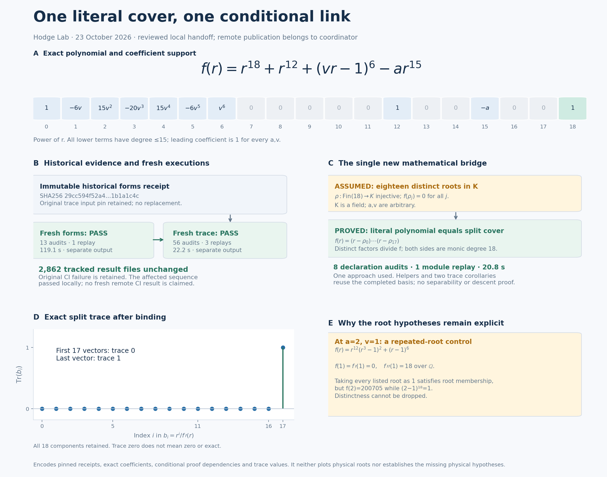](notes/skew-physical-cover-binding.md)

For `f(X)=X^18+X^12+(vX-1)^6-aX^15`, Lean proves degree 18,
leading coefficient **1**, and equality with the split-cover polynomial
**given eighteen distinct roots of f in the coefficient field**. Two
corollaries reuse the split trace formulas. Pro's saved run passed eight
declaration audits, one module replay, nine positive and four negative
controls; the coordinator separately checked source binding and receipt
integrity. The CI repair keeps fresh execution receipts separate from
immutable historical evidence. The complete [Lean CI run](https://github.com/rbajaj5/hodge-lab/actions/runs/40026828482) passed on the published proof commit.

Distinct-root data over a specified splitting extension of `Q(a,v,t)`,
descent, physical differential-source normalization and a rational primitive
remain separate obligations.

[Proof, execution scope and limits](notes/skew-physical-cover-binding.md) · [Lean module](formal/HodgeLab/OneReflectionSkew/PhysicalCoverBinding.lean) · [Pro execution receipt](results/ci-receipt-physical-cover-20261023/lean-development/checker-01/validation.json)

### One-reflection-skew: trace-free basis in Lean

[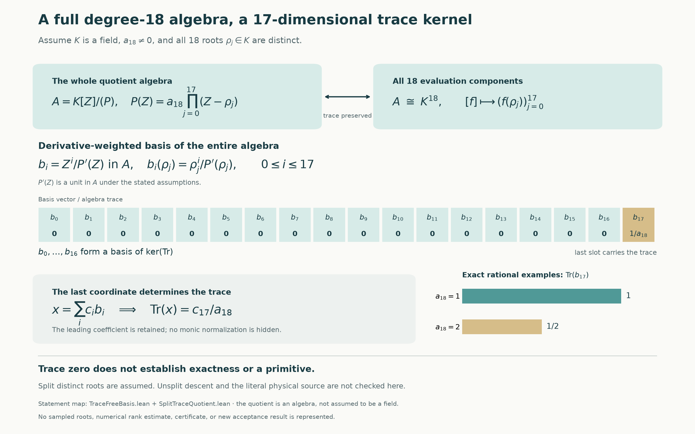](notes/skew-trace-basis-lean.md)

For a degree-18 polynomial with **nonzero leading coefficient and eighteen
distinct roots in the coefficient field**, Lean constructs the full quotient's
derivative-weighted basis and **17-dimensional trace kernel**. The last
basis vector has trace **1/a18**. All 18 components are retained.
**56 declaration audits, three module kernel replays, seven positive and
three negative controls passed.** The conditional literal-polynomial binding
is now linked above. Unsplit descent and physical differential-source
normalization remain open; trace zero does not establish a primitive.

[Proof and limits](notes/skew-trace-basis-lean.md) · [Lean quotient module](formal/HodgeLab/OneReflectionSkew/SplitTraceQuotient.lean) · [Executed receipt](formal/results/skew-trace-basis/validation.json)

### One-reflection-skew: actual differential forms in Lean

[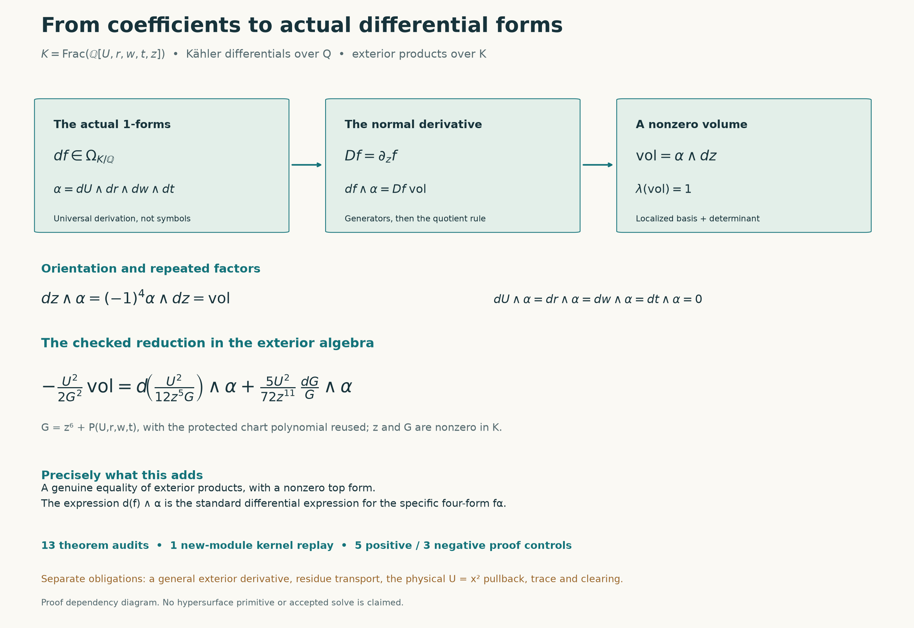](notes/skew-differential-forms-lean.md)

The +5/72 local reduction now holds in the **exterior algebra of actual
Kähler differentials**. Lean proves **df∧α=D(f)vol**, the positive
normal-first orientation, and **vol≠0**. **13 theorem audits, one
new-module kernel replay, five positive and three negative controls passed.**

This closes the scalar-to-exterior-product step. A general exterior
derivative, residue transport, the physical square-cover pullback and
a rational primitive remain separate.

[Proof and limits](notes/skew-differential-forms-lean.md) · [Lean module](formal/HodgeLab/OneReflectionSkew/DifferentialForms.lean) · [Executed receipt](formal/results/skew-forms/validation.json)

[Related compact-source architecture](notes/skew-compact-architecture.md): fqlx’s
physical correction and rank-17 reformulation, their reported scope, and the
interfaces still needed to connect them to these Lean proofs.

### One-reflection-skew: the ambient derivation constructed in Lean

[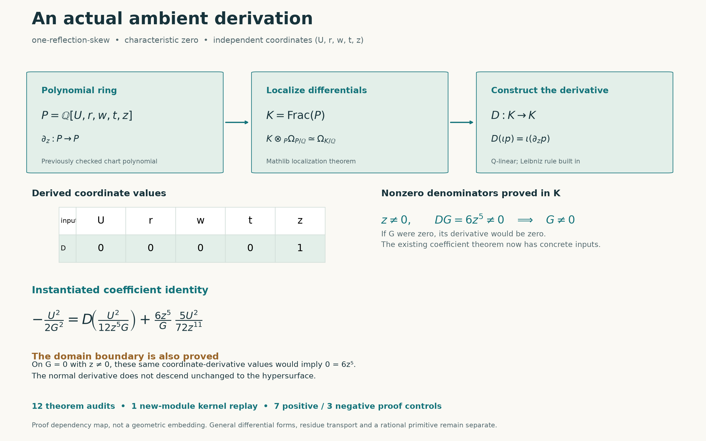](notes/skew-ambient-lean.md)

Lean now constructs the derivation on **Frac(ℚ[U,r,w,t,z])**, proves
**DU=Dr=Dw=Dt=0, Dz=1**, and instantiates the existing +5/72 coefficient
reduction. The needed z≠0 and G≠0 conditions are proved in that ambient
field. **12 theorem audits, one new-module kernel replay, seven positive
and three negative proof controls passed.**

The same normal derivative cannot descend unchanged to G=0 with z≠0.
General differential-form/residue transport and a rational primitive
remain separate; this is no new solve or denominator exclusion.

[Construction and limits](notes/skew-ambient-lean.md) · [Lean module](formal/HodgeLab/OneReflectionSkew/AmbientDerivation.lean) · [Executed receipt](formal/results/skew-ambient/validation.json)

### One-reflection-skew: the local residue coefficient checked in Lean

[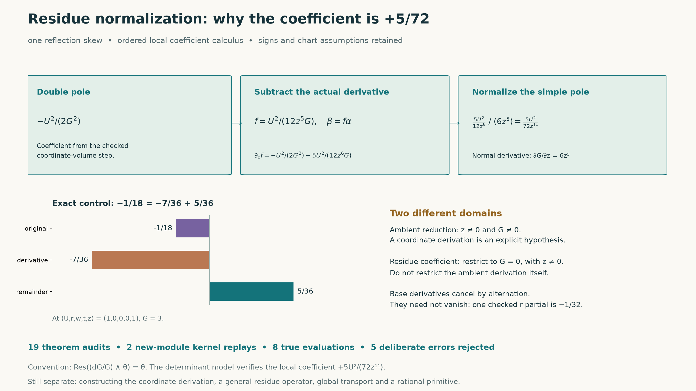](notes/skew-residue-lean.md)

Lean now checks the local normalization **+5U²/(72z¹¹)**, deriving the
normal partial **6z⁵**, the alternating sign and the correction's quotient
derivative. **19 theorem audits, two new-module kernel replays and five
deliberate-error controls passed.**

This earlier ambient theorem assumes a coordinate derivation and z≠0,
G≠0; the construction above now instantiates those hypotheses in the
rational ambient field. Only the separate coefficient formula restricts
to G=0, z≠0. A general residue operator and the primitive remain separate.

[Proof and chart limits](notes/skew-residue-lean.md) · [Lean module](formal/HodgeLab/OneReflectionSkew/ResidueNormalization.lean) · [Executed receipt](formal/results/skew-residue/validation.json)

### One-reflection-skew: coordinate volume and signs checked in Lean

[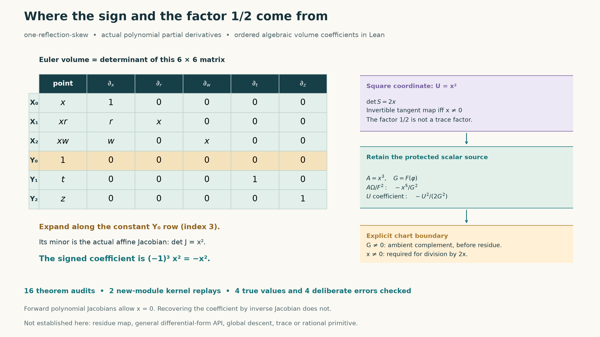](notes/skew-volume-lean.md)

Lean now derives the actual polynomial Jacobians **x²** and **2x**, the
ordered Euler-volume coefficient **−x²**, and the ambient source coefficient
**−U²/(2G²)**. The inverse-Jacobian step explicitly requires x≠0; G≠0
describes the complement before taking residue. **16 theorem audits, two
new-module kernel replays and four deliberate-error controls passed.**

This closes the coordinate-volume coefficient step. The formal model uses
ordered determinants; residue reduction, general differential-form transport
and the rational primitive remain separate obligations.

[Proof and limits](notes/skew-volume-lean.md) · [Lean modules](formal/HodgeLab/OneReflectionSkew/VolumeDensity.lean) · [Executed receipt](formal/results/skew-volume/validation.json)

### One-reflection-skew: protected sextic to chart, checked in Lean

[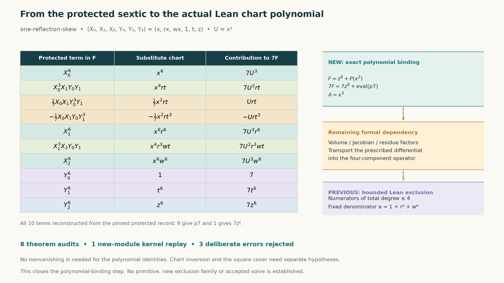](notes/skew-chart-lean.md)

Lean now proves `F(x,rx,wx,1,t,z)=z^6+P(x^2)` and `A=x^3`, and identifies
the resulting P with the **existing `p7` polynomial divided by seven**.
The existing denominator is bound to `1+r^6+w^6` as well. Eight theorem
audits, one new-module kernel replay and three deliberate-error controls
check the substitution and its source binding.

This closes the polynomial-substitution step. Differential normalization,
other denominator families and the rational primitive remain outside these
theorems; the target is still open.

[Proof and limits](notes/skew-chart-lean.md) · [Lean module](formal/HodgeLab/OneReflectionSkew/ChartSubstitution.lean) · [Executed receipt](formal/results/skew-chart/validation.json)

### One-reflection-skew: arbitrary degree-four numerators checked in Lean

[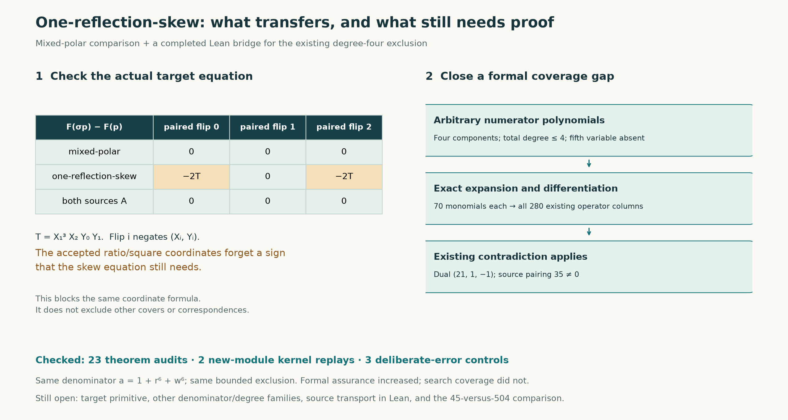](notes/skew-lean-extension.md)

Lean now expands **arbitrary degree-at-most-four numerator polynomials** into the 280 previously checked operator columns, closing the formal coverage gap. A source-bound comparison also proves why mixed-polar's paired-sign coordinate formula needs adaptation for skew. **23 theorem audits, two new-module kernel replays and three deliberate-error controls passed.**

This strengthens the existing bounded exclusion for `D=1+r^6+w^6`; it adds no new search coverage or solve. The unused fifth polynomial coordinate is explicitly absent. Protected-source transport, other denominator families and the 45-versus-504 comparison remain outside these theorems.

[Proof, comparison and limits](notes/skew-lean-extension.md) · [Lean expansion theorem](formal/HodgeLab/OneReflectionSkew/DegreeFour.lean) · [Verification receipt](formal/results/skew-extension/validation.json) · [Earlier coefficient proof](notes/skew-lean.md)

### Including the base derivatives: four bounded primitive searches

[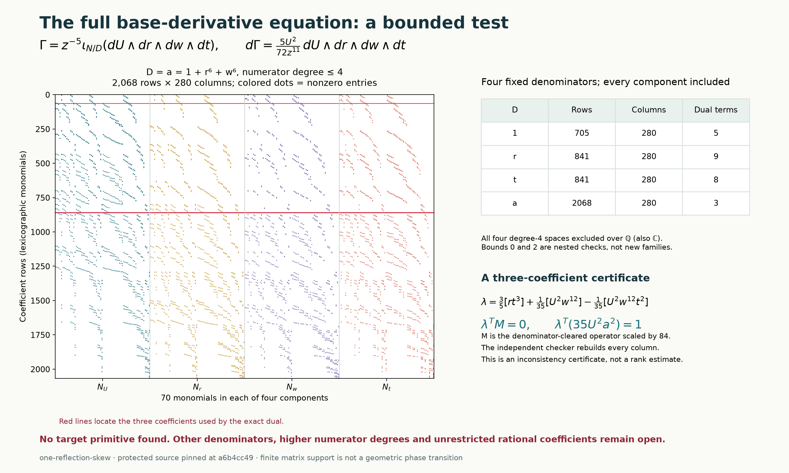](notes/skew-base-derivatives.md)

The **one-reflection-skew** search now includes derivatives in `U,r,w,t`, including the derivative of each chosen denominator. Exact rational duals exclude all four-component numerators of total degree at most four for fixed `D=1,r,t,1+r⁶+w⁶`. A separate checker reconstructs every column; manufactured positive controls verify that base derivatives can supply a primitive. **No target primitive was found. Other denominators and unrestricted rational functions remain open.**

[Equation, attribution and scope](notes/skew-base-derivatives.md) · [1,376 independently rebuilt columns](results/skew-base-derivatives/verification.json) · [Detected errors and rendering repair](results/skew-base-derivatives/validation.json)

### The chi-curve idea reaches an actual protected source

[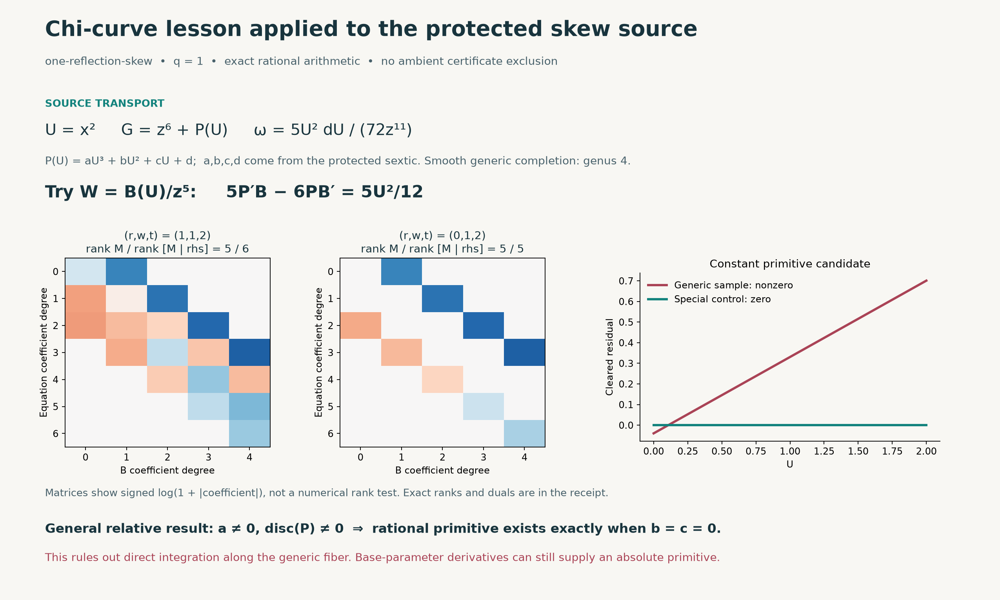](notes/chi-target-source.md)

For **one-reflection-skew**, retaining the source and Jacobian gives `ω = 5U² dU/(72z¹¹)` on `z⁶ = −P(U)`. On the smooth cubic open, a rational primitive along the fiber exists exactly when `b = c = 0`. The generic physical coefficients miss that locus; a special fiber supplies a positive control. **This tests direct integration along the curve, not the full target: base-parameter derivatives remain available.**

[Derivation, prior work and limits](notes/chi-target-source.md) · [58 exact requirements and rational duals](results/chi-target-source/replay.json) · [Three detected errors](results/chi-target-source/validation.json)

### A chi-variable curve: geometry is only part of the data

[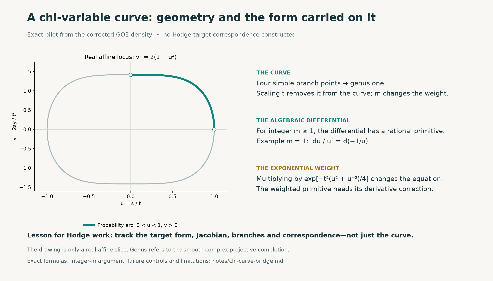](notes/chi-curve-bridge.md)

The corrected GOE factor gives the genus-one model `v² = 2(1 − u⁴)`. For every integer `m ≥ 1`, its unweighted algebraic density differential has an explicit rational primitive. The Gaussian weight changes that primitive equation. This small example explains why a Hodge construction must transport the specified form, Jacobian and covering data along with the curve. **No correspondence to a protected Hodge target is constructed.**

[Derivation and limits](notes/chi-curve-bridge.md) · [46 exact/control checks](results/chi-curve-bridge/replay.json) · [Deliberate error tests](results/chi-curve-bridge/validation.json)

### The actual covariant jets, replayed exactly

[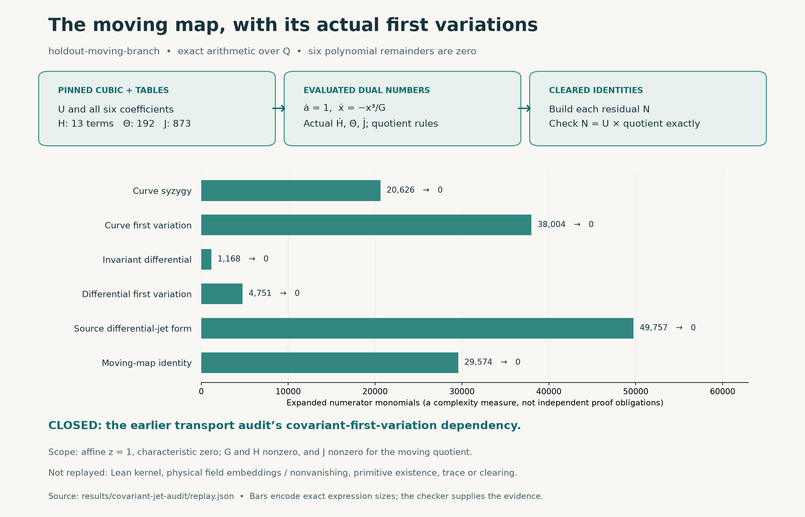](notes/covariant-jet-audit.md)

The `holdout-moving-branch` audit now evaluates the actual covariant jets: **six complete polynomial residuals vanish modulo the generic cubic**, including both first variations and the moving-map identity. Three deliberate errors are rejected. This closes the first-variation dependency in the transport audit below, under its stated function-field hypotheses. Lean/kernel verification, primitive existence, trace and clearing remain outside this replay.

[Derivation and limits](notes/covariant-jet-audit.md) · [Pinned replay](results/covariant-jet-audit/replay.json) · [Commands and failure tests](results/covariant-jet-audit/validation.json)

### Physical source transport: why the factor is 144

[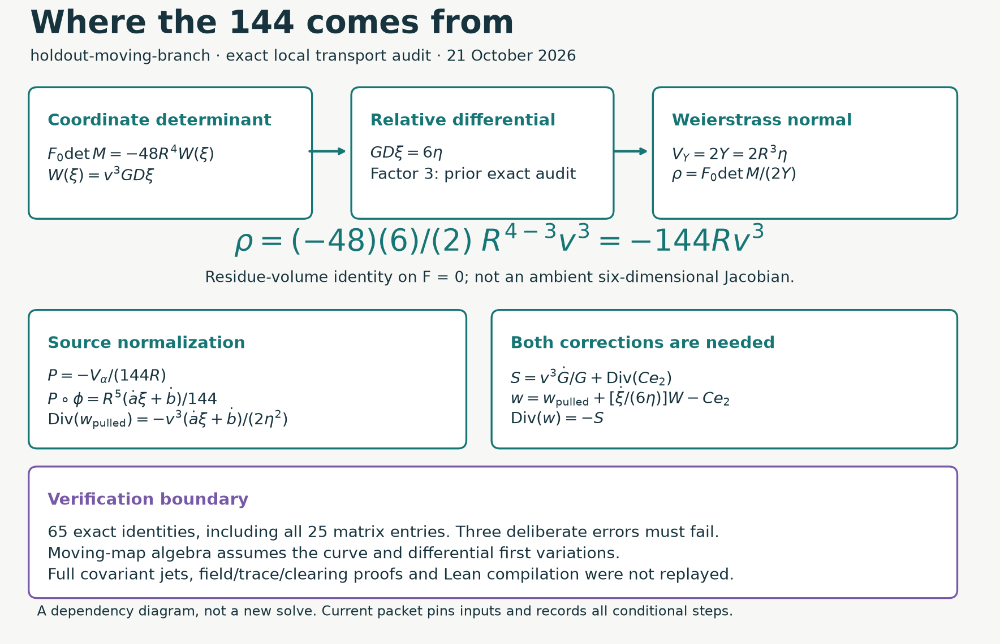](notes/physical-source-transport-audit.md)

For the accepted `holdout-moving-branch` construction, **65 exact equalities** check the residue-volume multiplier `-144 R v^3`, the corresponding alpha-source normalization, and the correction algebra. All 25 coordinate-matrix entries are reconstructed, and three deliberate errors are rejected. Its curve and differential first-variation hypotheses are now checked by the separate covariant-jet replay above; the original 65-check receipt is unchanged. This remains a bounded independent audit, not a new solve or full Lean replay.

[Derivation and limits](notes/physical-source-transport-audit.md) · [Source-bound checker](scripts/audit_physical_source_transport.py) · [Executed checks](results/physical-source-transport-audit/validation.json)

### From a GPU screen to exact exclusions

[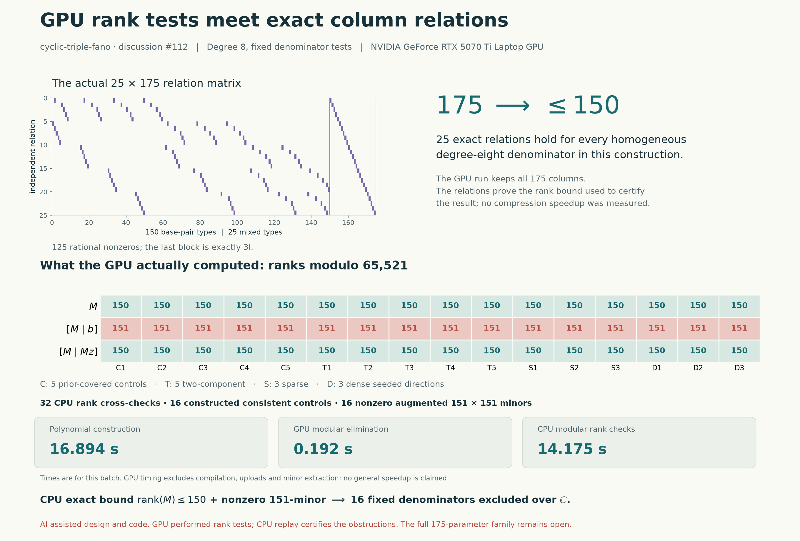](notes/cyclic-fano-cubic-polars.md)

For sixteen fixed cubic-direction candidates, **25 exact relations bound the correction rank by 150**, while nonzero augmented minors establish rank at least **151** after adding the target. The recorded CUDA screen and independent CPU reconstruction agree.

These results exclude the sixteen fixed candidates. The full mixed 175-parameter denominator family remains open in this calculation.

[Derivation and scope](notes/cyclic-fano-cubic-polars.md) · [Recorded GPU run](results/cyclic-fano-cubic-gpu/report.json) · [Independent exact checker](experiments/check_cyclic_fano_cubic_polars.py)

### A polynomial obstruction checked in Lean

For the fixed **Case05** candidate, Lean constructs the polynomial operators and verifies the coefficients giving a two-row contradiction over every characteristic-zero field. This formalizes an existing exclusion.

Identification with the original geometric problem and completeness of the normalized correction space remain outside those Lean theorems.

[Proof and boundary](notes/cyclic-fano-polynomial-bridge.md) · [Lean source](formal/HodgeLab/CyclicFano/Case05PolynomialField.lean) · [Archived CI receipt](formal/results/polynomial-bridge-ci/39089131101/metadata.json)

### See the actual correction map

[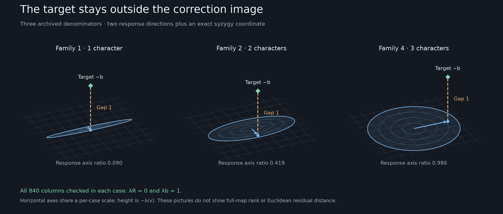](notes/koszul-geometric-map.md)

The diagrams show what the allowed numerator corrections can change, and why a target can retain an obstruction even as a numerical fit improves.

[Operator geometry](notes/koszul-geometric-map.md) · [Denominator sweep](notes/koszul-denominator-sweep.md) · [Visual idea atlas](notes/idea-atlas.md)

The atlas also connects the experiments with Gaussian fields, flows, random matrices, and geometric constructions. Each route links its motivation to the computations and limits recorded in the corresponding note.

## Explore the repository

| Directory or document | What to find |
| --- | --- |
| [`LEDGER.md`](LEDGER.md) | Dated research checkpoints, upstream contributions, corrections, and attribution |
| [`notes/`](notes/) | Derivations, visual explanations, experimental choices, and failed approaches |
| [`experiments/`](experiments/) | Search programs, independent checkers, and figure generators |
| [`results/`](results/) | Saved inputs, outputs, exact certificates, figures, and verification receipts |
| [`algebra/`](algebra/README.md) | Polynomial certificate models and exact linear-algebra machinery |
| [`formal/`](formal/README.md) | Lean statements, proof sources, build instructions, and audit boundaries |
| [`SOURCES.md`](SOURCES.md) | Source attribution and the origins of the methods and data |

## Reproduce an exact check

With Git and Python 3.11 or later:

```sh
git clone --recurse-submodules https://github.com/rbajaj5/hodge-lab.git
cd hodge-lab
python -S experiments/check_cyclic_fano_cubic_polars.py
```

This checker uses standard-library exact arithmetic and needs no GPU. Read the [reproduction notes](notes/cyclic-fano-cubic-polars.md#bounds-failures-and-reproduction) for the complete scope and recorded controls.

Plotting and numerical experiments use [`requirements.txt`](requirements.txt); CUDA experiments have separate [dependencies](requirements-cuda.txt). Lean setup and replay commands are in [`formal/README.md`](formal/README.md). Follow each checker's documented command: older scripts may rely on assertions, while the newer Lean receipt/source checkers are explicitly tested under `-O`. Regeneration commands may overwrite saved outputs; the individual notes identify them.

## Evidence, credit, and publication

The ledger distinguishes numerical observations, exact identities, bounded exclusions, formal proofs, and accepted upstream submissions. Author-reported findings and locally reproduced checks are recorded separately. AI assistance is part of the workflow; each audit states what was actually executed.

The recorded upstream contribution tally is **29 discussion contributions, one closed maintenance PR, and zero accepted authored solves by rbajaj5**. Acknowledgment of a research direction does not transfer solve authorship.

Every upstream post, reply, or substantive edit requires a ledger audit before publication, followed by the actual outcome and permanent link. Routine technical updates stay in this notebook. Discussion 127 is included in the intended monitoring scope; that policy does not itself change an external scheduled monitor.

[Research standards](notes/research-milestones.md) · [Repository workflow](AGENTS.md) · [Earlier front-page snapshot](https://github.com/rbajaj5/hodge-lab/blob/b3e213e27e6fb153d99d7118fc8a35cb059e9c7a/README.md)

---

Hodge Lab is an independent learning and research notebook. It is not affiliated with Hodge Labs, hodge.computer, or the maintainers of `hodge-computer/sextics`.
