# Hodge lab

A public lab notebook for [hodge.computer](https://hodge.computer/). We test geometric ideas for making better guesses at algebra problems, then check those guesses exactly. The code, pictures, results, and failed approaches stay visible.

This is an independent learning and research notebook. It is not affiliated
with Hodge Labs, hodge.computer, or the maintainers of
`hodge-computer/sextics`; similar naming was unintentional.

This is the **meta-repository for our work in [hodge-computer/sextics](https://github.com/hodge-computer/sextics)**: it records the motivation for our approaches, supporting experiments, and the purpose and outcome of each public contribution. The [contribution ledger](LEDGER.md) links to the actual upstream posts and submissions.

**Current status: no new accepted Hodge solve.** The repository contains actual GPU runs, exact rejection certificates, independent checks, and the approaches that failed. Code and notes were developed with AI assistance; the recorded checks describe what was executed.

**How we judge progress:** a useful exclusion, a simpler baseline that performs equally well, and a corrected claim all count as results. Numerical ranking, exact certificates, and external review are separate milestones. [Evidence standards and next experiments](notes/research-milestones.md).

**Why read Yang?** The checked examples distinguish relations among equations
from the graded images that force denominator coefficients to vanish.
Equal Koszul H1 dimensions can accompany very different H0 dimensions;
our homology ranking did not outperform its controls.
[Concrete mathematical rationale, figure, evidence, and limits](notes/why-yang.md).

**Current direction: Diamond's ten newly added targets only.** On
`cyclic-triple-fano`, an explicit free rational curve and a checked
three-parameter incidence family give dominant marked evaluation on the
weighted quotient. Its deformation map has an exact positive Gram matrix;
Bourbaki's spectral projectors give a checked right inverse. The support
divisor and certificate remain unconstructed.
[Curve, spectral visualizations, checks, and limits](notes/cyclic-fano-curve.md).

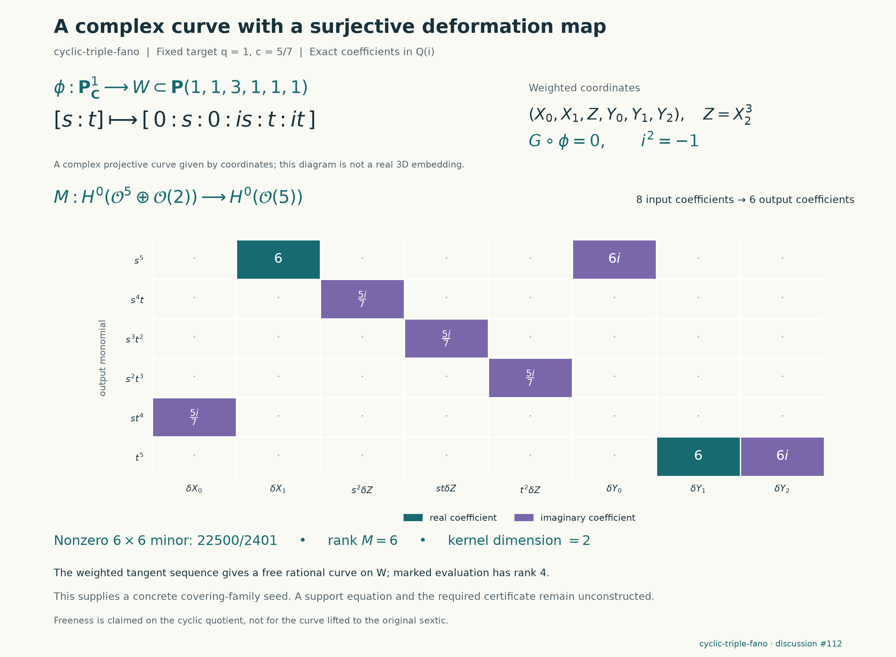

**Preceding checkpoint:** work on `cycle-three` and `mixed-biweight`, with
different fixed hypersurface equations from holdout. Exact calculations now
exclude every denominator of **degree zero through six for both targets**.
All coefficients and numerator corrections are included; nonzero quotients
are allowed. The mixed continuation includes all three extra E1 directions,
reduces the full family to two complex candidates, and rejects both with a
three-term coefficient functional. Denominator degree seven and higher
remain open; neither instance is solved.
[Mixed argument, packets, figures, and failures](notes/mixed-degree6-extra.md),
[cyclic degree-six obstruction](notes/fresh-instance-degree6.md),
[preceding degree-five bounds](notes/fresh-instance-baselines.md).
Further holdout discussion posts remain paused.

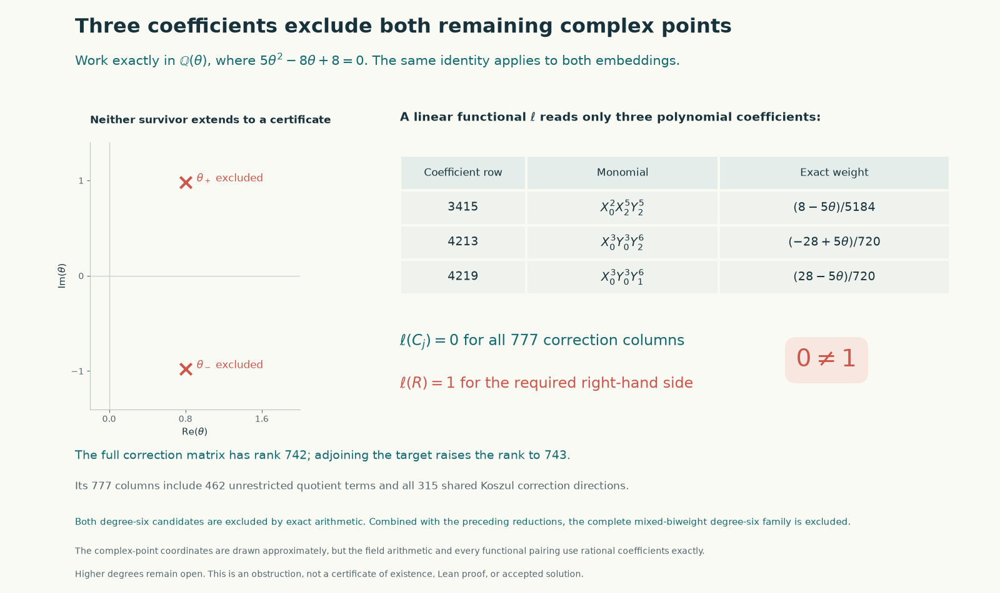

**Holdout checkpoint: degree seven.** Our exact **{chi_X0, chi_Y0}** exclusion, our earlier **{chi_Y0, chi_X1}** result, and fqlx's reproduced **{chi_X1, chi_Y1}** proof complete **9,453 of 9,453 two-character families** in the preceding scan. Denominators with three or more characters and higher degrees remain open. [Combined coverage, attribution, and checks](notes/x0-y0-exclusion.md).

**Latest holdout result:** the rebuilt T100 multiplier search forces all five
Y1 coefficients to vanish and makes both added-character charts contradictory.
The separately replayed anchor dependency then closes the family. This
completes **132 of 132** fresh X0/Y1 triples and brings the selected union to
**812 triples**. Exact ranks agree modulo three primes, but all proof witnesses
are rational; this is finite-field screening, not p-adic Hodge theory. The five
failed rebuilt charts and unsupported BB/KZ/KPZ and VC-complexity suggestions
remain visible. [Proof, visualization, checks, and limits](notes/t100-rebuilt-exclusion.md).

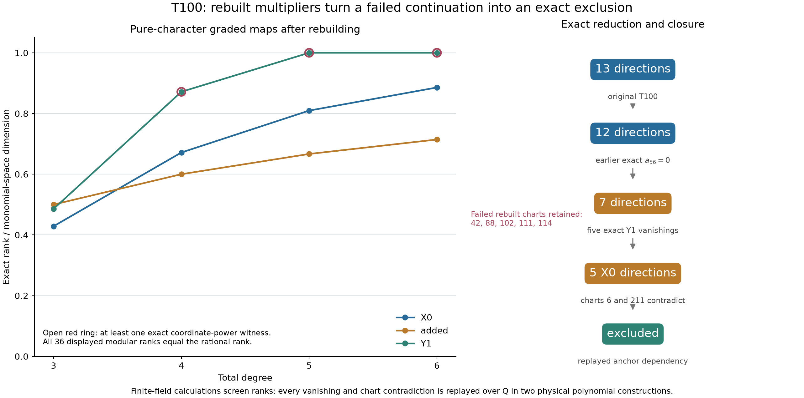

**Preceding exact result:** 131 of 132 fresh X0/Y1 three-character families
were excluded, bringing the selected union to 811 triples at that checkpoint.
T100 remained open after a separate exact reduction from thirteen to twelve
directions. A frozen typed-cache comparison was slower than the existing
method; target-character projection nevertheless gave smaller exact power
queries. [Results, figures, and limits](notes/typed-rewrite-search.md).

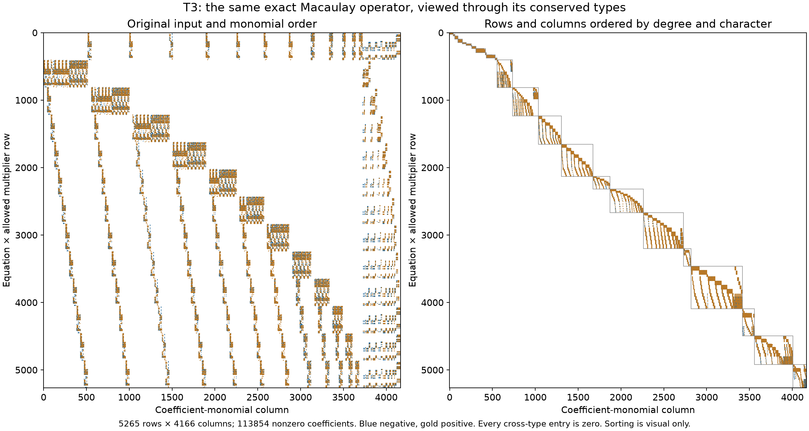

**Preceding exact result:** an exact search guided by the added character's
Koszul homology and a separate multiplier continuation exclude all
**132 fresh X0/X1 extensions**, bringing the selected union to **680 triples**.
The earlier 131/132 checkpoint and A100's failed charts are preserved.
High-score and low-score groups both close 4/4. The figures
separate empty blocks from computed zero homology and compare H1 with H0,
which directly detects full graded images. Both physical reconstructions
pass; failed charts and the reproduced full-pair dependency are retained.
[Results, visualizations, and limits](notes/added-character-homology.md).

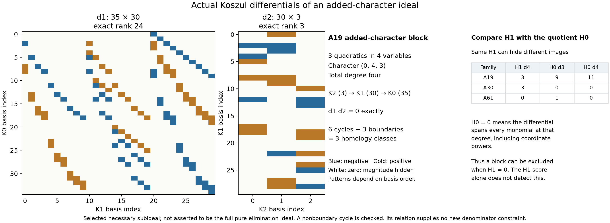

**Preceding exact result:** 132 additional complete three-character families
around `Y0/Y1` are excluded, bringing the selected union to **548 triples**.
Koszul homology guided a prospective comparison, but high- and low-score
groups both closed 4/4; no ranking advantage was established. All seven
later continuations closed too. Both physical polynomial implementations
pass. The record keeps the unsuccessful charts, an explicit pair-dependency
correction, actual Koszul-map figures, and the rebuild history.
[Proofs, homology experiment, visualizations, and failed attempts](notes/homology-guided-triples.md).

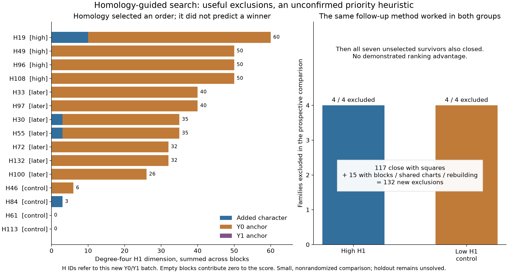

**Preceding exact result:** another 132 complete three-character families around
`Y0/X1` are excluded, bringing our selected union to **416 triples**.
Small-block reductions close 123; shared equations and rebuilding close
eight more. The last family needs 39 additional cubic consequences,
quartic power identities, and a further rebuild. Both physical polynomial
implementations pass the exact chain. This completes all 136 third-character
extensions of Y0/X1; holdout remains unsolved.
[Proof, visual record, and unsuccessful attempts](notes/y0x1-extensions.md).

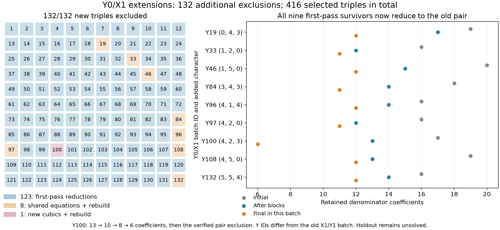

**What do the curved matrix bands mean?** Compare old X1/Y1 cases 19, 49,
and 100 in [original, factor-adapted, and reordered bases](notes/graded-map-patterns.md),
with alternative sign palettes and relative coefficient strength. Exact
ranks survive; apparent curves depend on ordering. The record includes the
rejected first factorization for case 100 and its checked correction.

**From the matrix to a complex:** the [Koszul homology companion](notes/categorical-syzygies.md)
separates relations from boundaries in degrees two through six. At degree
four, B19 has six relations, three Koszul boundaries, and three remaining
homology classes. Thirty exact complexes pass checks in both bases. This
also clarifies the distinct roles of Yang, Eisenbud-Erman, and Riehl; it
does not assert a geometric cohomology identification or a new exclusion.

**Preceding exact result:** 132 further three-character families around the
`X1/Y1` pair are excluded, bringing our selected union to **284 triples**.
Necessary block reductions close 123; full shared-numerator charts and
rebuilding finish the remaining nine. Both physical polynomial
implementations replay the proofs, including the explicitly reproduced
fqlx pair-30 dependency. This completes all 136 third-character extensions
of X1/Y1, with four already covered previously. Other triples among the
428,536 possible supports, larger supports, and higher degrees remain open.
[Proofs, graded-map visualization, and failed searches](notes/x1y1-extensions.md).

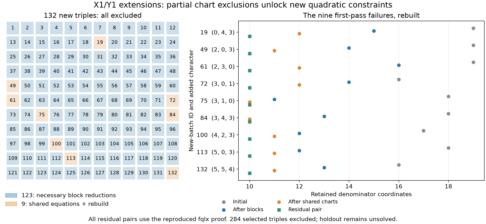

The [preceding polynomial-multiplier result](notes/family151-multipliers.md)
closed family 151, completing the original 152 selected triples. Its full
Linux workflow subsequently passed all eight jobs.

The [preceding shared-numerator batch](notes/remaining-triples-shared.md)
closed family 17 and supplied the linear constraint used to rebuild 151,
giving 151/152 at that checkpoint.

The [eleven-family quartic batch](notes/eleven-quartic.md) closed families
1, 2, 4, 5, 7, 9, 15, 39, and 150, giving 150/152 at that checkpoint.

The [preceding degree-four batch](notes/eisenbud-quartic-strand.md) closed
families 6, 8, 10, 149, and 152, giving 141/152 at that checkpoint.

**Earlier parameter optimization:** two L-BFGS-B starts in each of the 16
then-remaining selected triple spans beat an equal-evaluation uniform-random comparator on
the numerical score (median reduction 91.9%). All 32 rounded finalists fail
exact checks; ten optimized winners round into previously excluded one- or
two-character sectors. [Search history, visualization, checks, and limits](notes/koszul-parameter-optimization.md).

**Explore those searches:** the [interactive trajectory view](visualizations/koszul-search-standalone.html)
links the residual history to the denominator's three character shares. Select
a family and move through its recorded evaluations to see boundary drift.
Download the HTML and open it in a browser; GitHub's file viewer shows source.
This presents the existing experiment, with all failed finalists retained.

**Original systematic three-character batch:** of all 136 extensions of the `X0/Y0` pair by a third character, **132 complete families were excluded and four remained unresolved at that checkpoint**. Including all coordinate-character triples gave 152 tested families and 20 unresolved. Exact duals and shared-numerator chart proofs are replayed by two polynomial constructions. [Coverage, failed charts, and reproducible proofs](notes/three-character-families.md).

**First polynomial-syzygy follow-up:** one of those four residual families was
excluded, giving **133/136 fixed-pair extensions excluded** (133/152 in the
combined selection). Affine polynomial multipliers preserve shared numerator
coefficients and yield new denominator constraints. Three cubic identities
then close family 87; two charts of family 115 gain constraints but remain
open. [Short proof, literature motivation, and failed attempts](notes/polynomial-syzygies.md).

**Rebuilt-syzygy continuation:** family 115 is now excluded as well, giving
**134/136 fixed-pair extensions excluded** (134/152 in the combined selection).
Rebuilding after the verified zeros and searching through total degree five
closes one chart; its forced zero closes the other. The two larger families
remained unresolved at that checkpoint, with checked conditional progress and ten timed-out
searches retained. [Proof, visualization, and failed attempts](notes/syzygy-rebuild.md).

**Earlier Koszul continuation:** families 16 and 137 are now excluded, completing
**136/136 fixed-pair extensions** (136/152 in the original combined selection).
Two-row square identities force global linear vanishings; rebuilding the
Koszul correction equations then closes all ten third-component charts.
Sixteen other selected triples remained open at that checkpoint. [Exact proof, dependencies,
and retained failed searches](notes/koszul-rank-continuation.md).

**Eisenbud follow-up:** degree-three maps of the necessary ideals force
eleven family-specific coordinate zeros in five of those sixteen triples.
All sixteen remained unresolved at that checkpoint. The [calculation and cancellation explorer](notes/eisenbud-linear-strand.md)
show the actual polynomial identities, 1,149 checked relation vectors, and
where the bounded search fails. Every substantive research batch now includes
a reproducible internal visualization and a ledger entry.


**See the correction map:** [three views of post six](notes/koszul-map-visualizations.md)
show its actual polynomial support, the syzygies cancelling corrections, and
the chart dependencies. The two-row example explains how a weighted numerical
score can improve while the exact obstruction stays nonzero.

**A geometric operator view:** [move a circle through the Koszul correction
map](notes/koszul-geometric-map.md). Three actual denominators give response
ellipses, while their exact syzygies keep the target off the image plane.
The interactive version links correction coefficients to their image and
lets you fit the projected target, rotate the view, and compare the examples.

**Now vary the denominator:** an [interactive two-parameter sweep](notes/koszul-denominator-sweep.md)
shows exact full-map ranks of 720, 713, and 690 at 81 rational samples. One
projection also collapses where the full rank stays unchanged. A common exact
syzygy rejects the entire restricted slice. Six additional searches constrained
to retain three characters produce six new exact rejections; all reach their
iteration limit. These finite rank changes do not establish a statistical
phase transition or solve holdout.

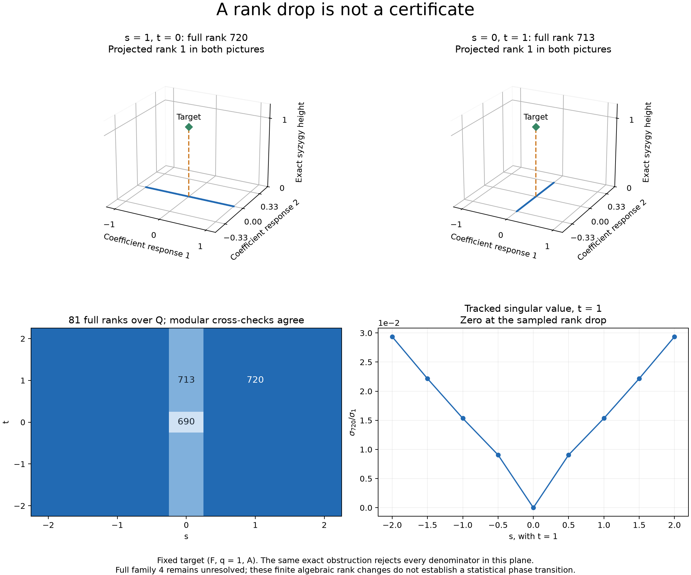


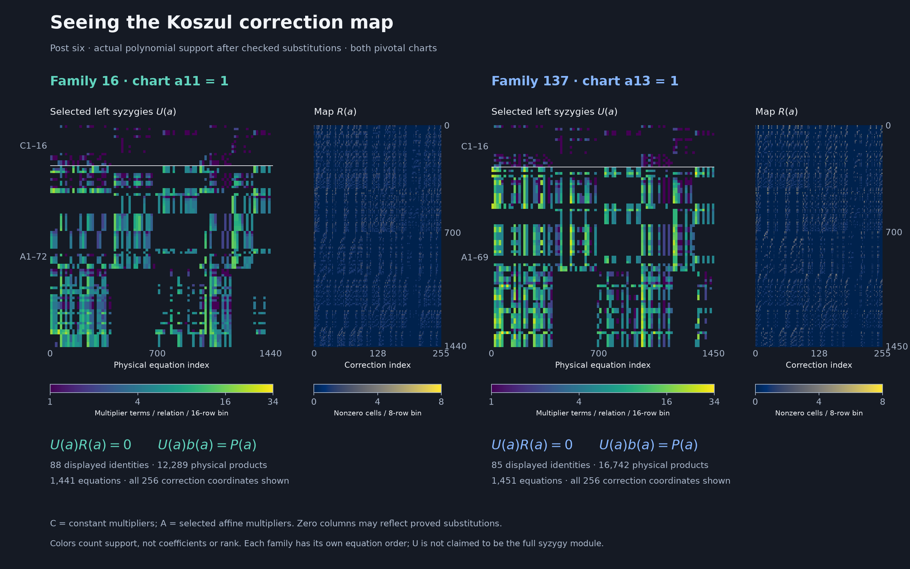

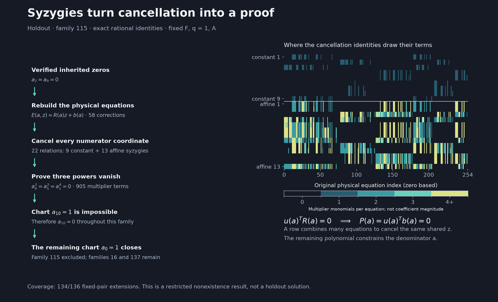

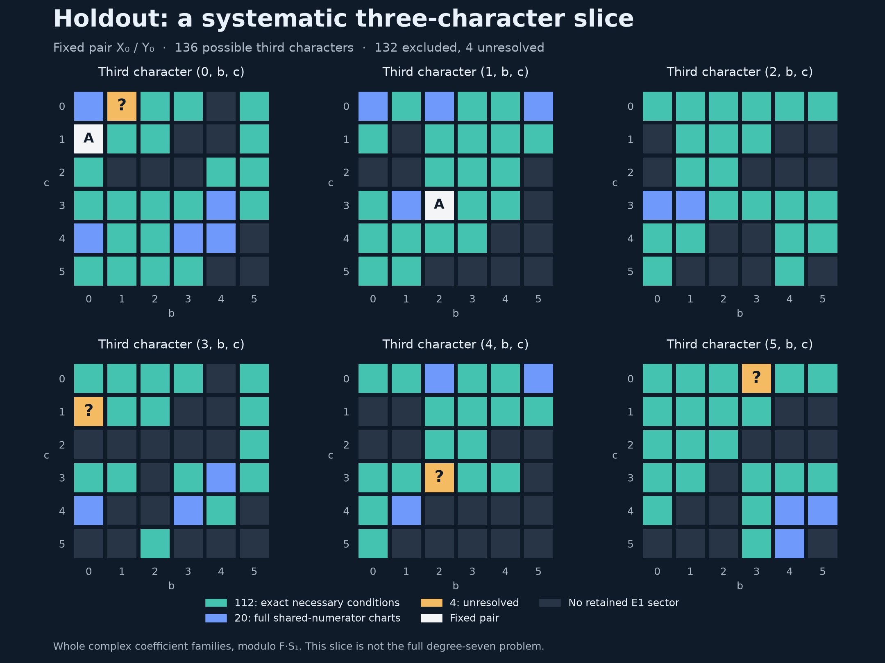

**Dubedat-inspired construction:** a weighted six-cycle matrix generates degree-seven determinants and exact first-equation lifts. All **45** tested directions fail the full second equation, including 30 with seven or eight characters. [Construction and exact witnesses](notes/dubedat-cycles.md).

**Imaginary geometry gallery:** the same GPU-generated Gaussian input under different flow angles and directional conductances. These are regularized illustrations. [Equations, images, and checks](notes/imaginary-geometry-gallery.md).

**Hodge projection search:** 600 new three-character degree-seven candidates outside the Jacobian ideal; all 34 shortlisted/control directions fail exact checks with the full 840-dimensional correction space. [The coefficient heat flow and its obstruction](notes/hodge-projected-search.md).

**48-handle continuation:** paired GPU fields, rotated harmonic directions, and a measured phase-coherence crossover. No phase transition found in this finite Gaussian model; the crossover scale depends on smoothing. [Images, equations, and failed long-flow approximation](notes/high-genus-flow.md).

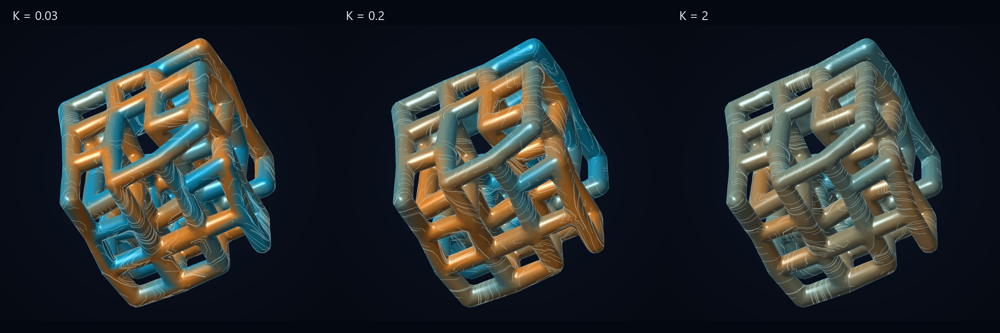

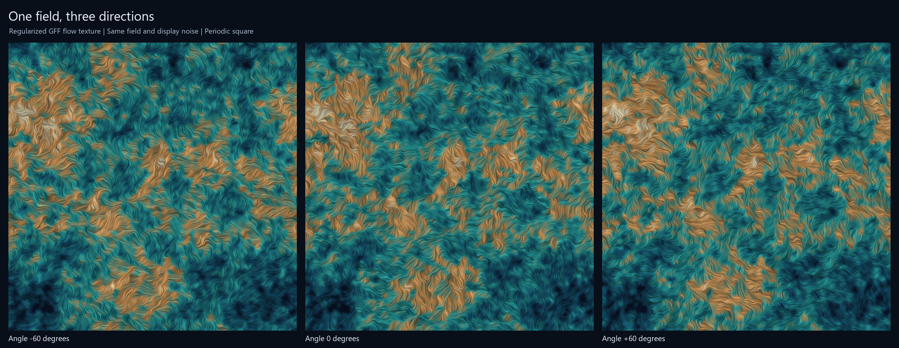

**Attribution update:** fqlx had already published the 138 single-character exclusions before our preceding commit. Our separately implemented calculation checks that result; it is not a first report of the bound. [Single-character calculation and chronology](notes/degree-seven.md).

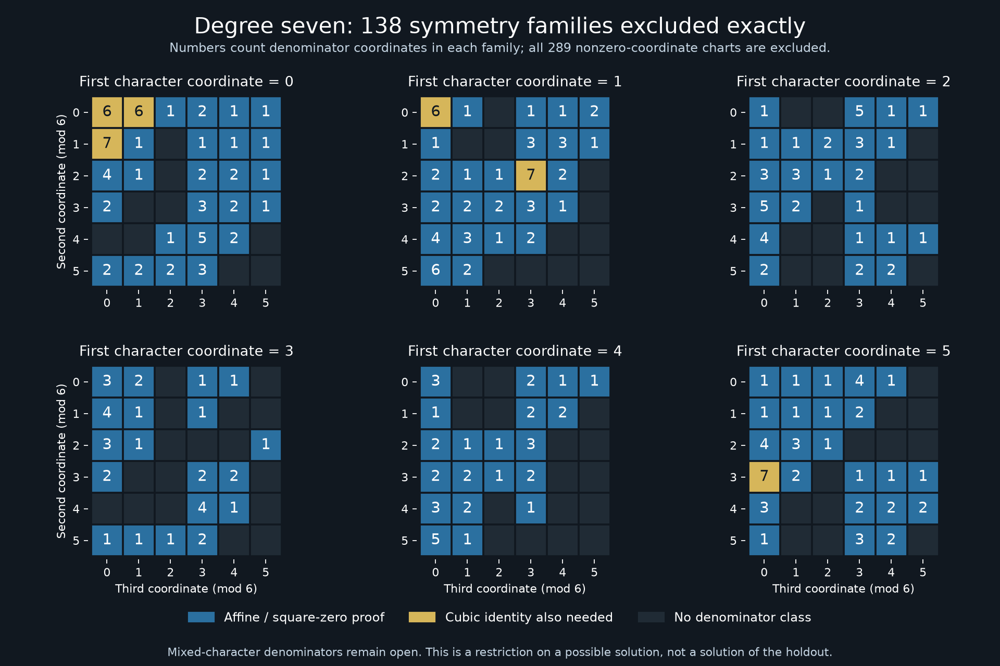

**Earlier ranking benchmark:** five pools of 768 degree-six candidates gave about a 32% lower normalized E2 residual for Gram-ranked shortlists than random selection. Anisotropic and uniform weighting were essentially tied; all 254 distinct shortlisted directions failed exact checks. The upstream degree-six exclusion had not yet been incorporated into that experiment. [Method and corrected frontier context](notes/denominator-ranking.md).

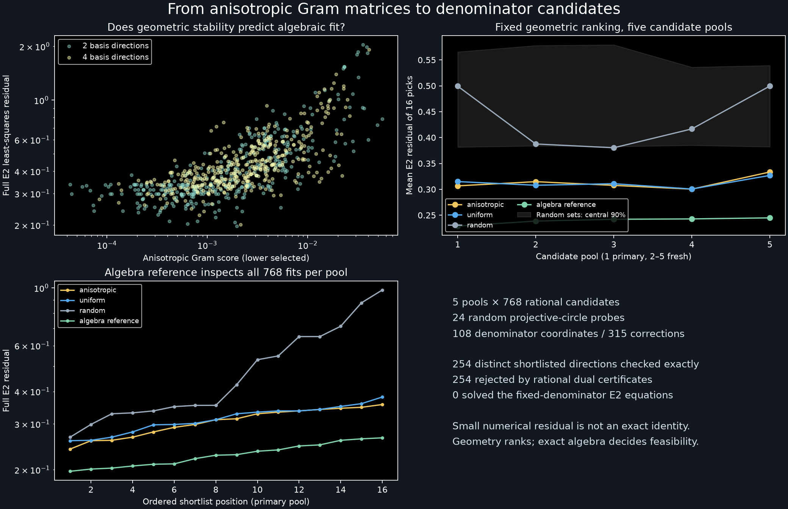

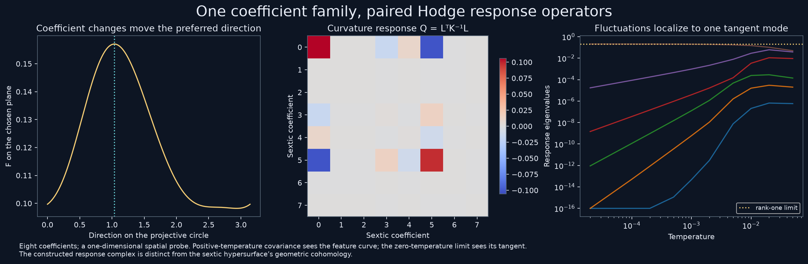

The unifying construction is [curvature-mediated response duality](notes/response-duality.md): coefficient changes produce spatial forces, inverse curvature turns them into displacement, and the pulled-back form is `Q=L* K^-1 L`. Its factorization defines a two-term Hodge complex. The holdout's eight coefficients give a concrete numerical example; its thermal Gram approaches the predicted rank-one limit to about 0.070% in the recorded low-temperature run.

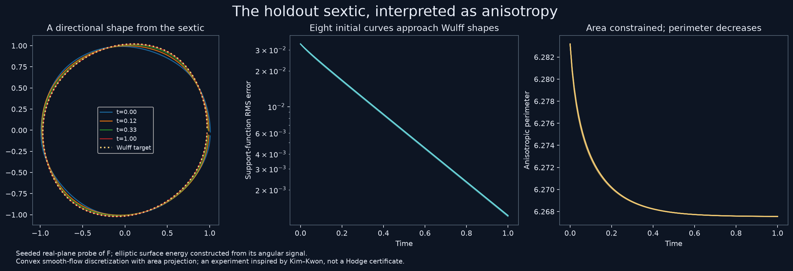

The flow experiment uses the holdout polynomial's directional variation to construct an elliptic surface energy, then evolves eight planar curves toward area-matched Wulff shapes. This is a chosen interpretation of the polynomial inspired by [Kim–Kwon, arXiv:2405.08296](https://arxiv.org/abs/2405.08296v1). [Construction, equations, and scope](notes/anisotropy.md).

## What is here

| Experiment | Recorded result | Evidence |
|---|---|---|
| Standard parameter optimization | 16 bounded triple spans; 2,078 evaluations per strategy; 32 exact rejections, no new family exclusion | [Methods, comparison, and failures](notes/koszul-parameter-optimization.md) |
| Koszul-map visual companion | 173 displayed cancellation identities replayed; exact two-row obstruction and weighting diagnostic | [Three figures, interpretation, and checks](notes/koszul-map-visualizations.md) |
| Koszul continuation after local rank identities | Families 16 and 137 excluded; 136/136 fixed-pair extensions covered; 16 other selected triples still open | [Exact chart covers and failed searches](notes/koszul-rank-continuation.md) |
| Rebuilt polynomial syzygies | Family 115 excluded; 134/136 fixed-pair extensions covered; two remain unresolved | [Exact proof, dependencies, and visualization](notes/syzygy-rebuild.md) |
| Polynomial syzygies of the shared correction map | One further complete family excluded; 133/136 X0/Y0 extensions now excluded; two next-family charts still unresolved | [Exact identities, literature, and failures](notes/polynomial-syzygies.md) |
| Original systematic three-character batch | 152 complete families tested; 132 excluded at that checkpoint; all 136 X0/Y0 extensions included | [Exact duals, shared charts, and coverage map](notes/three-character-families.md) |
| Hodge correction projection | 600 three-character directions screened; 34 fixed directions exactly rejected | [Heat flow and complete correction map](notes/hodge-projected-search.md) |
| Genus-48 Gaussian phase response | Three paired weightings, 256 samples each; broad analytic crossover and strong smoothing dependence | [High-genus gallery and limits](notes/high-genus-flow.md) |
| Imaginary geometry gallery | CUDA GFF transforms and flow textures; paired angle and directional-weight comparisons | [Gallery and model](notes/imaginary-geometry-gallery.md) |
| Dimer-inspired cycle determinants | 45 distinct directions pass E1; all fail E2 with all 840 corrections allowed | [Determinants, twists, and redundant edge weights](notes/dubedat-cycles.md) |
| Degree-seven {chi_X0, chi_Y0} family | Excluded by 25 exact chart identities; combined work covers all 9,453 two-character families | [Family-13 continuation and family-30 replay](notes/x0-y0-exclusion.md) |
| Degree-seven {chi_Y0, chi_X1} family | Excluded by an exact square of a linear form, chart contradictions, and the single-character theorem | [Two-character continuation](notes/degree-seven-pair.md) |
| Degree-seven character families | All 138 single-character families excluded with 289 exact chart certificates; mixed characters remain open | [Degree-seven frontier](notes/degree-seven.md) |
| Upstream degree-six exclusion | fqlx's full bound reproduced, including opposite-pivot verification | [Attributed replay](results/upstream-degree6/replay.json) |
| Denominator Gram rankings | 3,840 candidate draws; lower E2 residual than random, no anisotropy advantage; 254 distinct exact rejections | [Ranking experiment](notes/denominator-ranking.md) |
| Coefficient response and Hodge complex | Envelope derivatives, Gram factorization, paired modes, and thermal localization checked | [Response report](results/response-hodge/report.json) |
| Competing Gram models | Six Gaussian comparisons using a product-TV proxy and independent likelihood sampling | [Interpretation and results](notes/gram-discrimination.md) |
| Actual holdout, degree-six denominators | 120 fixed denominator directions tested with all 315 numerator corrections | [Exact search and dual certificates](algebra/README.md) |
| Accepted-witness transfer | 36 controls pass; all 582 transfers fail, including common scalar repairs | [CPU-replayable packet](results/leaderboard-experiments/report.json) |
| Holdout period coefficients | Seven failures of the naive cubic divisibility benchmark among the tested cases with primes at least five | [Exact arithmetic](results/period-congruence/report.json) |
| HodgeRank vs Kemeny | 216 of 2,600 three-ballot profiles have strict Hodge scores but a suboptimal induced ranking | [Source bridge report](results/source-bridges/report.json) |
| Cube Gaussian field | 2,048 samples on 1,024 vertices checked against the exact Walsh spectrum | [Source bridge report](results/source-bridges/report.json) |
| Ginibre loop | Discriminant winding −11, stable through five sampling resolutions | [Source bridge report](results/source-bridges/report.json) |
| Fractional fields and triangulations | Three independently checked four-colorings of triangulated spheres | [Saved fields and meshes](results/source-bridges/fractional-field-meshes.npz) |

The anisotropic flow uses the actual `F` but does not encode the target `q,A`. Pictures, numerical convergence, and a rejected family of candidates do not establish an algebraic certificate.

## Reproduce

Python 3.11 and Git are required. Clone the pinned source repositories:

```sh
git clone --recurse-submodules https://github.com/rbajaj5/hodge-lab.git
cd hodge-lab
python -m venv .venv
# Activate the environment using your shell's usual command.
python -m pip install -r requirements.txt
python -m unittest discover -s tests -v
python experiments/check_transfer_packet.py
python algebra/degree6_verify_all_coefficients.py
python algebra/fixed_denominator_search.py --check
python experiments/denominator_gram_search.py --check
python algebra/degree7_e1.py --check
python algebra/degree7_verify_polynomials.py
python algebra/degree7_character_search.py --check
python algebra/degree7_y0_x1.py --check
python -S algebra/degree7_x0_y0.py --check
python -S experiments/dubedat_cycle_search.py --check
python -S experiments/hodge_projected_search.py --check
python -S experiments/check_hodge_projected_search.py
python experiments/check_high_genus_flow.py
python -S algebra/degree7_triples.py --check
python -S algebra/check_degree7_triples.py
python -S algebra/degree7_triple_shared.py --check
python -S algebra/degree7_triple_shared.py --check --independent
python -S algebra/degree7_rank_strata.py --check-all
python -S algebra/degree7_rank_strata.py --check-all --independent
python -S algebra/degree7_koszul_continuation.py
python -S algebra/degree7_koszul_continuation.py --independent
python experiments/plot_koszul_continuation.py --check
python -S experiments/optimize_koszul_parameters.py --check
python experiments/optimize_koszul_parameters.py --check --independent --numerics
python experiments/plot_parameter_optimization.py --check
```

These checks run on a CPU. They use exact rational arithmetic for algebraic certificates; floating-point tolerances are confined to numerical experiments. Do not run verification scripts with Python's `-O` option.

Source-text hashes normalize CRLF line endings to LF so that Windows and Unix clones verify the same inputs. The compressed algebra tensor and E1 basis use their stored bytes without normalization.

To regenerate experiments and figures:

```sh
python experiments/period_congruence_probe.py
python algebra/fixed_denominator_search.py
python experiments/plot_source_bridges.py
python experiments/anisotropic_flow.py --cpu
python experiments/response_hodge.py --cpu
python experiments/gram_discrimination.py --cpu
python experiments/denominator_gram_search.py --cpu
python -S experiments/dubedat_cycle_search.py --workers 3
python experiments/plot_dubedat_cycles.py
python experiments/hodge_projected_search.py
python experiments/plot_hodge_search.py
python experiments/plot_koszul_continuation.py
```

For an NVIDIA GPU with a compatible CUDA 12 environment:

```sh
python -m pip install -r requirements-cuda.txt
python experiments/source_bridge_lab.py
python experiments/anisotropic_flow.py
python experiments/response_hodge.py
python experiments/gram_discrimination.py
python experiments/denominator_gram_search.py
python experiments/gpu_identity_screen.py
python experiments/imaginary_geometry_gallery.py
python experiments/high_genus_flow.py
python experiments/render_high_genus_flow.py
```

The recorded GPU was an RTX 5070 Ti Laptop GPU, using CuPy 13.6.0. Gaussian noise is seeded on the CPU; GPU/CPU responsibilities are recorded in each report. `HODGE_CUDA_DEPS` can point to an existing isolated dependency directory; it is optional. Regeneration overwrites the corresponding result files; review the diff before committing a new run. Floating-point output may vary slightly by platform.

`python experiments/leaderboard_experiments.py` additionally requires GitHub CLI access and network access. It checks the live upstream commit against the pinned checkout and intentionally stops if they differ. The saved CPU replay needs neither a GPU nor network access.

## Gallery

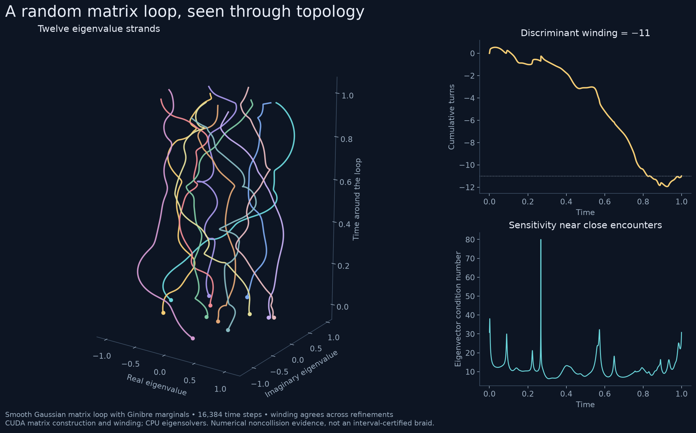

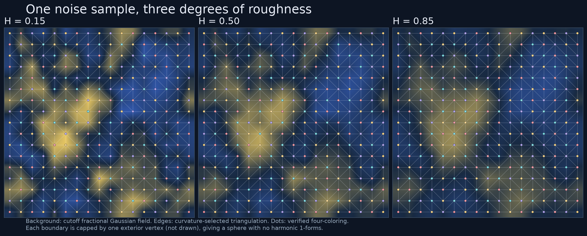

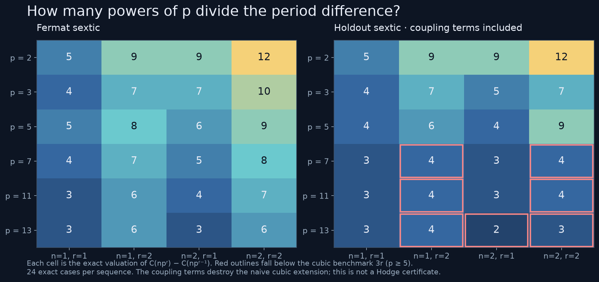

## The leaderboard

The snapshot of 16 October 2026 contains 61 entries: 42 solved and 19 open, with 42 credited to `benediamond`. These are historical counts, not a live dashboard. The upstream [contribution contract](https://github.com/hodge-computer/sextics/blob/b8c4edeb80a82395ec07164caf445cfa43bbbd56/CONTRIBUTING.md) requires an accepted proof for the fixed target. A public experiment or picture does not earn a solve point.

See [source attribution](SOURCES.md), [research notes](RESEARCH_LOG.md), and the [degree-six holdout model](algebra/README.md). Source submodules retain their own authorship and licensing. This repository does not post or submit anything to the challenge automatically.
