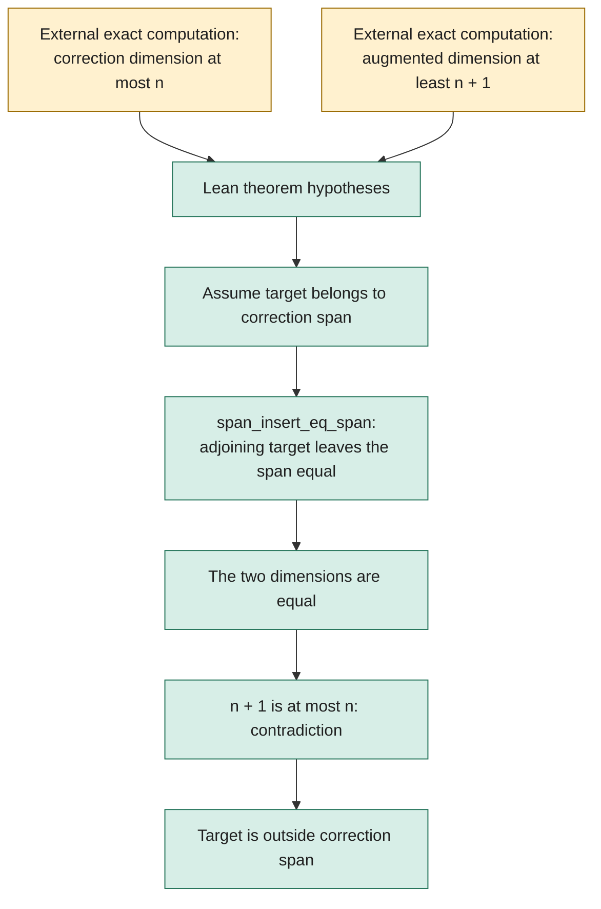

# Lean proofs for the rank shortcut and concrete obstructions

The notebook has two stages of formalization. The original rank-gap theorem
accepts dimension bounds as hypotheses. The new concrete project encodes
integer coefficient rows for all sixteen fixed cubic-direction candidates
and checks a separating row functional for each one. Its final theorems
have **no rank-bound hypotheses**: they rule out solutions to the literal
encoded equations over every characteristic-zero field.

[Concrete experiment and limits](../notes/cyclic-fano-concrete-lean.md)
· [Concrete proof visualization](../results/cyclic-fano-lean-figures/concrete-lean.png)
· [Case 05 source](HodgeLab/CyclicFano/Case05.lean)
· [Reusable row-certificate lemmas](HodgeLab/RowCertificate.lean).

The polynomial-to-matrix reconstruction and completeness of the correction
space remain independently checked in Python. The Lean theorems do not
establish that geometric correspondence or `HodgeComputer.HasCertificate`.
They also do not compute the exact ranks 150 and 151: an exact row
obstruction is enough to prove the required inconsistency.

## Concrete integer row certificates

For each case, `matrix`, `target`, and `dual` are transparent integer
definitions. Unlisted entries are zero. All 175 correction columns remain
in the encoded matrix; the selected row counts range from 2 to 39.

- `annihilates` splits the 175 finite column cases and checks each
  cancellation using kernel `decide`.
- `separates` checks the nonzero target pairing using kernel `decide`.
- `no_solution` applies the generic integer-certificate lemma over an
  arbitrary characteristic-zero field, including the complex numbers.

For case 05, the two rows have their only nonzero entries in column 119:
`1` and `-756`. Their target entries are `0` and `-5`. The row functional
`(756, 1)` cancels the correction column but gives `-5` on the target.
Every other column has zero pairing as well. This is a concrete two-row
contradiction, rather than an assumed rank inequality.

The portable audit driver builds all seventeen modules, audits fifty
declarations, and runs standalone kernel replay. It also requires two
deliberately corrupted concrete certificates to fail compilation. It
uses no new proof axioms or unchecked native decision procedure. The
[local compilation and axiom receipt](results/concrete-compilation-validation.json),
[separate native replay receipt](results/concrete-direct-replay-validation.json),
[export manifest](results/concrete-export.json), and
[development record](results/concrete-development.json) retain the source
bindings, checks, and failed build/replay attempts.

Repeated local WSL interruptions required a separate Windows replay route.
`ReplayConcrete.lean` calls the installed official
`replayFromImports` routine from `LeanChecker` sequentially for the seventeen
explicit modules. It avoids the command-line checker's full-cache scan
and parallel task dispatch. It retains the standard trusted-import
semantics; it is not a fresh replay of mathlib or a different kernel
implementation. The native receipt records the actual completed modules
and must be read separately from the compilation receipt. Its result
does not claim execution of the portable driver's two mutation controls.

**Concrete local status:** all seventeen modules compiled and all fifty
axiom audits passed. The additional aggregate native replay is
**INCOMPLETE** after its 420-second bound. The two Lean mutation controls
remain pending locally. Fresh Linux CI runs the full portable audit.

## Earlier generic rank-gap bridge

This notebook now has a small Lean project. It formalizes the **generic logical
step** used by the [cubic-polar rank certificates](../notes/cyclic-fano-cubic-polars.md):
if the correction span has dimension at most `n` and adjoining the target gives
dimension at least `n + 1`, the target cannot belong to that correction span.
The particular `150 / 151` bounds are a specialization.

In this earlier rank-gap module, the actual polynomial matrices, the 25 correction relations, the sixteen
modular minors, and the transfer of a nonzero modular minor to characteristic
zero are checked by the Python experiment, **not by the rank-gap module**. The
dimension inequalities remain explicit hypotheses of the Lean theorem. No
`HodgeComputer.HasCertificate` statement, instance solution, or upstream
acceptance is established here.

## What the proof does



The yellow nodes identify the current boundary of formalization. The green
nodes describe the actual implication proved in
[`HodgeLab/RankGap.lean`](HodgeLab/RankGap.lean):

- `HodgeLab.not_mem_of_finrank_gap` proves the general implication.
- `HodgeLab.not_mem_of_finrank_150_151` instantiates the experimental bounds.
- `HodgeLab.no_correction_solution_of_finrank_gap` rules out equality with any
  proposed candidate known to lie in the correction span.

The proof does not require independence of the correction generators. It also
does not require a separate finite-dimensional ambient-space assumption: under
the contradiction hypothesis the two spans are literally equal, hence their
`finrank` values are equal. The experiment itself concerns finite matrices.

## Pinned environment and reproduction

This standalone notebook project pins Lean **4.31.0** and mathlib commit
`fabf563a7c95a166b8d7b6efca11c8b4dc9d911f`. It uses the already available local
cache. The upstream challenge currently pins Lean 4.33.0 and a different mathlib
commit; compatibility with that environment has not been tested. Nothing here
changes upstream formal files.

With Elan installed, run from `formal/`:

```sh
lake exe cache get
python3 check.py
python3 check_concrete.py
```

The original audit driver runs `lake build`, prints the axioms for its three declarations,
and replays `HodgeLab.RankGap` with the standalone `leanchecker`. It rejects
unfinished-proof tokens in this project's Lean files and allows only `propext`,
`Classical.choice`, and `Quot.sound` in the reported theorem dependencies.
Each command has a 300-second bound. The source-bound result is saved in
[`results/rank-gap-validation.json`](results/rank-gap-validation.json), with
the actual compiler, build, axiom, and kernel logs beside it.

**Local status: PASS.** All three theorems compiled, their printed dependencies
contain only the three allowed axioms, and standalone kernel replay exited
successfully. The receipt records the exact sources and environment. This does
not by itself report a remote CI result.

The local cache link inside `.lake/` is ignored; it is not a portable dependency.
The committed Lake manifest pins the dependencies needed by a fresh checkout.
CI repeats both builds and audits without CUDA. Local compilation, a concrete
coefficient obstruction, and an accepted instance solution are distinct.

The Lean workflow uploads its actual receipts and command logs as
`concrete-lean-verification`, including diagnostic logs on failure.
The ordinary `check_concrete.py` invocation does not reuse committed
checkpoints; `--resume` is an explicit local recovery option.

This proof uses mathlib's span and dimension API, especially
`Submodule.span_insert_eq_span`. Codex assisted its construction and a separate
statement/scope review. The exact numerical experiments and their independent
replays remain linked from the mathematical notebook.
