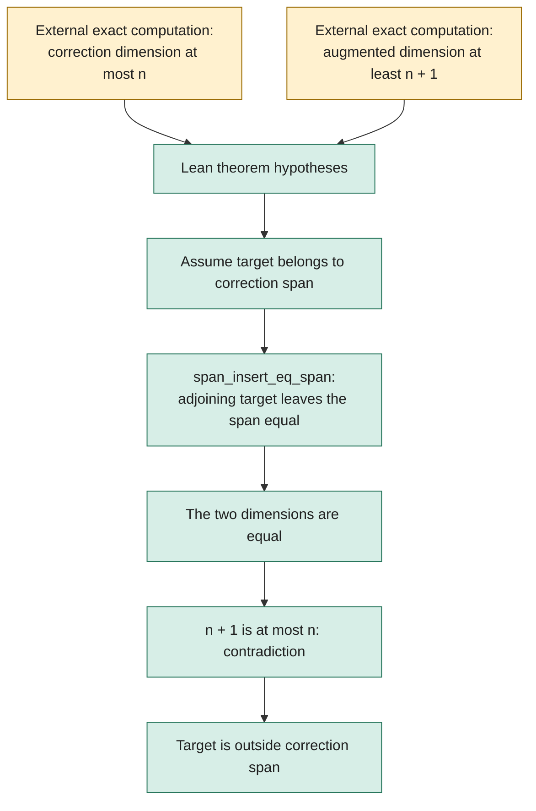

# A Lean bridge for the rank shortcut

This notebook now has a small Lean project. It formalizes the **generic logical
step** used by the [cubic-polar rank certificates](../notes/cyclic-fano-cubic-polars.md):
if the correction span has dimension at most `n` and adjoining the target gives
dimension at least `n + 1`, the target cannot belong to that correction span.
The particular `150 / 151` bounds are a specialization.

The actual polynomial matrices, the 25 correction relations, the sixteen
modular minors, and the transfer of a nonzero modular minor to characteristic
zero are checked by the Python experiment, **not by this Lean project**. The
dimension inequalities remain explicit hypotheses of the Lean theorem. No
`HodgeComputer.HasCertificate` statement, instance solution, or upstream
acceptance is established here.

## What the proof does



The yellow nodes identify the current boundary of formalization. The green
nodes describe the actual implication proved in
[`HodgeLab/RankGap.lean`](HodgeLab/RankGap.lean):

- `HodgeLab.not_mem_of_finrank_gap` proves the general implication.
- `HodgeLab.not_mem_of_finrank_150_151` instantiates the experimental bounds.
- `HodgeLab.no_correction_solution_of_finrank_gap` rules out equality with any
  proposed candidate known to lie in the correction span.

The proof does not require independence of the correction generators. It also
does not require a separate finite-dimensional ambient-space assumption: under
the contradiction hypothesis the two spans are literally equal, hence their
`finrank` values are equal. The experiment itself concerns finite matrices.

## Pinned environment and reproduction

This standalone notebook project pins Lean **4.31.0** and mathlib commit
`fabf563a7c95a166b8d7b6efca11c8b4dc9d911f`. It uses the already available local
cache. The upstream challenge currently pins Lean 4.33.0 and a different mathlib
commit; compatibility with that environment has not been tested. Nothing here
changes upstream formal files.

With Elan installed, run from `formal/`:

```sh
lake exe cache get
python3 check.py
```

The audit driver runs `lake build`, prints the axioms for all three declarations,
and replays `HodgeLab.RankGap` with the standalone `leanchecker`. It rejects
unfinished-proof tokens in this project's Lean files and allows only `propext`,
`Classical.choice`, and `Quot.sound` in the reported theorem dependencies.
Each command has a 300-second bound. The source-bound result is saved in
[`results/rank-gap-validation.json`](results/rank-gap-validation.json), with
the actual compiler, build, axiom, and kernel logs beside it.

**Local status: PASS.** All three theorems compiled, their printed dependencies
contain only the three allowed axioms, and standalone kernel replay exited
successfully. The receipt records the exact sources and environment. This does
not by itself report a remote CI result.

The local cache link inside `.lake/` is ignored; it is not a portable dependency.
The committed Lake manifest pins the dependencies needed by a fresh checkout.
CI repeats the same build and audit without CUDA. Local compilation and a
passing generic proof are distinct from a verified concrete rank certificate.

This proof uses mathlib's span and dimension API, especially
`Submodule.span_insert_eq_span`. Codex assisted its construction and a separate
statement/scope review. The exact numerical experiments and their independent
replays remain linked from the mathematical notebook.
