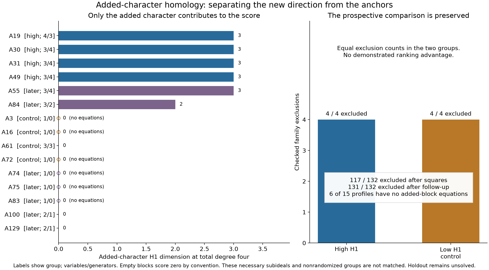
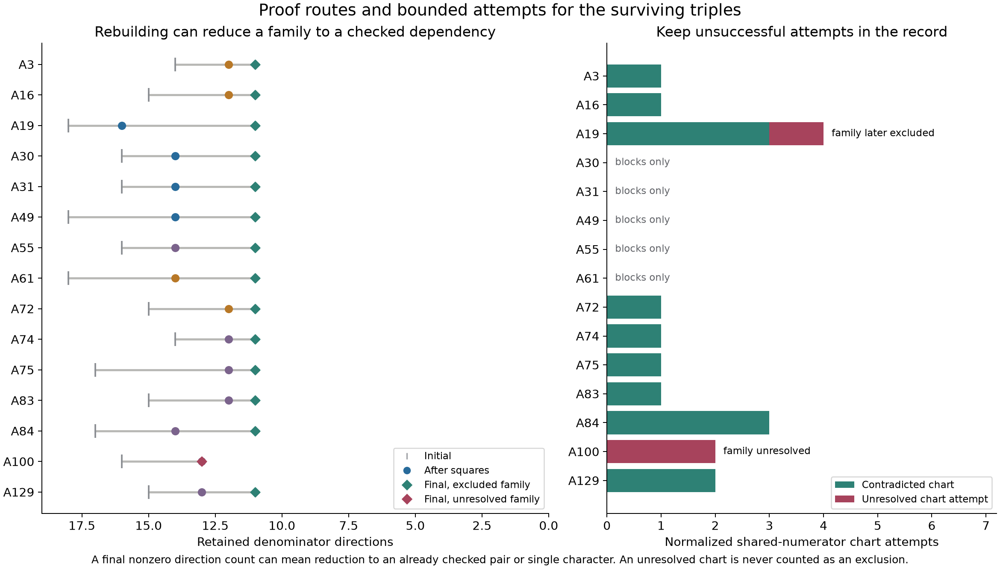
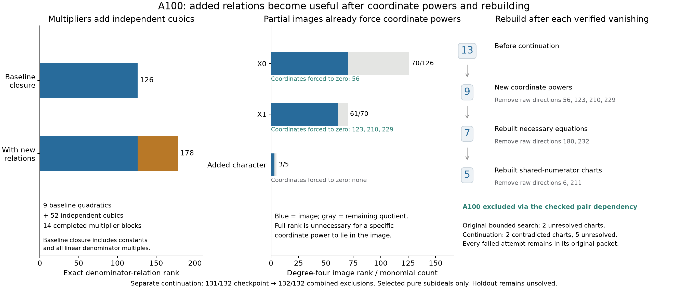

# Rank the added character, not the anchors

**17 October 2026: all 132 fresh X0/X1 extensions are excluded**, giving
**680 selected triples** with the preceding 548 disjoint exclusions.
The primary bounded pass stopped at 131/132 (679 selected triples).
A separate multiplier-and-rebuilding continuation closes A100; both
checkpoints and the originally unsuccessful charts remain in the record.
The original high/low comparison closes 4/4 in both groups. Ranking only
the added character's homology removes the previous anchor contribution,
but still establishes no efficacy advantage. Holdout remains unsolved.



## A fresh selection and a frozen comparison

We select all 136 third-character extensions of
`chi_X0=(0,0,1), chi_X1=(0,1,0)` and remove the four already in the preceding
548-family union. All 132 remaining families use complete retained E1
character eigenspaces, modulo the established six-direction `F*S1` gauge.
The exact `holdout` target with q=1 and all existing upstream files remain
unchanged at `b8c4edeb80a82395ec07164caf445cfa43bbbd56`; the equations allow
a nonzero quotient. Each local **A ID** records its character triple,
global triple number, and raw E1 indices. These are different families
from the earlier H, Y, and B batches.

Square identities first reduce 117 families to the known X0/X1 pair.
For the fifteen survivors we extract only the existing necessary rows
whose polynomial involves the **added character's** coefficients. We do
not set the anchor coefficients to zero. These rows generate a necessary
subideal; we do not claim they exhaust every pure consequence obtainable
by combining mixed rows or eliminating other variables. Thus the score
describes this selected subideal, not an intrinsic invariant of the entire
physical certificate family.

For its quadratic generators P over its polynomial ring S, compute the
Koszul complex in total degrees three and four. The new score is

$$
\dim_{\mathbb Q}H_1(K(P;S))_4,
\qquad H_1=\ker(d_1)/\operatorname{im}(d_2).
$$

Anchor blocks do not enter this score. Six survivors have positive scores:
A19, A30, A31, A49, A55 score three, and A84 scores two. Nine score zero.
Six of those nine have **no selected pure equations**; they score zero by
declared convention, not as evidence for regularity of the full system.

The [ranking plan](../results/added-character-homology/ranking-plan.json)
was saved before the follow-up searches. Ties use ascending A ID. It
selects A19/A30/A31/A49 as the high group and A3/A16/A61/A72 as controls.
All receive the same degree-three/four block search, shared-numerator
chart propagation, and rebuilding, with 120 seconds per family and two
workers. Both groups close 4/4. The checked **125/132 comparison checkpoint**
is preserved before incorporating the remaining seven continuations.
Six of those seven close; A100 does not.

The comparison is small, deterministic, and unmatched. High-group
variable/generator counts are `(4,3),(3,4),(3,4),(3,4)`; controls have
`(1,0),(1,0),(3,3),(1,0)`. Three controls have empty blocks. The manifest's
`comparison_is_informative` flag means only that the groups' scores are
strictly separated; it does not assert predictive or causal validity.
Three high-group families close with blocks alone, versus one control,
but high-group A19 needs four charts and rebuilding. Timing is retained
as an execution record, not a controlled benchmark. No ranking advantage
is established by equal exclusion counts.

## What H1 misses, and H0 detects


For A19's added block, three quadratics in four variables give
`K2 -> K1 -> K0` dimensions `3 -> 30 -> 35` in degree four. The map ranks
are 3 and 24, leaving six cycles, three boundaries, and three H1 classes.
All composition columns and an explicit nonboundary representative are
checked exactly. Colors show coefficient signs; the apparent bands depend
on basis order. This A19 ideal differs from the preceding H19 ideal even
though their added characters are the same.

| Family | H1, degree 4 | H0, degree 3 | H0, degree 4 |
| --- | ---: | ---: | ---: |
| A19 | 3 | 9 | 11 |
| A30 | 3 | 0 | 0 |
| A61 | 0 | 1 | 0 |

Here `H0 = S/(P)`. A zero degree-d H0 means the first differential spans
every degree-d monomial, including every coordinate d-th power. The
explicit identities then force those coordinates to vanish over C.
This is a sufficient route to remove the added character. It is not
necessary: individual power memberships can suffice even when H0 is
nonzero. The table shows why H1 alone is an incomplete guide: A19 and
A30 have equal H1 but different images, while A61 supplies quartic powers
with H1=0. An H1 cycle itself is a relation, not a new denominator equation.

This remains classical finite Koszul homology. The motivation from
[Yang and Eisenbud-Erman](categorical-syzygies.md) has not supplied the
geometric data and hypotheses or categorical pairing needed to apply
their specific theorems. No full resolution, Dubedat correspondence,
surface-genus interpretation, or phase transition is claimed.

## Exact closures and retained failures

After the square pass, five families close through block powers:
A30, A31, A49, A55, A61. Shared-numerator charts and rebuilding close nine
more. All allowed numerator correction directions are retained, with
one shared set of numerator coefficients for each system. Of seventeen
continuation charts, fourteen contradict and three initially do not:

- A19, raw coefficient 7: the chart is initially unresolved. The other
  charts force 119, 159, 216 to zero; rebuilding reduces 13 retained
  directions to the eleven-direction anchor support and closes the family.
- A100, raw coefficients 6 and 211: both charts remain unresolved in
  the primary pass. This is a bounded-search failure, not an existence
  certificate or an impossibility claim for that family.



The terminating X0/X1 exclusion is prior work, reconstructed here from
**all thirteen** retained pair directions to avoid a narrower-space
dependency. Squares force 139 and 262 to zero. Of eleven shared-numerator
charts, the charts for 56 and 102 contradict; the other nine are retained
as failed attempts. Rebuilding then supplies cubic powers of 42, 88,
111, and 114, leaving the checked X1 single-character sector. This is a
reproduced pair dependency, not an additional new pair result.

## Checks, bounds, and review

### A100 multiplier follow-up

After preserving the primary checkpoint, we expanded A100's 709 physical
shared-numerator equations by the constant and all thirteen linear
denominator monomials. All fourteen multiplier blocks completed in
127.57 seconds under a 180-second limit. Exact elimination gives nine
constant-multiplier denominator relations and **52 additional relations**
independent modulo the finite span of constant and linear multiples of
those nine. That span has rank 126; adjoining the new relations raises it
to 178. This does not assert completeness of the projected ideal or
independence modulo its radical.

Both physical polynomial reconstructions verify all 22,699 coefficient
products in the retained relation witnesses and reject an altered
multiplier. The new selected pure relations occur in the anchor blocks;
the added-character block still has its original single equation. These
relations alone do not exclude A100. Discovery logs, the bound, the
relations, and both exact replay receipts are in
[multipliers-100](../results/added-character-homology/multipliers-100/).

```sh
python -S experiments/added100_multipliers.py --check
python -S experiments/added100_multipliers.py --check --independent
```

Six mixed-degree pure-character maps, at total degrees three and four,
then provide a cubic power of raw coefficient 56 and quartic powers of
123, 210, 229. Their explicit identities force all four coordinates to
zero. Rebuilding the physical system supplies cubic powers of 180 and
232. This reduces the original sixteen directions through the chain
`16 -> 13 -> 9 -> 7`: the initial square pass removed three, the new
multiplier powers remove four, and rebuilding removes two more.

The seven remaining directions are `6,42,88,102,111,114,211`. The rebuilt
shared-numerator charts for 6 and 211 now contradict; the other five
charts remain unsuccessful and are retained. Removing those two
coordinates leaves `42,88,102,111,114`, a subspace of the reproduced
full X0/X1 exclusion. Thus **A100 is excluded** and the new batch closes
132/132. Both physical reconstructions replay the complete reduction and
the pair dependency. The original comparison figures deliberately retain
their earlier 131/132 checkpoint.

The map-discovery and rebuilding jobs complete in 4.07 and 5.80 seconds,
each under a separate 180-second limit. These timings are execution
records, not performance comparisons. The necessary subideal may miss
other consequences; no completeness of elimination is asserted.



The separate continuation figure shows the finite relation-space increase,
degree-four pure-block image ranks, and the checked reduction history.
None of the three displayed images is full, yet individual coordinate
powers suffice. Regenerate it with
`python experiments/plot_added100_continuation.py` and Matplotlib.

```sh
python -S experiments/added100_multipliers.py --check-blocks
python -S experiments/added100_multipliers.py --check-blocks --independent
python -S experiments/added100_multipliers.py --check-closure
python -S experiments/added100_multipliers.py --check-closure --independent
python -S experiments/plot_added100_continuation.py --check
```

### Primary batch validation

Both physical polynomial reconstructions pass the primary batch. Each
checks 5,552 physical duals, 347,945 correction pairings, 130,900 quadratic
pairings, 476 square identities, nineteen higher-power identities,
93 graded maps, eighteen finite complexes, and seventeen continuation
charts with 556 inferences. They reject 176 altered power witnesses and
seventeen altered chart claims. The separately counted pair-chart checks
cover eleven charts with 75 inferences and the X1 proof is explicitly
replayed. Counts include
rebuilt and inherited work, not distinct discoveries.

```sh
python -S experiments/check_added_character_homology.py
python -S experiments/check_added_character_homology.py --independent
python -S experiments/plot_added_character_homology.py --check
```

The checks use Python 3.11 standard-library rational arithmetic. No CAS,
GPU, or numerical tolerance is needed. Discovery uses two workers,
300 seconds per baseline chunk, sixty seconds per profile, and 120 seconds
per continuation family. Every job completes within its limit. All plans,
packets, logs, failures, and checkpoint receipts are retained in the
[result directory](../results/added-character-homology/). Regenerate figures
with `python experiments/plot_added_character_homology.py` and Matplotlib.
Figure data bind the exact packets and canonical JSON plans; text hashes
are independent of Windows versus Linux line endings.

The [source-review record](../results/added-character-homology/review.json)
records a separate AI agent's inspection of the producer/checker and
targeted tests of incomplete chart covers. A valid timeout prefix is
accepted; the same incomplete cover marked complete and a non-prefix
chart are rejected. That agent also wrote the pair module, so this is
not independent authorship review of its own module. Both physical
implementations share identity and complex utilities. No independent
human review or Lean acceptance is implied. A dedicated Linux job checks
both reconstructions and the visualization data; its result is recorded
after publication.

The [separate A100 review](../results/added-character-homology/multipliers-100/review.json)
checks the multiplier, mixed-degree power, rebuilt-chart, and dependency
chain. It records eight isolated exercises, including accepted timeout
prefixes without exclusion and rejected false completion, missing charts,
non-prefix charts, and a corrupted chart polynomial. Review identified
missing binding of the later phases' bounds/status receipts; those metadata
checks were added and both physical replays rerun successfully. No proof
packet changed. This remains AI review with shared checking utilities.

## Scope and credit

The primary result covers 131 new triples; the separate A100 continuation
makes **680 of 428,536** possible unordered three-character supports in
our excluded selection. All 136 third-character extensions of X0/X1 are
now covered, including four from the preceding selection. Untested
triples, larger supports, and higher degrees remain open in this work.
The unconditional degree bound stays at least
seven. No `HasCertificate`, solve PR, or leaderboard point is claimed.

Prepared with OpenAI Codex assistance for rbajaj5, including separate
checker, dependency-review, and visualization agents. Credit the project
authors' certificate/geometric-support framework, the bridge attributed
there to Benjamin E. Diamond, Griffiths's residue theory, fqlx's E1/Koszul,
symmetry and one-/two-character calculations, and the preceding exact
physical-dual/rebuilding work. Eisenbud's graded-syzygy viewpoint and the
distinct geometric/categorical work of Yang and Eisenbud-Erman motivate
the experiment; they do not by themselves prove the computed exclusions.

**Publication and CI receipt:** the consolidated result was posted as
[upstream contribution 15](https://github.com/hodge-computer/sextics/discussions/44#discussioncomment-18999334),
then proof commit `718cf9a2e721b58782748ac90414dd7707f2a061` was pushed.
The dedicated Linux job subsequently passed both primary replays, both
versions of all three A100 checks, and both figure-data checks.
[Exact job receipt](../results/added-character-homology/ci-added-character.json).
Other workflow jobs were still running when this receipt was recorded.
