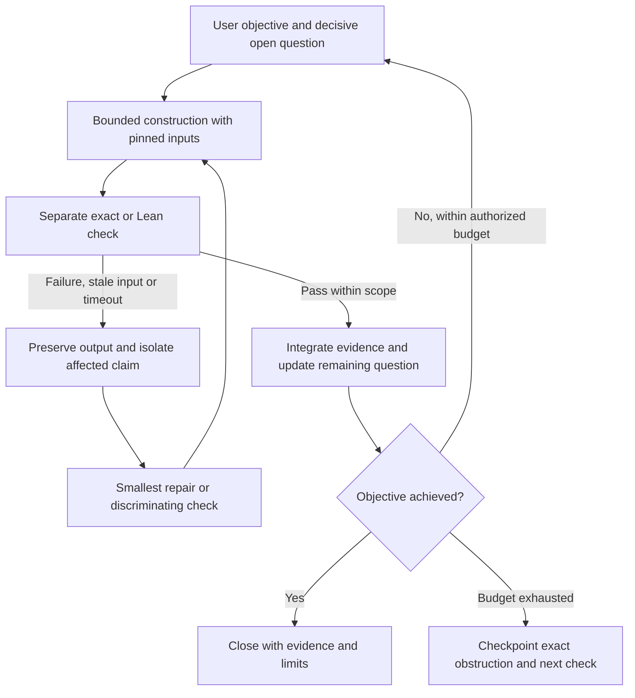

# Assured autonomy applied to Hodge Lab

24 October 2026. Workflow maintenance; no new mathematical result.

Use Ravi Bajaj's [Delay-Aware Runtime Assurance Lab](https://github.com/rbajaj5/delay-aware-runtime-assurance-lab/tree/2909919c7b4b3e9da3c2cd44cf4724680e8a7813)
to keep research directed toward the actual mathematical bottleneck while
separating speculative construction from checked claims. This adapts its
decision process; it does not transfer a physical safety guarantee to proof
search. These instructions are followed by the coordinator, not enforced by
a new scheduler or a text-based proof checker.

## What transfers

All source links below are pinned to the source release `2909919`.

| Source mechanism | Hodge Lab operating rule | Limit |
| --- | --- | --- |
| [Clearance age, expiry and throughput](https://github.com/rbajaj5/delay-aware-runtime-assurance-lab/blob/2909919c7b4b3e9da3c2cd44cf4724680e8a7813/paper/queue-aware-coordination-draft.md) | Each agent handoff names the target, claim, input revision, assumptions and artifact. Compare dependencies before integration. | A theorem does not expire with age. Changed dependencies require review; unrelated commits do not force replay. |
| [Useful-message priority and aging](https://github.com/rbajaj5/delay-aware-runtime-assurance-lab/blob/2909919c7b4b3e9da3c2cd44cf4724680e8a7813/analysis/run_fair_queue_multiagent_simulation.py) | Process counterexamples, corrections and changed assumptions first; consolidate repeated status reports. Revisit a deferred useful check at each batch boundary. | This is a scheduling analogy. The simulation's selection rule is not a complete safeguard against old messages being applied later. |
| [Non-monotone prediction-horizon sensitivity](https://github.com/rbajaj5/delay-aware-runtime-assurance-lab/blob/2909919c7b4b3e9da3c2cd44cf4724680e8a7813/course_study/README.md) | Extend a search only when a result changes the next decision. Record why a longer run or larger family is worth its cost. | The reported configuration-specific repair supplies no optimum duration, number of agents or search degree for Hodge research. |
| [Proposed versus realized conditioning, and a retained fallback](https://github.com/rbajaj5/delay-aware-runtime-assurance-lab/blob/2909919c7b4b3e9da3c2cd44cf4724680e8a7813/artifacts/20260813/basketball_affine_conditioning_v2/README.md) | Keep a promising proposal separate from its checked outcome. Retain the last checked assumptions while repairing the affected claim. | Passing a convenient proxy is insufficient: scalar trace zero does not establish exactness of the full physical source. |
| [Registered, exploratory and quarantined evidence](https://github.com/rbajaj5/delay-aware-runtime-assurance-lab/blob/2909919c7b4b3e9da3c2cd44cf4724680e8a7813/course_study/README.md) | Label sketches, reviewer reports, executed exact checks, Lean results and accepted upstream results separately. Preserve failed attempts and explicit corrections. | File hashes establish identity, not mathematical correctness. A numerical or bounded exclusion keeps its stated scope. |

The queue study explicitly exposes a completion cost when stale work is
rejected without recovery. Our response to a bad handoff therefore includes
a replacement action: refresh the changed dependency, reconstruct one missing
identity, or produce a minimal counterexample. Unaffected work can proceed.

## A small operating loop



This diagram describes the procedure, not an executed research experiment.
The Mermaid source is the reproducible diagram; no mathematical evidence is
inferred from it.

Use one mathematical lead, a second approach only when it is substantively
different, and a checker. The coordinator integrates and owns publication.
Reuse the user's requested Pro chat for the lead; record which executor
actually ran each check. A reviewer reading logs has not executed Lean.
No extra chats, paid API service, corpus ingestion or model training is
needed for this policy change.

Before dispatch, record already-running work and its input revision so a
delayed response cannot silently revive an abandoned assumption. Each worker
owns named files or returns a patch against a named parent. Only the
coordinator integrates shared ledger and status changes. A newer answer is
not automatically stronger evidence than an older checked artifact.

Separate the constructive objective from a bounded batch's deliverable.
Formalize a lemma when it closes a named dependency or gives a decisive test
of a candidate construction. Keep the Goal open if its larger objective
remains unresolved; report a completed batch as a completed batch. Do not
replace a primitive objective with "more Lean" without stating the change.

Use a declared wall-clock budget and per-process timeouts before work starts.
For an otherwise unspecified bounded batch, use a provisional 45-minute
budget, inspect progress at 15-minute boundaries, and permit at most one
repair of the same failed approach without new evidence. These are adjustable
planning defaults, not experimentally established optima or extra approval
requirements. Respect the user's tighter limits. Save partial output at the
boundary; extend only for a stated reason within the authorized scope.

When reviewers disagree, write the disputed inference and the test that
distinguishes the alternatives. Another vote is not that test. Once relevant
checks pass, integrate; repeat them only after a material change, failure or
unresolved concern. Reuse unchanged receipts with their original source pins.

## Reusable run card

Keep one short card in the active batch note. Update its outcome, rather than
creating separate reports for every agent message.

```text
User objective:
Current decisive question and why it matters:
Pinned inputs and reused receipts:
Assumptions / permitted domain / excluded claims:
Lead / optional alternate / checker / file ownership:
Candidate construction or competing explanations:
Smallest discriminating check and pass/fail meaning:
Batch budget / process bounds / stop rule:
Outcome: proposal | checked within scope | failed within scope | interrupted
Changed dependencies, unresolved objection, and recovery/next check:
Publication: local | notebook pushed | upstream verified permalink
```

Evidence status and publication status are independent. An interrupted
calculation is not an exclusion. A proof sketch or reviewer report is not an
executed check. Neither a successful notebook push nor multiple positive
reviews is upstream acceptance.

## Applying it to the current frontier

At Hodge Lab [`0ddf3af`](https://github.com/rbajaj5/hodge-lab/tree/0ddf3af6bca227bbba119d6af8e3e0b102e18254),
[checkpoint 143's physical trace bridge](skew-physical-trace-bridge.md) already
provides the coefficient-field embedding, physical scalar evaluation and
all-sheet scalar trace. Reuse those results and their pinned receipts.

The next proposed batch should discriminate between an actual compatible
all-sheet **physical-form/source** construction and an obstruction to that
construction. Its candidate uses sheet maps fixing common `V=rU` and `z`,
with `U_j=V/r_j`, on an allowed regular domain. The lead constructs that map;
the checker tests the domain, curve equation and form/source compatibility,
including both source rows. A second worker is useful only for a different
construction or a concrete obstruction. This card is a proposal, not a claim
that those maps have been constructed or that this research run has started.

A useful bounded outcome is a checked compatibility result or a precise
failed identity/domain condition and the smallest next check. The larger
rational-primitive/certificate problem remains open. Scalar trace zero,
additional declarations, commits and diagrams are not a substitute for its
missing source-class comparison or primitive.

Existing publication rules remain: prepare and push the ledger audit before
an authorized upstream contribution; verify its readback and record the
permalink afterward. Monitoring remains read-only upstream. This procedure
adds no permission gate, posting quota, new contribution, or claim of better
research performance. Its effectiveness must be assessed through resolved
mathematical questions and useful failed attempts, rather than activity counts.
