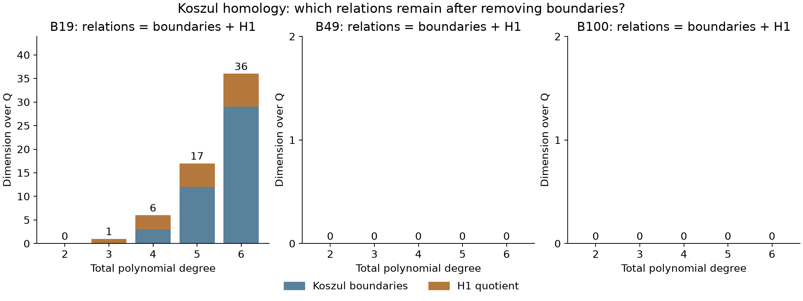

# From one matrix to a Koszul complex

The user suggested moving toward categorifications of syzygy theory and
recalled David H. Yang and Emily Riehl. This is a more direct continuation
of the existing graded-algebra work than a grammar-based solver.

## Which references connect

David H. Yang's [*S_n-equivariant sheaves and Koszul cohomology* (2014)](https://link.springer.com/article/10.1186/s40687-014-0010-9)
interprets geometric Koszul cohomology using equivariant sheaves. It connects
with Voisin's Hilbert-scheme interpretation through the Bridgeland-King-Reid
equivalence for curves and surfaces. Applying its theorems here would require
identifying the appropriate smooth projective variety, line bundles, sheaf,
and cohomology-vanishing hypotheses. Our denominator coefficient degree is
not automatically the positivity parameter in its asymptotic results.

David Eisenbud and Daniel Erman's [*Categorified duality in Boij-Soderberg
theory and invariants of free complexes*](https://ems.press/journals/jems/articles/14923)
is the directly relevant reference explicitly about categorifying syzygy
invariants. Its pairing of derived categories refines numerical functionals
on Betti and cohomology tables. Emily Riehl's
[books](https://emilyriehl.github.io/books/) provide broader categorical and
homotopical foundations. These contributions should not be conflated or
credited as one person's invention of syzygy theory.

The preceding suggestion, Vishnikin and Okhotin's
[*Categorial grammars with unique category assignment*](https://arxiv.org/abs/2505.14559),
concerns formal-language encodings. We considered an analogy between typing
filters and algebraic feasibility, then deferred that proposed experiment
when the user redirected the work. No grammar-based Hodge solver was run,
and no result from that paper is being asserted for our ideals.

## A concrete first computation

We extend the [B19/B49/B100 comparison](graded-map-patterns.md) from the map
`d1: (u_j) -> sum u_j P_j` to the actual Koszul complex of its quadratic
generators over the corresponding rational polynomial ring S:

\[
K_k(P;S)=S(-2k)^{\binom{r}{k}},\qquad
d(e_{i_1}\wedge\cdots\wedge e_{i_k})
=\sum_{j=1}^k(-1)^{j-1}P_{i_j}
 e_{i_1}\wedge\cdots\widehat e_{i_j}\cdots\wedge e_{i_k}.
\]

The existing matrix shows `d1`. Its kernel contains all polynomial relations
among the generators, including automatic pairwise relations. The incoming
`d2` identifies those **Koszul boundaries**. The quotient
`H1 = ker(d1)/im(d2)` records the cycles remaining after those boundaries.

This is classical Koszul homology of our necessary-block ideal. It is a
first step toward retaining the complex rather than just its numerical rank;
it is **not** an implementation of the Eisenbud-Erman categorical pairing,
Yang's geometric theorem, or a new identification with geometric `K_{p,q}`.



For B19 the adapted generators are `v^2, uv, w^2-4vw` in `Q[u,v,w,t]`.
The cycle `(-u,v,0)` is nonzero in degree-three `H1`: its image is exactly
`-u v^2 + v(uv)=0`, and the degree-three `K2` is zero. This gives a precise
algebraic distinction from the one-generator examples B49 and B100.

| B19 total degree | All relations: ker d1 | Koszul boundaries: im d2 | H1 |
| ---: | ---: | ---: | ---: |
| 2 | 0 | 0 | 0 |
| 3 | 1 | 0 | 1 |
| 4 | 6 | 3 | 3 |
| 5 | 17 | 12 | 5 |
| 6 | 36 | 29 | 7 |

Both B49 and B100 have `H1=0` throughout this tested range; each has only
one nonzero generator in a polynomial ring. At degree four, calling all
six B19 relations independent homology classes would therefore overcount
by three. These groups measure relations among **necessary equations**,
not the existence of a holdout certificate.

## Exact checks and limits

The script reconstructs the source physical necessities and the invertible
basis changes before forming the complexes. It constructs all differentials
at total degrees two through six in both original and adapted bases: 30
complexes in total. It checks 92 columns of successive compositions are
exactly zero, verifies explicit kernel vectors, computes exact boundary
spans and quotient representatives, checks Euler characteristics, and
compares homology dimensions across the basis changes. All checks pass.

```sh
python -S experiments/necessary_koszul_complex.py --check
```

This uses standard-library rational arithmetic. To regenerate the figure
and data, run `python experiments/necessary_koszul_complex.py` with Matplotlib.
[Exact data and representatives](../results/necessary-koszul-complex/data.json),
[validation receipt](../results/necessary-koszul-complex/validation.json).
The figure shows counts, not chosen representatives or spatial geometry.
The unequal panel scales are labeled; empty B49/B100 panels represent zero
relations, not missing computations.

No new family exclusion or higher-degree theorem follows from this bounded
calculation. We have not proved a full resolution, an all-degree Hilbert
series, or an eventual polynomial formula from five sampled degrees.
The unimplemented next step is to construct chain maps relating rebuilt
families and check what they preserve, rather than transferring a relation
merely because two pictures look alike. Any useful new obstruction must
still return to the fixed physical coefficient equations for exact checking.

Prepared with OpenAI Codex assistance for rbajaj5. Credit Eisenbud for the
graded-syzygy framework, the authors above for their distinct categorical
and geometric results, and the prior holdout calculations for the source
necessities. This internal visual companion adds no upstream post to the tally.
