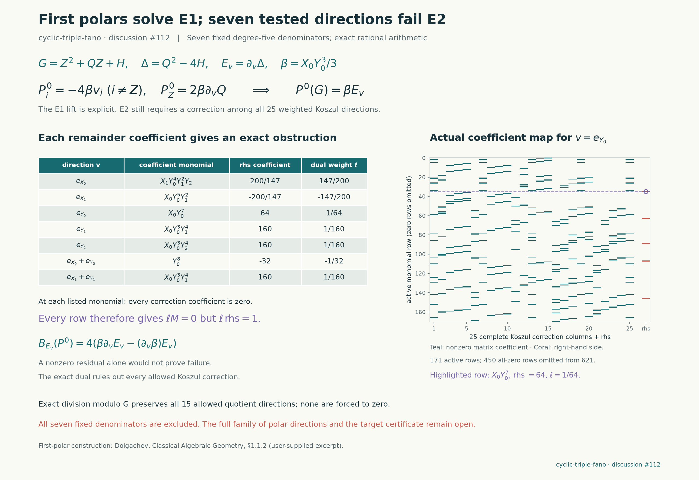

# First polars of the cyclic branch sextic

Seven degree-five denominators suggested by Dolgachev's first-polars construction were tested on the unchanged `cyclic-triple-fano` target. All seven satisfy the first normalized certificate equation by an explicit polynomial lift. All seven fail the second equation, even with its complete numerator-correction and quotient spaces. Each failure has a one-coefficient exact obstruction. This is a finite pilot, not an exclusion of the entire five-parameter family of first polars.

The source is frozen at `d96911d725077e66a8f10848908be01a643b1714`, with the same $F$, $q=1$ and $A$ as the preceding [cyclic transfer](cyclic-fano-transfer.md). The source hash, producer hash and arithmetic dependencies are recorded in every packet. Existing source files and prior experiment packets were not changed.



## What the reading contributes

Dolgachev, *Classical Algebraic Geometry: a modern view*, supplied excerpt §1.1.2, defines the first polar of a homogeneous polynomial by a constant directional derivative. At a smooth point of its zero set, this derivative detects whether the tangent hyperplane contains the specified direction. Here we apply that construction to an actual polynomial attached to the fixed target, rather than to a truncated local branch model.

Write the quotient by the $X_2\mapsto\zeta_3X_2$ action as

$$
G(x,Z)=Z^2+Q(x)Z+H(x),\qquad
x=(X_0,X_1,Y_0,Y_1,Y_2),\quad Z=X_2^3.
$$

All base coordinates have weight one and $Z$ has weight three. Its branch sextic and ramification equation are

$$
\Delta=Q^2-4H,\qquad J=G_Z=2Z+Q,\qquad J^2-\Delta=4G.
$$

For a fixed base point, the binary quadratic $Z^2+QZw+Hw^2$ has matrix $\left(\begin{smallmatrix}1&Q/2\\Q/2&H\end{smallmatrix}\right)$ and determinant $-\Delta/4$. This connects the discriminant and polar ideas in the supplied quadric chapters directly to the quotient map. It does not make the weighted fourfold an ordinary quadric or plane cubic. In particular, the Hesse-pencil and elliptic-curve conclusions in the later excerpt require their own dimension and smoothness hypotheses; none are invoked here. No claim that the branch sextic is smooth is needed for the polynomial identities below.

The further §4.2 excerpt on determinantal representations offers a possible later direction through graded presentations and arithmetically Cohen–Macaulay sheaves. Its plane-curve and surface existence statements do not automatically apply to this weighted fourfold. Our coefficient matrix is a map of certificate equations, not a determinantal equation for the hypersurface. A useful new presentation would need its grading and geometric support established, followed by a check against the fixed density $\beta$; neither a determinant identity nor a rank drop alone supplies that check. This pilot constructs no such sheaf or presentation.

Simply replacing $J^2$ by $\Delta$ would revisit the same function modulo $G$. First polars instead give a degree-five family

$$
E_v=\partial_v\Delta,\qquad \partial_v=\sum_i v_i\partial_{x_i}.
$$

## An explicit first-equation lift

Let $\beta=X_0Y_0^3/3$. In the weighted coordinates the normalized equations are

$$
P(G)=\beta E,\qquad B_E(P)=E\mathrm{div}P-P(E)\equiv0\pmod G.
$$

Direct differentiation gives the exact identity

$$
\partial_v\Delta=2J\partial_vQ-4\partial_vG.
$$

Consequently every constant direction has the explicit lift

$$
P_{x_i}=-4\beta v_i,\qquad P_Z=2\beta\partial_vQ.
$$

This proves $P(G)=\beta E_v$. The producer also substitutes $Z=X_2^3$ and checks the original physical identity $N(F)=AD$ using the Piola lift $N_{x_i}=3X_2^2P_{x_i}$ and $N_{X_2}=P_Z$. Thus first-equation success is not inferred from a numerical residual.

For the second equation the same explicit field has residual

$$
B_{E_v}(P)=4\left(\beta\partial_v^2\Delta-(\partial_v\beta)(\partial_v\Delta)\right).
$$

The useful feature is that this residual lies entirely in the base variables. It is not automatically zero merely because $E_v$ is a geometrically distinguished polar.

## Complete correction space and exact failures

Smoothness of the original sextic follows from its good reduction to the Fermat sextic modulo five. Its weighted quotient gradient likewise has no nonzero common zero: any such zero would lift to one for the original gradient. The six partials of $G$ therefore form a regular sequence, and their syzygies are generated by the Koszul fields. For a fixed denominator of degree five, the multiplier of the $(i,j)$ field has weight $5+w_i+w_j-8$. Only the five base/$Z$ pairs contribute, each with five linear base multipliers: **25 complete correction directions**. The second-equation quotient has weight $2\cdot5-8=2$, giving **15 quotient coefficients**. Monic division by $G$ eliminates that full quotient space exactly.

There is a short geometric explanation of the obstruction. Set $t=J$, so $g=t^2-\Delta=4G$. The explicit field transforms to $V_{x_i}=-4\beta v_i$ and $V_t=0$. Its residual is even under $t\mapsto-t$. In the matching reflection sector, base/base Koszul multipliers would have degree $5-6=-1$, while a mixed multiplier would have to be odd in $t$ despite having weight one. Both spaces are zero. Thus no matching Koszul correction can remove a nonzero base-polynomial residual. The saved computation independently retains all 25 raw Koszul directions and all allowed quotient freedom, rather than using this explanation to omit columns.

The table gives one coefficient of $-B_{E_v}(P)\bmod G$. For each displayed monomial, its coefficient is zero in **every** reduced correction column. Dividing coefficient extraction by the listed nonzero value is the saved dual functional, which evaluates to one on the required right side and zero on every available correction.

| Fixed direction $v$ | Active coefficient rows | Obstructing monomial | Right-side coefficient |
|---|---:|---|---:|
| $e_{X_0}$ | 203 | $X_1Y_0^4Y_1^2Y_2$ | $200/147$ |
| $e_{X_1}$ | 161 | $X_0Y_0^5Y_1^2$ | $-200/147$ |
| $e_{Y_0}$ | 171 | $X_0Y_0^7$ | $64$ |
| $e_{Y_1}$ | 222 | $X_0Y_0^3Y_1^4$ | $160$ |
| $e_{Y_2}$ | 170 | $X_0Y_0^3Y_2^4$ | $160$ |
| $e_{X_0}+e_{Y_0}$ | 255 | $Y_0^8$ | $-32$ |
| $e_{X_1}+e_{Y_1}$ | 292 | $X_0Y_0^3Y_1^4$ | $160$ |

The ambient reduced coefficient space has dimension 621. Active rows count monomials that actually occur, not a matrix rank. Each denominator is a nonzero base polynomial, hence has nonzero remainder under the monic quadratic relation; it is not identically zero on the hypersurface. The rational obstruction identities also remain valid over $\mathbb C$.

All seven workers finished under 0.5 seconds including startup, against separate 60-second bounds. There were no timeouts or worker errors. The primary standard-library replay passed all seven tests and rejected 14 deliberately altered dual/right-side controls. Independent reconstruction also passed: it checked the original-source E1 and Piola identities, all 175 Koszul and 105 quotient columns across the seven tests, every saved obstruction, and separately constructed reflection-even projection obstructions. It rejected 21 mutation controls. This result records unsuccessful denominator choices, not a certificate, support construction, Lean proof or accepted solve. Arbitrary linear combinations of the five first polars and higher-degree products remain outside the seven fixed tests.

## Reproduction

```sh
python -S experiments/cyclic_fano_branch_polars.py list
python -S experiments/cyclic_fano_branch_polars.py run --candidate polar_X0 --seconds 60
python -S experiments/cyclic_fano_branch_polars.py verify
python -S experiments/check_cyclic_fano_branch_polars.py
python experiments/plot_cyclic_fano_branch_polars.py
```

Packets, explicit fields, actual sparse correction maps, duals and bounded attempt logs are in `results/cyclic-fano-branch-polars/`. The construction uses the prior recorded exact arithmetic as a declared dependency; the independent checker reconstructs the target and equations separately. Credit is due to Dolgachev's first-polar construction, the upstream fixed-target framework, the cyclic Piola transfer, and the regular-sequence/Koszul description of all corrections. OpenAI Codex assisted construction and independent verification. No upstream discussion post is part of this pilot.
