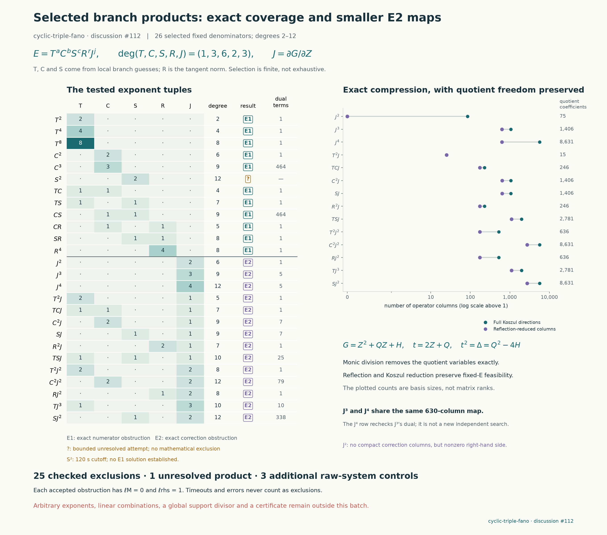

# Higher powers and products of the branch-inspired guesses

This batch tests 26 specified products on the same protected `cyclic-triple-fano` instance. It follows the [nine fixed-denominator failures](cyclic-fano-guided-denominators.md) and the [higher local unfolding](cyclic-fano-higher-unfolding.md). Higher powers can admit additional numerator corrections, so the earlier failures are not silently propagated to them. The original $(F,q,A)$, with $q=1$, remains unchanged.

**Result: 25 of the 26 fixed products are excluded exactly; one remains unresolved.** Eleven fail E1 and fourteen fail complete E2 tests. The degree-twelve candidate `S2` reached its 120-second limit without a completed obstruction or an E1-success checkpoint. No solution was found, and the timeout is not counted as a failure of that denominator.

| Product | Degree | Exact obstruction stage | Dual terms | Status |
| --- | ---: | --- | ---: | --- |
| `T2` | 2 | E1 | 1 | Excluded exactly |
| `T4` | 4 | E1 | 1 | Excluded exactly |
| `T8` | 8 | E1 | 1 | Excluded exactly |
| `C2` | 6 | E1 | 1 | Excluded exactly |
| `C3` | 9 | E1 | 464 | Excluded exactly |
| `S2` | 12 | No completed obstruction | — | Unresolved: 120-second timeout |
| `TC` | 4 | E1 | 1 | Excluded exactly |
| `TS` | 7 | E1 | 1 | Excluded exactly |
| `CS` | 9 | E1 | 464 | Excluded exactly |
| `RC` | 5 | E1 | 1 | Excluded exactly |
| `RS` | 8 | E1 | 1 | Excluded exactly |
| `R4` | 8 | E1 | 1 | Excluded exactly |
| `J2` | 6 | E2, complete compact system | 1 | Excluded exactly |
| `J3` | 9 | E2, complete compact system | 5 | Excluded exactly |
| `J4` | 12 | E2, same system as `J3` | 5 | Excluded exactly |
| `JT2` | 5 | E2, complete compact system | 1 | Excluded exactly |
| `JTC` | 7 | E2, complete compact system | 1 | Excluded exactly |
| `JC2` | 9 | E2, complete compact system | 7 | Excluded exactly |
| `JS` | 9 | E2, complete compact system | 7 | Excluded exactly |
| `JR2` | 7 | E2, complete compact system | 1 | Excluded exactly |
| `JTS` | 10 | E2, complete compact system | 25 | Excluded exactly |
| `J2T2` | 8 | E2, complete compact system | 1 | Excluded exactly |
| `J2C2` | 12 | E2, complete compact system | 79 | Excluded exactly |
| `J2R` | 8 | E2, complete compact system | 1 | Excluded exactly |
| `J3T` | 10 | E2, complete compact system | 10 | Excluded exactly |
| `J2S` | 12 | E2, complete compact system | 338 | Excluded exactly |



## The specified products

Use the previous definitions

$$
T=-X_1-iY_2,\qquad L=Y_0-iX_1,\qquad
C=X_1^2T-\mu_3L^3,\qquad S=C^2+\gamma L^6,
\qquad R=X_1^2+Y_2^2.
$$

The exact coefficients $\mu_3,\gamma$ remain bound to the prior candidate packet. The local calculation motivates $C,S$, but has not proved either a global branch equation or a supporting divisor. Also $R=T\overline T$, so these are related factors, not independent samples.

The fixed weighted quotient is $G=Z^2+QZ+H$, with $Z=X_2^3$ and weights $(1,1,3,1,1,1)$. Write $J=G_Z=2Z+Q$. Each candidate is

$$
E=T^{n_T}C^{n_C}S^{n_S}R^{n_R}J^a,
\qquad d=n_T+3n_C+6n_S+2n_R+3a.
$$

The producer explicitly lists the 26 exponent tuples. They are a finite geometric experiment, not all products through degree twelve and not a comparison against random search. Direct products with $a=0$ first face the full E1 coefficient system. For $a>0$, E1 has the explicit solution $P_Z=\beta J^{a-1}K$, with the other components zero, where $K=T^{n_T}C^{n_C}S^{n_S}R^{n_R}$ and $\beta=X_0Y_0^3/3$.

The largest first-equation obstructions are the 464-term exact functionals for `C3` and `CS`. The repaired degree-twelve cases include completed tests of `J2C2` and `J2S`; their success means a checked exclusion, not a certificate. `J4` reuses the five-term obstruction for the identical complete `J3` system. It is a second fixed denominator covered by one proved equivalence.

## An exact reduction of the repaired tests

The earlier cyclic-character and Piola calculation preserves every solution for an invariant denominator and gives

$$
P(G)=\beta E,\qquad B_E(P):=E\,\mathrm{div}P-P(E)\equiv0\pmod G.
$$

Euler normalization preserves the denominator and the cleared certificate expression. A coordinate of weight $w_i$ in $P$ has weight $d+w_i-2$. The full E2 quotient has weight $2d-8$; it is retained by taking the polynomial remainder modulo $G$, rather than assumed zero.

The six partials of $G$ form a regular sequence. Indeed, a nonzero common zero would lift under $Z=X_2^3$ to a nonzero common zero of the partials of $F$. Reduction of $F$ modulo five is a smooth Fermat sextic, so the characteristic-zero hypersurface is smooth. The partials therefore have height six, and their first syzygies are generated by the Koszul fields. Their required homogeneous components include every allowed correction, including exceptional coefficient choices.

Now make the polynomial coordinate change

$$
x=(X_0,X_1,Y_0,Y_1,Y_2),\qquad
t=2Z+Q(x),\qquad \Delta(x)=Q(x)^2-4H(x),\qquad
g=t^2-\Delta=4G.
$$

The five $x$ coordinates have weight one and $t$ has weight three. The pushed vector field is

$$
V_i=P_i,\qquad V_t=2P_Z+\sum_i Q_iP_i.
$$

The coordinate change has constant Jacobian two, so it preserves divergence. E1 becomes $V(g)=4\beta E$. For $E=t^aK(x)$, $a>0$, the particular field and its exact residual are

$$
V_t^{(0)}=2\beta t^{a-1}K,\qquad V_i^{(0)}=0,
\qquad B_E(V^{(0)})=-2\beta t^{2a-2}K^2.
$$

Three exact operations reduce the complete correction system:

1. Reflection $t\mapsto-t$ retains $V_i$ of parity $a$ and $V_t$ of parity $a-1$. Averaging a solution onto this character keeps its E1 target and E2 equation. This is the quadratic-cover reflection, distinct from the original order-three cover symmetry and from local evaluation monodromy.
2. A Koszul multiplier can be reduced modulo $g$. If $W(g)=0$, then $B_E(gW)=gB_E(W)$, so the removed part contributes zero to E2 modulo $g$.
3. After $t^2=\Delta$, every retained E2 term is a polynomial in the five base variables and has a common factor $\Delta^{\lfloor a/2\rfloor}$. Cancelling this nonzero polynomial is exact. No numerical or generic-rank assumption enters.

Let $k=\deg K$, $d=3a+k$, $\varepsilon=a\bmod2$, and

$$
W_{ij}=\Delta_i\partial_j-\Delta_j\partial_i.
$$

The complete remaining unknowns are ordinary homogeneous base polynomials

$$
\deg h_{ij}=d-6-3\varepsilon,\qquad
\deg h_i=d-7+3\varepsilon.
$$

A negative degree means that space is zero. The full E2 feasibility question is the following five-variable linear equation:

$$
\begin{aligned}
&\sum_{i<j}\Delta^\varepsilon\bigl(KW_{ij}(h_{ij})-h_{ij}W_{ij}(K)\bigr)\\
&\quad+\sum_i\left[2\Delta\bigl(K\partial_i h_i-h_i\partial_iK\bigr)
 +(1-\varepsilon-a)K\Delta_i h_i\right]
=2\beta\Delta^{\lceil a/2\rceil-1}K^2.
\end{aligned}
$$

Every coefficient has ordinary degree $2k+6\lceil a/2\rceil-2$. The helper exports the original and reduced dimensions, the cancelled power and both multiplier degrees. It does not additionally cancel repeated factors of $K$.

## Why two pure powers share a system

For $K=1$, the neighboring powers $J^{2m-1}$ and $J^{2m}$ reduce to the same complete equation

$$
\sum_i\left(2\Delta\partial_i h_i-(2m-1)\Delta_i h_i\right)
=2\beta\Delta^{m-1},\qquad \deg h_i=6m-7.
$$

The apparent extra $W_{ij}$ columns add no freedom. If $v_i=\partial_j f$, $v_j=-\partial_i f$ and the other coordinates vanish, then

$$
\sum_\ell\left(2\Delta\partial_\ell v_\ell-(2m-1)\Delta_\ell v_\ell\right)
=-(2m-1)W_{ij}(f).
$$

Also $W_{ij}(\Delta f)=\Delta W_{ij}(f)$, which covers the odd case. Thus $J^3$ and $J^4$ share one 630-column degree-ten system. Their agreement is a proved equivalence, not two independent confirmations. For $J,J^2$ there is no multiplier of degree $-1$, and the nonzero right side already obstructs E2. None of this excludes every higher pure power without checking the corresponding system.

## Admissibility and interpretation

At these higher degrees, denominator admissibility cannot be justified merely by being below the degree of $F$. Instead, the monic quadratic quotient gives the explicit normal form

$$
t^aK\equiv\Delta^{\lfloor a/2\rfloor}t^{a\bmod2}K\pmod g.
$$

Here $\Delta$ and every tested $K$ are nonzero base polynomials. The displayed remainder is nonzero, proving that each denominator is not identically zero on the hypersurface. It may vanish along a divisor. This argument also covers the direct products $K$.

An exclusion is certified by an exact linear functional annihilating every column and pairing to one with the required right side. The identity remains valid after extending $\mathbb Q(i)$ to $\mathbb C$, so the exclusions do not merely reflect a search for rational coefficients. A stopped or timed-out search supplies no such conclusion. A solution of a compressed system would still require an explicit lift and verification of the original certificate equations before being called a certificate.

## Reproduction and checks

```sh
python -S experiments/cyclic_fano_branch_products.py list
python -S experiments/cyclic_fano_branch_products.py run --candidate J2C2 --seconds 120
python -S experiments/cyclic_fano_branch_products.py verify
python -S experiments/cyclic_fano_branch_compact.py
python -S experiments/check_cyclic_fano_branch_products.py
python experiments/plot_cyclic_fano_branch_products.py
```

All 26 workers used a 120-second wall-clock bound and recorded their result or stop reason. The longest completed attempt was `J2S`, about 68.8 seconds including process overhead; `S2` stopped at about 120.06 seconds. No worker error was reported. The sum of the recorded worker durations is approximately 432.3 seconds; this is not a claim about elapsed wall time for parallel execution. The compact helper checks twelve actual six-variable column identities, four particular residuals, all 630 paired-power columns, and three curl identities. Separate raw computations modulo $G$ for `J2`, `JT2`, and `JTC` all produced exact one-term obstructions. Together they retain 340 raw Koszul directions and eliminate 336 allowed quotient coefficients. These are additional cross-checks of the compression, not three additional distinct candidates. Reproduce them with `run --candidate ID --raw --seconds 120`.

The independent standard-library checker passed all 28 saved obstruction checks: 25 distinct candidate exclusions and three raw controls. It independently checked every compact column and 40 physical first-order operator identities for each of the 14 compact cases (560 identities), and rejected all 56 mutation controls. `S2` remains explicitly unresolved in its receipt.

The primary witness replay also passed all 28 obstruction checks, covering 33,695 coefficient columns. Its receipt records `S2` as unresolved and `certificate_found: false`; it does not rerun or extend the timed-out search.

The raw coefficient systems retain all Koszul corrections and eliminate the full allowed quotient by monic polynomial remainder. The compact systems retain the same feasibility problem through the proved reductions above. Discovery stops when it finds a contradiction; recorded pivot counts are lower bounds, not full matrix ranks. No higher-degree or arbitrary-linear-combination exclusion is inferred from this batch.

Credit: the upstream fixed-target certificate and rational-support framework, the preceding cyclic Piola transfer and local unfolding, finite-group character projection, and the complete-intersection/Koszul viewpoint. OpenAI Codex assisted construction and independent agent verification. Notebook pushes and a substantial eventual upstream consolidation are distinct activities; this batch does not itself claim a solved instance, Lean proof, accepted PR or leaderboard point.
