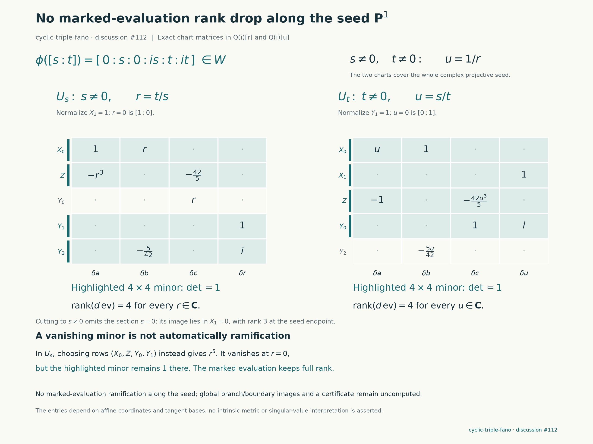

# Cyclic-triple-fano: the evaluation fiber and its boundary

**Only the new target `cyclic-triple-fano` is involved**, with its protected
$(F,q,A)$ at upstream commit `d96911d725077e66a8f10848908be01a643b1714`.
This continues the [explicit quotient curve and covering family](cyclic-fano-curve.md).
The complete normalized incidence fiber through one fixed quotient point has
scheme length **120, counted with multiplicity**, over $\mathbb Q(i)$.
The seed curve is a reduced point of that fiber. Separately, marked evaluation
is unramified everywhere along the seed, and one omitted section has a
concrete boundary image contained in $X_1=0$.

These are inputs to the support construction. We have not obtained the other
boundary images, a supporting equation, a rational primitive, or a Lean proof.
The total fiber length is not a computed degree of the component containing
the seed, and does not assert that all 120 points are distinct.

**Subsequent refinement:** the [spectral continuation](cyclic-fano-spectrum.md)
proves that the fiber consists of 117 simple points and one triple point
over the complex numbers. The sections below preserve the original
length-only argument and state its own limits.

## A six-variable fiber becomes three equations

Work on the weighted quotient $W$, in coordinates
$(X_0,X_1,Z,Y_0,Y_1,Y_2)$, where $Z=X_2^3$. Its equation has the form

$$
G=Z^2+Q(X_0,X_1,Y_0,Y_1,Y_2)Z+P(X_0,X_1,Y_0,Y_1,Y_2),
$$

with $Q$ cubic and $P$ sextic. Both are extracted from the protected source,
not fitted numerically. The preceding seed passes through

$$
p=[0:1:0:i:1:i].
$$

In the chart $X_1=s=1$, put $u=t/s-1$. Every curve in the normalized
incidence family through this point can be written as

$$
\begin{aligned}
X_0&=bu, &X_1&=1,\\
Y_0&=i+cu, &Y_1&=1+u,\\
Y_2&=i+(i+v)u,\\
Z&=ku+\ell u^2+mu^3.
\end{aligned}
$$

Here $b,c,v,k,\ell,m$ are fiber variables; the target's coupling remains
$5/7$. Homogenizing restores $X_1=s,Y_1=t$, so the entire normalized family
has no common coordinate zero. The point condition removes the constant
coefficient of $G$. There remain six equations, one for each coefficient
of $u^1,\ldots,u^6$.

Write the restricted polynomials as $Q(u)=\sum Q_j u^j$ and
$P(u)=\sum P_j u^j$. The constant term of $Z$ is zero and

$$
\Delta=Q_0=5i/7\ne0.
$$

The first three equations solve exactly and successively:

$$
\begin{aligned}
k&=-P_1/\Delta,\\
\ell&=-(k^2+Q_1k+P_2)/\Delta,\\
m&=-(2k\ell+Q_1\ell+Q_2k+P_3)/\Delta.
\end{aligned}
$$

Substitute these into the remaining equations:

$$
\begin{aligned}
R_4&=\ell^2+2km+Q_1m+Q_2\ell+Q_3k+P_4,\\
R_5&=2\ell m+Q_2m+Q_3\ell+P_5,\\
R_6&=m^2+Q_3m+P_6.
\end{aligned}
$$

They have total degrees $4,5,6$ in $(b,c,v)$. Because the eliminated pivot
is the nonzero constant $5i/7$, this is an equivalent fiber presentation;
it drops no solution and introduces no saturation exception at this point.
The seed is $(b,c,v)=(0,0,0)$, and the reduced Jacobian determinant there is
$-180i/7$. It is therefore one reduced isolated point.

The [exact packet](../results/cyclic-fano-fibers/fiber-equations.json)
contains every coefficient, the three substitution polynomials, and the
two Jacobians. The separate checker reconstructs this recurrence directly
from the raw protected $F$, without importing the producer's solver.

## Why the length 120 is a characteristic-zero conclusion

Let $L_4,L_5,L_6$ denote the highest homogeneous parts of $R_4,R_5,R_6$.
The multiplier map in degree 13 is

$$
\mathbb Q(i)[b,c,v]_9\oplus
\mathbb Q(i)[b,c,v]_8\oplus
\mathbb Q(i)[b,c,v]_7
\longrightarrow \mathbb Q(i)[b,c,v]_{13}.
$$

Its matrix has 105 rows and 136 columns. All columns are the actual
coefficient vectors of monomial multiples of the three leading forms.
At the reduction $i\mapsto10$ modulo 101, a recorded $105\times105$ minor
has determinant **47**. All coefficient denominators are invertible in
this reduction. Consequently that same minor is nonzero over $\mathbb Q(i)$:
the rank statement is exact, rather than an inference from a numerical score
or from a rank drop modulo a prime.

Surjectivity puts every degree-13 monomial in $(L_4,L_5,L_6)$, so these
forms have no common point in $\mathbb P^2$. Thus homogenizing the three
inhomogeneous equations introduces no point at infinity. The three forms
are a homogeneous system of parameters in a three-variable polynomial
ring, hence a regular sequence. Equivalently, projective complete-intersection
degree gives

$$
\dim_{\mathbb Q(i)}\bigl(\mathbb Q(i)[b,c,v]/(R_4,R_5,R_6)\bigr)
=4\cdot5\cdot6=120.
$$

The quotient algebra has vector-space dimension 120 over $\mathbb Q(i)$.
The degree argument counts multiplicities and the entire normalized fiber.
It does not separate its irreducible families or compute their individual
generic evaluation degrees. We have not tested that all points are reduced.

The [Macaulay witness](../results/cyclic-fano-fibers/infinity-witness.json)
lists row monomials, every source equation and multiplier, all sparse columns,
and the chosen minor. The standard-library verifier rebuilds the matrix from
the rational coefficient packet and checks the determinant. A separate
implementation reconstructs the equations from $F$ and repeats that check.
This is a finite-field certificate of a nonzero characteristic-zero determinant;
it is not an application of p-adic Hodge theory.

## The seed has no evaluation ramification

For the three local family parameters $(a,b,c)$ from the preceding note,
the marked evaluation derivative along the seed in the chart $X_1=1$ is

$$
J_r=
\begin{pmatrix}
1&r&0&0\\
-r^3&0&-42/5&0\\
0&0&r&0\\
0&0&0&1\\
0&-5/42&0&i
\end{pmatrix},\qquad r=t/s.
$$

Rows correspond to $(X_0,Z,Y_0,Y_1,Y_2)$ and columns to $(a,b,c,r)$.
The first four rows have determinant $r^5$. That single minor vanishes
at zero, but rows $(0,1,3,4)$, indexed from zero, have determinant one.
Thus the full map never drops rank in this chart.

The opposite chart $Y_1=1$ uses $u=s/t$ (a different local coordinate from
the Taylor variable above). Its rows $(X_0,X_1,Z,Y_0,Y_2)$ give

$$
J_u=
\begin{pmatrix}
u&1&0&0\\
0&0&0&1\\
-1&0&-42u^3/5&0\\
0&0&1&i\\
0&-5u/42&0&0
\end{pmatrix}.
$$

Its first four rows again have determinant one. The checker verifies all
ten maximal minors, the weighted target-coordinate transition on $ru=1$,
and the hypersurface tangent identities. Since source and target are smooth
fourfolds along the seed, evaluation is etale there. This concerns evaluation
on $W$, not the branch divisor $Z=0$ of the original cyclic cover.



The figure encodes actual polynomial matrices and minors. Its warning about
$r^5$ records a misleading diagnostic, not a failed certificate search.
No metric or numerical threshold is used to infer rank.

## One boundary component is now explicit

The upstream support construction uses an affine curve chart. Removing
$s=0$ from the source removes the section whose image is

$$
[b:0:j:c:1:e].
$$

It is contained in $X_1=0$ on $W$. Its derivative in the three family
directions has rank three at the seed endpoint. Thus this image is locally
a divisor, and $X_1$ can cover this one boundary image in the selected
construction. It does not follow that $X_1$ alone supports the target,
or that every possible certificate denominator must contain this factor.

Parameter-boundary images, exceptional fibers, and branch images away from
this local family remain uncomputed. The chosen fiber's lack of slope-space
points at infinity does not remove the need to control those geometric
boundaries over all target points.

## Reproduce, attempts, and credit

With Python 3.11, SymPy, and Matplotlib:

```sh
python experiments/cyclic_fano_fibers.py verify
python -S experiments/cyclic_fano_fibers.py verify-macaulay
python experiments/check_cyclic_fano_fibers.py work/cyclic-fiber-independent.json
python experiments/check_cyclic_fano_ramification.py
python experiments/plot_cyclic_fano_ramification.py
```

The exploratory command `python experiments/cyclic_fano_fibers.py groebner --prime 101`
has a 120-second subprocess limit. It completed in about seven seconds,
producing 23 Groebner basis elements and 120 standard monomials over the
finite field. This corroborates the fiber calculation; the separate
Macaulay determinant supplies the characteristic-zero argument.
The [bounded attempt](../results/cyclic-fano-fibers/attempt-101.json) and
[modular basis](../results/cyclic-fano-fibers/groebner-101.json) are retained.
No timeout or unsuccessful support-elimination run is claimed: those
eliminations have not been attempted in this batch.

The portable Macaulay check rejects three altered witnesses, the separate
fiber reconstruction rejects five, and the ramification checker rejects
five. [Fiber validation](../results/cyclic-fano-fibers/validation.json),
[independent reconstruction](../results/cyclic-fano-fibers/independent-validation.json),
and [ramification validation](../results/cyclic-fano-ramification/validation.json)
record exactly what was checked. None is a Lean acceptance receipt.

This uses the repository authors' weighted-Fano and geometric-support
framework, the bridge attributed there to Benjamin E. Diamond and Griffiths's
residue theory, and classical complete-intersection and Macaulay multiplier
methods. The regular-sequence interpretation is the concrete commutative
algebra connection to Eisenbud here. Bourbaki's supplied spectral material
organized the preceding exact deformation map; no new Fourier or p-adic
theorem is needed for this fiber calculation. Prepared for `rbajaj5` with
OpenAI Codex assistance and separate construction, reconstruction, and
visualization agents. This is not independent human review.

Following the user's revised publication direction, this batch is intended
to consolidate the existing new-target contribution, keeping the number of
comments unchanged. Smaller diagnostics remain in this notebook.
