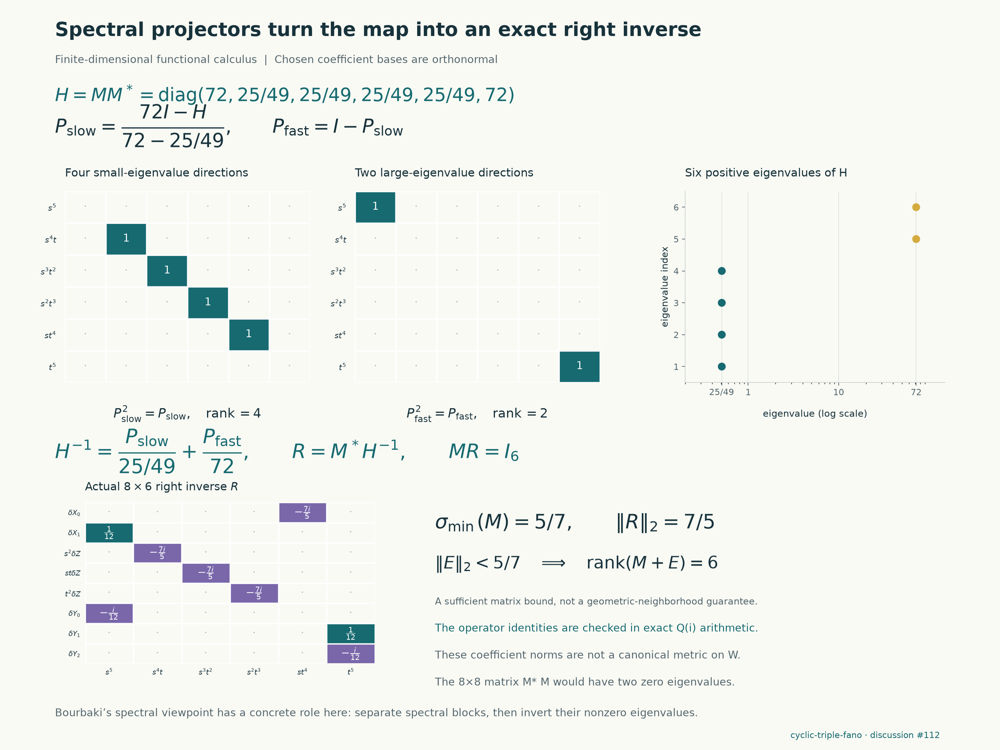
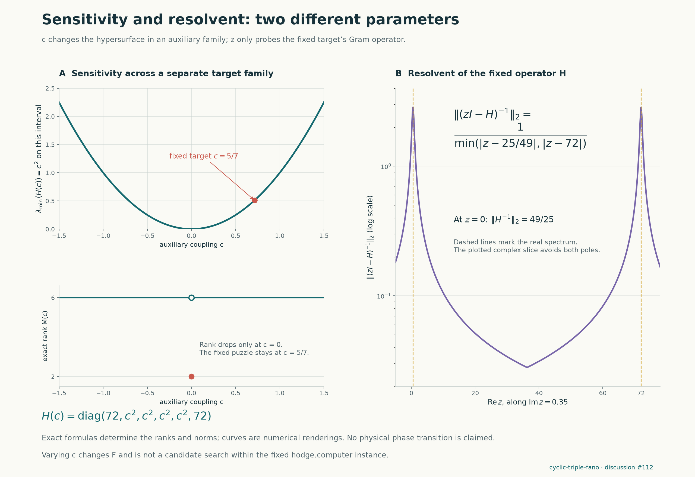

# A free curve on the new cyclic Fano target

We found an explicit free rational curve on the weighted quotient of
`cyclic-triple-fano`, one of the ten targets added by Benjamin E. Diamond on
17 October 2026. Exact deformation matrices also give a smooth
three-parameter family with dominant, generically finite marked evaluation.
This supplies a concrete input to the repository's support construction.
**The supporting divisor, rational-field certificate, and Lean proof have
not been constructed.** Geometric existence was already known in the
upstream context; the contribution here is the explicit curve and matrices.

**Target scope:** [cyclic-triple-fano](https://hodge.computer/#case/cyclic-triple-fano),
[discussion #112](https://github.com/hodge-computer/sextics/discussions/112).
No conclusion about the other nine newly added targets is claimed here.

This work follows the user's redirection to the ten new targets. The
preceding mixed-biweight degree-seven batch remains local and is not part
of this publication.

## Fixed target and quotient

The protected source is pinned to upstream commit
[`d96911d725077e66a8f10848908be01a643b1714`](https://github.com/hodge-computer/sextics/commit/d96911d725077e66a8f10848908be01a643b1714).
The exact `instance.rec` is frozen with its source hash; `why.md`,
`provenance.json`, and `checks.json` were read before beginning. The new
discussion was empty and no open solution PR was present at the initial
check. The original checkout and earlier proof sources remain unchanged.

Put $Z=X_2^3$ and use coordinates $(X_0,X_1,Z,Y_0,Y_1,Y_2)$ of weights
$(1,1,3,1,1,1)$. With $c=5/7$, the quotient polynomial is

$$
\begin{aligned}
G_c={}&X_0^6+X_1^6+Z^2+Y_0^6+Y_1^6+Y_2^6\\
&+c\bigl(X_0^3X_1Y_0Y_1+X_0^3Z+X_0^2Y_0Y_1Y_2^2
+X_0X_1Y_1^3Y_2+X_0ZY_1Y_2+X_1ZY_0Y_1\bigr).
\end{aligned}
$$

The checker reconstructs $G_{5/7}$ directly from $F$ and verifies
$F=G_{5/7}(X_0,X_1,X_2^3,Y_0,Y_1,Y_2)$. The fixed target has $q=1$ and
$A=X_0X_2^2Y_0^3$. Its density factor is exactly

$$
A=\det(d\Phi)\,\Phi^*(b),\qquad
\Phi=(X_0,X_1,X_2^3,Y_0,Y_1,Y_2),\qquad
b=X_0Y_0^3/3.
$$

This is the specific quotient-density hypothesis in upstream
[Chapter 3, §3.4](https://github.com/hodge-computer/sextics/blob/d96911d725077e66a8f10848908be01a643b1714/docs/03-geometric-support.md#34-nonlinear-polynomial-piola-maps-are-finite-fano-maps).

## The curve and its deformation map

Over $\mathbb Q(i)$, take

$$
\phi([s:t])=[0:s:0:is:t:it].
$$

The substitution $G_c(\phi)=0$ holds identically, even before specializing
$c$. The coordinates $X_1=s$ and $Y_1=t$ have no common projective zero,
so this is a morphism and avoids the weighted ambient vertex. Along it,
the partials with respect to $X_1$ and $Y_1$ are $6s^5$ and $6t^5$;
the hypersurface is smooth at every point of the curve.

Twisting the weighted Euler sequence by $\mathcal O(-1)$ and using the
hypersurface normal sequence gives the deformation test

$$
M_c:H^0\bigl(\mathcal O^5\oplus\mathcal O(2)\bigr)
\longrightarrow H^0\bigl(\mathcal O(5)\bigr).
$$

Both sides have explicit monomial bases, of dimensions eight and six.
Using source order $(\delta X_0,\delta X_1,\delta Z_{s^2},
\delta Z_{st},\delta Z_{t^2},\delta Y_0,\delta Y_1,\delta Y_2)$
and target order $(s^5,s^4t,s^3t^2,s^2t^3,st^4,t^5)$,

$$
M_c=
\begin{pmatrix}
0&6&0&0&0&6i&0&0\\
0&0&ic&0&0&0&0&0\\
0&0&0&ic&0&0&0&0\\
0&0&0&0&ic&0&0&0\\
ic&0&0&0&0&0&0&0\\
0&0&0&0&0&0&6&6i
\end{pmatrix}.
$$

At $c=5/7$ a six-column minor has absolute value $22500/2401$.
Thus the map is surjective. The Euler kernel is $\mathcal O(-1)$,
whose $H^0$ and $H^1$ vanish; the displayed source also has zero $H^1$.
The normal sequence therefore gives
$H^1(\mathbb P^1,\phi^*T_W(-1))=0$. By splitting vector bundles on
$\mathbb P^1$, all summand degrees of $\phi^*T_W$ are nonnegative:
this curve is free. This is a finite geometric calculation, not a
denominator-degree search.

Freeness and covering are asserted on the quotient $W$. The seed is in
$Z=0$, the branch divisor of the cyclic cover, and its displayed deformation
leaves that divisor. No rational or free lift to the original sextic is
claimed. This branch locus is distinct from ramification of the family
evaluation map checked below.

## A concrete use of Bourbaki's spectral and functional calculus

Declare the displayed coefficient bases orthonormal. For real $c$,

$$
H_c=M_cM_c^*=\operatorname{diag}(72,c^2,c^2,c^2,c^2,72).
$$

At the protected target, the spectrum is $\lambda=25/49$ with multiplicity
four and $\mu=72$ with multiplicity two. Zero is absent. The excerpts
supplied by the user give precisely the relevant language: Bourbaki,
*Théories spectrales*, Chapter I, §1 no. 2 (spectrum and invertibility),
§4 no. 9 (functional calculus in one variable), and §4 no. 12
(spectral partitions and idempotents), 2019 edition,
[DOI](https://doi.org/10.1007/978-3-030-14064-9).
The additional supplied excerpts cover the resolvent in §2 no. 5 and
positive elements in §6 no. 9. The latter gives the most direct formulation
of this calculation: $H\ge (25/49)I$.

Here that calculus reduces to exact polynomial formulas:

$$
P_\lambda=\frac{\mu I-H}{\mu-\lambda},\qquad
P_\mu=\frac{H-\lambda I}{\mu-\lambda},\qquad
H^{-1}=\frac{P_\lambda}{\lambda}+\frac{P_\mu}{\mu}.
$$

The code checks the two self-adjoint idempotents, their orthogonality,
their sum $I$, and their ranks four and two. It then constructs the exact
right inverse $R=M^*H^{-1}$ and checks $MR=I_6$. Thus the spectral
calculation actually certifies the needed deformation surjectivity.
No contour quadrature or floating-point eigenvector is used in the proof.

The resolvent is explicit:

$$
(zI-H)^{-1}=\frac{P_\lambda}{z-\lambda}
+\frac{P_\mu}{z-\mu},\qquad
\|(zI-H)^{-1}\|_2=\frac1{\min(|z-\lambda|,|z-\mu|)}.
$$

Also $R^*R=H^{-1}$, so $\|R\|_2=7/5$. For a perturbation $E$ of the
coefficient matrix with $\|E\|_2<5/7$, the Neumann-series criterion makes
$(M+E)R=I+ER$ invertible. Thus $R(I+ER)^{-1}$ is a right inverse for
$M+E$. This is a precise stability statement in the chosen matrix norm;
it does not assert that an arbitrary matrix perturbation comes from an
actual curve or that the curve stays on a perturbed hypersurface.

These are coefficient-space inner products, not a computed Hodge metric.
Their numerical eigenvalues depend on the chosen bases; surjectivity does
not. In the auxiliary family $c=0$ makes this particular curve's map drop
to rank two, whereas every nonzero real $c$ gives rank six. Changing $c$
changes the sextic, so this sensitivity plot is separate from the fixed
target. It does not imply a statistical phase transition, nor that the
$c=0$ hypersurface lacks other free curves.

## An explicit local covering family

Fix $X_1=s$ and $Y_1=t$. Consider

$$
\begin{aligned}
X_0&=as+bt,&Y_0&=ys+ct,&Y_2&=ds+et,\\
Z&=fs^3+gs^2t+hst^2+jt^3.
\end{aligned}
$$

In this paragraph $c$ is a family parameter; the sextic's coupling stays
fixed at $5/7$. At the original curve, $y=e=i$ and all other coefficients
are zero. The seven coefficients of the binary sextic obtained by
substitution are seven polynomial equations. Their Jacobian with respect
to $(y,d,e,f,g,h,j)$ is invertible, with determinant
$-135000i/2401$ in the recorded order. Hence $(a,b,c)$ are local étale
coordinates on a smooth three-dimensional component of this explicitly
given incidence scheme. This does not assert a rational parametrization
of the seven solved coefficients.

The checked tangent directions are

$$
\begin{array}{c|l}
a&\delta X_0=s,\quad \delta Z=-t^3\\
b&\delta X_0=t,\quad \delta Y_2=-5s/42\\
c&\delta Y_0=t,\quad \delta Z=-42s^3/5.
\end{array}
$$

At $s=t=1$ in the chart $X_1=1$, include the source parameter $r=t/s$.
The evaluation derivative, in coordinates $(X_0,Z,Y_0,Y_1,Y_2)$, is

$$
\begin{pmatrix}
1&1&0&0\\
-1&0&-42/5&0\\
0&0&1&0\\
0&0&0&1\\
0&-5/42&0&i
\end{pmatrix}.
$$

Its first four rows have determinant one. All columns lie in the
hypersurface tangent space. After taking a smooth affine open of the
component through the chosen point, marked evaluation from
$\mathbb P^1\times S$ is dominant and generically finite. The basepoint
condition holds throughout because $X_1=s,Y_1=t$ remain fixed.
The Jacobian criterion justifies the local component; see the
[Stacks Project discussion of smooth and étale coordinates](https://stacks.math.columbia.edu/tag/039P).

The initial curve lies in $X_0=0$, where the density $b$ vanishes. We
explicitly check that its $a$ deformation moves the density to first order:
$\delta b=-is^4/3\ne0$. This is a density calculation, not a computed
Gysin image or a certificate.

## Visualizations, checks, and unfinished steps






The diagrams encode actual matrices and identities; the curve is complex,
so the schematic is not a real three-dimensional surface rendering.
The [plot generator](../experiments/plot_cyclic_fano_curve.py) and saved
plot data bind the figures to the checked packet.

The reproducible packet retains exact polynomials over $\mathbb Q(i)$,
the source target and hashes, the matrices, bounded-run logs, independent
reconstruction, and altered-witness checks. The rank-two $c=0$ test is a
failed freeness test for this curve; it is not failure on the protected
target. The support-elimination and numerator-extraction stages have not
been attempted in this batch and are not recorded as failed searches.

The next required calculation is to compute the boundary, exceptional,
and branch images of a compactified family graph, as specified in
[upstream §3.2](https://github.com/hodge-computer/sextics/blob/d96911d725077e66a8f10848908be01a643b1714/docs/03-geometric-support.md#32-a-family-of-rational-curves-computes-a-support).
Only then can its support be pulled back and the exact numerator system
solved. No solution PR or leaderboard point is claimed.

## Reproduce

From Hodge Lab, with Python 3.11, SymPy, and Matplotlib:

```sh
python experiments/cyclic_fano_curve.py verify
python experiments/check_cyclic_fano_curve.py work/cyclic-fano-independent.json
python experiments/plot_cyclic_fano_curve.py
```

The discovery computation is `python experiments/cyclic_fano_curve.py run`,
with a 120-second subprocess limit. The saved source record makes this
batch reproducible without changing the older pinned sextics submodule.
The primary verifier reconstructs the quotient, line, coefficient equations,
and matrices from that record. The separate checker reconstructs them using
its own code and checks good reduction at five, rather than importing the
producer's polynomial or matrix construction. Both reject altered data.
Canonical hashes normalize CRLF to LF.

Final local checks pass: the primary verifier rejects ten altered witnesses,
the separate reconstruction rejects six, and figure generation validates its
input hashes and exact identities. The discussion draft was checked with
GitHub's Markdown API and the pinned website renderer, including a
360-pixel-wide content layout. All 37 math expressions, including four
display equations, render. A literal `M:` caused the website sanitizer to
drop one formula; the equivalent `M\colon` avoids that issue. Images are
embedded on GitHub and linked by the website renderer.

- [Exact packet](../results/cyclic-fano-curve/cyclic-free-curve.json)
- [Primary checks](../results/cyclic-fano-curve/validation.json)
- [Independent checks](../results/cyclic-fano-curve/independent-validation.json)
- [Bounded attempt](../results/cyclic-fano-curve/attempt.json)
- [Fixed target and source bindings](../results/cyclic-fano-curve/target.json)

## Attribution

This uses the sextics authors' weighted-Fano and certificate framework,
including the geometric bridge attributed to Benjamin E. Diamond and
Griffiths's residue theory. The curve-deformation argument is classical;
the spectral organization uses the cited Bourbaki sections. Prepared for
`rbajaj5` with OpenAI Codex assistance, including separate construction,
reconstruction, and visualization agents. Separate implementations are
not independent human review or Lean acceptance.
