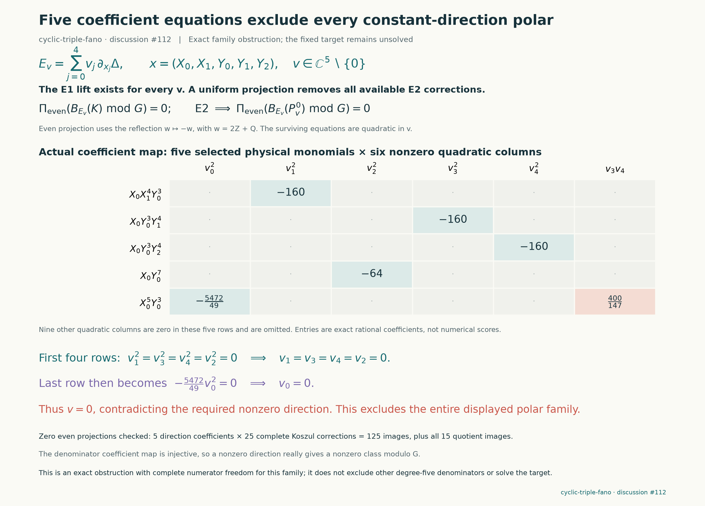

# Excluding every constant first polar of the branch sextic

For the unchanged `cyclic-triple-fano` target, the complete family

$$
E_v=\sum_{i=0}^4v_i\partial_{x_i}\Delta,
\qquad x=(X_0,X_1,Y_0,Y_1,Y_2),\qquad
v\in\mathbb C^5\setminus\{0\},
$$

is excluded as degree-five denominators. The corresponding original denominator is obtained by substituting $Z=X_2^3$; these particular $E_v$ are independent of $Z$. This extends the preceding [seven fixed polar tests](cyclic-fano-branch-polars.md) to every constant linear combination, with all permitted numerator corrections and quotients retained.

The proof uses five exact coefficient consequences and explicit polynomial identities. It excludes this particular four-dimensional projective family; it does not exclude arbitrary degree-five denominators, polynomial-direction polars, products or higher powers. It supplies no solution, Lean proof or accepted solve.



## The fixed source and explicit first-equation solution

The source is frozen at `d96911d725077e66a8f10848908be01a643b1714`; $F$, $q=1$ and $A$ are unchanged. Write

$$
G=Z^2+Q(x)Z+H(x),\qquad \Delta=Q^2-4H,\qquad
J=2Z+Q,\qquad \beta=X_0Y_0^3/3.
$$

For any constant $v$, define

$$
P^0_{x_i}=-4\beta v_i,\qquad P^0_Z=2\beta\partial_vQ.
$$

The identity $\partial_v\Delta=2J\partial_vQ-4\partial_vG$ gives $P^0(G)=\beta E_v$. The producer reconstructs all five basis lifts from the exact source and also replays their original upstairs identities $N(F)=AD$ using the cyclic Piola transfer. Linearity proves this identity for every parameter vector.

Every nonzero vector gives an admissible denominator. The coefficients of $X_0^5,X_1^5,Y_0^5,Y_1^5,Y_2^5$ in the five basis polars form the diagonal matrix

$$
\mathrm{diag}\left(-\frac{1026}{49},-24,-24,-24,-24\right),
$$

whose determinant is $-340402176/49\ne0$. Thus $v\mapsto E_v$ is injective. Each $E_v$ is a base polynomial, so its monic remainder modulo $G$ is itself; nonzero $v$ cannot produce a denominator identically zero on the hypersurface.

## Why the residual cannot be corrected

The explicit residual is

$$
R_v=B_{E_v}(P^0)
=4\left(\beta\partial_v^2\Delta-(\partial_v\beta)(\partial_v\Delta)\right).
$$

It is independent of $Z$ and quadratic in the five parameters. A general normalized first-equation solution differs from $P^0$ by a syzygy of the six partials of $G$. As in the earlier polar audit, the regular gradient sequence makes the Koszul fields complete. At degree five there are exactly 25 permitted Koszul correction directions. The second-equation quotient has weight two and all 15 quotient directions are allowed. The preceding cyclic character projection preserves any possible fixed-target certificate, so working in these weighted coordinates loses no possible correction.

Set $t=2Z+Q$, so $t^2=\Delta$ modulo $G$, and average under $t\mapsto-t$. For a polynomial $p=f_0+Zf_1+Z^2f_2$, with the $f_i$ independent of $Z$, this even projection is

$$
\mathcal P(p)=f_0-\frac Q2f_1+\left(\frac{Q^2}{2}-H\right)f_2.
$$

This is the order-two Reynolds average $(p(t)+p(-t))/2$ in the quotient $t^2=\Delta$. The supplied Shafarevich *Algebraic Appendix* §4, proof of Proposition A.6 (pp.287–288), uses exactly this finite-group averaging operation; characteristic zero permits division by the group order. The exclusion additionally needs the particular residual and the complete annihilation checks that follow.

It fixes every $R_v$. It annihilates all 15 multiples of $G$ and every permitted Koszul correction. The packet checks the latter directly for each of the five basis polars and all 25 correction fields: **125 exact polynomial identities**. Since the correction image is linear in $E_v$, those five basis checks prove annihilation for every constant parameter vector, including choices with exceptional symmetry or rank. They are not a numerical sampling argument.

Applying this projection to the full second equation forces $R_v=0$. The saved packet includes all 15 quadratic parameter coefficients of $R_v$, so the following five rows can also be independently reconstructed from the full residual.

## Five rows force the zero direction

Use $v_0,v_1,v_2,v_3,v_4$ in the order $X_0,X_1,Y_0,Y_1,Y_2$. Necessary coefficient equations are

| Spatial monomial in $R_v$ | Coefficient that must vanish |
|---|---|
| $X_0Y_0^3X_1^4$ | $p_1=-160v_1^2$ |
| $X_0Y_0^3Y_1^4$ | $p_3=-160v_3^2$ |
| $X_0Y_0^3Y_2^4$ | $p_4=-160v_4^2$ |
| $X_0^5Y_0^3$ | $p_0=-\frac{5472}{49}v_0^2+\frac{400}{147}v_3v_4$ |
| $X_0Y_0^7$ | $p_2=-64v_2^2$ |

The first, second, third and fifth rows force $v_1=v_3=v_4=v_2=0$ over $\mathbb C$. The fourth then forces $v_0=0$, contradicting the required nonzero direction. This does not require choosing a projective chart or assuming any parameter is generic.

For an additional portable algebraic check, put $a=5472/49$ and $b=400/147$. The packet supplies and verifies

$$
a^2v_0^4=p_0\left(p_0-2bv_3v_4\right)
+\frac{b^2}{25600}p_3p_4,
$$

together with the four immediate identities expressing $v_1^2,v_2^2,v_3^2,v_4^2$ as scalar multiples of their rows. Therefore the common zero set of the necessary equations consists only of the inadmissible zero vector. These rational identities remain valid over $\mathbb C$.

## Reproduction and limits

```sh
python -S experiments/cyclic_fano_polar_family.py run
python -S experiments/cyclic_fano_polar_family.py verify
python -S experiments/check_cyclic_fano_polar_family.py
python experiments/plot_cyclic_fano_polar_family.py
```

The primary standard-library computation passed five source-based E1 lifts, all 15 parameter-quadratic residual coefficients, 125 Koszul projection identities, 15 quotient projection identities, five coefficient rows, the invertible admissibility minor, and five coordinate-power identities. It rejected seven altered-packet controls. Generation took approximately 0.10 seconds and the replay including controls approximately 0.63 seconds; there was no iterative search or timeout. Exact data and source/dependency bindings are in `results/cyclic-fano-polar-family/packet.json`, with a separate validation receipt.

Independent source reconstruction passed the complete parameter calculation, all 125 Koszul and 15 quotient images, all five coordinate-power identities and injectivity. It additionally checked 180 Euler-normalization identities and rejected eight mutation controls. The independent receipt confirms the all-constant-parameter scope and the completeness of the degree-five correction space.

This universal family result is separate from the [normal-plane blowup audit](cyclic-fano-blowup-audit.md), which explains the pole geometry of one previously failed member. The blowup picture is not used as a substitute for the coefficient proof. Existing packets remain unchanged, and no upstream discussion post is part of this batch.

Credit: Dolgachev's supplied §1.1.2 first-polar construction; the fixed-target certificate framework; the cyclic Piola reduction and finite-group character projection; and the regular-sequence/Koszul description of all syzygies. The wider Shafarevich reading motivates careful handling of rational restrictions and divisor multiplicities, but the exclusion itself is the exact polynomial calculation above. OpenAI Codex assisted construction and independent review.
