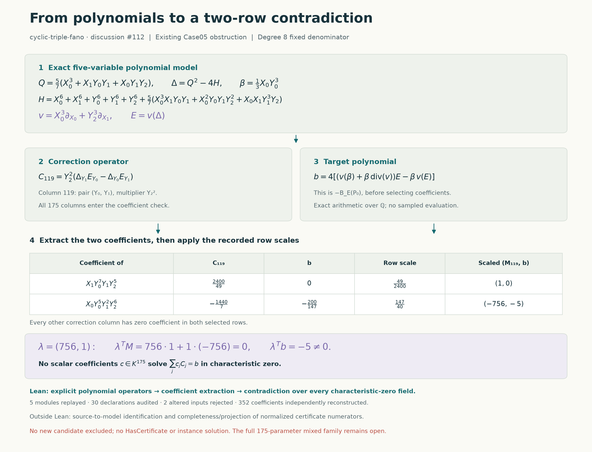

# From polynomial operators to the two-row contradiction

This continuation formalizes the next boundary in the
[concrete Lean experiment](cyclic-fano-concrete-lean.md): where the matrix
entries come from. The target is the same fixed mixed candidate, Case05,
with raw direction parameters `0 + 69`. No new denominator is excluded.

[](../results/cyclic-fano-polynomial-bridge-figures/polynomial-bridge.svg)

The diagram follows the actual fixed operators. Its renderer checks the
source bindings, physical coefficients, CI logs and declaration reports
before drawing the formalization boundary.

## The concrete polynomial equation

Use the five base variables `X0, X1, Y0, Y1, Y2`. In the cyclic quotient,
the sixth variable is `Z = X2³`, and the defining equation is

$$
G=Z^2+QZ+H,\qquad \Delta=Q^2-4H,\qquad
\beta=\frac{X_0Y_0^3}{3}.
$$

Here `Q` and `H` come from the frozen instance record. The fixed degree-eight
denominator is

$$
E=X_0^3\partial_{X_0}\Delta+Y_2^3\partial_{X_1}\Delta.
$$

The correction system has 175 operators. For each pair of distinct base
coordinates `i < j` and each quadratic monomial `f`, the first 150 are

$$
T_{ij,f}(E)=
(\Delta_i\partial_j f-\Delta_j\partial_i f)E
+f\Delta_j\partial_i E-f\Delta_i\partial_j E.
$$

The other 25, indexed by base coordinates `i,k`, are

$$
U_{i,k}(E)=(x_k\Delta_i+2\Delta\partial_i x_k)E
-2x_k\Delta\partial_i E.
$$

Writing `v₀ = X0³`, `v₁ = Y2³`, and the other three components as zero,
the target polynomial is

$$
b=4\left(E\sum_i\partial_i(\beta v_i)
-\beta\sum_i v_i\partial_i E\right).
$$

The equation tested is a polynomial identity: a linear combination of all
175 correction polynomials equals `b`. Coefficient extraction then gives
necessary linear equations in their unknown scalar weights.
These 175 unknowns are correction weights for this fixed denominator;
they are not the parameters of the still-open mixed denominator family.

## Why two rows suffice

The two selected base monomials are `X1 Y0⁷ Y1 Y2⁵` and
`X0 Y0⁵ Y1² Y2⁶`. Column 119 is the pair `(Y0,Y1)` with multiplier `Y2²`.
All other 174 columns have coefficient zero at both monomials.

| Coefficient | Column 119 | Target | Row multiplier |
| --- | ---: | ---: | ---: |
| `X1 Y0⁷ Y1 Y2⁵` | `2400/49` | `0` | `49/2400` |
| `X0 Y0⁵ Y1² Y2⁶` | `−1440/7` | `−200/147` | `147/40` |

After scaling these are the existing equations `x₁₁₉ = 0` and
`−756x₁₁₉ = −5`. The existing Lean row certificate combines them to give
`0 = −5`. The new work computes the entries from polynomial arithmetic
instead of accepting them as literal matrix data.

## Verification status

**Fresh Linux CI: PASS.**
[Run 39089131101](https://github.com/rbajaj5/hodge-lab/actions/runs/39089131101)
at source commit `b96230e` built and replayed all five modules, audited all
30 listed declarations, and rejected both altered polynomial inputs. It
also compiled separate proofs that those altered coefficient equations
are false and checked their axiom reports. All nine dependency commits
match the pinned environment. The independent Python reconstruction
passed in the same run.

[Archived metadata and logs](../formal/results/polynomial-bridge-ci/39089131101/metadata.json)
· [Formal receipt](../formal/results/polynomial-bridge-ci/39089131101/validation.json)
· [Independent reconstruction receipt](../formal/results/polynomial-bridge-ci/39089131101/independent-validation.json).

The archive checks 20 source bindings against the tested Git commit and
all 26 command logs. Recorded build/replay artifact hashes agree for all
five modules. Compiled binaries were not downloaded, so this is a check
of the recorded hash agreement, not a separate byte audit of the binaries.
The [independent archive audit](../formal/results/polynomial-bridge-ci/39089131101/independent-archive-audit.json)
also compared all 28 archived artifact files byte for byte with the download
and reconstructed both mutation probes from the tested sources.
The prior literal-matrix proof and its successful CI remain unchanged.

The implementation uses finite sparse lists with an interpretation as
mathlib multivariate polynomials. Addition, multiplication, differentiation
and coefficient extraction are proved to respect that interpretation. Closed
coefficient calculations are checked by Lean without trusting a
Python claim that the answer is correct.

The intended theorem concerns this explicit projected polynomial equation.
The relationship to every allowed normalized numerator, the cyclic-cover
transport and completeness of the projected correction space remain
separate obligations. This is not a `HodgeComputer.HasCertificate` proof
or a solution of the full cyclic-Fano instance.

## A further exact check outside Lean

An independent standard-library Python implementation parses the frozen
instance directly, reconstructs the operators and checks all 352 selected
coefficients. It also pulls the two-row functional back through the even
projection. The resulting functional has seven monomials in the original
six weighted variables. It annihilates all 525 raw Koszul correction
columns and all 636 weighted-degree-eight quotient columns, while evaluating the
target to `−1000/147`.

Before pulling back, this functional is `21` times the first unscaled
coefficient plus `5` times the second. Multiplying it by `147/200` gives
the scaled row certificate above, whose target pairing is `−5`.

That is a concrete next route toward a stronger formal statement: check
the functional on raw polynomial columns, eliminating the need to trust
the projection calculation at that stage. It is currently exact Python
evidence, not a Lean theorem. Even that extension would still need the
normalization, transport and completeness argument to cover arbitrary
certificate numerators.

## Failed attempts retained

The first native Lean attempt stopped at a missing compiled dependency in
the local cache. Unpacking the three required cached objects repaired
that environment issue. The sparse-polynomial semantic proofs then
needed an explicit induction rewrite after simplification unfolded a
definition on only one side. The repaired module compiled.

The initial concrete coefficient proof used ordinary `decide`, whose
reduction stopped at irreducible rational arithmetic definitions. This
did not report a false coefficient equality. The next attempt uses the
kernel reduction option for `decide`; it does not use `native_decide`.
That option passed a single coefficient probe, but two full-module attempts
reached their 180-second limits without a completed result. The revised
implementation skips nonmatching sparse terms before performing rational
addition and omits zero terms when differentiating. The semantic proofs
for both changes compiled in Lean; these optimizations change neither
the input equation nor the selected rows. With both optimizations, the full
rational coefficient module compiled locally in 79.8 seconds. In fresh CI,
the module built in 63.8 seconds and its separate replay took 62.7 seconds.
Those timings concern the same module on different environments, not a
controlled cross-machine speed comparison.
The field extension initially needed an explicit rewrite of the coefficient
of a mapped polynomial; the corrected module compiled in 3.8 seconds.
A wrong-scale equality produced an inconclusive tactic-reduction diagnostic,
so a separate proof of its negation was compiled successfully. The final
audit tests both the wrong-scale and wrong-density inputs this way: it
proves the altered equality false, then requires the altered full module
to fail. A failed tactic alone would not justify a mathematical claim.

All bounded attempt logs and source snapshots are retained in the
[development record](../formal/results/polynomial-bridge-development/),
separately from any final passing receipt.

## Reproduce

From the repository root, with the pinned Lean environment available:

```sh
python3 -S experiments/check_cyclic_fano_polynomial_bridge.py
cd formal
python3 -S check_polynomial_bridge.py --fetch-cache
```

The first command uses Python's standard library and imports no polynomial
producer. It reconstructs the source, audits the limited generated Lean
syntax, and checks 19 altered-input controls. The second builds the five
named Lean modules, audits 30 declarations, runs separate official kernel
replays, and tests the two altered polynomial inputs. The replays trust
their imported environment; they are not a fresh replay of mathlib or an
independent kernel implementation.

## Attribution

This continues the repository authors' certificate framework and the
notebook's independently reconstructed cyclic quotient and Koszul operators.
Coefficient extraction and finite linear separation are standard algebra.
Mathlib provides the polynomial and finite-sum theory; Codex assists with
formalization, checking, documentation and visualization. The earlier GPU
screen selected candidate obstructions; the proof checks here use exact
arithmetic and Lean's kernel.
