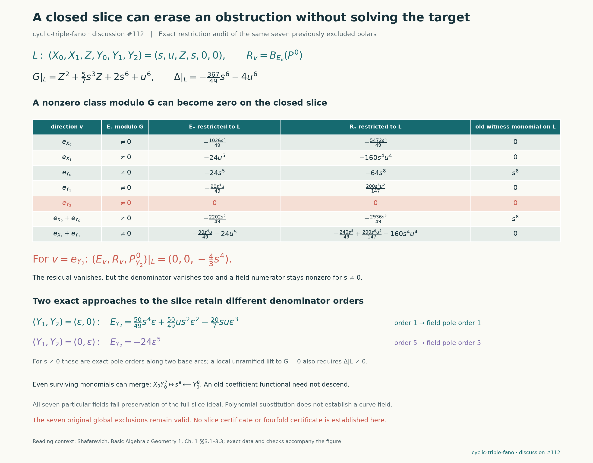

# What the curve slice forgets

This audit applies Shafarevich's distinction between rational functions on dense open sets and restrictions to closed subvarieties to the seven [previously excluded first polars](cyclic-fano-branch-polars.md). It finds a concrete trap: the $Y_2$ polar and its residual both vanish on the chosen curve slice, while a numerator component remains nonzero. That is an undefined restriction, not a new successful certificate. All seven global exclusions remain unchanged.



The source remains the fixed `cyclic-triple-fano` record at `d96911d725077e66a8f10848908be01a643b1714`, with $q=1$. No candidate search was performed and no prior code, target or result packet was changed. The new script reconstructs $G$, $\Delta$, each polar and its explicit numerator field from the source before comparing them with the saved polar packets.

## Exact restriction

Use the substitution

$$
(X_0,X_1,Z,Y_0,Y_1,Y_2)=(s,u,Z,s,0,0).
$$

It gives

$$
G_\ell=Z^2+\frac57s^3Z+2s^6+u^6,\qquad
\Delta_\ell=-\frac{367}{49}s^6-4u^6,\qquad
\beta_\ell=\frac13s^4.
$$

The table restricts the **ambient** polynomial identities for $E_v=\partial_v\Delta$ and $R_v=B_{E_v}(P_v)$. Differentiation is performed before substitution. It is not an intrinsic differential calculation on the curve.

| Direction | $E_v\vert_\ell$ | $R_v\vert_\ell$ | Saved obstructing monomial vanishes on slice? |
|---|---|---|---|
| $e_{X_0}$ | $-\frac{1026}{49}s^5$ | $-\frac{5472}{49}s^8$ | Yes |
| $e_{X_1}$ | $-24u^5$ | $-160s^4u^4$ | Yes |
| $e_{Y_0}$ | $-24s^5$ | $-64s^8$ | No |
| $e_{Y_1}$ | $-\frac{90}{49}s^4u$ | $\frac{200}{147}s^6u^2$ | Yes |
| $e_{Y_2}$ | $0$ | $0$ | Yes |
| $e_{X_0}+e_{Y_0}$ | $-\frac{2202}{49}s^5$ | $-\frac{2936}{49}s^8$ | No |
| $e_{X_1}+e_{Y_1}$ | $-24u^5-\frac{90}{49}s^4u$ | $-160s^4u^4+\frac{200}{147}s^6u^2-\frac{240}{49}s^8$ | Yes |

Five of the seven particular monomials used in the global obstruction proofs vanish after substitution. Losing those monomials does not undo their global coefficient identities. Six residuals remain nonzero on this slice; the seventh disappears along with its denominator.

For the $Y_2$ choice the exact data are

$$
E_{Y_2}\vert_\ell=0,\qquad
B_{E_{Y_2}}(P_{Y_2})\vert_\ell=0,\qquad
(P_{Y_2})_{Y_2}\vert_\ell=-\frac43s^4\ne0.
$$

Thus the rational field component $(P_{Y_2})_{Y_2}/E_{Y_2}$ has a generically nonzero numerator and a denominator vanishing identically on the slice. Vanishing of the residual does not provide cancellation or a regular restriction. The notation “zero over zero” applies to the collapsed residual/denominator test, not to every numerator component.

The further Shafarevich excerpt on blowups (Chapter 2 §4.1, pp.113–115) motivates retaining the direction of approach. Two exact base arcs with $X_0=Y_0=s$, $X_1=u$ give

$$
\begin{aligned}
E_{Y_2}(Y_1=\epsilon,Y_2=0)
&=\frac{50}{49}s^4\epsilon+\frac{50}{49}s^2u\epsilon^2-\frac{20}{7}su\epsilon^3,\\
E_{Y_2}(Y_1=0,Y_2=\epsilon)&=-24\epsilon^5.
\end{aligned}
$$

The numerator component remains $-4s^4/3$ on both arcs. For $s\ne0$ the same rational component therefore has pole orders one and five, respectively. These formulas are exact polynomials, not truncated numerical jets. At a chosen root $Z_0$ with $G_Z\ne0$—equivalently $\Delta_\ell(s,u)\ne0$—each base arc has a local formal lift to $G=0$. We have not constructed a global parameterization or performed a blowup; the directional pole orders do not prove that a blowup removes the pole, nor do they indicate a phase transition.

## A closed slice is not a dense open set

Work on the affine cone with coordinate ring $R=\mathbb Q(i)[X_0,X_1,Z,Y_0,Y_1,Y_2]/(G)$. Restriction to this slice is a quotient map with a nonzero kernel. The simplest saved control is

$$
Y_1\ne0\text{ in }R,\qquad Y_1\vert_\ell=0.
$$

Monic division in $Z$ proves the first assertion: $Y_1$ is its own nonzero remainder modulo $G$. Each of the seven global denominators is likewise a nonzero base polynomial and its own remainder. This remains true for the $Y_2$ polar even though its restriction is zero.

Shafarevich, *Basic Algebraic Geometry 1*, third edition, Chapter 1 §§3.1–3.3 (supplied excerpts, especially pp.36–38), explains why equality on a nonempty open subset of an irreducible variety determines a rational function, and why dominant rational maps induce inclusions of function fields. Our finite cyclic quotient maps are dominant; the curve's inclusion in the fourfold is not. The inclusion therefore does not induce restriction of every element of the fourfold's function field. A denominator that is nonzero globally may vanish identically on the curve. Even when a particular quotient can be rewritten to cancel such a denominator, that cancellation must be checked; the nonzero-numerator control above rules it out for the displayed field component.

## Ambient fields need not descend

The local tangent-space discussion in the second Shafarevich excerpt (Chapter 2 §1, pp.87–89) supplies a separate warning: an ambient derivation descends through an ideal only if it preserves that ideal. The audit records the three linear slice defects

$$
P(Y_0-X_0)\vert_\ell,\qquad P(Y_1)\vert_\ell,\qquad P(Y_2)\vert_\ell.
$$

Only the $e_{X_1}$ and $e_{X_0}+e_{Y_0}$ particular fields preserve all three linear slice equations. This is still insufficient for descent to the curve: the full ideal also contains $G$, while our numerator construction intentionally satisfies $P(G)=\beta E$, not $P(G)=0$. For those two choices $\beta_\ell E_\ell$ is nonzero. The $Y_2$ choice instead visibly violates the linear equation $Y_2=0$. None of these observations establishes a curve vector field or a curve certificate.

## Checks and scope

```sh
python -S experiments/cyclic_fano_slice_audit.py run
python -S experiments/cyclic_fano_slice_audit.py verify
python -S experiments/check_cyclic_fano_slice_audit.py
python experiments/plot_cyclic_fano_slice_audit.py
```

The primary replay passed all seven source-based comparisons, the noninjectivity and no-cancellation controls, both exact transverse arcs, and three mutated-packet rejection checks. Independent reconstruction also passed: it checked all seven polars, failure of the full slice-ideal preservation condition, the nonzero numerator, both arc formulas and orders, and the formal-lift identity, while rejecting nine negative controls. `results/cyclic-fano-slice-audit/validation.json` records the actual polynomials, field restrictions, prior-packet hashes and source bindings. This is a restriction audit of existing failures; it adds no newly excluded candidate, successful denominator, general polar-family theorem or fourfold certificate.

Credit: [Shafarevich, *Basic Algebraic Geometry 1*, third edition](https://link.springer.com/book/10.1007/978-3-642-37956-7), the supplied passages on rational functions, rational maps and tangent spaces; the preceding Dolgachev-inspired polar construction; and the upstream fixed-target framework. OpenAI Codex assisted implementation and independent review. No upstream post is part of this audit.
