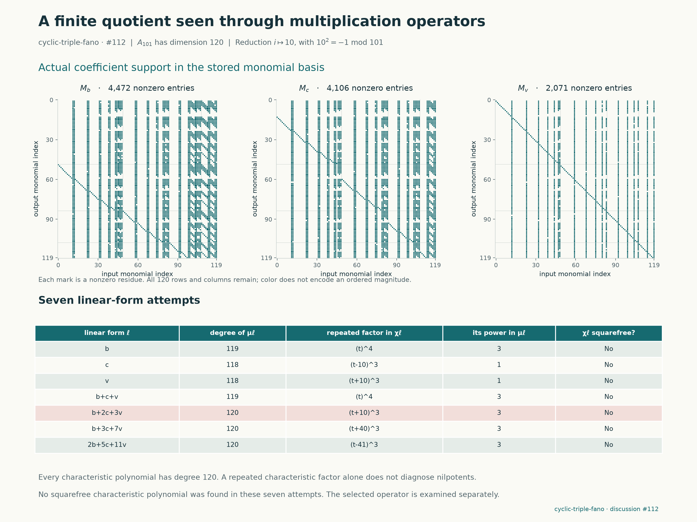
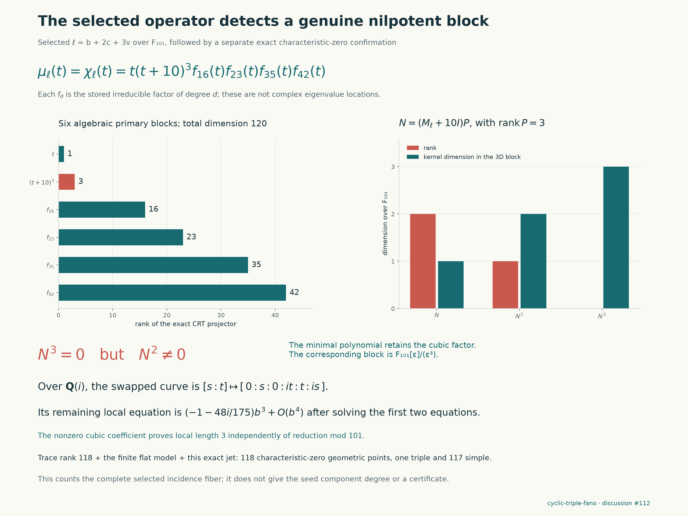

# Spectral tests of the cyclic Fano evaluation fiber

This experiment continues only **`cyclic-triple-fano`**, with the protected
target pinned to `d96911d725077e66a8f10848908be01a643b1714`. It uses the
[three-equation fiber of length 120](cyclic-fano-continuation.md), rather
than substituting a different hypersurface or treating a numerical score
as a certificate.

**Result:** this complete normalized fiber has **118 geometric points over
$\mathbb C$: 117 simple points and one point of length three**. Its total
scheme length remains 120. The triple point is the explicit swapped curve
$[0:s:0:it:t:is]$. This strengthens the previous multiplicity-only count;
it does not solve the target or compute the degree of the seed component.

## A failed squarefree search identifies a triple point

All seven tested linear forms failed the squarefree-characteristic-polynomial
test modulo 101. The tested weights on $(b,c,v)$ were
`(1,0,0)`, `(0,1,0)`, `(0,0,1)`, `(1,1,1)`, `(1,2,3)`, `(1,3,7)`,
and `(2,5,11)`. Their minimal-polynomial degrees were, respectively,
119, 118, 118, 119, 120, 120, and 120. These are recorded attempts, not
a claim about an unrestricted search over every linear form.

For $L=b+2c+3v$, the vectors $1,L,\ldots,L^{119}$ have determinant
96 modulo 101 in the monomial basis. Thus $L$ generates the entire
120-dimensional algebra. Its characteristic and minimal polynomials agree.
The irreducible-factor degrees and exponents are

| Factor degree | Exponent | Primary-block dimension |
| --- | --- | --- |
| 1 | 1 | 1 |
| 1 | 3 | 3 |
| 16 | 1 | 16 |
| 23 | 1 | 23 |
| 35 | 1 | 35 |
| 42 | 1 | 42 |

The repeated factor is $(T+10)^3$. Exact polynomial projectors split the
six blocks. On its three-dimensional block, $N=L+10$ has ranks 2, 1,
and 0 for $N,N^2,N^3$. This is a genuine length-three nilpotent block
in the modular algebra. It cannot be explained by three distinct points
with the same coordinate. Nevertheless, $L$ **does** separate the
geometric points, since it generates the algebra; squarefreeness and
separation are different tests on a nonreduced algebra.



## The multiplicity also exists in characteristic zero

The modular block suggests the exact point
$(b,c,v)=(0,i,-i)$. Direct substitution over $\mathbb Q(i)$ gives zero
in all three reduced equations. The full curve is
$[0:s:0:it:t:is]$. Its reduced fiber Jacobian is

$$
\begin{pmatrix}
0&6i&-24i\\
0&12i&-18i\\
0&6i&0
\end{pmatrix}.
$$

Its rank is two, with tangent direction $(1,0,0)$. The first two
equations have $(c,v)$ Jacobian determinant $-180$, so they uniquely
solve these variables as formal series in $b$. Through order three,

$$
\begin{aligned}
c(b)&=i+(-8/175+i/6)b^3+O(b^4),\\
v(b)&=-i+(8/175-i/6)b^3+O(b^4).
\end{aligned}
$$

The third equation becomes

$$
(-1-48i/175)b^3+O(b^4).
$$

The nonzero cubic coefficient shows that the completed local algebra is
$\mathbb Q(i)[[b]]/(b^3)$: the unit multiplying $b^3$ does not change
its ideal. This proves local length three directly in characteristic zero.
It does not lift a bad-reduction phenomenon by assumption.

The modular trace matrix in the basis $1,L,\ldots,L^{119}$ has rank 118.
Its explicit 118-by-118 minor has determinant **89 modulo 101**.
The finite-free lifting argument below therefore proves that the
characteristic-zero trace pairing has rank at least 118. In characteristic
zero, that rank is the number of geometric points of a finite algebra.
The exact triple point uses three of the total length 120, leaving room
for at most 117 other points. Both bounds agree: there are exactly 118
points, and every other point is simple. In particular,

$$
B\otimes_{\mathbb Q(i)}\mathbb C
\simeq \mathbb C^{117}\times\mathbb C[\epsilon]/(\epsilon^3).
$$

This is a description of this fixed fiber's algebra, not a decomposition
of the global incidence family into covering components. The modular
irreducible factors of degrees 16, 23, 35, and 42 are not asserted to be
characteristic-zero irreducible factors.



## What the supplied spectral theory suggests

The user's latest Bourbaki excerpt contains *Theories spectrales*, Chapter
III, section 6, number 1, pages 82–85: spectral projectors, generalized
eigenspaces, and the finite-dimensional example relating spectral
multiplicity to the characteristic polynomial. The continuation contains
Chapter IV, section 1, number 7, pages 164–167, on traces. These give a
concrete question for the current finite algebra: can multiplication
operators distinguish the points of the fiber and detect multiplicities?

Put

$$
B=\mathbb Q(i)[b,c,v]/(R_4,R_5,R_6).
$$

Its vector-space dimension is 120, by the preceding complete-intersection
calculation. Multiplication by a polynomial $f$ is an endomorphism
$M_f\colon B\to B$. The coordinate operators commute. Over an algebraic
closure, their simultaneous generalized eigenspaces correspond to the
fiber's points; the dimension of each local summand is its scheme length.

A single repeated eigenvalue is ambiguous: several distinct points might
have the same value of $f$. A nonzero nilpotent in the algebra, by contrast,
really does witness nonreduced structure. If one multiplication operator
has squarefree characteristic polynomial of degree 120, it separates all
120 geometric points and proves that the fiber is reduced.

The algebraic trace pairing is

$$
T(f,g)=\mathrm{tr}(M_fM_g)=\mathrm{tr}(M_{fg}).
$$

Over a perfect field, its nondegeneracy is equivalent to a finite
commutative algebra being reduced. This is an algebraic test inspired by
the trace discussion, not a new theorem from the supplied Hilbert-space
chapter. It is not the positive Hermitian Gram pairing
$\mathrm{tr}(M_f^*M_g)$. The multiplication matrices need not be normal.
In particular, no Hilbert-space spectral theorem or ordering of singular
values is being applied to a finite field.

The next supplied passage, Chapter IV, section 2, number 7, pages 191–194,
represents a commutative star algebra by multiplication on an $L^2$ space.
For our algebra over $\mathbb C$, a finite-point diagonal model describes
the **reduced quotient**. It cannot faithfully represent the full algebra
when nonzero nilpotents are present: a normal nilpotent matrix is zero.
This distinction explains why retaining generalized eigenspaces matters
in this experiment. Commutativity of the three coordinate matrices alone
does not give the star-algebra hypothesis of that theorem.

## What a modular computation can establish

The initial experiment uses the existing reduction modulo 101 with
$i\mapsto10$. Exact modular eigenvalue and polynomial computations are
different from approximate complex eigenvalues. Finite-field residues
must not be plotted as though they were locations in the complex plane.

A positive reducedness result can lift here, with an additional flatness
argument. Work over the discrete valuation ring obtained by localizing
$\mathbb Z[i]$ at $(101,i-10)$. All coefficient denominators and the
previous degree-13 Macaulay minor are units. Its leading-form identities
reduce monomials of degree at least 13 to lower degrees, so the quotient
is a finite module. Both generic and special fibers have dimension 120;
the structure theorem for finite modules over this ring then makes it
free of rank 120. The modular standard monomials lift to a basis.

Consequently a nonzero trace determinant, or a squarefree characteristic
polynomial, modulo 101 supplies a nonzero determinant over $\mathbb Q(i)$.
A failure modulo 101 does **not** prove characteristic-zero failure:
distinct points can collide in a special reduction. Any such failure
must remain labeled as modular unless a separate characteristic-zero
argument is supplied.

Here the argument is used in its lower-rank form: the size-118 minor,
rather than the full trace determinant, is nonzero. The local cubic
calculation supplies the complementary upper bound. Neither modular
factorization alone nor the Jacobian rank alone establishes the count 118.

## Reproduction and retained failures

The producer uses Python 3.11, SymPy and python-flint 0.9.0. Figure
generation also uses Matplotlib. The initial type-coercion error is
retained separately; it was an implementation failure, not a mathematical
obstruction. The completed discovery has a 180-second subprocess limit.
The seven unsuccessful squarefree tests remain in its output.

The [spectral packet](../results/cyclic-fano-spectrum/spectrum-101.json)
contains the actual multiplication matrices, characteristic and minimal
polynomials, projector polynomials, trace minor, and characteristic-zero
jet. The producer reconstructs the modular Groebner basis from the
source equations, checks all original equations on the matrices, and
checks their commuting action on the full monomial basis. A separate
checker verifies the algebra representation and spectral claims without
importing the producer.

```sh
python -m pip install "sympy>=1.13,<2" "python-flint>=0.9,<1" "matplotlib>=3.9,<4"
python experiments/cyclic_fano_fibers.py verify
python experiments/check_cyclic_fano_fibers.py work/cyclic-fiber-independent.json
python experiments/cyclic_fano_spectrum.py verify
python -S experiments/check_cyclic_fano_spectrum.py
python experiments/plot_cyclic_fano_spectrum.py
```

The standard-library spectral checker uses integer modular arithmetic and
`Fraction` pairs for $\mathbb Q(i)$. It identifies the quotient through
commuting multiplication matrices and the complete monomial orbit of one,
then checks the cyclic-power basis, characteristic-polynomial relation,
factor irreducibility, trace minor, and exact cubic jet. This avoids
reusing the producer's Groebner construction or FLINT spectral routines.
It also checks all seven characteristic and minimal polynomials, six CRT
projectors, and the actual Jordan chain. Its nine negative controls include
a changed characteristic polynomial, matrix action, projector, and local
cubic coefficient.

The figure panels show the actual support of multiplication matrices,
the seven trial results, and exact primary-block ranks. Their positions
and colors are not complex root coordinates or evidence of a phase
transition. The remaining supplied passages on polar decomposition and
unitary representations do not supply an additional result in this
batch. The exported CRT projectors are algebraic idempotents; no claim
that they are Hermitian orthogonal projections is made.

## Scope and attribution

The fiber calculation does not identify the generic covering degree of
the component containing the seed, compute
all boundary images, construct a supporting denominator, or prove the
protected Lean statement. The supporting construction remains the
repository authors' weighted-Fano framework, including the bridge
attributed there to Benjamin E. Diamond and Griffiths's residue theory.

The spectral interpretation is classical finite-dimensional algebra;
the supplied text is N. Bourbaki, *Theories spectrales*, Chapters 3–5
(2023), [publisher record](https://doi.org/10.1007/978-3-031-19505-1).
Only the supplied passages used above are cited; the full volume is not
reproduced in this repository. Prepared with OpenAI Codex assistance;
separate computational checks do not constitute independent human review.
