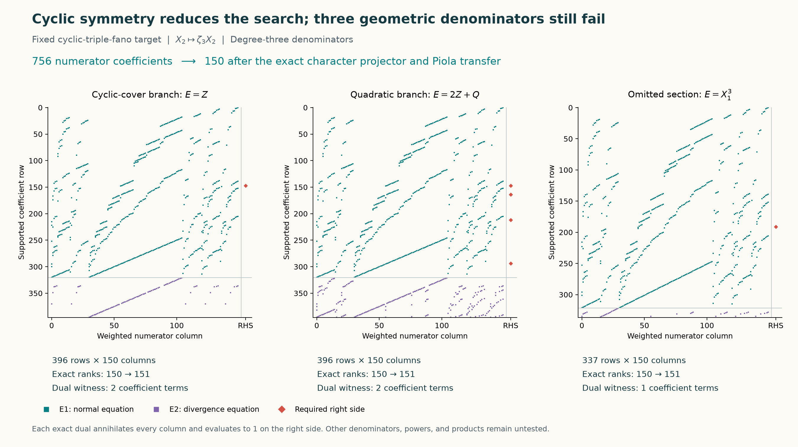

# Cyclic characters, Piola transfer, and three failed denominators

This continues only `cyclic-triple-fano`, keeping its exact target at
`d96911d725077e66a8f10848908be01a643b1714`. The final supplied Bourbaki passages
give a concrete tool: character averaging for the surviving cyclic group.
It reduces a degree-three fixed-denominator numerator test from 756
coefficients to 150 without losing a solution in that fixed-denominator
problem. Three natural geometric denominators all fail the complete test.

These are exclusions of the three displayed denominators. They do not exclude
arbitrary powers of their equations, their products, or other denominators,
and do not show that their zero sets cannot participate in a larger support.

## The exact character reduction

Let $x=X_2$, $Z=x^3$, and

$$
\Phi=(X_0,X_1,x^3,Y_0,Y_1,Y_2),\qquad \delta=3x^2.
$$

The frozen sextic satisfies $F=G\circ\Phi$, where
$G=Z^2+QZ+H$ and

$$
Q=\frac57(X_0^3+X_0Y_1Y_2+X_1Y_0Y_1).
$$

The weighted quotient has coordinate weights $(1,1,3,1,1,1)$ and density
$\beta=X_0Y_0^3/3$, so $A=\delta\Phi^*\beta$ exactly.

For a primitive cube root $\zeta$, the polynomial character projector is

$$
\Pi_r f=\frac13\sum_{j=0}^2\zeta^{-rj}
 f(X_0,X_1,\zeta^j x,Y_0,Y_1,Y_2).
$$

It retains precisely the monomials whose $x$ exponent is $r$ modulo three.
This is the finite-group specialization of the character projectors in
Bourbaki, *Theories spectrales*, Chapter V, section 4, pages 465–466;
page 466, Corollary 3, describes invariant averaging. Applying it to a
twist by a character gives the displayed formula. This is a specific use
of the supplied corpus, not a claim that its other chapters solve this target.

Fix an invariant homogeneous denominator $D=E\circ\Phi$ of degree $d$.
Since $A$ has character two, an existing solution can be projected onto
$N_i$ of character two for $i\ne2$ and $N_2$ of character zero. Thus

$$
N_i=3x^2(P_i\circ\Phi)\quad(i\ne2),\qquad
N_2=P_Z\circ\Phi.
$$

This is the polynomial Piola lift $\mathrm{adj}(d\Phi)\Phi^*P$.
No division by $x$ is needed at the cyclic branch. The weighted degrees
of $P_i$ are $d-1$ in the five weight-one coordinates, and $d+1$ for $P_Z$.
All monomials of these degrees are retained.

Polynomial differentiation gives

$$
N(F)=\delta\Phi^*(P(G)),\qquad
\mathrm{div}_xN=\delta\Phi^*(\mathrm{div}_yP),
$$
$$
D\mathrm{div}N-N(D)=
\delta\Phi^*(E\mathrm{div}P-P(E)).
$$

Consequently the full cleared certificate expression upstairs is $\delta$
times the pullback of

$$
\beta E^2-E P(G)+G(E\mathrm{div}P-P(E)).
$$

The computation verifies these identities on every numerator basis vector
for each of the three tested denominators, 450 vector tests in total.
The polynomial chain rule proves the formula for arbitrary $P$.

The fixed-denominator qualification matters. An arbitrary unknown denominator
need not be invariant. Multiplying by its cyclic conjugates can make a
presentation invariant, but increases its degree. We do not infer a bound
on unrestricted certificates from the reduced tests.

## Completeness of the normalized tests

Euler normalization turns a fixed-denominator solution into $P(G)=\beta E$.
Indeed, if $P(G)=\beta E+GR$, subtract $R/6$ times the weighted Euler field.
Here $\deg R=d-2$ and the weights sum to eight. This changes
$E\mathrm{div}P-P(E)$ by $-ER$, exactly cancelling the change in the
cleared expression. Thus normalization preserves that expression and
the denominator.

For $d=3$, the complete normalized system is

$$
P(G)=\beta E,\qquad E\mathrm{div}P-P(E)=0.
$$

The second expression has weight four; a nonzero multiple of the weight-six
$G$ is impossible. Its zero quotient follows from degree, rather than an
extra restriction on the challenge. The 150 numerator coefficients consist
of five sets of 15 weight-two monomials and 75 weight-four monomials.
The unprojected degree-four numerator space has $6\binom95=756$ coefficients.

The source sextic reduces modulo five to the Fermat sextic, which is smooth.
Smoothness lifts to characteristic zero, and a smooth projective sextic
hypersurface in this dimension is geometrically irreducible. Each displayed
nonzero degree-three $D$ is therefore relatively prime to $F$ over $\mathbb C$.
The test fails on the equations, not denominator admissibility.

## Three geometric guesses, all rejected exactly

The guesses deliberately test separate pieces of the geometry:

| Quotient denominator $E$ | Reason to test it | Matrix shape | Rank / augmented rank |
| --- | --- | --- | --- |
| $Z$ | Branch of the original cyclic cover | $396\times150$ | $150/151$ |
| $2Z+Q$ | Ramification equation of the quadratic projection in $Z$ | $396\times150$ | $150/151$ |
| $X_1^3$ | A power of the omitted-section equation | $337\times150$ | $150/151$ |

Let $T_1=P(G)$ and $T_2=E\mathrm{div}P-P(E)$. The right side is
$(\beta E,0)$. Brackets below extract a monomial coefficient. The following
functionals each annihilate every column of their own complete system and
give one on that right side:

$$
\begin{array}{c|l}
E & \lambda(T_1,T_2)\\
\hline
Z & 3[X_0ZY_0^3]T_1-\frac{42}{5}[X_0X_1Y_0^4Y_1]T_1\\
2Z+Q & \frac32[X_0ZY_0^3]T_1+\frac32[X_0Y_0^3]T_2\\
X_1^3 & 3[X_0X_1^3Y_0^3]T_1
\end{array}
$$

Each required identity would therefore imply $0=1$. In particular, the
quadratic-branch guess needs the divergence equation to expose this short
obstruction; satisfying only the normal equation would not suffice.



The image shows actual nonzero coefficient locations, not fitted geometry.
Its ranks are certified by exact elimination and dual pairings, not inferred
from the appearance of the dots.

## Reproduction, failures, and credit

```sh
python -S experiments/cyclic_fano_transfer.py run
python -S experiments/cyclic_fano_transfer.py verify
python -S experiments/check_cyclic_fano_transfer.py
python experiments/plot_cyclic_fano_transfer.py
```

The three-candidate worker has a 120-second timeout and completed in under
one second locally. The [attempt receipt](../results/cyclic-fano-transfer/attempt.json)
records its actual duration. The [packet](../results/cyclic-fano-transfer/packet.json)
contains the protected source hash, every column, right side, dual, and
exact rank. The producer's [validation](../results/cyclic-fano-transfer/validation.json)
reconstructs all data and rejects altered duals. Generic rational arithmetic
and sparse elimination are reused from the earlier quartic pilot; its target
is not reused. No floating-point tolerances or external algebra solver enter
these checks. The [separate standard-library reconstruction](../results/cyclic-fano-transfer/independent-validation.json)
also passes: all 450 transfer identities, all three physical matrices, exact
ranks, dual pairings, smooth reduction, and six deliberately altered inputs.
The figure binds both final validation receipts to the packet and script hashes.

All three denominator attempts failed; no solution, Lean proof, solve PR,
or leaderboard point follows. The new [local unfolding calculation](cyclic-fano-unfolding.md)
addresses a different branch locus, that of evaluation by rational curves.
Neither that germ nor the displayed cover branches have been shown to give
the whole support required by the geometric theorem.
The order-three deck symmetry used for averaging and the three-sheet local
evaluation monodromy are distinct constructions; their equal orders do not
identify the actions.

Credit: the upstream weighted-Fano density and polynomial Piola framework,
including its attribution to Benjamin E. Diamond and Griffiths's residue
theory; finite-group character averaging as presented in Bourbaki; and
Euler normalization in the project's certificate framework. Prepared with
OpenAI Codex assistance. Internal agent checks are not independent human review.
This notebook batch is being pushed at the user's request; a consolidated
upstream discussion update is intentionally deferred.
