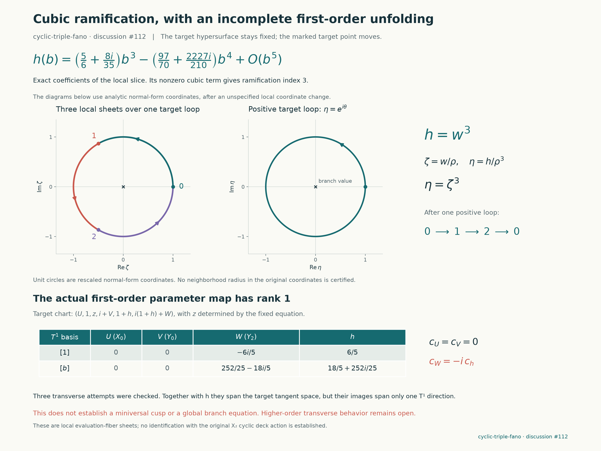

# Moving the cyclic Fano triple fiber

**Result:** moving the actual evaluation point along the original seed line produces a smooth local source curve with ramification index three. Testing the other target tangent directions gives a negative result: the full infinitesimal deformation map has rank one, so this evaluation family is not a miniversal unfolding of the cubic singularity. These statements use the fixed `cyclic-triple-fano` equation, not a replacement polynomial.

The experiment continues the [exact length-three point](cyclic-fano-spectrum.md), the swapped curve

$$
[0:s:0:it:t:is]
$$

through the target point $[0:1:0:i:1:i]$. The quotient coordinates are $(X_0,X_1,Z,Y_0,Y_1,Y_2)$, with $Z=X_2^3$. The original sextic, numerator and pole parameter remain unchanged.

## An actual moving target

The path

$$
p(h)=[0:1:0:i:1+h:i(1+h)]
$$

lies identically on the fixed weighted hypersurface $G=0$. For the three two-parameter tests we perturb, respectively, $X_0$, $Y_0$, or $Y_2$, while retaining this $h$-direction. In each case $Z=z$ is defined by the **actual quadratic equation** obtained by substituting the remaining coordinates into $G$. The branch $z(0,0)=0$ is uniquely determined locally because $G_Z=5i/7$ at the base point. The exact surface equations are exported in the three [axis packets](../results/cyclic-fano-unfolding/unfolding-X0.json).

Put $u=t/s-(1+h)$. On the seed-line slice the curve takes the form

$$
\begin{aligned}
X_0&=bu,&X_1&=1,&Z&=ku+lu^2+mu^3,\\
Y_0&=i+(i+C)u,&Y_1&=1+h+u,&Y_2&=i(1+h)+Eu.
\end{aligned}
$$

We substitute this into the original $G$, and solve the five coefficients of $u,u^2,\ldots,u^5$ for $(k,l,m,C,E)$. Their constant Jacobian determinant is $22500i/343$, so the formal and analytic implicit-function theorems apply. The sixth coefficient is a scalar germ $g(b,h)$. All eliminated-variable jets and all six substituted equations are checked through total degree four; higher terms are not silently discarded in an asserted exact polynomial identity.

At the central fiber,

$$
g(b,0)=\left(-1-\frac{48i}{175}\right)b^3
 +\left(\frac{846}{875}+\frac{613i}{175}\right)b^4+O(b^5),
\qquad g_h(0,0)=\frac65.
$$

Consequently the exact local incidence is a smooth curve $h=h(b)$, whose verified jet is

$$
h(b)=\left(\frac56+\frac{8i}{35}\right)b^3
-\left(\frac{97}{70}+\frac{2227i}{210}\right)b^4+O(b^5).
$$

The nonzero cubic coefficient proves ramification index three. After an analytic change of source coordinate, this one-dimensional local map is $z\mapsto z^3$; circling the branch value permutes its three nearby sheets cyclically. This is monodromy of the **evaluation map**. It has not been identified with the separate order-three deck symmetry $X_2\mapsto\zeta_3X_2$ of the original sextic.

## The failed versality tests

For the cubic germ, the infinitesimal deformation space $T^1$ has basis $1,b$. In the target directions $(X_0,Y_0,Y_2,h)$, the exact derivative matrix is

$$
\begin{pmatrix}
0&0&-6i/5&6/5\\
0&0&252/25-18i/5&18/5+252i/25
\end{pmatrix}.
$$

The first two columns vanish; the third is $-i$ times the fourth. Its rank is one. These four directions form a basis of the tangent space of $G=0$ in the chart $X_1=1$, because $Z$ is implicitly determined. Thus the failure is not restricted to one arbitrarily chosen pair of parameters: the full evaluation-target deformation has only a one-dimensional image in $T^1$. We do not claim an ordinary miniversal cusp discriminant. Nonlinear terms may still carry further structure; this experiment does not classify them.

The [summary packet](../results/cyclic-fano-unfolding/unfolding.json) binds the three attempts, records the tangent basis, and verifies the local branch jet. The figure distinguishes the actual tangent map and the checked fourth-order branch jet from an analytic cubic normal form. Neither is a global branch equation or a supporting divisor.



The three sheets in the normalized loop panel belong to the local evaluation map; they have not been identified with the original sextic’s deck action. The displayed branch jet is truncated, and the normal-form panel uses an unspecified analytic change of source coordinate.

## Reproduction, failures and scope

```sh
python experiments/cyclic_fano_unfolding.py run --axis X0
python experiments/cyclic_fano_unfolding.py run --axis Y0
python experiments/cyclic_fano_unfolding.py run --axis Y2
python experiments/cyclic_fano_unfolding.py verify --axis X0
python experiments/cyclic_fano_unfolding.py verify --axis Y0
python experiments/cyclic_fano_unfolding.py verify --axis Y2
python experiments/cyclic_fano_unfolding.py summary
python -S experiments/check_cyclic_fano_unfolding.py
python experiments/plot_cyclic_fano_unfolding.py
```

Each worker has a 120-second wall-clock bound. The final exact calculations took approximately 0.44, 0.48 and 0.57 seconds, respectively; complete subprocess runs took about two seconds each. All three primary verification runs passed. The unsuccessful rank-two searches are retained as results, rather than renamed successes.

The [separate standard-library audit](../results/cyclic-fano-unfolding/independent-validation.json) reconstructs the target from its frozen source and solves the five physical equations simultaneously using exact pairs of rational numbers. It verifies all three axis packets, the full tangent map, the fourth-order branch jet, and fifteen deliberately altered inputs. It imports neither the producer nor a computer algebra system. This is a separate implementation and internal agent review, not independent human review or a Lean proof.

An initial Gaussian-rational serialization error and a subsequent unsimplified symbolic-equality assertion were corrected before the final packets. The initial failure log is retained. Neither was a failure of the incidence identities or evidence of a new geometric obstruction.

Credit: the repository's rational-curve support and evaluation framework; the preceding independently checked cyclic Fano fiber calculation; standard formal implicit-function and local ramification arguments. OpenAI Codex assisted the construction and independent audit. No global support, rational certificate, Lean proof or solved instance is claimed.
