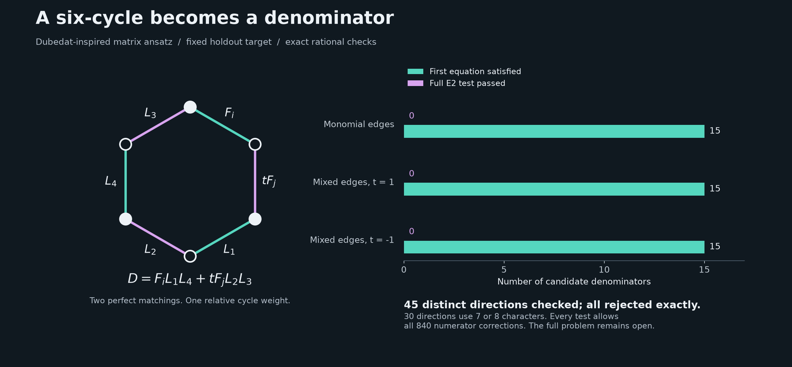

# From dimer matrices to exact denominator candidates

Dubedat offers several concrete directions: determinant partition functions,
inverse kernels, twists around cycles, and identities under deformations.
His [Dimers and analytic torsion I](https://arxiv.org/abs/1110.2808)
(published as *Dimers and families of Cauchy-Riemann operators I*) connects
dimer observables, free fields, and families of discrete/continuous operators.
His [double-dimer paper](https://arxiv.org/abs/1403.6076) develops connections
to isomonodromic tau functions. These are mathematical sources of ideas;
they do not assert the holdout certificate identity.

Here we test one deliberately small adaptation. A polynomial matrix supported
on a bipartite six-cycle produces both a degree-seven denominator and a
numerator satisfying the first certificate equation. We then test the second
equation exactly. This is an algebraic search, not a simulation of a GFF,
continuum imaginary geometry, or a verified discrete Cauchy-Riemann operator.



## The construction

Write `F_i = partial_i F`, choose `i < j`, four linear polynomials `L1,...,L4`,
and a nonzero rational twist `t`. Use the matrix

```text
        [ F_i   t F_j   0  ]
M_t  =  [  0     L1    L2  ].
        [ L3      0    L4  ]

D = det(M_t) = F_i L1 L4 + t F_j L2 L3.
```

Its two perfect matchings give the two displayed terms; the code separately
expands all six determinant permutations. The row degrees are five, one, and
one, so `D` has degree seven. Define a quadratic vector `h` by

```text
h_i = L1 L4,   h_j = t L2 L3,   h_k = 0 otherwise.
N0 = A h.
```

Then `N0(F)=AD` identically, with each numerator component of degree eight.
This uses the fixed holdout `F`, `A=X0^3 Y0^3`, and `q=1` directly. The
determinant/cofactor construction is our chosen adaptation, not a theorem
attributed to Dubedat. Since these denominators lie in the Jacobian ideal,
it also imposes a substantial restriction on the search.

All possible E1 numerators for this fixed denominator are `N0 + K`, where
`K` ranges over the complete 840-dimensional cubic Koszul space, independently
checked by the repository's degree-seven E1 calculation. We test

```text
B_D(N0 + K) = D div(N0 + K) - (N0 + K)(D) = 0 modulo F.
```

Exact polynomial division allows the unrestricted quotient. For each failed
candidate, the saved rational functional `lambda` satisfies
`lambda(B_D(K_r) mod F)=0` for all 840 corrections and
`lambda(B_D(N0) mod F)=1`. This proves inconsistency even over complex
coefficients. No numerator restriction from the matrix ansatz survives this
final test.

## The finite experiment

All 15 unordered pairs of the six partial derivatives were used in each row:

| Edge polynomials `(L1,L2,L3,L4)` | Twist | Candidates | E1 passes | E2 passes | Characters of D modulo F*S1 |
|---|---:|---:|---:|---:|---|
| `(X0,X2,Y0,Y1)` | 1 | 15 | 15 | 0 | 2 |
| `(X0+Y0,X2+Y2,X0+Y1,X1+Y1)` | 1 | 15 | 15 | 0 | 7 or 8 |
| Same mixed linear forms | -1 | 15 | 15 | 0 | 7 or 8 |

All **45 directions are distinct modulo gauge and scalar multiplication**.
The 15 two-character cases are controls already covered by the combined
family exclusions. The 30 mixed cases test individual directions beyond that
two-character theorem; they do not exclude the surrounding character families.
All 45 have exact rejection witnesses. There is no accepted solve or evidence
here that this selection method outperforms a random or simpler baseline.

For each case we also check the reciprocal edge change
`L1 -> 2 L1, L4 -> L4/2`. Both `D` and its cofactor lift stay unchanged.
This is a useful limitation: that particular reweighting is redundant. It is
not evidence that anisotropy never matters. In this one-cycle model, scalar
edge changes affect the two matching products; their relative weight, rather
than each separately named edge weight, determines the denominator direction.
The signs `t=1,-1` are algebraic twists; no positive-probability interpretation
is imposed on the variable polynomial edge weights.

## Checks and next constructions

```sh
python -S algebra/degree7_e1.py --check
python -S experiments/dubedat_cycle_search.py --check
# Regenerate the finite search with exact CPU arithmetic:
python -S experiments/dubedat_cycle_search.py --workers 3
python experiments/plot_dubedat_cycles.py
```

The replay reconstructs the determinants, E1 lifts, full correction columns,
and dual identities, checks the reciprocal-edge controls, and rejects a
deliberately damaged dual. [Code](../experiments/dubedat_cycle_search.py),
[report](../results/dubedat-cycle/report.json), and
[exact witnesses](../results/dubedat-cycle/certificates.json.gz) are provided.
This run uses rational CPU arithmetic, not GPU floating-point screening.

The next useful expansion is to use E1 denominator/lift pairs outside the
Jacobian ideal as matrix entries, with cofactors of complementary degree.
For example, if `N_G(F)=AG` and `N_H(F)=AH` with `deg G=deg H=6`, a four-cycle
determinant `D=G L2+t H L1` has the exact lift `L2 N_G+t L1 N_H`.
Another direction is a graph with multiple independent cycles, which has
several relative matching weights after removing vertex-rescaling redundancy.
Neither extension has been tested in this packet. Neither is guaranteed to
satisfy E2. Inverse-operator and deformation identities remain proposed leads.

Attribution: Dubedat motivates the operator/determinant viewpoint; fqlx and
the sextics repository supply the exact E1, Koszul, and certificate framework
credited elsewhere in this lab. The polynomial adaptation, finite experiment,
and implementation were developed with OpenAI Codex assistance for `rbajaj5`.
