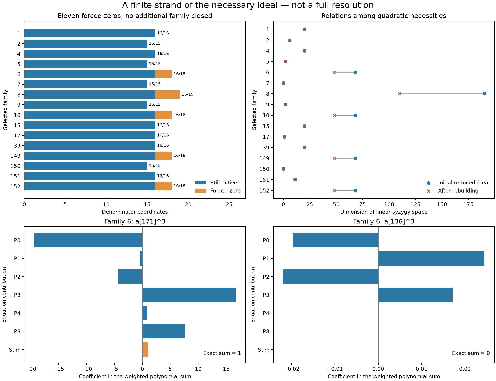

# Degree-three strands reveal more necessary zeros

**17 October 2026.** Extending the necessary-equation calculation to degree
three forces **eleven family-specific coordinate vanishings in five of the
sixteen remaining selected triples**. All sixteen families still remain
unresolved. The global selected-family exclusion count stays **136/152**;
there is no new holdout certificate, Lean proof, or improved degree bound.

The same raw coordinate can occur in more than one family: eleven counts
family-coordinate pairs, not eleven distinct indices. The indices involved
are 156, 168, and 171. No parameter is normalized or divided out, so these
necessary vanishings include exceptional rank cases.

[Interactive cancellation view](../visualizations/eisenbud-linear-strand-standalone.html)
— download and open the HTML; GitHub displays its source.
[Editable inline view](../visualizations/eisenbud-linear-strand.html),
[scientific SVG](../results/eisenbud-linear-strand/linear-strand.svg).



## Why this experiment

Eisenbud's *The Geometry of Syzygies* treats relations as kernels of maps of
graded modules. Chapters 1A–1B explain the relation to free resolutions and
Hilbert functions; Appendix A2F supplies the Koszul-complex background.
We use this viewpoint to examine a finite degree of a concrete ideal of
necessary equations. We do **not** compute a full resolution, apply a theorem
about generic matrices, or assume a regular sequence.
[Book](https://www-users.cse.umn.edu/~reiner/REU/REU2019notes/2005_Book_TheGeometryOfSyzygies.pdf).

The previous generic power search only attempted degree two when more than
twelve parameters survived. Every one of these sixteen families had between
15 and 19 surviving parameters. The new test removes that size cutoff for
degree three; it is a systematic extension of an existing exact method.
The earlier numerical searches can miss these exact polynomial consequences.

## What map is being visualized?

Keep the pinned holdout target, `q = 1`, and the raw E1 basis unchanged.
Write the denominator and its particular numerator lift as

\[
D(a)=\sum_i a_iD_i,\qquad N_a=\sum_i a_iN_i,\qquad N_a(F)=AD(a).
\]

The complete numerator correction uses the 840 cubic-coefficient Koszul
fields. For each family, archived physical functionals annihilate every
compatible `B(D_i,K)` column independently, where
`B(D,N) = D div(N) - N(D)` is reduced modulo `F`. This relaxation enlarges
the allowed correction space and leaves an unrestricted quotient by `F`.
Applying those functionals to `B(D(a),N_a)` gives homogeneous quadratics
`P_0(a), ..., P_(m-1)(a)` which every full certificate in the family must
satisfy. Their vanishing is not sufficient for a certificate.

For `S = Q[a_i : i active]` and `I = (P_0,...,P_(m-1))`, the displayed
degree-three map is

\[
M_3:\bigoplus_{j=0}^{m-1} S_1\longrightarrow S_3,
\qquad (L_j)_j\longmapsto\sum_j L_jP_j.
\]

Its columns are all products `a_i P_j`. Its kernel consists of linear
syzygies among these particular quadratic necessities. Its image is `I_3`;
the reported quotient dimension is `dim (S/I)_3`. We check that the
quadratics are linearly independent. These are finite graded pieces of the
**necessary ideal**, not the original physical Koszul correction operator
and not the entire certificate scheme.

An identity `sum L_j P_j = 0` explains redundant equations. An identity
`sum L_j P_j = a_i^3` has a different use: it forces `a_i = 0` over `C`.
After such a vanishing, we reconstruct the physical correction space and
its necessary quadratics on the smaller denominator span. Merely adding
more multiples does not invent new solutions or turn an approximation into
a proof.

## Checked reductions

Family numbers, characters, and indices refer to our original
[152-family packet](three-character-families.md), not to an external numbering.
Character weights and source hashes are retained in the packet dependencies.

| Family | Characters | First cubic consequences | After rebuilding | Active coordinates |
|---|---|---|---|---|
| 6 | `(0,0,0), (0,1,0), (1,2,3)` | `a171 = 0` | `a168 = 0` | 18 → 16 |
| 8 | `(0,0,0), (1,0,0), (1,2,3)` | `a156 = a171 = 0` | `a168 = 0` | 19 → 16 |
| 10 | `(0,0,0), (1,2,3), (5,3,0)` | `a171 = 0` | `a168 = 0` | 18 → 16 |
| 149 | `(0,1,0), (1,0,0), (1,2,3)` | `a156 = 0` | `a168 = 0` | 18 → 16 |
| 152 | `(1,0,0), (1,2,3), (5,3,0)` | `a156 = 0` | `a168 = 0` | 18 → 16 |

Each of the six initial cubic identities uses 23 multiplier monomials.
For example, family 6 initially has 18 variables and 34 quadratic
necessities. Its cubic map has 612 columns, rank 544, and a 68-dimensional
kernel. An exact combination of six of its quadratics gives `a171^3`.
After imposing `a171 = 0`, the rebuilt equation with zero-based index 27
is `P27 = -(5/9) a168^2`. Thus `a168^2 = -(9/5) P27`, forcing the next
zero. Family 8 uses equation 43 for this second identity; the other four
families use equation 27. All equation indices are local to their stored
stage. The verifier expands every identity, rather than trusting these labels.

After the second rebuilding, these five families have 16 variables each.
Family 8 has 45 quadratics and 110 linear syzygies; the other four have
29 quadratics and 48 linear syzygies. No surviving coordinate square or
cube belongs to the tested ideal piece. This is the exact stopping condition,
not an existence result. The five remaining `a168^3` identities are also
stored, but are redundant once the five squares have been checked.

## Reading the picture

The static figure shows **all sixteen families**, including the eleven
families with no new coordinate vanishing. It compares the relation
dimensions before and after rebuilding. The rings and generating equations
change when coordinates are removed; this is not a rank scan of one fixed
matrix or evidence of a phase transition.

The interactive view includes 35 illustrative identities across 26 stages.
For each identity, its multipliers are grouped by equation. Select a
monomial to see the exact coefficient contributed by each `L_j P_j`.
The power monomial sums to one; every other monomial sums to zero. A stored
syzygy sums to zero for every monomial. Displayed bar lengths use floating
point, but their underlying labels and sums are checked rational numbers.
Hover or tap a bar to inspect its exact fraction.

Families 7 and 150 have no linear syzygy in this degree; their empty states
are shown explicitly. A large kernel alone does not imply a contradiction.
The Dubedat-inspired operator viewpoint motivates looking at images and
kernels, but no GFF, SLE, genus, or statistical phase-transition identification
is asserted for this algebraic diagram.

## Reproduce and inspect

From the repository root, with Python 3.11 and the pinned submodule present:

```sh
python -S experiments/eisenbud_linear_strand.py --check
python -S experiments/eisenbud_linear_strand.py --check --independent
python experiments/plot_eisenbud_strand.py --check
```

The first two commands need only the standard library. Discovery is
`python -S experiments/eisenbud_linear_strand.py`; it deterministically
checks degrees two and three in all sixteen families and permits at most
six rebuilding stages. This run uses one or three stages per family and
never reaches that cap. Figures can be regenerated without `--check` using
the Matplotlib dependency in `requirements.txt`. The browser checker is
`node experiments/check_eisenbud_strand.cjs` with Playwright available.

- [Exact packet](../results/eisenbud-linear-strand/certificates.json.gz):
  original-equation physical duals, all 1,149 stored relation vectors,
  six cubic and five square consequences plus five redundant cubes,
  retained coordinates, and stop reasons.
- [Primary replay](../results/eisenbud-linear-strand/validation.json) and
  [separate physical reconstruction](../results/eisenbud-linear-strand/independent-validation.json):
  **PASS**. Each reconstructs or rechecks 2,007 physical duals, 212,547
  correction pairings and 56,198 quadratic pairings, including inherited
  dependencies. Both replay the same identity checker. The second uses
  a separate polynomial API and opposite monic-division order; it is not
  an independent human or agent review.
- All 52 degree-two/three matrix ranks agree between rational elimination
  and a calculation modulo 1,000,003. Rational kernel relations are
  individually multiplied out, and their distinct final pivots establish
  independence. Modular rank agreement alone is not the proof over `Q`.
- A deliberately corrupted power identity is rejected. All displayed
  grouped sums are checked exactly. The browser checks pass in **111**
  family/stage/example layouts at widths 736, 360, and 320, including
  controls, empty cases, tooltips, light/dark views, and state restoration.
  [Figure checks](../results/eisenbud-linear-strand/figure-validation.json),
  [browser checks](../results/eisenbud-linear-strand/browser-validation.json).

## Failed attempts, limits, and next test

No coordinate square or cube was obtained in families
`1, 2, 4, 5, 7, 9, 15, 17, 39, 150, 151`. After rebuilding, the same search
finds no additional power in the five improved families. We did not search
degree four, compute a complete radical, or prove that all linear forms
whose powers lie in the ideal have been found. The full shared-numerator
system may impose stronger conditions than this relaxed necessary ideal.

A sensible next computation is the degree-four strand on these rebuilt
spaces, separating multiples of already known linear relations from new
syzygies, then using new physical shared-numerator constraints where needed.
This proposal is not counted as completed work. Earlier optimization traces
are preserved and still refer to their original parameter spans; they are
not retroactively relabeled as searches of the smaller spaces.

A preliminary chat update mistakenly counted seven first-stage vanishings.
The checked count is six first-stage cubes plus five later squares: eleven
family-coordinate zeros. The packet and figure use the corrected counts.

This extends our previous E1/physical-dual calculations, building on the
repository authors' certificate framework, the bridge attributed there to
Benjamin E. Diamond, Griffiths's residue theory, and fqlx's character and
enlarged-correction approach. The separate new triple reported by fqlx is
outside this selected list; no credit is taken for that result. Code and
notes were developed with OpenAI Codex assistance. Keeping evidence and
failed attempts visible makes the work inspectable; a picture alone does
not establish correctness or intent.
