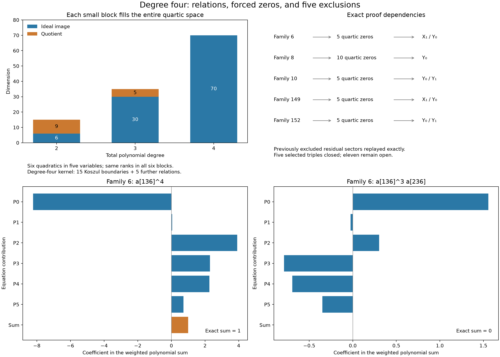

# Degree four closes five selected triple families

**17 October 2026.** Families **6, 8, 10, 149, and 152** in our original
152-family selection are now excluded exactly over `C`. The selected-family
count increases from **136/152 to 141/152**. The eleven still unresolved are
`1, 2, 4, 5, 7, 9, 15, 17, 39, 150, 151`.

This is a restricted denominator-family obstruction. Holdout remains unsolved;
there is no existence certificate, Lean `HasCertificate` proof, accepted solve,
or improved unconditional degree bound. Keep `(F,q,A)` and the upstream files
at `b8c4edeb80a82395ec07164caf445cfa43bbbd56` unchanged.

[Interactive exact-cancellation view](../visualizations/eisenbud-quartic-strand-standalone.html)
(download and open; GitHub displays source),
[editable view](../visualizations/eisenbud-quartic-strand.html),
[scientific SVG](../results/eisenbud-quartic-strand/quartic-strand.svg).



## The useful simplification

The [preceding degree-three experiment](eisenbud-linear-strand.md) reduced
these five families to sixteen denominator coordinates each. We extended
the necessary ideal to degree four, initially computing maps with 3,944
or 6,120 columns. Those computations found fourth-power identities.
Inspection then revealed that much smaller blocks already suffice.

For each disappearing character, six of the archived necessary quadratics
involve only its five surviving coordinates `z_1,...,z_5`. These are actual
equations in the full reduced family: **we do not set the other characters
to zero to obtain them**. Let

$$
S=\mathbf Q[z_1,\ldots,z_5],\qquad J=(Q_0,\ldots,Q_5).
$$

The exact ranks of `M_d : S_(d-2)^6 -> S_d`, mapping the multipliers to their
weighted equation sum, are:

| Total degree | Domain dimension | Target dimension | Rank | Kernel | Quotient |
|---|---:|---:|---:|---:|---:|
| 2 | 6 | 15 | 6 | 0 | 9 |
| 3 | 30 | 35 | 30 | 0 | 5 |
| 4 | 90 | 70 | 70 | 20 | 0 |

All six blocks have these ranks. Consequently `J_4=S_4`. In particular,
the packet supplies explicit rational quadratic multipliers satisfying

$$
z_i^4=\sum_{j=0}^{5} C_{ij}(z)Q_j(z),\qquad i=1,\ldots,5.
$$

Every complex common zero has `z_i=0` for all five coordinates. No
normalization, division by a denominator parameter, or generic-rank
assumption occurs in this step. The small quotient has Hilbert function
`(1,5,9,5,0,...)` and length 20: its affine scheme is supported at the origin,
and its projective common-zero locus is empty. This describes the small
necessary ideal, not the entire holdout certificate scheme.

There are no linear syzygies in a small block. Of its twenty degree-four
relations, fifteen are the independent Koszul boundaries
`Q_j e_i - Q_i e_j`; five remain modulo those boundaries. Thus the
degree-four first Koszul homology of **these six quadratics** has dimension
five. It is distinct from the original gradient Koszul correction space.
We have not computed a complete minimal free resolution.

This is a concrete use of Eisenbud's graded-module and Hilbert-function
viewpoint, with the Koszul complex distinguishing tautological relations
from additional ones. See Chapters 1A–1B and Appendix A2F of
[*The Geometry of Syzygies*](https://www-users.cse.umn.edu/~reiner/REU/REU2019notes/2005_Book_TheGeometryOfSyzygies.pdf).
No generic-matrix theorem or regular-sequence hypothesis is used.

## How the five families close

All indices below use the pinned Hodge Lab raw E1 basis, not an external
packet's numbering. Let

```
U = {136,236,273,290,294}, character (0,0,0)
V = {130,233,253,267,270}, character (1,0,0)
```

| Family | Three original characters | New quartic zeros | Residual sector |
|---|---|---|---|
| 6 | `(0,0,0), (0,1,0), (1,2,3)` | U | X1 / Y0 |
| 8 | `(0,0,0), (1,0,0), (1,2,3)` | U and V | Y0 |
| 10 | `(0,0,0), (1,2,3), (5,3,0)` | U | Y0 / Y1 |
| 149 | `(0,1,0), (1,0,0), (1,2,3)` | V | X1 / Y0 |
| 152 | `(1,0,0), (1,2,3), (5,3,0)` | V | Y0 / Y1 |

There are **30 family-coordinate fourth-power identities**, using ten
distinct raw indices. Family 8 contains two blocks; the others contain one.
The existing degree-three/square reductions remove the other coordinates
of the disappearing character. Every surviving certificate would therefore
lie in a previously excluded one- or two-character sector.

The new checker explicitly replays those dependencies, rather than inferring
closure from a coverage table. X1/Y0 uses our archived pair proof, then its
single-X1 proof. Y0 uses its full archived single-character proof. Y0/Y1 is
reconstructed with all sixty compatible numerator correction directions in
the remaining eleven-dimensional denominator span. Its 309 physical rows
force coordinate 271 to zero, then 115, 133, 234, 285, and 288. The remaining
pure-Y1 sector is checked against the archived single-character proof.

**The Y0/Y1 pair result is a reproduction, not a new exclusion.** It is
family 24 in fqlx's earlier actual-pair packet, revision
[`ffff4273a7a04905bb7de50382d731b91e08b328`](https://gist.github.com/fqlx/296a0c053d6f7405f8560f1693995c28/ffff4273a7a04905bb7de50382d731b91e08b328).
The original source and context are also linked from our [two-character checkpoint](degree-seven-pair.md) and
[holdout discussion #44](https://github.com/hodge-computer/sextics/discussions/44).
Our new contribution here is closing the five specified triples.

## Larger calculation and unsuccessful alternatives

The full degree-four maps are retained even though the short proof does not
need them. These maps use all sixteen active coordinates and all reduced
necessary quadratics.

| Families | Quadratics | Columns | Rank | Kernel | Linear multiples | Additional Koszul | Beyond both |
|---|---:|---:|---:|---:|---:|---:|---:|
| 6, 10, 149, 152 | 29 | 3944 | 2936 | 1008 | 684 | 271 | 53 |
| 8 | 45 | 6120 | 3741 | 2379 | 1474 | 574 | 331 |

“Additional Koszul” is the dimension added after the linear multiples have
already been included. The entire Koszul boundary space has dimension
406 or 990, respectively. These spaces overlap; adding their separate
dimensions would overcount. For example, the 324 new quadratic first-syzygy
generators in the 29-equation case include 271 supplied by Koszul boundaries
modulo linear multiples and 53 further ones.

The full necessary quotient still has degree-four dimension 940 (135 for
family 8). Its nonzero quotient does not prevent specific character
coordinates from being forced to zero.

Retained attempts and limits:

- Family 8's first full rational calculation reached a **300-second limit**
  without a complete exported packet. A follow-up inserted columns in
  increasing polynomial-support order, with a **600-second limit**, and
  completed in about 270 seconds. The timeout itself proves nothing.
- An exact invertible row-basis change in family 6 reduced the quadratic
  term count from 488 to 428. Its full calculation nevertheless took about
  122 seconds versus 52 seconds for the first direct pilot. Jobs overlapped;
  these are observations, not a controlled speed comparison. Both give
  rank 2936 and the same five zeros. The alternative equations, change of
  basis, and full proof packet are retained and checked.
- Rebuilding only the relaxed necessary ideal on the residual eleven-variable
  Y0/Y1 pair gives eleven quadratics. Searches through degrees 2, 3, and 4
  have ranks 11, 110, and 572, and find **no coordinate power**. This bounded
  failure is preserved. Keeping the shared numerator coefficients, as in
  the existing pair proof, supplies the missing constraints.
- The first visualization interaction check assumed monomial index zero
  was a cancellation term; here it is the target fourth power. The check
  now selects an actual zero-sum term from the data. No mathematical data
  or display tolerances were changed.

The shift to pure-character blocks was made after inspecting the larger
identities. It is not evidence that every future family admits such a block.
The other eleven families were not searched through degree four in this batch.

## Replay, provenance, and checks

Run from the repo root with Python 3.11 and the pinned submodule:

```sh
python -S experiments/quartic_pure_blocks.py --check
python -S experiments/check_quartic_exclusions.py
python -S experiments/check_quartic_exclusions.py --independent
python -S experiments/plot_quartic_strand.py --check
```

These use only the standard library. The two exclusion checks each pass
881 physical-dual checks, 104,430 correction pairings, 26,017 quadratic
pairings, all inherited reductions, all thirty new power identities, and
the required pair/single-sector closures. One reconstructs physical
polynomials with a separate API and opposite monic-division order. Both
share the identity replayer; this is not independent human or agent review.

- [Small blocks and exact multipliers](../results/eisenbud-quartic-strand/pure-blocks.json.gz)
  and [rank checks](../results/eisenbud-quartic-strand/pure-blocks-validation.json).
- [Full exclusion replay](../results/eisenbud-quartic-strand/exclusions-validation.json)
  and [separate physical reconstruction](../results/eisenbud-quartic-strand/exclusions-independent-validation.json).
- [All full-map packets, timings, failures, and checks](../results/eisenbud-quartic-strand/).
- [Figure checks](../results/eisenbud-quartic-strand/figure-validation.json)
  and [120 browser checks](../results/eisenbud-quartic-strand/browser-validation.json).

For the larger maps, repeat for `N` in `6 8 10 149 152`:

```sh
python -S experiments/eisenbud_quartic_strand.py --family N --check
python -S experiments/eisenbud_quartic_strand.py --family N --check --independent
```

Rational kernel vectors are expanded coefficient by coefficient and have
distinct final pivots. They prove the rank upper bound; modular elimination
at prime 1,000,003 proves the matching lower bound. Exact power identities
are checked separately, and a corrupted coefficient is rejected. This
does not infer characteristic-zero rank from a modular answer alone.

Discovery uses the same command without `--check`; use `--sparse-order` for
family 8. `python -S experiments/quartic_pure_blocks.py` rebuilds the small
packets. `python -S experiments/quartic_auxiliary.py` checks the alternative
basis and bounded pair failure; `--discover-pair` reconstructs the already
known Y0/Y1 closure. The auxiliary `--archive-local-pilots` switch is only
for importing the original scratch runs; published checks do not need scratch
files. To regenerate figures, run the plot script without `--check` with
Matplotlib installed. Browser QA uses `node experiments/check_quartic_strand.cjs`
with Playwright available.

## What the visualization establishes

The static figure shows the growing ideal image, the five closure paths,
and two monomial coefficients in an actual fourth-power identity. The
interactive view exposes forty identities: thirty coordinate powers and
two types of relation for each family. Bars group quadratic multipliers by
their original equation index. Power coefficients sum to one; every other
coefficient sums to zero. Fractions are checked exactly; bar lengths use
floating-point display. Select any monomial and inspect a bar's exact value.

The operator/image/kernel intuition remains useful. No correspondence with
Dubedat's GFF/SLE constructions, surface genus, or a statistical phase
transition is established here. The transition from a nonzero degree-three
quotient to a zero degree-four quotient is a graded algebra calculation,
not a thermodynamic limit.

This builds on the project authors' certificate framework, the bridge
attributed there to Benjamin E. Diamond, Griffiths's residue theory, fqlx's
character and enlarged-correction calculations and earlier pair exclusions,
and our preceding E1/physical-dual and syzygy continuations. Code, experiments,
and notes were developed with OpenAI Codex assistance. Reproducible pictures
and failed attempts make the evidence inspectable; they do not by themselves
establish correctness or intent.
