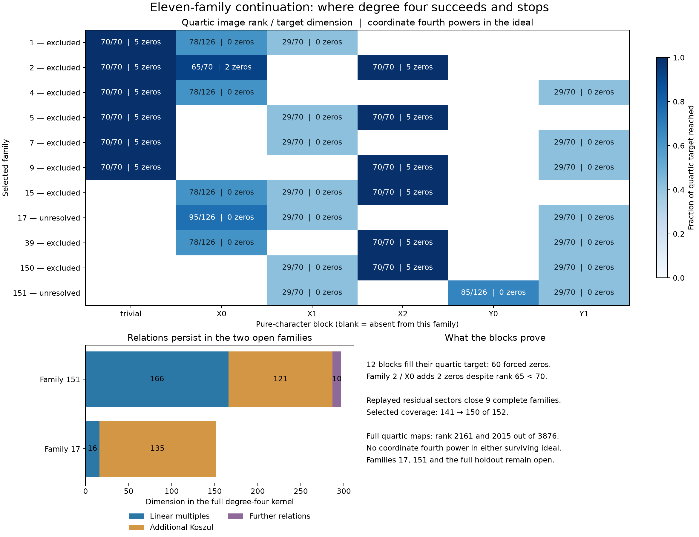

# Degree four on the eleven remaining selected triples

**17 October 2026.** Nine more complete degree-seven denominator families are
excluded: **1, 2, 4, 5, 7, 9, 15, 39, 150**. Together with the preceding
141 exclusions this gives **150/152 selected triples**. Families **17 and
151 remain unresolved**, as does holdout. This is an exact-arithmetic partial
result, not a Lean proof, an existence certificate, or an improved
unconditional degree bound.



The [interactive cancellation explorer](../visualizations/eleven-quartic-standalone.html)
includes all 33 pure-character blocks and the two surviving full maps.
Download the HTML and open it in a browser. Select a family, block, identity,
and monomial to see exact equation contributions. It contains 110 illustrative
identities, including failures to force powers. The [SVG figure](../results/eleven-quartic/eleven-quartic.svg)
is suitable for export. Neither picture is a proof of the physical reduction;
the checkers below supply that evidence.

## Fixed problem and inherited reductions

The protected upstream checkout remains
`b8c4edeb80a82395ec07164caf445cfa43bbbd56`. We keep
$q=1$, $A=X_0^3Y_0^3$, and

$$
F=X_0^6+X_1^6+X_2^6+Y_0^6+Y_1^6+Y_2^6
  +X_0^3X_1Y_0Y_1+X_1^3X_2Y_1Y_2.
$$

After Euler normalization, the necessary equations are

$$
N(F)=AD,\qquad B_D(N)=D\operatorname{div}N-N(D)\equiv0\pmod F.
$$

We use the same raw E1 indices, six $F S_1$ gauge directions, complete
840-dimensional numerator Koszul kernel, diagonal characters, and selected
152-family list as the [preceding calculation](eisenbud-linear-strand.md).
These are selected triples, not all triples among the 138 character sectors.
The exact starting packet is
[`results/eisenbud-linear-strand/certificates.json.gz`](../results/eisenbud-linear-strand/certificates.json.gz),
SHA256 `6fb3224ef9ad6dbb7a726d56b9c53ffa39ecdd10f2ba58fba320e7c521ad37b7`.

The physical left annihilators eliminate an enlarged correction space where
the products of denominator and numerator parameters may vary independently.
Thus every physical solution satisfies the resulting quadratics. A
contradiction in this relaxed ideal is valid; survival need not give a
physical numerator. The unrestricted quotient modulo $F$ is retained.

## Small blocks first

The prior five-family batch suggested looking for equations involving only
one character's coefficients. We therefore tested **all three blocks in
each of the eleven remaining families**, before using larger maps where the
blocks failed. This is a subset of actual necessary equations: other
characters are not set to zero to obtain a block.

For homogeneous quadratics $P_1,\ldots,P_m$ in $n$ variables let

$$
\Phi_4:S_2^m\longrightarrow S_4,\qquad
(C_1,\ldots,C_m)\longmapsto\sum_j C_jP_j.
$$

Twelve blocks have $n=5$, $m=6$, and ranks $6,30,70$ in degrees $2,3,4$.
Their quotient dimensions are $9,5,0$ in those degrees. In particular
$\Phi_4$ fills all 70 quartic monomials. The packet supplies an explicit
identity $a_i^4=\sum_j C_jP_j$ for each of their five coordinates. These
identities force 60 family-coordinate zeros over $\mathbb C$.

Write
$U=(136,236,273,290,294)$ for the trivial-character block and
$V=(130,233,253,267,270)$ for character $(1,0,0)=\chi_{X_2}$.

| Family | Newly zero coordinates | Residual sector, replayed below |
|---|---|---|
| 1 | U | X0 / X1 |
| 2 | U, V, 102, 111 | X0 |
| 4 | U | X0 / Y1 |
| 5 | U, V | X1 |
| 7 | U | X1 / Y1 |
| 9 | U, V | Y1 |
| 15 | V | X0 / X1 |
| 39 | V | X0 / Y1 |
| 150 | V | X1 / Y1 |

Family 2's X0 block gives the extra two zeros. It has five quadratics in
five variables and quartic rank **65/70**, yet contains $a_{102}^4$ and
$a_{111}^4$. Full quartic rank is sufficient, not necessary, for coordinate
vanishing. There are **62 family-coordinate identities**, using 12 distinct
raw coordinate indices. They are not 62 independent global directions.

## Residual sectors are part of the proof

The quartic identities alone do not finish all families. After the proven
zeros, the checker reconstructs the complete shared-numerator systems for
the residual X0/X1 and X0/Y1 spans. Two rounds of exact normalized-chart
deductions force all six remaining X0 coefficients to zero; the appropriate
single-character proof then closes each sector. Families 2, 5, and 9 reduce
directly to previously proved single-character sectors, whose equations and
all normalized charts are replayed.

Families 7 and 150 reduce to fqlx's **already excluded family 30**, X1/Y1.
We fetch and hash-check the [immutable attributed packet](https://gist.github.com/fqlx/58c0183e1fdbfc5d42a78d005e1d9bab/d69313fe578843f8341e6ed557c425bc7755c1d7),
run both upstream verifiers on a disposable copy, and match its target
polynomials and all ten residual denominator/lift pairs to our own basis.
The replay checks all 41 physical consequences, five normalized-chart
identities, 44,681 coefficient products, and the remaining pure sector.
This is a proof dependency and reproduction, **not a new pair exclusion**.
See the [pinned manifest](../references/fqlx-pair30.json),
[fresh replay](../results/eleven-quartic/pair30/replay.json), and
[original post](https://github.com/hodge-computer/sextics/discussions/44#discussioncomment-18983962).

## Where degree four stops

Families 17 and 151 have sixteen remaining parameters and seventeen
necessary quadratics. Their full quartic maps were run with separate
300-second wall limits and both completed. The concurrent local times,
about 15.0 and 9.5 seconds, are not a controlled performance comparison.

| Family | Full map domain → target | Rank | Kernel | Quartic quotient | Fourth powers found |
|---|---|---:|---:|---:|---:|
| 17: X0/X1/Y1 | 2312 → 3876 | 2161 | 151 | 1715 | 0 |
| 151: X1/Y0/Y1 | 2312 → 3876 | 2015 | 297 | 1861 | 0 |

The rank proofs combine independent rational kernel vectors with a modular
rank lower bound at prime 1,000,003. Exact polynomial expansion checks every
kernel vector. Since the modular and rational base ranks agree, an increased
augmented modular rank proves each failed coordinate power is outside the
degree-four rational image, hence outside its complex extension.

For family 17 the kernel consists of 16 dimensions of prolonged linear
relations and 135 additional Koszul boundaries. Family 151 has 166 dimensions
of prolonged linear relations, 121 additional Koszul boundaries, and ten
further quartic relations. These are finite graded calculations of the
necessary ideal, not full free resolutions or proofs that higher-degree
consequences cannot exist. A large kernel is not itself an exclusion.

All 20 pure blocks with no coordinate fourth powers, both failed full-map
power searches, and the intermediate residual-pair charts are retained.
No statistical phase transition is established by these finite algebraic maps.

## Checks and reproduction

From the repository root with Python 3.11 or later:

```sh
python -S experiments/eleven_quartic.py --check-blocks
python -S experiments/reproduce_pair30.py --fetch --output-directory results/eleven-quartic/pair30
python -S experiments/check_eleven_quartic.py
python -S experiments/check_eleven_quartic.py --independent
python -S experiments/plot_eleven_quartic.py --check
```

Only the pinned external-packet fetch uses the network. The arithmetic
replayers require Python's standard library, with no Singular, SymPy, or
numerical tolerances. To reproduce discovery:

```sh
python -S experiments/eleven_quartic.py --blocks --pairs --bounded-full --check-blocks
python experiments/plot_eleven_quartic.py
```

Plot production requires Matplotlib. Recreating compressed packets may change
their gzip metadata and hash, so regenerate the visualization data afterward.
The independent physical reconstruction uses a separate polynomial API and
opposite monic-division order, while sharing the small identity replayer.
No new independent agent review or external human review is claimed.

Local checks **PASS**:

- All 33 small blocks and two full maps: ranks, exact syzygies, successful
  powers, and failed power membership checks.
- Both physical reconstructions: 1,126 duals, 108,117 correction pairings,
  30,181 quadratic pairings, 42 inherited power identities, 62 new quartic
  identities, and all residual closures. Each deliberately altered new
  identity is rejected.
- Both pinned fqlx family-30 verifiers and explicit target/basis binding.
- All 110 displayed identities are expanded exactly; 330 browser layouts
  pass at widths 736, 360, and 320, with control, tooltip, state, and theme checks.

The new Linux `eleven-quartic` CI job repeats all arithmetic and figure-data
checks. Its remote result is recorded after it runs; local PASS does not
assert that remote CI has already passed.

Presentation failures were also retained in this account: the first payload
exceeded the inline size limit because it duplicated proof polynomials. The
plotter now checks those products before embedding only the coefficients
needed for display. A tooltip test exposed redraws triggered by changes in
detail-text height; the observer now redraws only when width changes. An
attempt to re-export an existing standalone preview without `--force` was
rejected; it was then regenerated and all browser checks rerun.

## Motivation, attribution, and next decision

Eisenbud's graded-module viewpoint motivates using bounded polynomial
relations and comparing their image with particular coordinate powers.
The successful small blocks suggest looking for short reusable obstructions.
The survivors suggest testing the shared-numerator equations directly or
higher-degree multipliers with explicit bounds. Neither change is counted
as completed work here.

Credit the Sextics authors and certificate framework, Benjamin E. Diamond's
attributed bridge, Griffiths's residue theory, fqlx's E1/symmetry and family-30
proofs, earlier independent checks by contributors, and our preceding
reductions. Dubedat's operator intuition motivated visualization in this
project; this calculation does not invoke an imaginary-geometry theorem.
Code, calculations, and prose were prepared with OpenAI Codex assistance on
behalf of `rbajaj5`.
