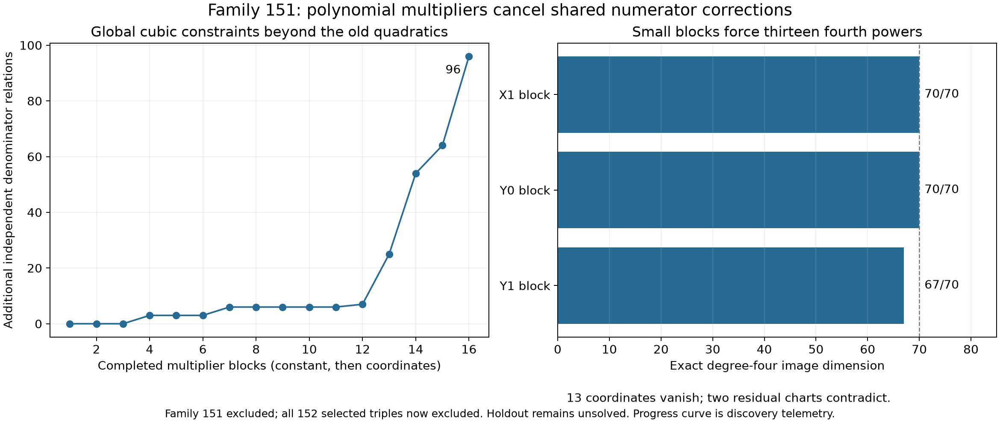

# Family 151: polynomial multipliers finish the selected triple scan

**Exact result:** the complete degree-seven family 151, with characters
`X1 / Y0 / Y1`, is excluded after replaying the preceding reductions.
Together with the preceding results, this gives **152/152 selected triples
excluded**. This collection consists of the 136 extensions of `X0/Y0` by a
third character, together with all triples of coordinate characters (with
overlap removed). It is not the collection of all possible three-character
supports. Other triples, larger supports, and higher degrees remain open.
Holdout is unsolved; there is no Lean `HasCertificate` proof or solve PR.

The protected target is unchanged: `q = 1`, `A = X0^3 Y0^3`, and the exact
`F` in `sources/sextics/data/holdout/instance.rec`, pinned to upstream commit
`b8c4edeb80a82395ec07164caf445cfa43bbbd56`. All existing upstream files remain
unchanged. This is an obstruction over the complex numbers, proved by rational
polynomial identities and elementary field implications.

## Starting from the new linear constraint

The [preceding packet](remaining-triples-shared.md) proved, globally in the
then-reduced family,

\[
L=3a_{115}-6a_{133}+a_{234}+a_{285}+a_{288}=0,
\qquad L^2=108P_{12}-54P_{13}-18P_{11}.
\]

We substitute
`a133 = (3 a115 + a234 + a285 + a288)/6` in both the denominator and its
numerator lift. The remaining labels are the zero-based raw E1 basis indices

```
115, 123, 135, 180, 210, 229, 232, 234,
235, 271, 272, 285, 288, 289, 293.
```

These label the explicitly rebased pairs, not an unchanged list of raw
polynomials. Fresh physical model instances avoid reusing columns cached
before the basis change. The proof replays all inherited reductions and the
linear-square identity before using this change of basis.

The order-18 stabilizer permits **125 shared Koszul correction coordinates**.
Projection to the complete permitted numerator-character coset preserves
every certificate with such a denominator. The quotient modulo `F` remains
unrestricted. The rebuilt physical system has **599 coefficient equations**,
written

\[
E(a,z)=b(a)+M(a)z=0.
\]

Here `a` has 15 coordinates, `b` is quadratic, and `M` is linear in `a`.
The same 125 numerator coordinates `z` occur in every row; they are never
replaced by unrelated products for individual denominator directions.

## What the polynomial multipliers add

For every physical equation, use the multipliers `1, a0, ..., a14`, where
these are **local positions in the rebased 15-coordinate system**. Exact
elimination first removes every monomial containing a numerator coordinate.
Each exported relation retains its expression

\[
R(a)=\sum_j u_j(a) E_j(a,z),\qquad \deg u_j\leq1.
\]

Thus the numerator cancellation is a polynomial left syzygy of `M(a)`.
No division by a denominator coefficient or matrix minor is used in the
global calculation. Exceptional parameter ranks are included.

Constant multipliers yield 12 independent quadratics. The completed global
search exports 288 independent denominator relations: 12 quadratics and 276
cubics. Linear multiples of the old quadratics span 180 dimensions in degree
three. **The new cubic contribution has dimension 96.** This is a graded
vector-space statement, not a codimension estimate or a full resolution.
The packet stores all equation-product witnesses; the checker verifies their
coefficients and independence. Expanded physical-matrix ranks and checkpoint
timings are discovery telemetry, not premises of the exclusion.

The five normalized `Y0` charts (`a115`, `a234`, `a271`, `a285`, or `a288`
equal to one) are separately searched with affine multipliers. Their outputs
and any bounded failures are retained as auxiliary experiments. The global
proof below does not depend on completing these larger chart searches.

## Three small blocks and two residual charts

Select the baseline quadratics and the 96 new cubic representatives. Keep
the polynomials involving only one character's five denominator coordinates.
These are necessary consequences of the full physical system; **we do not
set the other two character components to zero** to obtain them.

| Block | Raw coordinate labels | Generators | Degree-three rank | Degree-four rank | Fourth powers forced |
| --- | --- | ---: | ---: | ---: | ---: |
| X1 | 123, 180, 210, 229, 232 | 2 quadratics + 11 cubics | 21/35 | 70/70 | all 5 |
| Y0 | 115, 234, 271, 285, 288 | 2 quadratics + 13 cubics | 23/35 | 70/70 | all 5 |
| Y1 | 135, 235, 272, 289, 293 | 2 quadratics + 10 cubics | 20/35 | 67/70 | 135, 272, 289 |

For every forced coordinate, the packet contains an explicit identity
`a_i^4 = sum C_j P_j`. There are **13 such identities**, with **862 polynomial
multiplier terms** in total. The graded maps multiply each quadratic by
monomials of degree `d-2` and each cubic by monomials of degree `d-3`.
Their rational ranks, modular lower bounds, kernel relations, and all power
identities are checked.

Over any field, `a_i^4 = 0` implies `a_i = 0`. Only `a235` and `a293` survive.
Substitute all thirteen zeros into the **original rebuilt shared equations**.
Normalizing each remaining coordinate to one gives two direct exact
contradictions. These two charts cover every nonzero residual denominator,
so the family is excluded. No external pair exclusion is needed for this
last step. The previous aggregate 151/152 result retains its own credited
dependencies.

## Visual record



The left panel records the global search's growth as multiplier blocks are
processed; intermediate counts describe discovery. The right panel displays
the exact quartic ranks used in the proof. The change in graded rank is not
a statistical or physical phase transition.

The [interactive cancellation view](../visualizations/family151-multipliers-standalone.html)
lets readers choose a global or normalized-chart identity and a monomial.
Numerator coefficients cancel to zero, while denominator coefficients remain.
Every displayed coefficient sum is checked with `Fraction`. Small marks may
be combined into an explicitly labeled “Other” contribution; no coefficient
is discarded. `E` labels refer to physical equation rows; `a` labels are
rebased denominator indices and `z` labels are original Koszul-field indices.
Download the HTML to use it; GitHub's file viewer shows source.

These pictures expose the calculation. They do not independently establish
the proof or the researchers' intent. The arithmetic verifier supplies the
checkable evidence.

## Bounds, failures, and corrections

- The global and five normalized multiplier searches have a declared
  **180-second limit each**, with two workers. Completed multiplier blocks
  are checkpointed; an interrupted block contributes no exported claims.
  [Plan](../results/family151-multipliers/plan.json) and
  [outcomes](../results/family151-multipliers/attempts.json).
  The global run and charts 115, 234, and 271 complete; charts 285 and 288
  time out after 14 of their 15 multiplier blocks. Their final checked
  checkpoints each supply 64 additional relations. The completed runs each
  supply 96. No interrupted block is used.
- The auxiliary direct chart follow-up has a **120-second limit per chart**,
  with two workers. It tries coordinate powers or a constant contradiction
  through total degree four, then replays affine/square consequences in the
  physical equations. Its completed degree-three searches find no coordinate
  powers or contradiction. Any timeouts remain timeouts even though a
  different proof now excludes the family.
  [Plan](../results/family151-multipliers/follow-plan.json) and
  [outcomes](../results/family151-multipliers/follow-attempts.json).
  Charts 115 and 271 find degree-four constant contradictions. Charts 285
  and 288 find coordinate powers, but the subsequent physical propagation
  does not close either chart. Chart 234 times out during its degree-four
  search; its degree-three failure remains recorded. The global small-block
  proof supplies coverage independently.
- The three pure-block searches have **120 seconds each**, with two workers,
  and a planned maximum degree six. They stop at degree four, where powers
  are found. This much smaller calculation was an adaptive follow-up after
  inspection showed pure-character cubic relations.
- The first small-block pilot mistakenly reused a quadratic-only constructor
  on mixed quadratic/cubic generators. It was stopped before its outputs
  were used. Its degree labels and rank ratios are invalid, and its retained
  files are explicitly marked
  [discarded](../results/family151-multipliers/discarded-grading-run/README.txt).
  The replacement uses each generator's actual degree and asserts that every
  resulting monomial lies in the requested degree. No discarded rank enters
  the result. An unrelated inspection process that repeatedly constructed
  the model was also stopped and replaced by one cached model instance.
- No numerical optimization, real-positivity argument, generic-rank
  assumption, Lean acceptance, or unrestricted degree-seven conclusion is
  used. All prior failed quadratic and quartic-only searches stay in their
  earlier packets.

## Reproduce

From a checkout with the pinned upstream submodule present:

```sh
python -S experiments/check_family151_multipliers.py
python -S experiments/check_family151_multipliers.py --independent
python -S experiments/family151_cubic_blocks.py --check
python -S experiments/family151_cubic_blocks.py --check --independent
python -S experiments/check_family151_multipliers.py --follow
python -S experiments/check_family151_multipliers.py --follow --independent
python -S experiments/plot_family151_multipliers.py --check
```

The first four commands suffice to check the new relations and exclusion.
The next two replay auxiliary chart results. All proof checks use Python's
standard library; no CAS, numerical tolerance, or external algebra solver
is needed. The second physical implementation uses another polynomial API
and opposite monic division, but shares the identity-replay code. This is
not a claim of independent human review or a new independent agent review.

Discovery and figure production:

```sh
python -S experiments/family151_multipliers.py --limit 180
python -S experiments/family151_continue.py --limit 120
python -S experiments/family151_cubic_blocks.py --limit 120
python -S experiments/family151_cubic_blocks.py --closure
python experiments/plot_family151_multipliers.py
```

Matplotlib is needed only to produce the static figure. Regenerated gzip
metadata may change file hashes; regenerate downstream packets and figures
when regenerating their dependencies. Replaying checks leaves proof payloads
unchanged.

The exclusion replay passes with both physical implementations: 107 inherited
physical duals, 19,586 correction pairings, 3,257 quadratic pairings, five
inherited power identities, 29,777 new relation products, six graded maps,
13 fourth-power identities, and two residual chart contradictions. All 13
deliberately altered fourth-power multipliers are rejected. Full search and
presentation receipts are saved in the result directory. Local checks and
remote CI are recorded separately.

The six multiplier packets also pass both full replays: 1,652 identity checks
and 298,341 equation products, including repeated baseline checks, with six
altered multipliers rejected. The auxiliary follow-up replays pass with
121,496 relation products, 53 chart inferences, and twelve power/constant
identities. Those counts are check operations, not distinct mathematical
discoveries.

The visualization checks all 1,792 displayed monomial sums in seven
illustrative identities. All 42 browser layouts pass at widths 736, 360,
and 320, including numerator cancellation, denominator residue, controls,
tooltips, and state restoration. Static and browser images were inspected.

## Attribution

Credit the Sextics authors' certificate framework; the geometric bridge
attributed there to Benjamin E. Diamond; Griffiths's residue theory; fqlx's
E1, character, and preceding pair calculations; the earlier Hodge Lab
reductions; and Eisenbud's graded-syzygy viewpoint. Dubedat's operator
intuition motivated earlier visualizations, but no imaginary-geometry theorem
is used in this proof. Prepared with OpenAI Codex assistance on behalf of
`rbajaj5`. This result adds a checked exclusion, not a solution certificate.

Published as [upstream contribution 11](https://github.com/hodge-computer/sextics/discussions/44#discussioncomment-18998404)
on 17 October 2026 at 12:34 UTC, immediately before pushing the linked proof
commit `a825be71140bb5c70327c2229c208df7d959e164`. The complete body and author
were read back and matched. The [publication receipt](../results/family151-multipliers/upstream-post.json)
records this check. The [remote workflow](https://github.com/rbajaj5/hodge-lab/actions/runs/39033064675)
was still running at publication; no remote success was claimed then.

The complete workflow subsequently **passed all eight jobs**, including the
[family-151 job](https://github.com/rbajaj5/hodge-lab/actions/runs/39033064675/job/117397284050).
The later [CI receipt](../results/family151-multipliers/ci-family151.json)
is retained separately from the publication-time status above.
