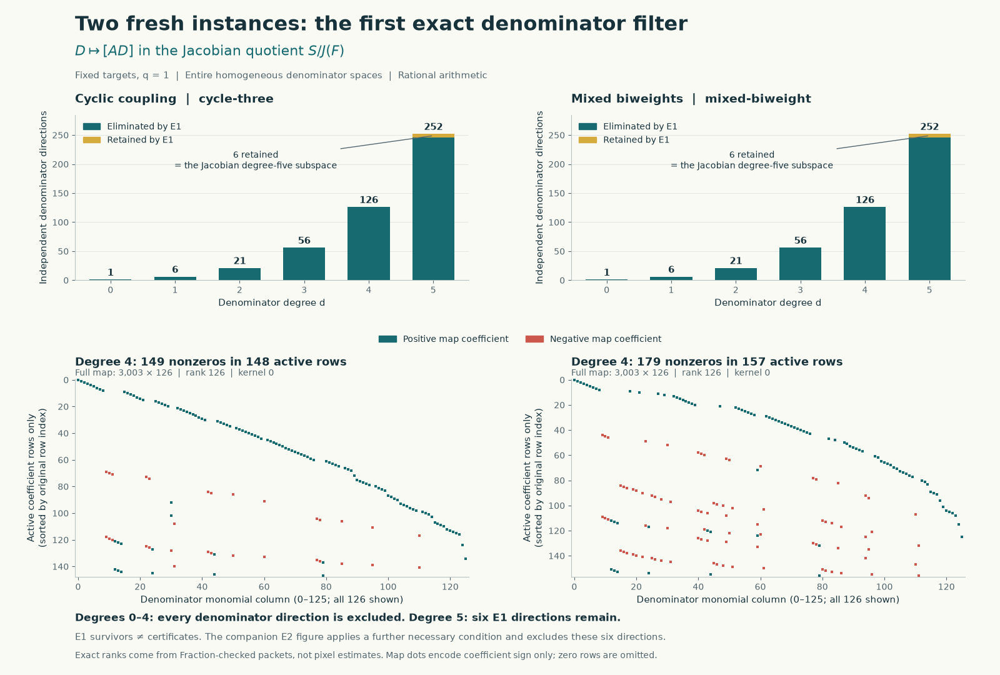
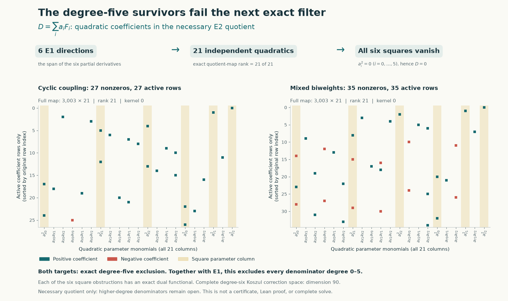

# Two fresh instances: denominators must have degree at least six

For the fixed `cycle-three` and `mixed-biweight` targets with `q=1`, the
calculations below exclude **every nonzero homogeneous denominator of degree
zero through five**, over the complex numbers, with the full numerator space
and an unrestricted quotient. Neither instance is solved. Degrees six and
higher have not been searched in this batch.

These use different fixed hypersurface equations from the holdout experiment. At the selection
check on 17 October 2026, upstream main was
`0768616c9b70b318011b7c421abdd640322ccbfc`. Neither target had a proof or
acceptance file, the open-PR list was empty, and the existing discussions
[#55](https://github.com/hodge-computer/sextics/discussions/55) and
[#56](https://github.com/hodge-computer/sextics/discussions/56) contained no
research comments. These are snapshots, not ongoing status guarantees.
The targets are unchanged from our pinned source checkout
`b8c4edeb80a82395ec07164caf445cfa43bbbd56`.

## Fixed targets

Write $F_0=\sum_{i=0}^2(X_i^6+Y_i^6)$. Both targets have $A=X_0^3Y_0^3$.
Their exact sextics are

$$
F_{\mathrm{cycle}}=F_0+\tfrac12X_0^3X_1Y_0Y_1
+\tfrac12X_1^3X_2Y_1Y_2+\tfrac12X_2^3X_0Y_2Y_0,
$$

$$
F_{\mathrm{mixed}}=F_0+\tfrac12X_0^3X_1Y_0Y_1
+\tfrac12X_1^3X_2Y_1Y_2+\tfrac13X_0X_2Y_0^3Y_2.
$$

The script parses `F`, `A`, and `q` from the protected `instance.rec` files;
it does not substitute the holdout polynomial or use the displayed mesh.
Bindings also cover each instance's `why.md` and `provenance.json`.

## First equation: all denominator coefficients, without an ansatz

Let $J=(F_0',\ldots,F_5')$ be the Jacobian ideal, with $F_i'=\partial_iF$,
and let $S_d$ be the space of homogeneous polynomials of degree $d$ in the
six specified variables. We use primes here to distinguish derivatives from
the Fermat polynomial $F_0$ above.

A certificate with denominator $D$ can be Euler-normalized to satisfy
$N(F)=AD$ with $\deg N_i=d+1$. In detail, reducing the cleared certificate
identity modulo $F$ and using $\gcd(D,F)=1$ gives $N(F)-AD=FH$ with $H\in S_d$.
Then $N'=N-H\epsilon/6$, where $\epsilon=(X_0,X_1,X_2,Y_0,Y_1,Y_2)$,
satisfies $N'(F)=AD$. If $B_D(N)=D\operatorname{div}N-N(D)$, homogeneity
gives $B_D(H\epsilon)=6HD$. Thus this normalization preserves the cleared
identity; it does not require a strict certificate.

Consequently every certificate denominator lies in

$$
\ker\left(S_d\xrightarrow{D\mapsto[AD]} S_{d+6}/J_{d+6}\right).
$$

The following **exact ranks are the same for both instances**. Here $M_d$
is the complete map $N\mapsto N(F)$, and the augmented map also includes
every column of $D\mapsto AD$.

| Degree $d$ | Denominator coefficients | Numerator coefficients | Rank $M_d$ | Augmented rank | Denominator kernel |
| --- | ---: | ---: | ---: | ---: | ---: |
| 0 | 1 | 36 | 36 | 37 | 0 |
| 1 | 6 | 126 | 126 | 132 | 0 |
| 2 | 21 | 336 | 336 | 357 | 0 |
| 3 | 56 | 756 | 756 | 812 | 0 |
| 4 | 126 | 1512 | 1497 | 1623 | 0 |
| 5 | 252 | 2772 | 2682 | 2928 | 6 |

The exported rational linear functionals annihilate every numerator column.
Their values on the denominator columns give independent necessary linear
constraints. Explicit denominator/numerator lifts supply the matching lower
bound on the kernel. The checker verifies both sides, so these are complete
kernel dimensions in the stated degrees, rather than sampled denominators.
Rational matrix ranks and the exact identities remain valid over $\mathbb C$.

## Second equation eliminates the six degree-five directions

In degree five, the complete denominator kernel is exactly

$$
D=\sum_{i=0}^5 a_i F_i'=a\cdot\nabla F.
$$

An initial lift is $N_i=Aa_i$. Every other lift is obtained by adding the
90 independent linear multiples of the 15 Koszul fields
$F_j'\partial_i-F_i'\partial_j$. Their span is the entire numerator kernel:
$2772-2682=90$. This completeness is checked algebraically; it is not an
assumption that a convenient set of corrections is exhaustive.

Every component of such a correction $K$ belongs to $J$. Since $D\in J$,
$B_D(K)\in J$. Also $F\in J$ by Euler's identity. For the initial lift,

$$
B_D(Aa)=D(a\cdot\nabla A)-A\cdot a^{\mathsf T}\operatorname{Hess}(F)a.
$$

The first term belongs to $J$. Therefore the full second equation, including
a possible nonzero quotient, necessarily implies

$$
[A\cdot a^{\mathsf T}\operatorname{Hess}(F)a]=0\quad\text{in }S_{10}/J_{10}.
$$

The 21 columns indexed by $a_i a_j$, with the factor two on off-diagonal
Hessian entries, are linearly independent in this quotient for both targets.
The Jacobian image has rank 1497 and adjoining these columns gives rank 1518.
In particular, six exported rational dual functionals isolate the six squares
$a_i^2$, one at a time. Every certificate would force all six squares to be
zero, hence $a=0$ and $D=0$, a contradiction.

Passing to $S/J$ is only a necessary test for the second equation. Its failure
is enough for this exclusion; passing it would not prove existence.

## Evidence, limitations, and the next search





The figures use the checked coefficient matrices. Teal and coral indicate
coefficient sign; the second figure highlights the six square columns in gold.
Zero rows are omitted and explicitly counted, while all denominator or
quadratic columns are retained. The visual patterns do not establish rank;
the exact checkers do. [Plotted data and bindings](../results/fresh-instance-e1-figures/plot-data.json)
and the [figure generator](../experiments/plot_fresh_instance_e1.py) are included.

The primary implementation uses Python's standard-library `Fraction` for
all coefficient arithmetic. It verifies the duals, numerator lifts, gradient
span, Koszul completeness, and square functionals. Altered proof data are
passed through the actual checker and rejected.

A separate implementation parses the two targets with SymPy and uses a
different sparse elimination order modulo 1009. Its ranks are paired with
explicit characteristic-zero upper bounds: the 15 constant Koszul fields,
90 linear Koszul fields, and six gradient denominator lifts. Thus the
modular calculation supplies a second rank proof in these particular cases,
not a claim that modular ranks always equal rational ranks. That implementation
also reconstructs and checks the rational square functionals independently.

Checks performed: 12 E1 packets pass with 1,845,216 exact Jacobian-annihilation
pairings and 12 denominator/numerator lift identities. Both E2 packets pass
with 18,144 annihilation pairings. The actual validators reject 14 altered E1
records and 12 altered E2 functionals. The separate checker reproduces the
ranks and checks all 12 rational square functionals with 18,144 Jacobian
pairings and 252 Hessian pairings. Canonical LF hashes bind the inputs;
both verifiers also pass in an isolated copy with LF files, executed on
Windows. That last test is not a claim of Linux execution or remote CI.

Receipts: [E1](../results/fresh-instance-e1/validation.json),
[E2](../results/fresh-instance-e1/e2-validation.json),
[independent implementation](../results/fresh-instance-e1/independent-validation.json),
and [LF portability](../results/fresh-instance-e1/portability-validation.json).

The mathematical failures are retained as packets and bounded-attempt logs:
all denominator searches through degree four fail the first equation, and
the six-dimensional space surviving degree five fails a necessary second
equation. Degree six is **unattempted**, rather than failed or timed out.
No numerical optimization, GPU calculation, p-adic Hodge theorem, quantum
intertwiner theorem, or Lean proof was used in this batch.

The useful next step is to construct the full degree-six denominator kernel
and numerator correction space for these exact targets, then test its
necessary quadratic equations before selecting projective charts.

## Reproduce

From Hodge Lab with its pinned submodule initialized, verify the committed
packets using only Python's standard library:

```sh
python3 -S experiments/fresh_instance_e1.py verify
```

The separate implementation needs SymPy; rendering needs Matplotlib. Both
are listed in the notebook's requirements. Write a fresh independent receipt
outside the recorded result files if preserving their execution timings:

```sh
python3 experiments/check_fresh_instance_e1_independent.py . 5 work/fresh-independent.json
python3 experiments/plot_fresh_instance_e1.py
```

To regenerate the discoveries, including their attempt logs and timings:

```sh
python3 -S experiments/fresh_instance_e1.py run --max-degree 5 --timeout 60
python3 -S experiments/fresh_instance_e1.py e2 --timeout 60
python3 -S experiments/fresh_instance_e1.py verify
```

The 60-second bound applies to each subprocess. All attempted cases completed;
no timeout was counted as an exclusion. Regenerating packets changes recorded
timings and their hashes, so rerun the E2 construction, verification, and plot
generator together. The exact coefficients and rank conclusions are the
reproducible mathematical data.

## Attribution

The fixed challenges, certificate formulation, Euler normalization, and
Jacobian/Koszul framework come from the sextics repository authors, especially
[Chapter 1](https://github.com/hodge-computer/sextics/blob/0768616c9b70b318011b7c421abdd640322ccbfc/docs/01-certificates.md)
and [Chapter 5](https://github.com/hodge-computer/sextics/blob/0768616c9b70b318011b7c421abdd640322ccbfc/docs/05-computation.md).
The repository attributes its geometric certificate bridge to Benjamin E.
Diamond and uses Griffiths's residue theory. The Hessian test here is a
direct calculation in that framework. Classical syzygy ideas motivate the
linear-algebra organization; no separate theorem of Yang or Sun is asserted
to apply. Code, checks, and this explanation were prepared with OpenAI Codex
assistance for `rbajaj5`, including separate construction and review agents.
These computational checks are not independent human review, formal Lean
acceptance, or a solution of either instance.
