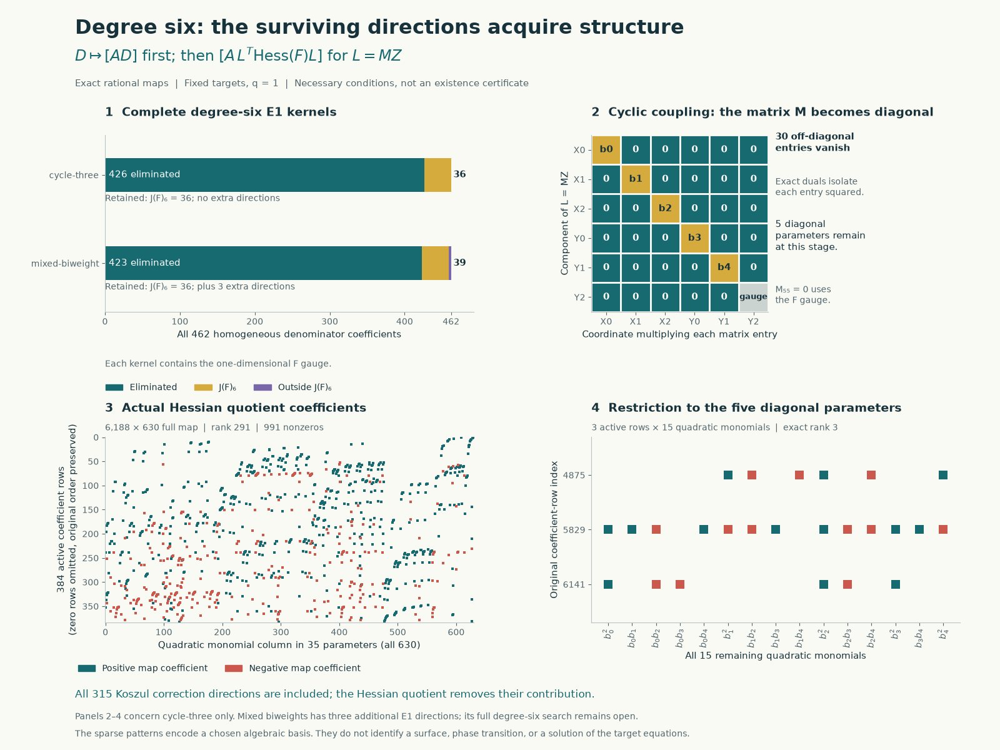
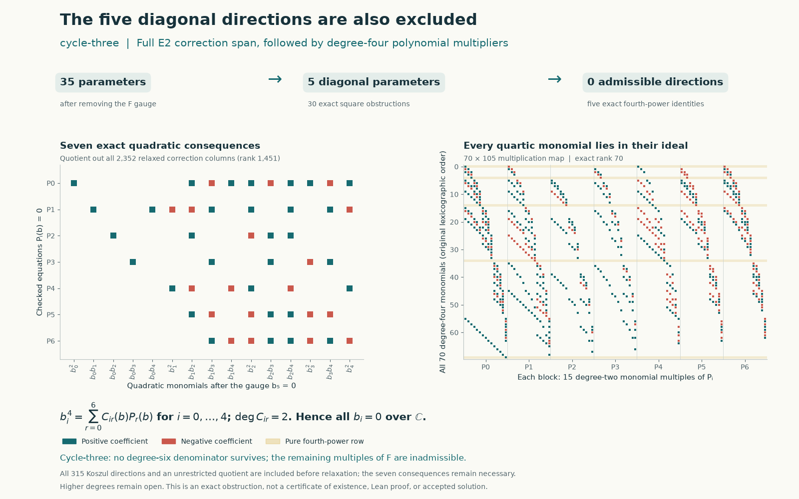

# Cycle-three: the degree-six denominator obstruction

The degree-six continuation excludes every certificate denominator of that
degree for the fixed `cycle-three` target. Together with the
[preceding degrees zero through five](fresh-instance-baselines.md), any
certificate for this instance must have denominator degree **at least seven**.
This is a lower bound, not an existence proof or a solution of the instance.
Complex coefficients, all numerator corrections, and nonzero quotients are
included.

The companion `mixed-biweight` calculation remains open in degree six. Its
first-equation kernel is larger, and the cyclic argument cannot simply be
transferred to it.

## Fixed targets and complete first equation

The exact targets, variable order, and normalization are those in the
[previous note](fresh-instance-baselines.md#fixed-targets). Both have
`q=1` and `A=X0**3*Y0**3`. The protected records, context, and provenance are
bound by canonical LF SHA-256 hashes in the packets. Existing upstream
files remain unchanged at the pinned source commit
`b8c4edeb80a82395ec07164caf445cfa43bbbd56`; the same targets were checked at
upstream main `0768616c9b70b318011b7c421abdd640322ccbfc`.

Write $J=(\partial_iF)$ and $B_D(N)=D\operatorname{div}N-N(D)$.
After Euler normalization, every certificate satisfies

$$
N(F)=AD,\qquad B_D(N)\equiv0\pmod F.
$$

The complete degree-six first-equation map has 462 denominator columns,
4,752 numerator columns, and 6,188 coefficient rows. Exact rational duals
and explicit lifts certify both bounds on each kernel dimension:

| Instance | Numerator rank | Augmented rank | Denominator kernel | $J_6$ | Kernel modulo $\langle F\rangle$ |
| --- | ---: | ---: | ---: | ---: | ---: |
| `cycle-three` | 4437 | 4863 | 36 | 36 | 35 |
| `mixed-biweight` | 4437 | 4860 | 39 | 36 | 38 |

For `cycle-three`, this proves that every degree-six denominator has the form

$$
D=L(F),\qquad L=MZ,\qquad N=A L+K,
$$

where $Z=(X_0,X_1,X_2,Y_0,Y_1,Y_2)$ and $M$ is an arbitrary $6\times6$
matrix. The 315 quadratic multiples of the 15 Koszul fields
$F_j\partial_i-F_i\partial_j$ are independent and exhaust the numerator
kernel, since $4752-4437=315$. Here $F_i=\partial_iF$.

For `mixed-biweight`, there are three additional denominator directions
outside $J_6$. The complete 39-dimensional kernel and its numerator lifts
are exported; a test restricted to the 36-dimensional Jacobian subspace
does not address all of them.

## Euler gauge preserves the full equation

Let $\epsilon=\sum_i Z_i\partial_i$. Replacing

$$
D\longmapsto D+cF,\qquad
N\longmapsto N+\frac c6 A\epsilon
$$

preserves $N(F)=AD$. Direct homogeneity calculations give

$$
B_{D+cF}\left(N+\frac c6 A\epsilon\right)
=B_D(N)+cF\operatorname{div}N+c^2AF.
$$

Thus the condition modulo $F$ and coprimality with $F$ are preserved. With
$c=-6M_{55}$, we may replace $M$ by $M-M_{55}I$ and set $M_{55}=0$.
This removes a gauge direction; it does not discard an admissible branch.
If the transformed denominator is zero, the original denominator was a
multiple of $F$ and already inadmissible.

## The Jacobian quotient forces 30 off-diagonal entries to vanish

Every component of a Koszul correction belongs to $J$. Since $D\in J$,
the correction term $B_D(K)$ also belongs to $J$, and $F\in J$ by Euler's
identity. Differentiating $D=L(F)$ therefore gives the necessary condition

$$
\left[A\cdot L^{\mathsf T}\operatorname{Hess}(F)L\right]=0
\quad\text{in }S_{12}/J_{12}.
$$

There are 35 gauge-fixed parameters and 630 quadratic monomials. The exact
quotient map has rank 291. Thirty exported rational functionals annihilate
every Jacobian column and isolate $M_{ij}^2$ for $i\ne j$. Consequently all
30 off-diagonal coefficients vanish over $\mathbb C$.

The five remaining diagonal parameters are $a_0,\ldots,a_4$, with $a_5=0$.
On these parameters the same quotient has rank only three. This weaker test
does **not** finish the complex-coefficient problem. For a coupling monomial
$cZ^m$ in $F$, its diagonal contribution modulo $J$ is

$$
cAZ^m\left((m\cdot a)^2-6\sum_i m_i a_i^2\right).
$$

These weighted-variance expressions suggest a real positivity argument, but
positivity cannot be used over $\mathbb C$. We retain this failed stopping
point and use the full second equation instead.

## Seven consequences of the full second equation

Set $D_i=Z_iF_i$ and $N_i=A Z_i\partial_i$. For a diagonal field,
$D=\sum_i a_iD_i$ and $N=\sum_i a_iN_i+K$. Consider the coefficient span

$$
W=F S_6+\operatorname{span}\lbrace B_{D_i}(K_k):0\leq i<6,\ 0\leq k<315\rbrace
\subseteq S_{12}.
$$

This uses 462 quotient columns and $6\cdot315=1890$ correction columns,
for 2,352 columns in total; their exact rank is 1,451. Allowing the products
$a_i b_k$ to vary independently enlarges the available correction space.
Annihilating this larger space gives necessary conditions for the original
shared-numerator problem, so a contradiction here still excludes it.

After $a_5=0$, the 15 columns of $B_D(\sum_i a_iN_i)$ yield seven independent
quadratic consequences $Q_1,\ldots,Q_7$. Each is accompanied by a rational
functional on the original coefficient space that annihilates all 2,352
columns of $W$. The verifier reconstructs those physical columns directly.

The degree-four multiplier map

$$
\mathbb Q[a_0,\ldots,a_4]_2^{7}
\longrightarrow \mathbb Q[a_0,\ldots,a_4]_4,
\qquad (C_r)\longmapsto\sum_{r=1}^7 C_r Q_r
$$

has rank **70 of 70**, with 105 input monomials. In particular, the packet
exports five explicit identities

$$
a_i^4=\sum_{r=1}^7 C_{ir}(a)Q_r(a),\qquad 0\leq i<5,
$$

with rational quadratic multipliers $C_{ir}$. Multiplying and summing their
coefficients proves all five diagonal parameters vanish over $\mathbb C$.
The ungauged denominator is therefore a multiple of $F$, contradicting
coprimality. No projective chart, positivity assumption, or numerical rank
threshold is used.

## Evidence and visualizations





The first figure compares the complete first-equation kernels, shows the
actual signed 630-column Hessian quotient, and marks the 30 vanished entries
of $M$. The second shows the seven necessary quadratics and their
$70\times105$ quartic multiplication map. Zero coefficient rows are
explicitly compressed where indicated. These are coefficient-space views,
not surface topology or evidence of a phase transition.
The figures label the diagonal parameters $b_i=a_i$ and equations
$P_0,\ldots,P_6=Q_1,\ldots,Q_7$; this matches their zero-based packet indices.
[Figure generator](../experiments/plot_fresh_instance_degree6.py) and
[bound plot data](../results/fresh-instance-degree6-figures/plot-data.json).

The [primary checker](../experiments/fresh_instance_degree6.py) uses Python's
standard-library `Fraction`. It reconstructs the original equations, verifies
the complete E1 kernels and lifts, checks the 315-dimensional Koszul space,
replays all 30 square functionals and seven full-equation functionals, and
multiplies the five quartic identities coefficient by coefficient. It also
rejects altered records through the same validators.
The primary validators reject 46 altered records across the stages.

The [separate implementation](../experiments/check_fresh_instance_degree6_independent.py)
parses the target records with SymPy and uses its own polynomial and rational
arithmetic, without importing the primary algebra routines. Its rational
reconstruction checks 4,034,448 E1 Jacobian pairings, 75 numerator lifts,
142,560 Hessian-test Jacobian pairings, 18,900 Hessian pairings, 16,464
full-equation correction pairings, and 147 quadratic pairings. The five
quartic identities contain 326 multiplier terms and expand to 2,275
coefficient products. Separate modular rank and unsuccessful-search
diagnostics are explicitly labelled as such.
This implementation rejects 42 altered witnesses independently.

Receipts and packets:

- [Complete E1 validation](../results/fresh-instance-degree6/validation.json),
  with [cyclic kernel](../results/fresh-instance-degree6/cycle-three/degree-6.json)
  and [mixed kernel](../results/fresh-instance-degree6/mixed-biweight/degree-6.json).
- [Hessian identities](../results/fresh-instance-degree6/cycle-three/degree-6-e2.json)
  and [their replay](../results/fresh-instance-degree6/cycle-three/e2-validation.json).
- [Full-equation quadratics and quartic identities](../results/fresh-instance-degree6/cycle-three/degree-6-diagonal.json)
  and [their replay](../results/fresh-instance-degree6/cycle-three/diagonal-validation.json).
- [Separate reconstruction](../results/fresh-instance-degree6/independent-validation.json).
- [E1 bounded attempts](../results/fresh-instance-degree6/attempts.json)
  and [E2 bounded attempts](../results/fresh-instance-degree6/e2-attempts.json).

## Reproduce

From Hodge Lab with the pinned submodule initialized:

```sh
python3 -S experiments/fresh_instance_degree6.py verify-all
python3 experiments/check_fresh_instance_degree6_independent.py . work/fresh-degree6-independent.json
python3 experiments/plot_fresh_instance_degree6.py
```

The first command needs only the standard library. The separate checker uses
SymPy; rendering uses Matplotlib. Both are listed in the repository's
requirements. To repeat discovery with a 120-second limit per subprocess:

```sh
python3 -S experiments/fresh_instance_degree6.py run --timeout 120
python3 -S experiments/fresh_instance_degree6.py e2 --timeout 120
python3 -S experiments/fresh_instance_degree6.py verify-all
```

All recorded bounded workers completed. A timeout is never counted as an
exclusion. Regeneration changes timings and packet hashes; regenerate the
dependent E2 packets and figures together. Source hashes normalize CRLF to
LF, and generated JSON is written with LF line endings.

## Scope, failures, and attribution

The initial degree-six E1 tests alone do not exclude either instance. The
cyclic Hessian quotient alone leaves five diagonal parameters. Moving from
the quotient by $J$ to the stronger quotient by the relaxed correction
space $W$ supplies the additional equations needed for the cyclic proof.
The modular companion exploration restricted to $J_6$ in `mixed-biweight`
does not finish that subfamily or its full 39-dimensional kernel. It is
kept as an unsuccessful diagnostic, not an exclusion. Higher degrees are
outside this batch.

The certificate framework, Euler normalization, and Jacobian/Koszul
formulation come from the sextics authors, especially its Chapters 1 and 5.
The repository attributes its geometric bridge to Benjamin E. Diamond and
uses Griffiths's residue theory. The graded multiplier-map organization is
motivated by classical syzygy methods; no additional theorem of Yang,
Dubedat, or p-adic Hodge theory is being applied. Prepared with OpenAI Codex
assistance for `rbajaj5`, including separate construction, review, and
visualization agents. Separate code checks are not independent human review,
a Lean proof, or formal acceptance.
