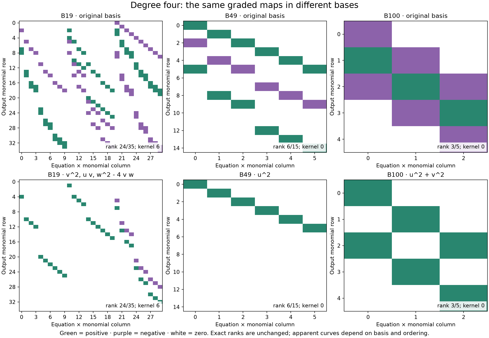

# Curved bands, factors, and basis choice

The user noticed parabola-like bands in case 19 at degree four, and asked
to compare cases 49 and 100 and reconsider the colors. These are **B19,
B49, B100 in the preceding X1/Y1 batch**. The new Y0/X1 batch uses different
families with the same local numbers; no equation transfers between them.

The image displays coefficients of the graded multiplication map
`(u_j) -> sum u_j P_j`. Rows enumerate output monomials, and columns
enumerate equation/multiplier pairs. They are not spatial coordinates.
Consequently a curved band is not evidence that the solution variety is a
parabola. A deterministic row/column permutation breaks up the bands while
preserving every entry with its labels and the exact rank.

The [interactive comparison](../visualizations/graded-map-patterns-standalone.html)
offers original, factor-adapted, and reordered bases, at degrees three and
four. Green/purple and blue/orange encode signs; the strength option adds
opacity relative to the largest absolute coefficient **in each column**.
Exact rational entries are available on selection. Download the HTML and
open it locally; GitHub displays the source. Colors are display choices and
are never proof inputs.

## What survives a change of basis

All indices below are zero-based raw E1 indices in the pinned old packet.
The `P` labels identify that packet's final first-pass necessary equations.
These are necessary-block ideals, not full certificate solution ideals.

For B19, put `x=a7-2a216`, `y=a159`. Then

\[
P_6=y(y-3x)/3,\qquad P_8=36x(y-3x),
\qquad yP_8-108xP_6=0.
\]

In particular `(y-3x)^2=3P6-P8/12`. With the invertible coordinates

\[
u=a_7-2a_{216},\quad v=a_{159}-3u,\quad
w=a_{119}-6u,\quad t=a_{216},
\]

an invertible constant change of generators gives

\[
3P_6-P_8/12=v^2,\quad P_8/36=uv,\quad
3P_7+P_8/3=w^2-4vw.
\]

Their common zero set over the complex numbers is `v=w=0`, with `u,t`
free. This identifies actual algebraic structure behind the matrix pattern.
It does not show that any point satisfies the full holdout equations.

For B49, the sole generator is `(2a122-a223/3)^2`. Setting
`u=2a122-a223/3, v=a138, w=a223` turns it into `u^2`: a double-plane
equation whose reduced zero set is `u=0`.

For B100, the sole generator is

\[
P_8=-a_6^2/12+a_6a_{211}/3-5a_{211}^2/12.
\]

With `u=a6-2a211, v=a211`, the correct form is `-12P8=u^2+v^2`.
It factors over the complex numbers as `(u+iv)(u-iv)`, two distinct lines.
Its real zero set is just the origin. Real positivity cannot exclude its
nonzero complex solutions.

| Old X1/Y1 case | Degree | Domain | Codomain | Exact rank | Kernel dimension |
| --- | ---: | ---: | ---: | ---: | ---: |
| B19 | 3 | 12 | 20 | 11 | 1 |
| B19 | 4 | 30 | 35 | 24 | 6 |
| B49 | 3 | 3 | 10 | 3 | 0 |
| B49 | 4 | 6 | 15 | 6 | 0 |
| B100 | 3 | 2 | 4 | 2 | 0 |
| B100 | 4 | 3 | 5 | 3 | 0 |

Both bases give these same values. These finite strands are not a full
minimal free resolution, and kernel dimensions are not dimensions of a
solution variety. The relevant mathematical framework is the graded-module
and syzygy viewpoint in David Eisenbud, *The Geometry of Syzygies* (2005).
No Dubedat flow, braid action, or phase transition has been derived here.

## Correction and verification

The first proposed B100 factorization was wrong:
`(a6-a211)(a6-5a211)` differs from the actual `-12P8` by `-2a6a211`.
The exact change-of-basis check rejected it before a figure was generated.
We corrected the statement in the conversation and retained the
[rejected proposal](../results/graded-map-patterns/rejected-factorization.json).
No family-exclusion proof used that factorization. The new Y100 has no
pure-third-character generator at the corresponding stage, so importing
even the corrected B100 formula there would also be invalid.

`python -S experiments/graded_map_patterns.py --check` passes. It uses the
second physical polynomial implementation to replay the source reductions,
checks the three variable maps and their inverses, checks invertibility of
the generator changes, reconstructs twelve graded maps, and checks six
ordering controls. The explicit B19 syzygy and square identity are replayed.
[Exact receipt](../results/graded-map-patterns/validation.json).

The browser check passes 162 combinations at widths 736, 360, and 320,
including exact-entry inspection and state restoration. The screenshots and
static figure were inspected. [Browser receipt](../results/graded-map-patterns/browser-validation.json).
Rebuild the data and static figure with `python experiments/graded_map_patterns.py`;
the checked template is kept beside the generated interactive view.

Prepared with OpenAI Codex assistance for rbajaj5. The observation motivating
the comparison came from the user; the displayed equations come from the
previously checked X1/Y1 packet. This presentation adds no new exclusion.
