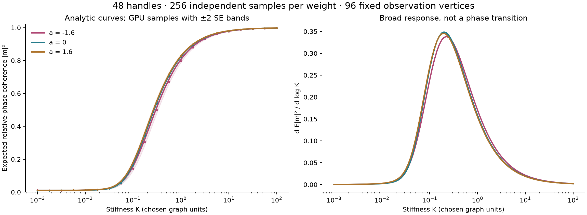

# Imaginary-geometry intuition on 48 handles

The earlier high-genus surface now carries GPU-sampled weighted Gaussian
fields and a rotated harmonic reference field. We also measured how relative
phase coherence changes with stiffness. The result is a **broad, smooth
crossover**, not evidence of a phase transition or a holdout solution.


The three panels share the mesh, Gaussian noise, smoothing, harmonic
reference, camera, and color mapping. Only stiffness changes. Color encodes
the sine of the regularized phase, using gold/blue at -1/+1; it is not a
one-to-one phase legend. Pale short curves integrate a piecewise-flat tangent
field. Lighting is a display choice. The geometry is fully shown, with no
cutaway in these saved images.

## Fixed finite model

The saved mesh is the boundary of a thickened seeded random connected
subgraph of a jittered 4x4x4 lattice. It has 7,200 vertices, 21,882 edges,
14,588 triangles, Euler characteristic -94, and genus 48. We check
connectedness, oriented paired edges, and circular vertex links. Consequently
the real harmonic one-cochain dimension is 96. This is not a uniform random
surface, a hyperbolic surface ensemble, or the holdout's algebraic variety.

Orient each edge from lower to higher vertex index and let `d0` be its incidence
matrix. With `x_e` the squared x-component of its unit embedded direction,

```text
c_e(a) = exp(2 a (x_e - mean_edges(x_e))),
L_a = d0^T diag(c(a)) d0,
h_a = L_a^+ d0^T sqrt(diag(c(a))) z,       z ~ N(0,I_edges).
```

Thus `Cov(h_a)=L_a^+` on the arithmetic-mean-zero vertex space. The geometric
mean conductance is one; varying `a` changes relative edge weights. We use
`a=-1.6,0,1.6` and 256 independent noise columns, paired across the three
weights. There are 256 independent samples per weight, not 768 independent
samples across weights. This is a positive combinatorial energy chosen from
the embedding, not a metric-convergent Laplace--Beltrami discretization.

Apply the same smoothing operator `S=(I-dt L_0)^64`, where
`dt=0.4/max_vertex_degree`. The regularized phase at stiffness `K>0` is
`phi=S h_a/(0.62 sqrt(K))`. The scalar 0.62 is an illustrative choice, not a
calibrated SLE parameter. No per-sample amplitude normalization is used.

A seeded random edge cochain is projected to its harmonic component using
`z-d0 L_0^+ d0^T z-d1^T(d1 d1^T)^+d1 z`. Its closed and coclosed residuals
are below `2e-10`. Reconstruct a tangent vector on each triangle from the
closed edge integrals, then rotate its direction by the local phase. This
uses a chosen harmonic reference with possible zeros, not an everywhere
nonzero global frame. The rotated field is not itself claimed harmonic.

## Phase response and what failed

At 96 fixed seeded observation vertices define
`m=(1/96) sum_i exp(i phi_i)`. This measures scalar phase agreement relative
to the reference; it is not tangent-vector alignment after parallel transport.
The observation vertices' field values are correlated, not independent.
If `C` is the covariance of `S h_a` restricted to them, Gaussian integration gives

```text
E |m|^2 = (1/96^2) sum_ij exp(-(C_ii+C_jj-2C_ij)/(2*0.62^2*K)).
```

This is an analytic finite sum for `K>0`. With strictly positive conductances,
the covariance also varies analytically in `a`. This finite Gaussian model
cannot have a nonanalytic thermodynamic transition at a positive finite
parameter. We examine steepness as a crossover diagnostic, not as a way to
override that fact. No thermodynamic, genus, volume, or mesh limit was tested.



| Anisotropy a | Peak-response stiffness K | Half-maximum interval in K |
|---|---:|---|
| -1.6 | 0.22395 | 0.07440–1.01064 |
| 0 | 0.20079 | 0.07048–0.88580 |
| 1.6 | 0.19594 | 0.06796–0.86772 |

The response widths exceed a decade in stiffness. At `a=0`, changing the
smoothing steps to 0, 16, or 128 moves the peak to approximately 0.9384,
0.3501, or 0.1427. The visually suggestive crossover scale is strongly
regularization-dependent. We did not find evidence for a robust critical
point. The plotted bands are pointwise ±2 empirical standard errors, not
simultaneous confidence bands; the maximum discrepancy from the analytic
prediction is 2.88 pointwise SE across the saved comparisons.

**Trajectory limitation:** 1,527, 1,352, and 1,468 of 1,600 seeded short paths
stop at triangle edges in the three displayed stiffness settings. The
piecewise-constant reconstructed field can point back across the edge just
crossed, so the renderer terminates those paths instead of inventing a
continuation. This high termination rate prevents using path length or
apparent trapping as a physical observable. It is a failed long-flow
approximation, recorded in the [render report](../results/high-genus-flow/render-report.json).
The phase-coherence calculation does not use these trajectories.

An initial GPU covariance contraction failed because this isolated runtime
has no cuBLAS DLL. The final implementation uses CUDA reductions instead.
That failure produced no result; independent CPU covariance reconstruction
checks the replacement.

## Validation and reproduction

```sh
# CPU replay: full topology, all three anchor covariances, all 303 sample summaries:
python experiments/check_high_genus_flow.py
# Actual CUDA run and rendering (CuPy/CUDA environment required):
python experiments/high_genus_flow.py
python experiments/render_high_genus_flow.py
```

Use `--deps PATH` to point the latter two commands at an isolated CUDA runtime.
The recorded device is an RTX 5070 Ti Laptop GPU. Seeded noise and triangle
trajectory tracing use the CPU; Poisson solves, smoothing, covariance
reductions, Hodge projections, depth rasterization, and curve visibility use
CUDA. CPU sparse factorizations check selected full solutions, and the offline
replay reconstructs all three 96x96 covariance matrices to relative error
below `8e-13`. Saved sample means and standard errors are recomputed.

The input mesh and [provenance](../results/high-genus-flow/provenance.json)
are included. To regenerate geometry separately, install
`scikit-image==0.26.0 fast-simplification==0.2.0` and run
`python experiments/generate_high_genus_mesh.py`. Its default writes to
`work/regenerated-high-genus`, preserving the saved experiment input. Exact
geometry can depend on library versions; topology must be checked again.

Credit and limits: [Dubedat](https://arxiv.org/abs/1110.2808) motivates free
fields, operator inverses, and response observables; [Miller--Sheffield's
Imaginary Geometry I](https://arxiv.org/abs/1201.1496) supplies the formal
phase-flow intuition, also explained in [Sellke's exposition](https://math.mit.edu/research/undergraduate/urop-plus/documents/2016/Sellke.pdf).
These sources do not establish this graph model as a critical dimer model,
an SLE approximation, or a solution of the holdout equations. Our finite
adaptation, simulation, and rendering were developed with OpenAI Codex
assistance for `rbajaj5`. The actual algebraic application in this update is
the separate [correction-projection search](hodge-projected-search.md).
