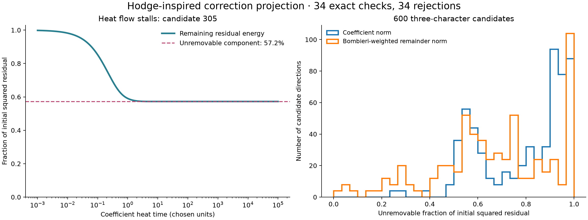

# Using the Hodge decomposition as a search tool

The latest experiment tests **600 distinct rational degree-seven denominator
directions with three characters**. We checked 34 shortlisted/control
directions exactly; all 34 fail. No solution, new family exclusion, or
upstream repository change follows. These numerical searches use real
coefficients. The rational obstruction for each checked direction also rules
out complex numerator coefficients for that fixed denominator.



## The connection to the torus picture

In the torus picture, an orthogonal decomposition separates the gradient,
rotation, and harmonic parts of a field. Here the useful analogue is a
**two-term coefficient complex**, not a claim that a polynomial coefficient
vector is a differential form on that torus.

For a fixed degree-seven denominator `D`, first choose an exact E1 lift `N0`:

```text
N0(F) = A D.
N = N0 + sum_j z_j K_j,              j = 1,...,840.
b_D = B_D(N0) mod F.
M_D[:,j] = B_D(K_j) mod F.
E2 is b_D + M_D z = 0.
```

The 840 cubic Koszul fields span the complete E1 numerator kernel, as checked
in the preceding [degree-seven calculation](degree-seven.md). Reduction
modulo `F` retains an unrestricted degree-eight quotient. The target remains
the original `holdout`, `q=1`, `A=X0^3 Y0^3`, at upstream commit
`b8c4edeb80a82395ec07164caf445cfa43bbbd56`.

Choose a positive diagonal inner product `W` on the physical remainder
coefficients. Least squares decomposes

```text
b_D = M_D u + r,        M_D^T W r = 0.
```

The component in the image can be removed by a numerator correction;
the cokernel component cannot. Changing positive weights changes the
projection and its numerical size, but not whether the exact equation has
a solution. This is the elementary finite-dimensional Hodge analogy.

With a column-normalized correction matrix `T`, the coefficient heat flow is
`e(t)=exp(-t T T^T)b_D`. Its limit is the same orthogonal cokernel component.
For candidate **305**, which has the smallest coefficient-norm score in this
pool, dense SVD gives rank 714 and a limiting squared-residual fraction
**0.5724248233946986**. Sparse least squares gives
**0.5724248233946988**. The exact dual separately proves that the residual
cannot vanish. The apparent heat-flow plateau is an obstruction, not a
near-solution or a thermodynamic phase transition.

## What was actually searched

The earlier six-cycle construction restricted `D` to the Jacobian ideal
`J=(partial_i F)`. This experiment deliberately removes that restriction.
Exact elimination of the degree-seven part of `J` identifies 193 individual
retained E1 basis directions with nonzero class modulo `J`. This is a count
of eligible basis directions, not the dimension of the quotient.

Seed `202610164800` selects six triples with distinct characters:

| Triple | Raw E1 basis indices |
|---|---|
| 0 | 43, 57, 115 |
| 1 | 124, 170, 278 |
| 2 | 117, 120, 195 |
| 3 | 40, 155, 217 |
| 4 | 197, 223, 227 |
| 5 | 64, 78, 154 |

For each triple, divide each basis pair by its denominator's exact coefficient
L1 height and use weights `(1,s,t)`, with both `s,t` ranging over
`{-4,-2,-1,-1/2,-1/4,1/4,1/2,1,2,4}`. This gives 100 directions per triple.
Distinct characters prevent cancellation of their nonzero classes modulo
the invariant Jacobian ideal. All denominators have three characters modulo
`F S1`; the earlier two-character theorem does not cover them.

Two numerical metrics are compared: ordinary coefficient norm and positive
Bombieri weights `alpha!/14!` on the degree-fourteen remainder monomials,
rescaled to geometric mean one. The latter is a chosen norm on this particular
remainder representative; it is not an intrinsic metric on the quotient.
Scores divide the residual norm by the squared ordinary coefficient norm of
`D mod F`. The numerical residual is unchanged by adding a correction to the
chosen E1 lift, while the fraction of initial energy can depend on that lift.

For each triple, check the best two directions under each metric and two
seeded random controls. Overlap leaves 34 distinct exact tests. All 600
numerical fits converge with scaled normal-equation residual below
`4e-11`. All 34 exact tests reject, with correction ranks 714, 719, or 720.
The other 566 directions have numerical scores, not exported exact rejection
certificates. Selecting the smallest score after computing every residual
is an expensive reference search, not evidence of predictive advantage over
random selection. There was no continuous optimization or complex-valued
denominator search in this run.

For each rejected direction a rational functional `lambda` satisfies
`lambda(M_D[:,j])=0` for every one of the 840 columns and `lambda(b_D)=1`.
These identities prove inconsistency over the complex numbers for that
fixed direction. They do not exclude arbitrary combinations in its triple.

## Reproduce and inspect

```sh
# Offline exact checks; Python standard library only:
python -S experiments/hodge_projected_search.py --check
python -S experiments/check_hodge_projected_search.py
# Numerical discovery and coefficient heat-flow figure, CPU:
python experiments/hodge_projected_search.py
python experiments/plot_hodge_search.py
```

The first replay verifies the seeded recipes, shortlist selection from the
saved scores, E1 identities, and all exact duals; a deliberately corrupted
dual is rejected. The second reconstructs E1 and all **28,560 correction
columns** through a separate polynomial API and opposite polynomial-division
ordering, reading the actual pinned upstream target. The dense/sparse heat
check agrees to `2.3e-16`. The repository's 25 tests pass.

[Search source](../experiments/hodge_projected_search.py),
[full numerical report](../results/hodge-projected-search/report.json),
[exact packet](../results/hodge-projected-search/certificates.json.gz), and
[heat-flow check](../results/hodge-projected-search/heat-check.json).

This run uses CPU arithmetic. The separate [genus-48 field experiment](high-genus-flow.md)
uses the GPU. Credit for the complete E1/Koszul framework and previous
symmetry exclusions remains with the repository authors and fqlx, as
documented in the preceding notes. The Hodge/heat-flow presentation and this
bounded implementation were developed with OpenAI Codex assistance for
`rbajaj5`. No new Lean theorem was attempted in this update.

Possible next steps, not results: use the exact duals to constrain a whole
three-character span; search complex rational pairs; or optimize coefficients
while enforcing necessary algebraic conditions. Better conditioning or a
smaller residual alone will still not certify a solution.
