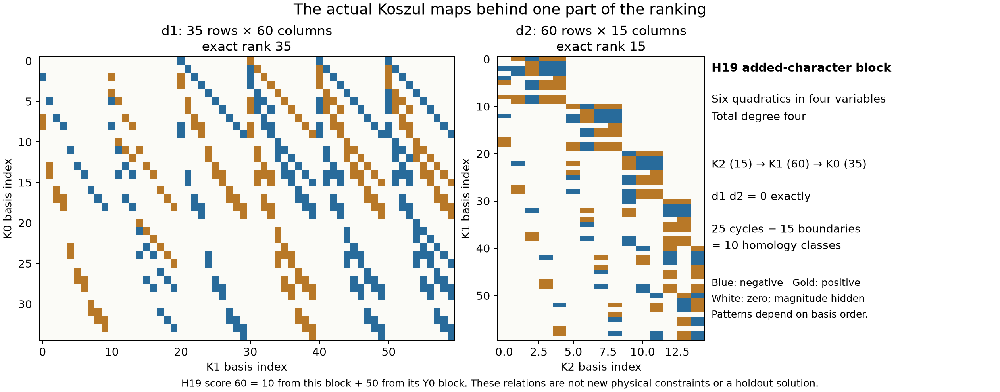
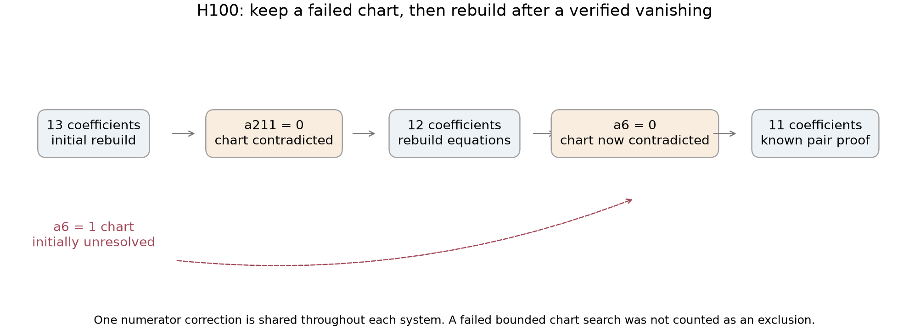

# A prospective Koszul-homology ranking and 132 Y0/Y1 extensions

**Result, 17 October 2026:** all 132 newly selected degree-seven triples
containing the Y0/Y1 character pair are excluded. They are disjoint from
our preceding 416, giving **548 selected three-character exclusions**.
Together with four previously covered triples, this completes all 136
third-character extensions of Y0/Y1. There are 428,536 unordered triples
among the 138 retained characters; other triples, larger supports, and
higher degrees remain open. Holdout is unsolved, and the unconditional
denominator degree bound remains at least seven. No Lean proof or solve
credit is claimed.

**The ranking experiment did not establish an advantage.** We computed
homology before choosing continuations, then gave four high-score and four
low-score families the same bounded method. Both groups closed 4/4.
The remaining seven also closed afterward. This is a useful negative
finding about the proposed priority heuristic, not evidence that homology
cannot help in another form.


## What was selected and held fixed

The protected target is the unchanged `holdout`, q=1, at upstream commit
`b8c4edeb80a82395ec07164caf445cfa43bbbd56`. The selection is every remaining
triple containing `chi_Y0=(1,2,3)` and `chi_Y1=(5,3,0)`, after removing the
union of the previous 152-family selection and the two 132-family extension
batches. The checker reconstructs that disjoint selection. Each character
uses its complete retained E1 eigenspace, modulo the previously established
six-direction `F*S1` gauge. No rank-one denominator condition or vanishing
borrowed from another family is imposed. The coefficient equations allow
a nonzero quotient modulo F.

Local IDs **H1...H132** refer only to this batch. In particular, H19 is not
the old X1/Y1 case B19 or the Y0/X1 case Y19. The manifest records each
character triple, raw basis indices, and global triple number.

First, square identities among necessary equations reduced 117 families
to the known pair. Fifteen survived. Their necessary pure-character blocks
were extracted as consequences of the whole coefficient system; the other
denominator characters were not set to zero to obtain those consequences.

## From Yang and Eisenbud-Erman to a testable heuristic

The [preceding reference note](categorical-syzygies.md) separates Yang's
equivariant-sheaf interpretation of geometric Koszul cohomology from
Eisenbud-Erman's categorical pairing. Both motivate retaining complexes
and maps rather than treating a numerical rank as the entire invariant.
Here the implemented object is the classical Koszul complex of the
quadratic **necessary equations** P in each block's polynomial ring S:

$$
K_k(P;S)=S(-2k)^{\binom{r}{k}},\qquad
H_1=\ker(d_1)/\operatorname{im}(d_2).
$$

We compute total degrees three and four. The score is the sum of
`dim H1` in degree four across the three blocks. Empty generator lists
contribute zero; they mean missing pure-block constraints, not regularity
of the full physical system. The calculation records explicit quotient
representatives, not just dimensions. A class in H1 is a relation among
equations, **not a new equation or a denominator vanishing**.

The [ranking plan](../results/homology-guided-triples/ranking-plan.json)
was saved before the first follow-up run. Ties use ascending local ID.
It selected H19/H49/H96/H108 (scores 60/50/50/50) and low controls
H61/H113/H84/H46 (0/0/3/6). Each received the same degree-three/four block
search, shared-numerator chart propagation, and rebuilding, with two
workers and 120 seconds per family. This is a small prospective comparison,
not a randomized or size-matched trial. Timing is retained but is not a
controlled efficiency benchmark.

Both groups closed 4/4. The saved comparison receipts preserve that
**125/132 checkpoint** before incorporating the seven later continuations.
The full ranking's high scores are dominated by the Y0 anchor block.
For example, H19's score is 10 from its added character plus 50 from Y0;
H49, H96 and H108 get all 50 from Y0. H61 closes despite an empty
added-character pure block. This suggests that an aggregate score can
overemphasize anchor relations instead of the obstruction needed to remove
the third character. That is an interpretation of this experiment, not a
proved general principle.



This picture is H19's added-character block: six quadratics in four
variables, with `K2 -> K1 -> K0` dimensions `15 -> 60 -> 35`. Exact ranks
are 15 and 35, so 25 cycles modulo 15 boundaries leave ten classes.
All 15 composition columns vanish; an explicit nonboundary representative
is also checked. Colors show coefficient signs, not magnitudes. Basis
order controls the apparent bands. H19's cubic image is already full,
which supplies the four coordinate-cube identities used in its exclusion.

This does not apply Yang's theorem or implement the Eisenbud-Erman pairing:
no suitable geometric data and hypotheses or derived-category pairing have
been supplied. Nor does it identify these groups with surface genus,
Dubedat's GFF/SLE objects, or a phase transition. A future test could rank
added-character blocks separately and study verified chain maps under
rebuilding; neither is claimed as completed here.

## Exact exclusion, rebuilding, and two failed charts

The 117 square reductions are followed by four closures using powers in
small degree-three/four maps (H19, H30, H55, H84). Eleven other families
need shared-numerator charts and rebuilding. In these systems the complete
allowed numerator correction space is retained; it is shared across all
denominator coefficients. Twenty-one of 23 attempted normalized charts
contradict at their recorded stages. The two unsuccessful charts are kept:

- H61, raw coefficient 213: the first chart search fails. Other charts
  force three zeros, and the rebuilt block equations remove the remaining
  third-character direction.
- H100, raw coefficient 6: the first chart search fails, while coefficient
  211 is forced to zero. Rebuilding with that zero makes the repeated
  coefficient-6 chart contradict. Its denominator counts are 13 -> 12 -> 11.



Every resulting support lies in the Y0/Y1 pair. A dependency audit caught
an important mismatch before publication: the archived pair checker starts
with **11** directions, but the full retained pair has **14**. The new
`full-pair-binding.json.gz` explicitly removes raw directions 170, 198,
then 168 and matches the eleven-direction proof. That proof and its final
single-character dependency are replayed. We credit the prior Y0/Y1
exclusion; this is a checked binding to it, not a new pair exclusion.

The first new checker also failed because a rank-only elimination mutated
its input equations before identity verification. Passing copies corrected
that checker bug; original witness packets were not changed to accommodate
the failure. Both physical reconstructions then passed. The
[audit record](../results/homology-guided-triples/audit.json) retains these
corrections and the two unsuccessful charts.

## Reproduce and assess the checks

From a recursive checkout, with Python 3.11, assertions enabled:

```sh
python -S experiments/check_homology_guided_triples.py
python -S experiments/check_homology_guided_triples.py --independent
python -S experiments/plot_homology_guided_triples.py --check
```

All three pass locally. The two physical polynomial implementations use
different construction APIs and opposite monic-division orders; they share
the identity and homology checking utilities. This is not separate human
review or a fresh independent-review agent. Each full replay checks 4,597
physical duals, 581,595 correction pairings, 112,401 quadratic pairings,
493 square identities, 13 higher-power identities, 70 finite homology
complexes, 92 graded maps, and 23 charts with 923 inferences. It rejects
182 altered power witnesses. These counts include inherited and rebuilt
work, not distinct discoveries. The pair dependency separately replays
340 chart inferences and its seven single-character charts.

Discovery used two workers: 300 seconds per baseline chunk, 60 seconds
per profile, and 120 seconds per follow-up family. All jobs completed
within their limits. Every packet, plan, timing, log, empty block, and
unsuccessful strand/chart is retained in the
[result directory](../results/homology-guided-triples/). Source-only checking
uses standard-library rational arithmetic, no CAS or GPU. Plot generation
uses Matplotlib: `python experiments/plot_homology_guided_triples.py`.
The plotted counts, exact matrices and source hashes are checked against
the packets. Static figures were visually inspected and label overlaps
corrected. Dedicated Linux CI runs the three checking commands; its status
is recorded separately after publication.

## Attribution

Prepared with OpenAI Codex assistance for rbajaj5. Credit the project
authors' certificate and geometric-support framework, the bridge attributed
there to Benjamin E. Diamond, Griffiths's residue theory, fqlx's preceding
E1/Koszul, symmetry, one-/two-character calculations including Y0/Y1, and
our preceding exact physical-dual and rebuilding work. Eisenbud's
*The Geometry of Syzygies* motivates the graded-module approach. The
distinct contributions of [Yang](https://link.springer.com/article/10.1186/s40687-014-0010-9)
and [Eisenbud-Erman](https://ems.press/journals/jems/articles/14923) motivated
this experiment; the finite computations here do not claim their theorems
as applicable to the physical coefficient ideals.
