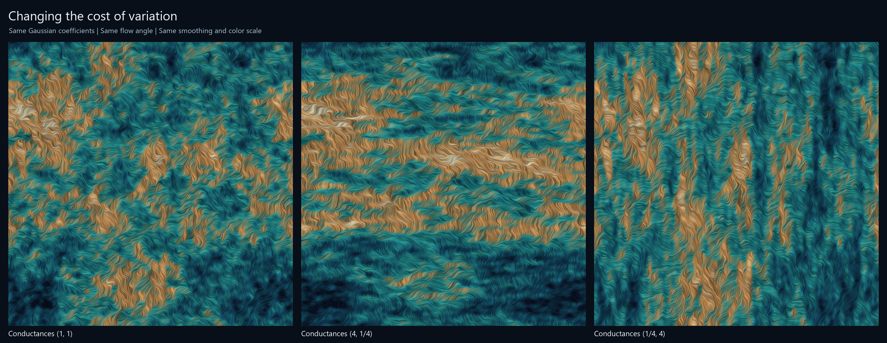

# Imaginary geometry: field, angle, and directional weighting

These are computed illustrations of the smooth-field intuition in
[Mark Sellke's introduction](https://math.mit.edu/research/undergraduate/urop-plus/documents/2016/Sellke.pdf).
The underlying continuum theory is due to
[Jason Miller and Scott Sheffield](https://arxiv.org/abs/1201.1496).
[Julien Dubedat's dimer/operator viewpoint](https://arxiv.org/abs/1110.2808)
motivates looking at free fields, precision operators, and their deformations
together. Our finite weighted model is a chosen visualization, not a theorem
from these sources.


The three panels share exactly the same scalar field and texture noise. The
angle field is `h_smoothed / 0.62 + theta`. Its unit direction is
`(cos(angle), sin(angle))`; changing `theta` changes the integrated curves.
The texture is line integral convolution: noise averaged along short curves
of this direction field. It makes local flow direction visible without
claiming that every bright strand is a separately sampled SLE curve.



Here the Gaussian spectral input, flow angle, smoothing, texture noise, and
color mapping are held fixed. The three graph precisions are
`L_c = cx L_x + cy L_y` for conductances `(1,1)`, `(4,1/4)`, `(1/4,4)`.
The product of conductances is one in each case. Higher conductance penalizes
variation in that direction. Each field before smoothing has covariance
`L_c^+` on mean-zero functions of the periodic 1280 by 1280 grid. They are
coupled through common Gaussian coefficients; the fields themselves differ.

For Fourier index `(kx,ky)`, the precision eigenvalue is

```text
lambda = 4 cx sin(pi kx/n)^2 + 4 cy sin(pi ky/n)^2.
```

We multiply the transform of white noise by `1/sqrt(lambda)`, remove the zero
mode, and apply `exp(-18 L_isotropic)` before taking the inverse transform.
No sample-dependent amplitude normalization enters the direction field.
The fixed field color scale is [-2.4, 2.4]; the same fixed contrast map is
used for every flow texture. The display may saturate outside that color range.

Actual CUDA work includes Fourier transforms, inverse-square-root weighting,
heat smoothing, midpoint flow integration, texture convolution, and coloring.
CPU code draws seeded Gaussian/noise coefficients and encodes the PNGs.
The recorded hardware is an RTX 5070 Ti Laptop GPU. Independent NumPy Fourier
transforms agree to less than `3e-15`; the spectral energy check has relative
error below `2e-16`. All rendered texture values are finite. A float wrapping
edge case in the first rendering attempt was detected by this finite-value
check and fixed before saving the images.

```sh
python experiments/imaginary_geometry_gallery.py
```

Use the repository's CUDA requirements, or pass `--deps` to an existing
isolated CuPy/CUDA dependency directory. Seed: `2026101649`.
[Source](../experiments/imaginary_geometry_gallery.py),
[numerical report](../results/imaginary-geometry/report.json), and
[full-size single image](../results/imaginary-geometry/imaginary-currents.png).
The inline view uses the saved `display-fields.json`: extra heat time eight,
stride-five subsampling to 256 by 256, and quantization to multiples of 1/4000.
Its curves are computed from that coarser display field.

The periodic square is a flat torus of genus one. It is not the earlier
genus-48 surface. Smooth numerical ODE trajectories also do not reproduce all
interactions of continuum imaginary-geometry flow lines. No continuum
convergence, exact GFF/SLE coupling, or Hodge certificate is claimed.
The images explain the geometric motivation recorded in [the ledger](../LEDGER.md);
the [determinant experiment](dubedat-cycles.md) is the separate algebraic test.
