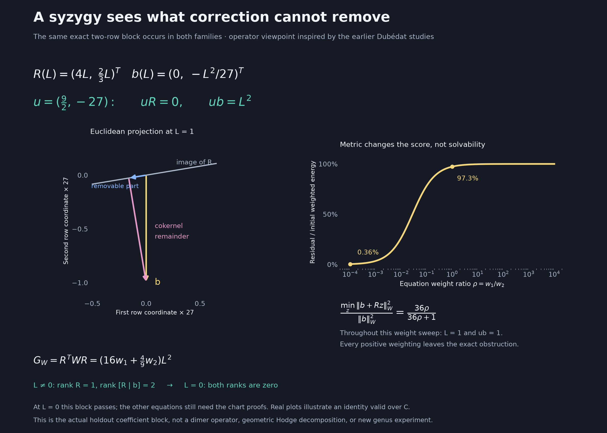
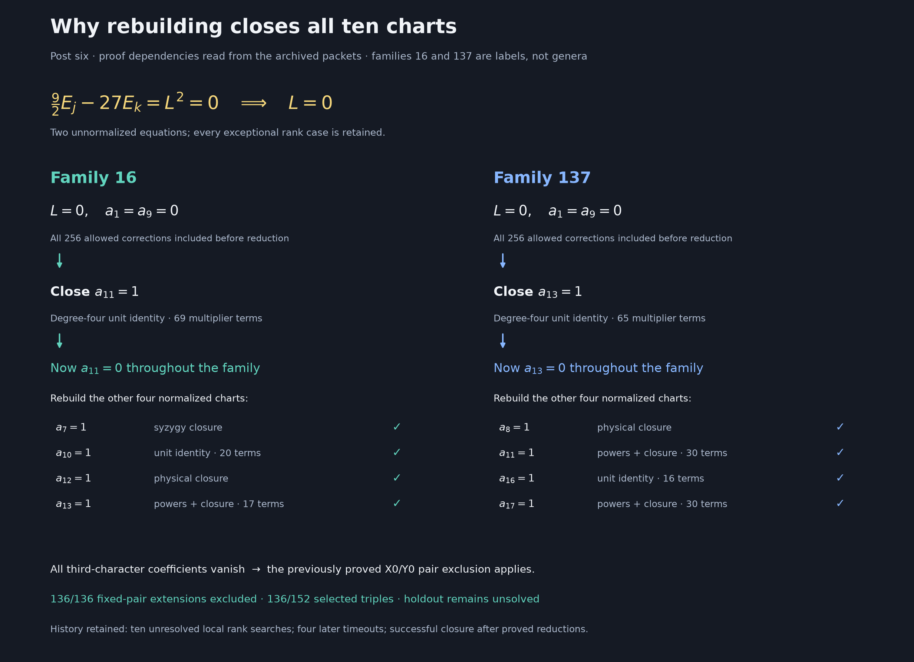

# Visualizing the Koszul correction map

This companion to [post six](https://github.com/hodge-computer/sextics/discussions/44#discussioncomment-18986224)
shows the actual operators behind the exclusions of families 16 and 137.
The pictures answer three questions: which corrections affect which equations,
which combinations cancel every correction, and how the resulting constraints
close the charts. The [proof and failed searches](koszul-rank-continuation.md)
remain the source of the family exclusions. This adds no new exclusion or
upstream post.

For a geometric rather than support-count view, see the later
[interactive response ellipses and exact syzygy height](koszul-geometric-map.md).
Those use three fixed denominators from the optimization packet, with all
840 correction directions checked in each example.

## Which map are we drawing?

The gradient Koszul differential is

$$
d_2:S_3^{15}\longrightarrow S_8^6,\qquad
h e_i\wedge e_j\longmapsto h(F_j e_i-F_i e_j).
$$

It produces numerator corrections that preserve the first equation
`N(F)=AD`. For fixed denominator coefficients `a`, apply the second-equation
operator `B_D(N)=D div N - N(D)`, reduce modulo `F`, and extract coefficients.
The resulting matrix is the **induced correction map** `R(a)`:

```text
correction coefficients z --d2--> numerator correction K(z)
                        --B_D, mod F, coefficients--> R(a)z
```

Thus `R` is a composition involving the Koszul differential. Its rows are
equations, and its columns are allowed correction directions. With a checked
first-equation lift `N0`, the target equations become

$$
R(a)z+b(a)=0.
$$

A row vector `u(a)` with `u(a)R(a)=0` is a left syzygy of this matrix. It gives
the necessary denominator equation `u(a)b(a)=0`. These are polynomial
relations among the correction equations; we do not identify them with a
geometric Koszul-cohomology group.

## The full support and its cancelling relations


The source packets are the pivotal charts `a11=1` in family 16 and `a13=1`
in family 137, after their recorded exact substitutions. Each family starts
with all **256** stabilizer-compatible correction directions. All their
coordinate positions remain visible; a zero column can result from a proved
substitution and need not represent an intrinsic kernel of the unreduced map.

For `R`, a pixel counts nonzero polynomial entries in eight consecutive
physical rows and one correction column. For `U`, a pixel counts multiplier
monomials in one relation and sixteen consecutive physical rows. The two
families use common color scales without clipping. These are support counts,
not coefficient magnitudes, singular values, or ranks. Each family has its
own physical equation order.

The white line separates constant multipliers from selected affine
multipliers. All **173** displayed identities, containing **29,031** physical
equation-multiplier products, are replayed exactly against the stored rows.
They satisfy `UR=0` and `Ub=P`. The displayed selection is not asserted to
generate the full left-syzygy module.

## A two-row obstruction that can be seen completely



Before chart normalization, both families contain the block

$$
R(L)=\begin{pmatrix}4L\\2L/3\end{pmatrix},\quad
b(L)=\begin{pmatrix}0\\-L^2/27\end{pmatrix},\quad
u=(9/2,-27).
$$

Here `L` is the family's specified linear denominator form. The
[exact row indices, forms, and original identities](koszul-rank-continuation.md#two-physical-rows-force-a-linear-vanishing)
fix its provenance. Since `uR=0` and `ub=L^2`, solvability forces `L=0`.
For `L!=0`, `rank R=1` and `rank [R|b]=2`; at `L=0` both ranks are zero.
The block then vanishes and the remaining equations still require proof.
This rank change is algebraic, not evidence of a statistical phase transition.

The left panel fixes real `L=1` and scales both row coordinates by 27.
It splits `b` into its Euclidean projection onto `im R` and an orthogonal
remainder. The latter represents the obstruction in the cokernel.

The right panel returns to our earlier anisotropic-Gram intuition. For
positive equation weights `W=diag(w1,w2)`, direct minimization gives

$$
G_W=R^TWR=(16w_1+4w_2/9)L^2,\qquad
z_* = \frac{w_2L}{18(36w_1+w_2)},
$$

$$
\min_z\|b+Rz\|_W^2=
\frac{4w_1w_2L^4}{81(36w_1+w_2)}.
$$

For `L!=0`, the fraction of the initial weighted energy remaining is
`36 rho/(36 rho+1)`, where `rho=w1/w2`. At `L=1`, changing `rho` from one
to `0.0001` lowers this fraction from **97.3% to 0.36%**, while the exact
obstruction remains `ub=1`. A small weighted score can therefore come from
discounting an equation. This is an exact diagnostic for this block, not a
new benchmark across candidate denominators. The Gram inverse is undefined
at `L=0`; that branch is handled explicitly. The identity `ub=L^2` holds
over the complex numbers, while the projection plot uses a real slice.

## How the local obstruction enters the proof



The critical ordering is to prove a global vanishing, substitute it, and
rebuild the correction equations. Closing a normalized chart then permits
another global zero before the other charts are rebuilt. The archived history
includes ten unresolved local-rank searches and four later timeouts. The
successful proof uses the reductions and complete chart dependencies shown
here; neither a timeout nor a favorable matrix picture closes a chart.

## Where the geometric motivation fits

Dubedat's [work on dimers and families of Cauchy--Riemann operators](https://arxiv.org/abs/1110.2808v2)
studies operators, inverses, and determinant variation. That motivates examining
our actual matrix's image, obstruction, and singular locus. It supplies a
research viewpoint here: no identification of `R` with his dimer operator or
an imaginary-geometry construction has been established. Our earlier
[cycle-matrix experiment](dubedat-cycles.md) records a separate concrete
adaptation and its 45 failed candidates.

Genus is not a parameter of these figures. Chatterjee and Jafarov's
[strong-coupling expansion](https://arxiv.org/abs/1604.04777) gives a different
setting in which surface topology enters a `1/N` expansion. Chatterjee's
[concentration and chaos work](https://arxiv.org/abs/0810.4221) concerns
fluctuations and perturbations of random systems. Applying either framework
would require an additional model and checked correspondence. The present
focus is the deterministic polynomial correction map.

## Reproduce and check

```sh
python experiments/plot_koszul_continuation.py
python experiments/plot_koszul_continuation.py --check
```

Generation saves PNG and SVG versions of all three figures and a
[source/hash report](../results/degree7-rank-strata/visualization-report.json).
The check replays the 173 displayed syzygies over `Fraction`, compares the
ten-chart metadata with both saved proof-validation reports, checks the
recorded failed searches, and verifies the saved figure hashes. Twenty exact
rational cases check the local weighted formula, cancellation, and the `L=0`
branch. These sample checks accompany the explicit derivation above.

This visualization check consumes stored physical equations. Reconstruction
from the fixed target is performed by the existing standard and independent
proof checkers, which passed at
[proof commit 17799c6](https://github.com/rbajaj5/hodge-lab/actions/runs/38988964935).
It is not a new independent proof review. No GPU is needed for these plots.
