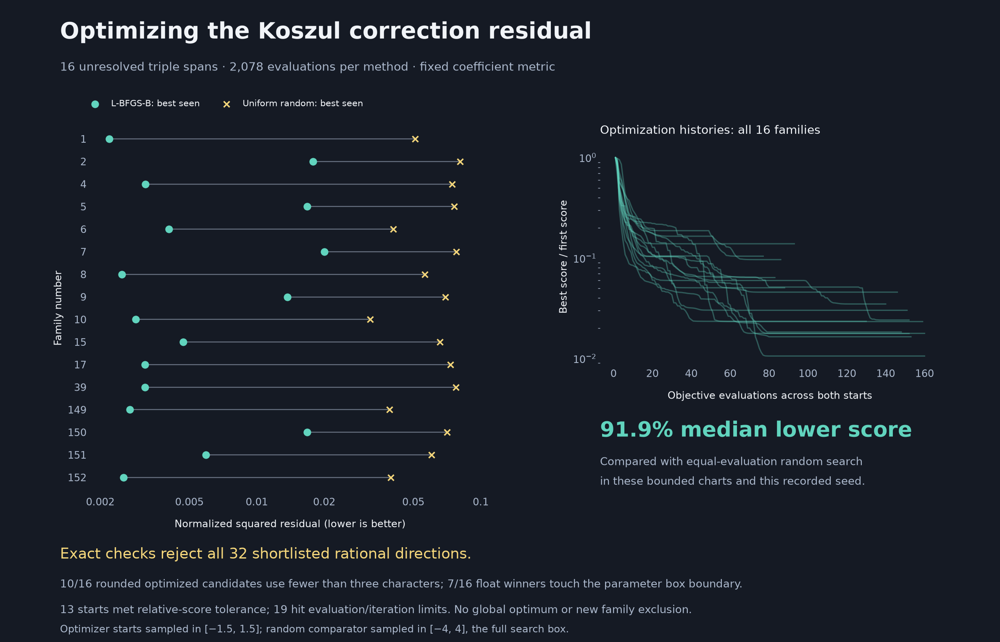

# Standard parameter optimization on the remaining selected triples

**Result:** multi-start parameter optimization finds a lower numerical score
than the uniform-random comparator in all 16 tested families, with a **91.9%
median reduction**. Exact checks reject **all 32 distinct rounded finalists**,
one optimized and one random per family. No certificate or new family
exclusion was found. This is a Hodge Lab experiment; it is not post seven in
the upstream discussion.



## Fixed target and search region

The live upstream head was checked before this batch and remains
`b8c4edeb80a82395ec07164caf445cfa43bbbd56`; `holdout` has no accepted proof or
pending solve PR. The [catalogue](https://github.com/hodge-computer/sextics/blob/b8c4edeb80a82395ec07164caf445cfa43bbbd56/data/catalogue.json)
contains 19 instances without a proof manifest. We start with holdout because
its checked E1/Koszul machinery supplies the actual optimization equations.
No upstream file was changed. The target remains

$$
q=1,\quad A=X_0^3Y_0^3,\quad
F=X_0^6+X_1^6+X_2^6+Y_0^6+Y_1^6+Y_2^6
  +X_0^3X_1Y_0Y_1+X_1^3X_2Y_1Y_2.
$$

After post six, the selected triples outside the completed fixed-`X0/Y0`
extension set are families
`1,2,4,5,6,7,8,9,10,15,17,39,149,150,151,152`.
We optimize all surviving basis coefficients from each family's first exact
reduction, rather than selecting one denominator direction per character.
Those reductions are inherited from the
[earlier triple packet](three-character-families.md); this is not a new replay
of their entire family proofs. The new fixed-direction checks below reconstruct
the actual equations directly and do not assume that a candidate satisfies
the remaining necessary constraints.

For raw denominator/lift pairs `(D_i,N_i)`, put
`h_i=sum |coefficients of D_i|` and use

$$
D(x)=D_0/h_0+\sum_{i>0}x_iD_i/h_i,\qquad -4\le x_i\le4.
$$

This is one bounded real affine chart per family, with **14 to 18 free
parameters**. It excludes the chart at infinity and does not exhaust complex
coefficients. The corresponding first-equation lift is fixed by the same
linear combination of the `N_i`.

## Objective and ordinary optimization

Use the [correction-map viewpoint](koszul-map-visualizations.md):

$$
b(x)=B_{D(x)}(N_0(x))\bmod F,\qquad
M(x)_{:,j}=B_{D(x)}(K_j)\bmod F,
$$

$$
f(x)=\frac{\min_z\|b(x)+M(x)z\|_2^2}
                 {\|D(x)\bmod F\|_2^4}.
$$

All **840** cubic Koszul corrections are included at every evaluation.
There are 5,432 to 6,464 physical coefficient rows, depending on the family.
Reducing modulo `F` permits a nonzero quotient. The denominator normalization
prevents a common rescaling toward zero from improving the score. Equation
weights remain fixed; we do not optimize a metric that can discount an
inconvenient equation. This coefficient norm is not an intrinsic geometric
norm on the quotient.

Each evaluation uses sparse [LSMR](https://docs.scipy.org/doc/scipy/reference/generated/scipy.sparse.linalg.lsmr.html)
to eliminate the linear correction parameters, with column scaling for
conditioning and no damping. The nonlinear outer search uses
[L-BFGS-B](https://docs.scipy.org/doc/scipy/reference/optimize.minimize-lbfgsb.html)
with two seeded starts. This is standard variable projection. At a locally
constant rank, the residual's orthogonality to `im M` lets us differentiate
the minimized score without differentiating the fitted `z`:

$$
\partial_i\|r\|^2=2r^T(\partial_i b+(\partial_i M)z),\qquad r=b+Mz.
$$

The implementation also differentiates the denominator norm in `f`.
Rank changes can invalidate smoothness assumptions; no global convergence
or differentiability theorem for this search is claimed.

The recorded configuration is seed `202610162240`, at most 60 iterations and
80 objective evaluations per start, and a 120-second outer-search cap per
family. Optimizer starts are uniform in `[-1.5,1.5]` in each coordinate.
The comparator samples the full `[-4,4]` box and receives exactly the same
number of objective evaluations used by the optimizer in that family.
Thus this compares these specific strategies, including their different
initial distributions; it does not isolate initialization effects or compare
equal wall-clock budgets. Gradient diagnostic and endpoint validation calls
are separate from the **2,078 evaluations per strategy**.

## Outcomes, failures, and boundaries

The optimized best scores are **74.3% to 95.9% lower** than each family's
best random score, with a median reduction of **91.9%**. The smallest score
is approximately `0.00219366`, in family 1. These are squared residual scores,
not solution probabilities or distances to a certified solution.

Of the 32 starts, 13 satisfy the optimizer's relative-function tolerance,
11 hit the iteration cap, and eight hit the evaluation cap. No start hits
the wall-clock cap. All recorded inner least-squares fits meet the stated
normal-equation tolerance. A reported function-tolerance stop is not a
global optimum or proof of stationarity. Seven winning float candidates
touch a parameter-box boundary, so a wider chart remains a possible follow-up.

Each family's best optimized and random point is rechecked at tighter
least-squares tolerance, then each chart coefficient is rounded to a rational
with denominator at most 1,024 **before** dividing by its basis height.
Rounded points receive a fresh numerical score and exact equation checks.
The raw basis coefficients can consequently have denominators larger than
1,024. Rounding changes a direction; exact rejection of the rounded point
does not itself reject the original floating-point point or a neighborhood.

Among the 16 rounded optimization winners, **five use one character, five
use two, and six retain all three**. This is a useful limitation of the
unconstrained objective: it can favor already-excluded boundary sectors.
The plotted floats need not have those exact zero coefficients. No whole
triple family is excluded by this experiment.

All **32 distinct rational directions** fail. For each, a rational dual
`lambda` satisfies `lambda(b)=1` and `lambda(M[:,j])=0` for all 840 columns.
Existing necessary-condition duals supply the witnesses; the checks validate
their use directly on each new direction. This excludes a complex numerator
for that fixed rational denominator. It supplies no obstruction to all
denominators in the searched chart.

## Checks and reproducibility

Discovery ran on the CPU with Python 3.11.9, NumPy 2.4.6, and SciPy 1.17.1.
The record includes every objective evaluation, starting point, stopping
reason, rationalized candidate, and exact dual. A one-family pilot preceded
the full run and was reproduced as family 1 of the saved batch.

- **48 derivative checks pass:** central differences versus analytic
  derivatives at seeded interior points; maximum scaled discrepancy
  `1.35e-11`. These are local diagnostic checks, not a differentiability proof.
- **All 4,156 search fits pass:** maximum scaled normal-equation residual
  `2.45e-11`.
- **Standard exact replay passes:** 32 directions, 26,880 correction-column
  pairings, and rejection of a corrupted dual.
- **Separate polynomial assembly passes:** it reads the fixed upstream
  target, uses a different polynomial API and opposite reduction order, and
  verifies all 26,880 column pairings. It also independently recomputes all
  32 rounded numerical scores; maximum relative discrepancy `1.29e-15`.

The separate assembly shares the E1 basis file and SciPy numerical solver;
it is not independent human review or a second optimization library.
No Lean or accepted-solve check was run, since every selected direction fails
the necessary equation test.

```sh
# Exact replay, standard library:
python -S experiments/optimize_koszul_parameters.py --check
python -S experiments/optimize_koszul_parameters.py --check --independent
# Independent rounded numerical-score reconstruction:
python experiments/optimize_koszul_parameters.py --check --independent --numerics
python experiments/plot_parameter_optimization.py --check
# Regenerate the bounded search and figure:
python experiments/optimize_koszul_parameters.py
python experiments/optimize_koszul_parameters.py --check --independent --numerics
python experiments/plot_parameter_optimization.py
```

[Full search history](../results/koszul-parameter-optimization/report.json),
[exact packet](../results/koszul-parameter-optimization/certificates.json.gz),
[summary](../results/koszul-parameter-optimization/summary.json), and
[independent score checks](../results/koszul-parameter-optimization/numerical-validation.json).

Credit remains with the repository authors' normalized certificate framework,
fqlx's E1/Koszul and symmetry work, and the earlier Hodge Lab reductions.
The numerical implementation uses SciPy's L-BFGS-B and Fong--Saunders LSMR.
The code and explanation were developed with OpenAI Codex assistance for
`rbajaj5`. This batch uses ordinary parameter optimization; no advantage is
attributed to imaginary geometry, genus, or GPU computation.

Useful next experiments include matched initialization distributions,
multiple seeds, wider charts, and explicit lower bounds on each character
component's norm to keep searches away from the known excluded boundary.
These are proposals, not additional results in this batch.
