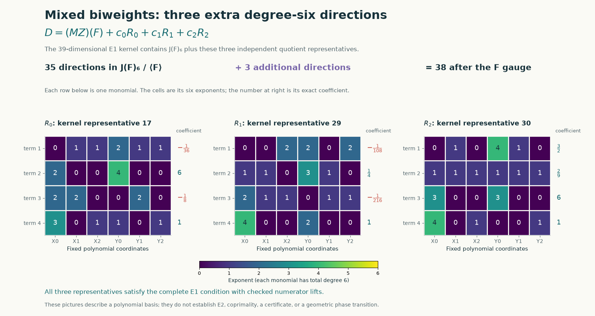
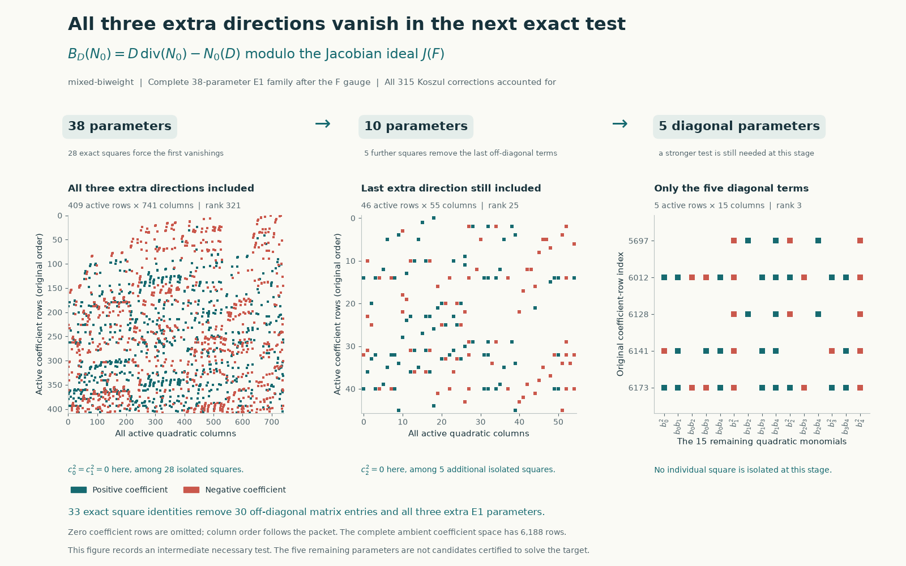
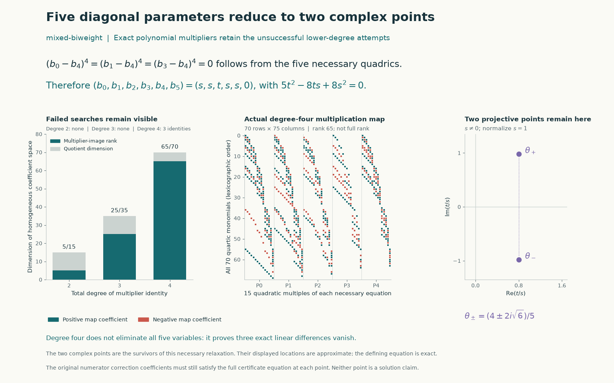

# Mixed biweights: the three extra directions and the degree-six obstruction

The complete degree-six denominator family for the fixed `mixed-biweight`
target is excluded over the complex numbers. Together with the
[previous degree-zero through degree-five result](fresh-instance-baselines.md),
any certificate must have denominator degree **at least seven**. This is
a lower bound; the instance remains unsolved.

The important change from the preceding restricted search is that all three
directions outside the Jacobian ideal are included from the start. Exact
equations eliminate them. The remaining diagonal family has two complex
points after normalization, and a three-term coefficient functional rejects
both using the full shared numerator correction space.

## The fixed problem and its complete first-equation kernel

Variables are ordered $Z=(X_0,X_1,X_2,Y_0,Y_1,Y_2)$, with $q=1$ and
$A=X_0^3Y_0^3$. The protected sextic is

$$
F=\sum_{i=0}^2(X_i^6+Y_i^6)
+\tfrac12X_0^3X_1Y_0Y_1
+\tfrac12X_1^3X_2Y_1Y_2
+\tfrac13X_0X_2Y_0^3Y_2.
$$

The exact record, `why.md`, and `provenance.json` are parsed or hash-bound
in the packets. They remain unchanged from pinned upstream source
`b8c4edeb80a82395ec07164caf445cfa43bbbd56` and checked current main
`0768616c9b70b318011b7c421abdd640322ccbfc`.

Write $J=(F_i)$, where $F_i=\partial_iF$. Euler normalization makes every
certificate satisfy

$$
N(F)=AD,\qquad B_D(N):=D\operatorname{div}N-N(D)\equiv0\pmod F.
$$

The [complete degree-six E1 packet](../results/fresh-instance-degree6/mixed-biweight/degree-6.json)
has numerator rank 4437, augmented rank 4860, and denominator kernel dimension
39. Its Jacobian subspace $J_6$ has dimension 36. The saved kernel-lift
indices **17, 29, 30** supply three additional representatives $R_0,R_1,R_2$,
with explicit numerator lifts $T_r(F)=AR_r$. Each representative has four
monomials; its exact support is visualized below.

Every possible denominator and initial numerator can therefore be written

$$
D=(MZ)(F)+\sum_{r=0}^2 c_rR_r,\qquad
N_0=A MZ+\sum_{r=0}^2 c_rT_r.
$$

The 315 quadratic multiples of the 15 Koszul fields are independent and
exhaust the numerator kernel. Thus every lift is $N_0+K$, with all 315
correction coefficients available. The verifier checks all 38 displayed
lifts after the Euler gauge, and verifies that adding the $F$ direction
gives a basis of the full 39-dimensional E1 kernel.

The gauge $M\mapsto M-M_{55}I$ replaces $D$ by $D-6M_{55}F$ and $N$ by
$N-M_{55}A Z$. It preserves the second equation modulo $F$ and coprimality.
The [explicit gauge identity](fresh-instance-degree6.md#euler-gauge-preserves-the-full-equation)
applies without requiring $D\in J$. We set $M_{55}=0$, leaving 35 matrix
entries and the three extra coefficients.

## Why quotienting by the Jacobian ideal still works for the extras

For an elementary correction $K=c(F_j\partial_i-F_i\partial_j)$,

$$
\operatorname{div}K=(\partial_i c)F_j-(\partial_j c)F_i\in J.
$$

Its components also belong to $J$. Consequently $B_D(K)\in J$ for **any**
denominator $D$, including the three extra directions outside $J_6$.
Since $F\in J$, every full certificate must satisfy $[B_D(N_0)]=0$ in
$S_{12}/J_{12}$. This is the actual quadratic map for the complete
38-parameter family, rather than the Hessian-only formula for $D\in J$.

| Stage | Remaining parameters | Quadratic columns | Exact quotient rank | New square vanishings |
| --- | ---: | ---: | ---: | ---: |
| Complete family | 38 | 741 | 321 | 28 |
| Rebuild after the first zeros | 10 | 55 | 25 | 5 |
| Diagonal restriction | 5 | 15 | 3 | 0 |

The first step kills $c_0,c_1$; the second kills $c_2$. Together the 33
rational square functionals force all three extra coefficients and all 30
off-diagonal entries of $M$ to vanish over $\mathbb C$. The remaining
parameters are $a_0,\ldots,a_4$, with $a_5=0$.

## The five diagonal equations retain two complex points

As in the cyclic calculation, eliminate the enlarged correction span

$$
W=F S_6+\operatorname{span}\lbrace
B_{Z_iF_i}(K_k):0\leq i<6,\ 0\leq k<315\rbrace.
$$

It has 2,352 columns and rank 1,451. Five rational functionals on the original
physical coefficient space give necessary quadratics $Q_0,\ldots,Q_4$.
This relaxation permits the products of denominator and correction
coefficients to vary independently; it cannot establish existence.

The degree-two and degree-three multiplier searches do not force the needed
linear differences. Their ranks are 5/15 and 25/35. In degree four the rank
is **65/70**, not a full image. Nevertheless, three exported rational identities
give

$$
(a_0-a_4)^4=\sum_r C_{0r}Q_r,\qquad
(a_1-a_4)^4=\sum_r C_{1r}Q_r,\qquad
(a_3-a_4)^4=\sum_r C_{3r}Q_r.
$$

The quadratic multipliers expand to 1,731 coefficient products, checked
exactly. These identities imply
$a=(s,s,t,s,s,0)$. Substituting into the five original quadratics makes each
a rational multiple of

$$
P(t,s)=5t^2-8ts+8s^2.
$$

At least one multiplier is nonzero, so $P=0$ is necessary. If $s=0$, then
$t=0$ and the gauge-fixed denominator is zero, which is inadmissible. Scale
to $s=1$. The two remaining choices are

$$
\tau=\frac{4\pm2\sqrt{-6}}5,
\qquad a=(1,1,\tau,1,1,0).
$$

This explains the earlier failure to force individual coordinate powers:
the relaxed equations really do have nonzero complex points. Their existence
does not imply that one shared numerator correction works.

## A three-term functional rejects both candidates

For either root of $5\tau^2-8\tau+8=0$, set

$$
D_\tau=Z_0F_0+Z_1F_1+\tau Z_2F_2+Z_3F_3+Z_4F_4,
\qquad
N_\tau=A(Z_0,Z_1,\tau Z_2,Z_3,Z_4,0).
$$

Now keep the **shared** 315 correction coefficients. The 777 columns of
$F S_6+\operatorname{span}(B_{D_\tau}(K_k))$ have rank 742 over
$\mathbb Q[\tau]/(5\tau^2-8\tau+8)$. Adjoining $B_{D_\tau}(N_\tau)$ raises
the rank to 743.

There is a particularly small witness. For a degree-twelve polynomial $H$,
let $[m]H$ mean the coefficient of monomial $m$. Define

$$
\ell_\tau(H)=\frac{8-5\tau}{5184}[X_0^2X_2^5Y_2^5]H
+\frac{5\tau-28}{720}
\bigl([X_0^3Y_0^3Y_2^6]H-[X_0^3Y_0^3Y_1^6]H\bigr).
$$

Exact coefficient arithmetic gives

$$
\ell_\tau(FS_6)=0,\qquad
\ell_\tau(B_{D_\tau}(K_k))=0\text{ for every }k,\qquad
\ell_\tau(B_{D_\tau}(N_\tau))=1.
$$

The three-term functional therefore contradicts the full second equation.
The checker uses pairs of rational numbers representing $u+v\tau$ and
reduces products with $\tau^2=(8\tau-8)/5$. The identities evaluate at both
complex roots. No numerical approximation or coprimality claim based only
on rational irreducibility is needed. Both remaining branches are excluded,
completing the degree-six obstruction.

## Visual record, failed tests, and checks








The figures use actual exponent supports, coefficient maps, and the two
algebraic roots. Zero rows are compressed only where explicitly labelled.
The complex locations are drawn approximately, while the root equation
and coefficient identities are exact. The figures use $b_i=a_i$,
$P_i=Q_i$, and $\theta=\tau$. Their patterns do not assert a genus or phase
transition. [Generator](../experiments/plot_mixed_degree6_extra.py) and
[plot data with packet bindings](../results/mixed-degree6-extra-figures/plot-data.json).

The unsuccessful tests remain visible: no square isolates the final five
diagonal parameters in the Jacobian quotient; the degree-two and degree-three
multiplier searches fail; and the degree-four image has codimension five.
The two points of the relaxed system are kept rather than being labelled
solutions. Modular fixed-denominator probes suggested the final obstruction;
the rational-pair identity, not those probes, proves it.

The primary reduction checker verifies 38 numerator lifts, all 315 Koszul
directions, 33 square functionals with 156,816 Jacobian pairings, and five
full-equation functionals with 11,760 correction pairings and 105 quadratic
pairings. It expands the three difference-power identities through 1,731
coefficient products. The field checker verifies all 777 correction pairings
and the target value one. Together these primary validators reject 43
altered witnesses.

The separate implementation reconstructs the exact polynomials using its
own parser/arithmetic layer, independently checks all these obstructions,
and rejects 50 altered witnesses. In particular, its field replay works
with rational constant/linear coefficient polynomials and does not import
the field solver. Its finite-field screens are labelled separately.

Packets and receipts:

- [Full 38-parameter quotient](../results/mixed-degree6-extra/quotient.json)
  and [verification](../results/mixed-degree6-extra/quotient-validation.json).
- [Diagonal equations, failed multiplier degrees, and quartic identities](../results/mixed-degree6-extra/diagonal.json)
  and [verification](../results/mixed-degree6-extra/diagonal-validation.json).
- [Three-term field obstruction](../results/mixed-degree6-extra/field-obstruction.json)
  and [verification](../results/mixed-degree6-extra/field-validation.json).
- [Independent reconstruction](../results/mixed-degree6-extra/independent-validation.json).
- [Bounded reduction runs](../results/mixed-degree6-extra/attempts.json),
  [bounded field run](../results/mixed-degree6-extra/field-attempts.json),
  and [retained exploratory probes](../results/mixed-degree6-extra/diagnostic-probes.json).

## Reproduce

From Hodge Lab with the pinned source submodule initialized:

```sh
python3 -S experiments/fresh_instance_e1.py verify
python3 -S experiments/mixed_degree6_extra.py verify-all
python3 -S experiments/mixed_degree6_quadratic_field.py verify
python3 experiments/check_mixed_degree6_extra.py . work/mixed-degree6-independent.json
python3 experiments/plot_mixed_degree6_extra.py
```

The first command replays the preceding degree-zero through degree-five
bound. The next two use only Python's standard library. The separate checker
uses SymPy; rendering uses Matplotlib. Discovery and the retained diagnostic
tests can be repeated with explicit per-subprocess limits:

```sh
python3 -S experiments/mixed_degree6_extra.py run --timeout 120
python3 -S experiments/mixed_degree6_extra.py diagonal --timeout 120
python3 -S experiments/mixed_degree6_quadratic_field.py run --timeout 120
python3 experiments/probe_mixed_degree6_diagonal.py --timeout 120
```

All recorded workers completed. The failed mathematical tests are failures
to find the stated multipliers in the specified degrees, not timeouts or
claims of unrestricted nonexistence. Rebuilding changes timings and hashes;
rerun downstream verifiers and figures together. Canonical source hashes
normalize CRLF to LF, and generated JSON is written with LF newlines.

## Attribution and limits

This continues the published cyclic and mixed degree bounds, retaining the
sextics authors' certificate, Euler, and complete Jacobian/Koszul framework.
The repository attributes the geometric bridge to Benjamin E. Diamond and
uses Griffiths's residue theory. Graded multiplier maps follow the classical
syzygy viewpoint; no theorem of Yang, Dubedat, or p-adic Hodge theory is
assumed to apply here. Prepared with OpenAI Codex assistance for `rbajaj5`,
including separate construction, coefficient-reconstruction, and visualization
agents. Separate code checks are not independent human review or Lean
acceptance. No existence certificate, solve PR, or leaderboard point follows.
