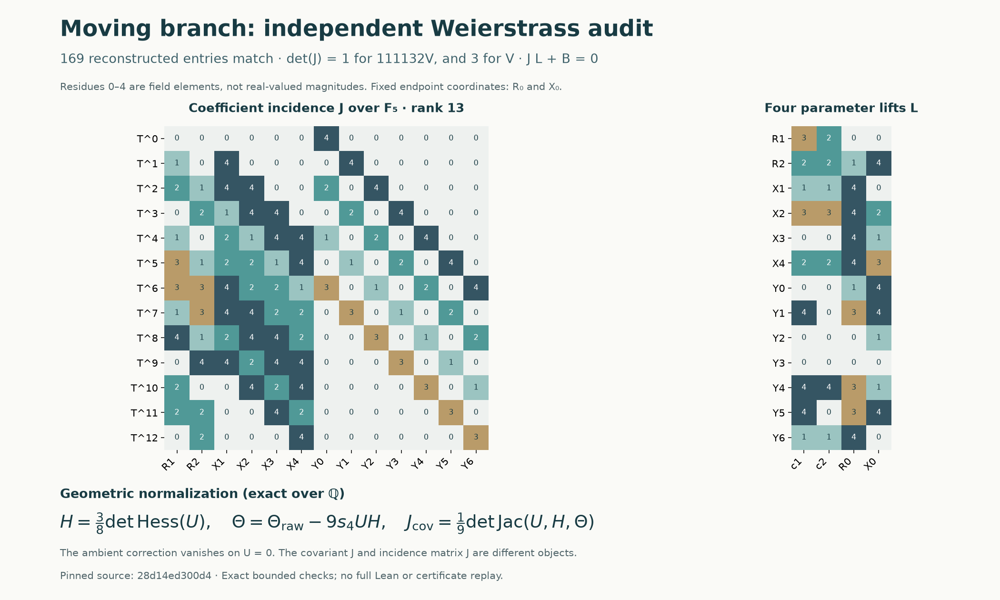

# Moving branch: an independent Weierstrass normalization audit

21 October 2026. **No defect was found in the calculations checked here.**
We reconstructed a geometric dictionary for the transitive-cubic covariants,
the protected sextic's specialized Weierstrass coefficients and polynomial
source, and the finite-field incidence matrix. This is a bounded independent
check of an existing accepted construction, not a new solve or full Lean replay.

The useful normalization detail is
$\Theta=\Theta_{\mathrm{raw}}-9s_4UH$. The two expressions agree on the
cubic, but differ as ambient polynomials. This is a dictionary for the existing
coefficient tables, not a correction to the accepted proof or a novelty claim.



The figure encodes field elements in the actual reconstructed matrices. It
does not depict real magnitudes, numerical conditioning or global geometric
coverage. [SVG](../visualizations/moving-branch-weierstrass-audit.svg) ·
[Reproducible figure script](../scripts/visualize_moving_branch_weierstrass.py).

## Pinned inputs and scope

Upstream: [`28d14ed300d4d2cb84555466b81cfcfa54854cdd`](https://github.com/hodge-computer/sextics/tree/28d14ed300d4d2cb84555466b81cfcfa54854cdd).
Notebook base: [`0eb6b83bf0d5749fbc1aa1087222f4fa1d9ce881`](https://github.com/rbajaj5/hodge-lab/commit/0eb6b83bf0d5749fbc1aa1087222f4fa1d9ce881).
The latest merge at this pin is a website-view change; the audit examines the
recent mathematical construction and shared-library commits already contained
in that tree.

The [input manifest](../results/moving-branch-weierstrass-audit/inputs.json)
pins seven source files by Git blob and SHA-256, with exact copies in `inputs/`.
The checker verifies both hashes, uses a restricted arithmetic parser for the
Lean expressions, and never evaluates Lean text as Python code.

The protected [record](https://github.com/hodge-computer/sextics/blob/28d14ed300d4d2cb84555466b81cfcfa54854cdd/data/holdout-moving-branch/instance.rec)
gives, in variable order $(X_0,X_1,X_2,Y_0,Y_1,Y_2)$,

$$
F=\sum_{i=0}^2(X_i^6+Y_i^6)+X_0^3X_1Y_0Y_1
 +X_1^3X_2Y_1Y_2+\tfrac17X_0^2Y_0^2Y_2^2,
\qquad A=X_0^3Y_0^3,\quad q=1.
$$

The [existing acceptance receipt](https://github.com/hodge-computer/sextics/blob/28d14ed300d4d2cb84555466b81cfcfa54854cdd/data/holdout-moving-branch/acceptance.json)
credits `benediamond`'s [PR #172](https://github.com/hodge-computer/sextics/pull/172),
accepted 21 October 2026 at 13:22:41 UTC. We inspected that status; we did not
repeat its protected verification, kernel replay or publication workflow.

## 1. Geometric reconstruction of the covariants

For independent coefficients over $\mathbb Q$, put

$$
U=ax^3+by^3+cz^3+dx^2y+ey^2z+fx^2z,\quad
M=\operatorname{Hess}_{x,y,z}(U),\quad g=\nabla_{x,y,z}H.
$$

The actual functions and their 10, 28 and 55 coefficient blocks in
[`Covariants.lean`](https://github.com/hodge-computer/sextics/blob/28d14ed300d4d2cb84555466b81cfcfa54854cdd/formal/lean/HodgeComputer/Constructions/TransitiveCubic/Covariants.lean)
agree exactly with

$$
H=\frac38\det M,\qquad
\Theta_{\mathrm{raw}}=-\frac1{36}g^{\mathsf T}\operatorname{adj}(M)g,
\qquad \Theta=\Theta_{\mathrm{raw}}-9s_4UH,
\qquad J_{\mathrm{cov}}=\frac19\det\operatorname{Jac}_{x,y,z}(U,H,\Theta).
$$

Here $3s_4=-9bcdf+3cd^2e-e^2f^2$, read from the pinned `Cubic.lean`.
The check compares all coefficients over
$\mathbb Q[a,b,c,d,e,f,x,y,z]$: 13 expanded monomials for $H$, 192 for
$\Theta$, and 873 for $J_{\mathrm{cov}}$. It also binds the coefficient
labels to the actual function bodies, so a misplaced assembly term would fail.

The omitted correction is not identically zero: at all nine variables equal
to one, $U=6$ and $\Theta_{\mathrm{raw}}-\Theta=-18900$.
On $U=0$ it vanishes, but its normal derivative need not vanish. Thus one
cannot replace the ambient representative in a differentiated calculation
solely because its restriction is unchanged. The upstream moving-map and
normal-chart corrections are separate steps, not errors exposed by this check.

On the affine chart $z=1$, write $[p,q]=p_xq_y-p_yq_x$. Direct polynomial
reconstruction also verifies

$$
H[U,\Theta]-2\Theta[U,H]+3J_{\mathrm{cov}}=U[H,\Theta].
$$

For coefficient-constant differentiation on $U=0$, let
$D=\partial_y-(U_y/U_x)\partial_x$,
$\xi=\Theta/H^2$, and $\eta=-J_{\mathrm{cov}}/(2H^3)$.
Where $U_x,H,J_{\mathrm{cov}}\ne0$, the identity gives
$D\xi/(2\eta)=3/U_x$. This recovers the exact differential factor in the
library. It is a relative derivative identity, not a statement about arbitrary
parameter variation. We did not independently replay the separate full
Weierstrass covariant syzygy.

## 2. Protected equation, invariant scales and source

Introduce $F_\alpha=F+(\alpha-1)X_0^6$. Substitute
$Y_0=vX_0$, $Y_1=c_1vX_1$, $Y_2=c_2vX_2$.
Every resulting coordinate exponent is even, and collecting the three squares
gives the transitive cubic with

$$
(a,b,c)=(\alpha+v^6,1+c_1^6v^6,1+c_2^6v^6),\qquad
(d,e,f)=(c_1v^2,c_1c_2v^2,c_2^2v^4/7).
$$

This is reconstructed from the protected `F` expression, rather than assumed
from the explanation. Also $A=v^3X_0^6=v^3\partial_\alpha F_\alpha$.
With $R=X_2^2$, normalized squares $x=X_0^2/R,y=X_1^2/R$, and
$T=Rv^6$, every invariant power of $v$ is divisible by six. The resulting
coefficients are polynomials
$A_4=R^4s_4$, $B_6=-R^6s_6/4$.

Comparing every rational coefficient with
[`JacobianModel.lean`](https://github.com/hodge-computer/sextics/blob/28d14ed300d4d2cb84555466b81cfcfa54854cdd/data/holdout-moving-branch/JacobianModel.lean)
gives `a8 = 4116*A4`, `b256 = 111132*B6`, and

$$
E=111132V,\qquad V=Y^2-X^3-A_4X-B_6.
$$

The names `a8` and `b256` are historical API names; interpreting them as the
scales eight and 256 here would be incorrect. The upstream source already
documents the actual scales.

The source in `JacobianSource.lean` agrees coefficientwise with the polynomial
$P=-V_\alpha|_{\alpha=1}/(144R)$; the factor of $R$ cancels.
Equivalently $E_\alpha|_{\alpha=1}=-16003008RP$.
This checks the alpha-source binding, not the entire physical transport.

## 3. Incidence, parameters and normalization

At $c_1=c_2=\alpha=1$, the parsed seed is

$$
R=1+2T^2,\quad X=4+4T+T^2+3T^3+T^4,\quad
Y=1+3T^2+4T^4+2T^6.
$$

All thirteen coefficients of $E(R(T),T,X(T),Y(T))$, through degree twelve,
are zero over $\mathbb F_5$. Denominators used in the normalized comparison
are units modulo five. We differentiate the model itself and extract its
coefficient matrix, with rows $T^0,\ldots,T^{12}$ and columns

$$
R_1,R_2,X_1,X_2,X_3,X_4,Y_0,Y_1,\ldots,Y_6.
$$

All 169 entries agree with the committed `coefficientJacobian`. Both products
with the supplied inverse are the identity. Its rank is 13 and determinant is
1 for $E$. For $V$, the determinant is $1/111132^{13}=3$ modulo five.
The two normalization conventions are consistent.

The endpoints $R_0,X_0$ are retained parameters, alongside $c_1,c_2$.
Let $B$ be the four external-parameter derivative columns. We compute all
52 entries of $L=-J_{\mathrm{inc}}^{-1}B$, checking
$J_{\mathrm{inc}}L+B=0$. The full 13-by-17 linearized system has rank 13.
Thus every first-order change of these four parameters lifts uniquely at the
seed when the thirteen coefficient variables are used as dependent variables.
The constant-column inverse also yields a polynomial normal $n(T)$ with
$\nabla E\cdot n=1$ in $\mathbb F_5[T]$.

These facts check the actual square incidence system and its local parameter
freedoms. Transfer to the generic characteristic-zero family uses the
arithmetic lifting theorem, its integral model and hypotheses; it is not a
bare inference from a single modular rank. Source review locates these steps
in `JacobianLifting`, `JacobianParameters` and `JacobianGeometry`; this audit
does not reprove their full field, dominance and descent arguments.

## Executed checks and limits

```sh
python scripts/audit_moving_branch_weierstrass.py --output results/moving-branch-weierstrass-audit/replay.json
python scripts/visualize_moving_branch_weierstrass.py
```

Requirements: Python 3.11, SymPy 1.14; the figure additionally uses Matplotlib
(executed with 3.11.1). The actual Python version was 3.11.9.
[Replay](../results/moving-branch-weierstrass-audit/replay.json) ·
[Failing perturbations and commands](../results/moving-branch-weierstrass-audit/validation.json) ·
[Checker](../scripts/audit_moving_branch_weierstrass.py).

The positive run passed. Four intentional in-memory changes each failed with
nonzero exit status at the expected check: an added degree-six model coupling,
one Jacobian entry, one inverse entry, and replacing normalized Theta by the
raw bordered-Hessian expression. The source snapshots were not changed. Each
run had a 60-second timeout; no run timed out. Two read-only reviewers
independently reconstructed the seed/parameter data and covariant formulas.

**Unexecuted:** complete Lean compilation/kernel replay; full Weierstrass
syzygy replay; the full moving-map, physical volume, normal-chart correction,
finite trace, denominator admissibility and homogeneous-clearing chain. The
accepted proof supplies those separate steps. Their absence from this audit
is a coverage limit, not evidence that the accepted theorem is false or has a
proof gap. A smallest next audit unit would reconstruct the actual physical
volume/alpha-variation identity from the pinned coordinate maps, retaining
the moving-map terms; it is not a prerequisite for reporting this result.

## Attribution and publication

Classical covariant invariant theory is credited upstream to Tom Fisher and
SageMath. `hodgepodgeconjecture` supplied the cyclic construction; `fqlx`
adapted the transitive cubic; `benediamond` specialized the moving-branch
instance. The maintained lifting, residue transport, trace and clearing
constructions and Mathlib remain their respective authors' work. This
independent audit was prepared for `rbajaj5` with OpenAI Codex assistance and
two read-only review agents.

Discussion [#146](https://github.com/hodge-computer/sextics/discussions/146)
was read completely before drafting; it contained no comments or replies.
The planned contribution is a concise checked normalization dictionary and
seed/source replay, with its limits. Hodge Lab's corresponding ledger audit
must be pushed first; the actual upstream result is recorded only after a
successful publication and readback. Prompt 3 and the two earlier verified
comment corrections remain complete and were not rerun or republished.

**Publication outcome:** the audit was pushed in [826ed41](https://github.com/rbajaj5/hodge-lab/commit/826ed4150c9b034f0bcd2e7874323e5d07136213) before [the one discussion contribution](https://github.com/hodge-computer/sextics/discussions/146#discussioncomment-19103930). A fresh source/thread check preceded publication; a separate readback matched its body and permalink. [Verified receipt](../results/moving-branch-weierstrass-audit/publication-outcome.json). This records publication, not another mathematical check or accepted solve.
