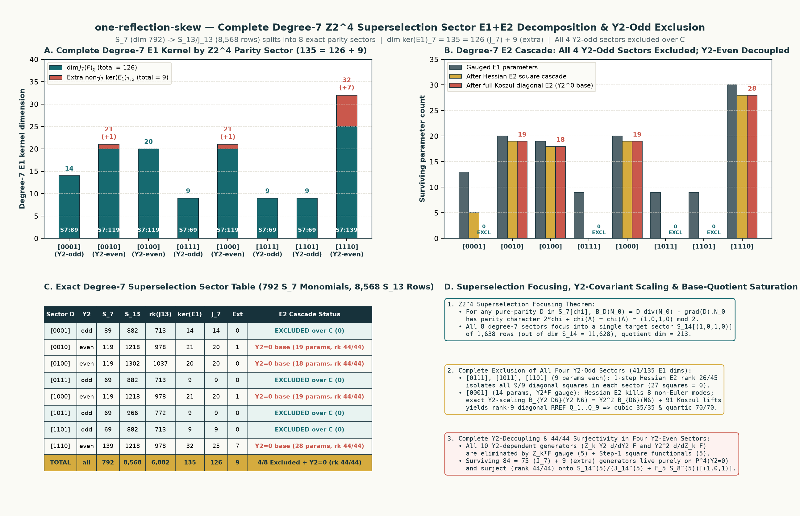

# `one-reflection-skew`: Degree-7 Character Decomposition, Pure-Sector Exclusions & Base-Quotient Column Rank

**Target (`hodge-computer/sextics`, Discussion #127):**
$$F = X_0^6 + X_1^6 + X_2^6 + Y_0^6 + Y_1^6 + Y_2^6 + X_0^3 X_1 Y_0 Y_1 + X_1^3 X_2 Y_0 Y_1 + \frac{1}{7} X_0 X_1 Y_0 Y_1 (Y_0^2 - Y_1^2), \qquad A = X_0^3 Y_0^3, \qquad q = 1.$$

This note records **Checkpoint 87**, advancing the analysis of `one-reflection-skew` to **degree $d = 7$** ($S_7$ of dimension $792$, mapping into $S_{13}/J_{13}$ of ambient dimension $8{,}568$ with $7{,}722$ numerator columns). By exploiting the exact order-16 real charge-parity symmetry group $G_{\text{parity}} \cong \mathbb{Z}_2^4$ (projective quotient $PG_{\text{parity}} \cong \mathbb{Z}_2^3$), we decompose the complete degree-7 $E_1$ map into **8 character blocks** and test $E_2$ separately on each pure-character family, using exact rational arithmetic over $\mathbb{Q}$ in [`experiments/one_reflection_skew_degree7.py`](../experiments/one_reflection_skew_degree7.py).

**Scope correction, 21 October 2026:** the first equation decomposes linearly across characters, but the second equation is quadratic. The reported exclusions below apply to each pure-character sector separately; they do not exclude a denominator mixing characters. The phrase “44/44 surjectivity” in the historical figure means that the quadratic coefficient columns span the quotient. It does not assert surjectivity of the nonlinear parameter map. The figure is retained as a historical display; this audit did not rerun the full degree-seven calculation. [Audit evidence](repository-audit-20261021.md).



*Figure 1 (`results/one-reflection-skew-degree7/one-reflection-skew-degree7-sectors.png`, SVG companion `one-reflection-skew-degree7-sectors.svg`). Panel A shows the complete degree-7 $E_1$ kernel dimension across all 8 projective parity sectors ($\dim\ker(E_1)_7 = 135 = 126 + 9$). Panel B shows the $E_2$ parameter-elimination cascade across the 8 sectors, completely excluding all 4 $Y_2$-odd sectors over $\mathbb{C}$ and decoupling all $Y_2$-dependent generators in the 4 $Y_2$-even sectors. Panel C tabulates the exact dimensions, ranks, and $E_2$ status of every sector. Panel D summarizes the $\mathbb{Z}_2^4$ Superselection Focusing Theorem, the exact $Y_2$-covariant scaling identity $B_{Y_2 D_6}(Y_2 N_{6,0}) = Y_2^2 B_{D_6}(N_{6,0})$, and the historical “$44/44$ surjectivity” label for quadratic-column rank in the 5-variable base Hessian quotient. Scope note: the figure establishes complete degree-7 $E_1$ decomposition across all $792$ monomials of $S_7$, complete exclusion over $\mathbb{C}$ of all four pure $Y_2$-odd sectors ($296$ monomials of $S_7$, $41$ $E_1$ kernel dimensions), and $Y_2$-decoupling of the four $Y_2$-even sectors; it does not yet close the 5-variable ($Y_2=0$) degree-7 base sectors or establish a full certificate.*

---

## 1. $\mathbb{Z}_2^4$ Charge-Parity Structure at Degree 7

All 10 monomials of $F$ are invariant under the order-16 diagonal sign group $G_{\text{parity}} \subset \{\pm 1\}^6$ defined by
$$\chi(X_0^{e_0} X_1^{e_1} X_2^{e_2} Y_0^{e_3} Y_1^{e_4} Y_2^{e_5}) = \big((e_0 + e_1 + e_2) \bmod 2,\; (e_0 + e_2 + e_3) \bmod 2,\; (e_0 + e_2 + e_4) \bmod 2,\; e_5 \bmod 2\big) \in \mathbb{F}_2^4.$$
Since the sum of the four parity bits equals $\sum_{i=0}^5 e_i + 2(e_0 + e_2) \equiv d \pmod 2$ on any homogeneous piece $S_d$, the 16 characters of $G_{\text{parity}}$ partition $S_7$ ($\dim = 792$) and $S_{13}$ ($\dim = 8{,}568$) into **8 non-empty superselection sectors** (corresponding to the 8 characters of $PG_{\text{parity}} = G_{\text{parity}} / \{\pm I_6\} \cong \mathbb{Z}_2^3$).

Because $\chi(F) = (0,0,0,0)$ and $\chi(A) = \chi(X_0^3 Y_0^3) = (1,0,1,0)$, the degree-7 $E_1$ map $D \mapsto [AD] \in S_{13}/J_{13}(F)$ is block-diagonal across the 8 sectors:
$$S_7[\chi] \xrightarrow{D \mapsto [AD]} S_{13}[\chi + \chi(A)] / J_{13}(F)[\chi + \chi(A)].$$

### Complete Degree-7 $E_1$ & $E_2$ Sector Ledger

| Sector $\chi(D)$ | Output $\chi(AD)$ | $Y_2$ Parity | $\dim S_7[\chi]$ | $\dim S_{13}[\chi_{\text{out}}]$ | $\mathrm{rank}(J_{13})$ | Koszul $\ker(J_{13})$ | $\dim\ker(E_1)_7$ | $\dim J_7(F)_\chi$ | Extra Non-$J_7$ | $E_2$ Cascade & Quotient Status |
| :--- | :--- | :--- | :---: | :---: | :---: | :---: | :---: | :---: | :---: | :--- |
| **`[0, 0, 0, 1]`** | `[1, 0, 1, 1]` | odd | $89$ | $882$ | $713$ | $91$ | **$14$** | $14$ | $0$ | **EXCLUDED over $\mathbb{C}$** ($Y_2 F$ gauge $\to 13 \to 5 \to 0$, cubic $35/35$, quartic $70/70$) |
| **`[0, 1, 1, 1]`** | `[1, 1, 0, 1]` | odd | $69$ | $882$ | $713$ | $91$ | **$9$** | $9$ | $0$ | **EXCLUDED over $\mathbb{C}$** (1-step Hessian $E_2$ rank $26/45 \implies 9/9$ squares $=0$) |
| **`[1, 0, 1, 1]`** | `[0, 0, 0, 1]` | odd | $69$ | $966$ | $772$ | $87$ | **$9$** | $9$ | $0$ | **EXCLUDED over $\mathbb{C}$** (1-step Hessian $E_2$ rank $26/45 \implies 9/9$ squares $=0$) |
| **`[1, 1, 0, 1]`** | `[0, 1, 1, 1]` | odd | $69$ | $882$ | $713$ | $91$ | **$9$** | $9$ | $0$ | **EXCLUDED over $\mathbb{C}$** (1-step Hessian $E_2$ rank $26/45 \implies 9/9$ squares $=0$) |
| **`[0, 1, 0, 0]`** | `[1, 1, 1, 0]` | even | $119$ | $1{,}302$ | $1{,}037$ | $117$ | **$20$** | $20$ | $0$ | $Y_2$ decoupled ($Y_0 F$ gauge + $Y_2^2\partial_{Y_0}F = 0 \implies 18$ params on $Y_2=0$, rank $44/44$) |
| **`[0, 0, 1, 0]`** | `[1, 0, 0, 0]` | even | $119$ | $1{,}218$ | $978$ | $121$ | **$21$** | $20$ | $+1$ | $Y_2$ decoupled ($Y_1 F$ gauge + $Y_2^2\partial_{Y_1}F = 0 \implies 19$ params on $Y_2=0$, rank $44/44$) |
| **`[1, 0, 0, 0]`** | `[0, 0, 1, 0]` | even | $119$ | $1{,}218$ | $978$ | $121$ | **$21$** | $20$ | $+1$ | $Y_2$ decoupled ($X_1 F$ gauge + $Y_2^2\partial_{X_1}F = 0 \implies 19$ params on $Y_2=0$, rank $44/44$) |
| **`[1, 1, 1, 0]`** | `[0, 1, 0, 0]` | even | $139$ | $1{,}218$ | $978$ | $121$ | **$32$** | $25$ | $+7$ | $Y_2$ decoupled ($X_0 F, X_2 F$ gauge + $2$ squares $=0 \implies 28$ params on $Y_2=0$, rank $44/44$) |
| **Total ($S_7$)** | **All 8** | — | **$792$** | **$8{,}568$** | **$6{,}882$** | **$840$** | **$135$** | **$126$** | **$+9$** | **All 4 $Y_2$-odd sectors excluded ($41/135$); all $Y_2$-dependent generators killed** |

---

## 2. Key Structural Theorems at Degree 7

### Theorem 2.1 ($\mathbb{Z}_2^4$ Superselection Focusing & Universal Koszul Invariance of the $E_2$ Quotient)
1. **Koszul Completeness at Degree 8:** Across all 8 sectors, the numerator kernel $\ker(J_{13}: (S_8)^6 \to S_{13})$ has exact dimension $7{,}722 - 6{,}882 = 840 = 15 \times \binom{3+5}{5}$, spanned completely by the cubic multiples $m\,e_{ij}$ ($m \in S_3$) of the 15 elementary Koszul fields $e_{ij} = (\partial_j F)\epsilon_i - (\partial_i F)\epsilon_j$.
2. **Koszul Annihilation for Arbitrary $D \in S_d$:** For **any** homogeneous polynomial $D \in S_d$ (including non-Jacobian $E_1$ kernel elements $D \notin J_d(F)$) and any multiple $K = m\,e_{ij}$ of an elementary Koszul field, both $\mathrm{div}(K) = (\partial_i m)(\partial_j F) - (\partial_j m)(\partial_i F)$ and $\nabla D \cdot K = m(\partial_i D)(\partial_j F) - m(\partial_j D)(\partial_i F)$ lie in $J(F)$. Hence $B_D(K) = D\,\mathrm{div}(K) - \nabla D \cdot K \in J_{2d}(F)$ identically, so the quadratic map
   $$D \longmapsto [B_D(N_0)] \in S_{14} / \big(J_{14}(F) + F S_8\big)$$
   is well-defined on the **entire** 135-dimensional kernel $\ker(E_1)_7$ and independent of the choice of lift $N_0$.
3. **Superselection Focusing into $S_{14}[(1,0,1,0)]$:** For any pure-parity denominator $D \in S_7[\chi]$, the numerator lift $N_{0,i}$ has parity $\chi + \chi(A) + \chi(Z_i)$, so every term in $B_D(N_0) = D\,\mathrm{div}(N_0) - \nabla D \cdot N_0$ has parity character
   $$2\chi + \chi(A) \equiv \chi(A) = (1, 0, 1, 0) \pmod 2.$$
   Consequently, all 8 degree-7 sectors target the **same single sector** $S_{14}[(1,0,1,0)]$ ($1{,}638$ rows out of $\dim S_{14} = 11{,}628$; quotient dimension $1{,}638 - 1{,}425 = 213$ modulo $J_{14}(F) + F S_8$).

---

### Theorem 2.2 (Complete Exclusion over $\mathbb{C}$ of All Four $Y_2$-Odd Sectors)
Every monomial in the four $Y_2$-odd sectors (`[0,0,0,1]`, `[0,1,1,1]`, `[1,0,1,1]`, `[1,1,0,1]`, totaling $296$ monomials of $S_7$ and $41$ dimensions of $\ker(E_1)_7$) is divisible by $Y_2$, and $\ker(E_1)_{7,\chi} = J_7(F)_\chi$ in all four sectors:
- **Sectors `[0,1,1,1]`, `[1,0,1,1]`, and `[1,1,0,1]` ($9$ parameters each):** Because $\chi(F) = (0,0,0,0)$ and none of $\chi(Z_k)$ equals `[0,1,1,1]`, `[1,0,1,1]`, or `[1,1,0,1]`, these three sectors have zero intersection with $F S_1$. On the $\binom{9+1}{2} = 45$ quadratic pairs of the natural monomial-gradient basis $m\,\partial_i F$, the Hessian quotient map into $\big(S_{14}/(J_{14}(F)+F S_8)\big)[(1,0,1,0)]$ has exact rank $26$ in each sector and isolates **all $9/9$ diagonal squares**, forcing $D = 0$ over $\mathbb{C}$ in a single step.
- **Sector `[0,0,0,1]` ($14$ parameters, containing $Y_2 F$):** Since $\chi(Y_2 F) = (0,0,0,1)$, we fix the Euler/$F$ gauge $D \mapsto D - 6 a_5 Y_2 F$ by dropping $Y_2^2 \partial_{Y_2} F = 6 Y_2^7$, leaving $13$ parameters. Two Hessian $E_2$ steps (`13 -> 6 -> 5`, ranks $30$ and $5$) isolate and kill all $8$ non-Euler generators ($X_2 Y_2 \partial_{X_0} F$, $X_0 Y_2 \partial_{X_2} F$, and $m\,\partial_{Y_2} F$ for $m \in \{Y_1^2, Y_0^2, X_2^2, X_1^2, X_0 X_2, X_0^2\}$), leaving only the $5$ **$Y_2$-twisted Euler generators**:
  $$D = Y_2 \sum_{i=0}^4 a_i Z_i \frac{\partial F}{\partial Z_i} = Y_2 D_6, \qquad N_{0,i} = Y_2(a_i Z_i A) + K_i = Y_2 N_{6,0,i} + K_i \quad (N_{6,0,5} = 0).$$
  Because $N_{6,0,5} = 0$ and $D_6$ is independent of $Y_2$, the bilinear operator $B$ satisfies the **exact $Y_2$-covariant scaling identity**
  $$B_{Y_2 D_6}(Y_2 N_{6,0}) = Y_2^2\,B_{D_6}(N_{6,0}).$$
  Retaining all $91$ sector Koszul syzygies $K \in \ker(J_{13})_{(1,0,1,1)}$ and $189$ $F S_8[(1,0,1,0)]$ columns ($735$ total correction columns, rank $536$) yields the **exact same 9 RREF quadratic equations $Q_1,\dots,Q_9$** on $(a_0, a_1, a_2, a_3, a_4)$ as at degree 6 ([Checkpoint 86](one-reflection-skew-degree6.md)), with **full cubic Macaulay rank $35/35$** ($a_i^3 = 0$) and **full quartic Macaulay rank $70/70$** ($a_i^4 = 0$). Thus $D \in \mathbb{C}\cdot Y_2 F$, which is excluded over $\mathbb{C}$.

---

### Theorem 2.3 ($Y_2$-Decoupling and Quadratic Column Rank Within Each Pure $Y_2$-Even Sector)
In each of the four $Y_2$-even sectors (`[0,1,0,0]`, `[0,0,1,0]`, `[1,0,0,0]`, `[1,1,1,0]`):
1. The only $Y_2$-dependent generators in $\ker(E_1)_{7,\chi}$ are $Z_k Y_2 \partial_{Y_2} F = 6 Z_k Y_2^6$ and $Y_2^2 \partial_{Z_k} F$, where $Z_k \in \{X_0, X_1, X_2, Y_0, Y_1\}$ has $\chi(Z_k) = \chi$:
   - $Z_k \in \{Y_0\}$ for `[0,1,0,0]`, $Z_k \in \{Y_1\}$ for `[0,0,1,0]`, $Z_k \in \{X_1\}$ for `[1,0,0,0]`, and $Z_k \in \{X_0, X_2\}$ for `[1,1,1,0]`.
2. Fixing the $Z_k F$ gauge ($D \mapsto D - 6 c_k Z_k F$) eliminates all $5$ generators $Z_k Y_2 \partial_{Y_2} F$, and Step 1 of the Hessian $E_2$ cascade (`ranks = 62, 63, 63, 82`) isolates and kills all $5$ remaining $Y_2$-dependent generators $Y_2^2 \partial_{Z_k} F$.
3. Thus **every surviving generator across all four $Y_2$-even sectors is strictly independent of $Y_2$** ($e_5 = 0$), living on the 5-variable base space $\mathbb{P}^4_{(X_0, X_1, X_2, Y_0, Y_1)}$ ($18$ parameters in `[0,1,0,0]`, $19 = 18+1$ in `[0,0,1,0]` and `[1,0,0,0]`, and $28 = 21+7$ in `[1,1,1,0]`).
4. In the 5-variable target space $S_{14}^{(5)}[(1,0,1)]$ ($756$ rows), the ideal $(J_{14}^{(5)}(F_5) + F_5 S_8^{(5)})[(1,0,1)]$ has exact rank $712$, leaving a **$44$-dimensional base Hessian quotient**. The quadratic coefficient columns in each pure $Y_2$-even sector have reported linear-span rank $44$. Products of denominator parameters are constrained; this column rank does not establish surjectivity of the nonlinear parameter map.

---

## 3. Reproducibility

Run the complete degree-7 sector analysis and figure generation from the repository root (~48 seconds):
```bash
python experiments/one_reflection_skew_degree7.py
```
