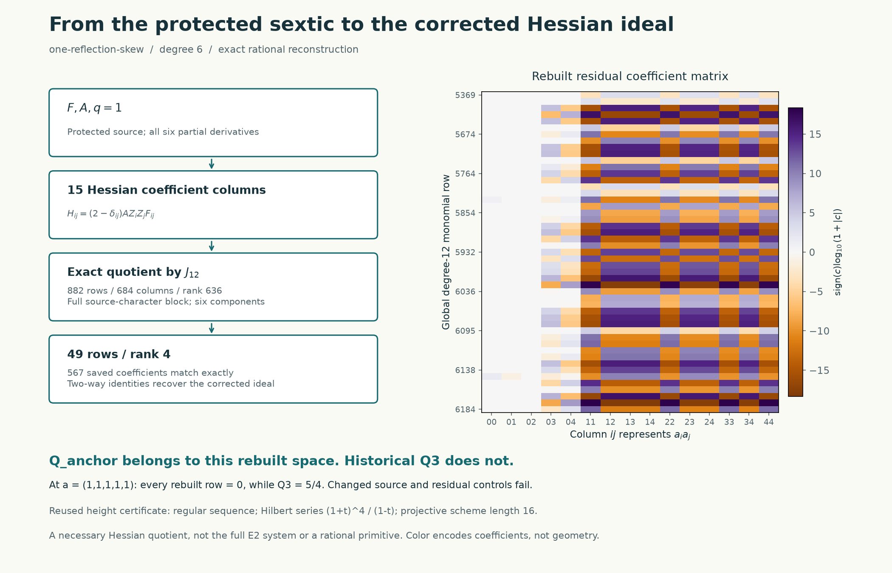

# Binding the corrected Hessian ideal to the protected sextic

**21 October 2026. The missing dependency is closed.** Independent reconstruction
from the protected equation reproduces all **567 rational coefficients on 49
rows**, with row rank four. Explicit transformations in both directions identify
this space with `(Q_node/9, Q_Kramers, Q_bridge, Q_anchor)`. The old substitution
of `Q3` fails against the rebuilt space itself. This is a provenance result for
a necessary quotient ideal, not a new denominator exclusion or a primitive.



The heatmap displays the actual 49 by 15 residual coefficient matrix, with
signed logarithmic color. Row labels are global degree-12 monomial indices.
Its patterns depend on the chosen basis; they do not assert geometric features.

## Pins and the gap being closed

The notebook starting head was
[`aa72496deb8968958c54ba72ac568f34b7ca57ee`](https://github.com/rbajaj5/hodge-lab/tree/aa72496deb8968958c54ba72ac568f34b7ca57ee).
Fresh API reads found the same upstream head
[`78632ddad42489fe92f14e588f1ed4b8909395dd`](https://github.com/hodge-computer/sextics/tree/78632ddad42489fe92f14e588f1ed4b8909395dd).
The protected `instance.rec` Git blob is
`6d35d3b8bc50814cb5c7774306f64d6902372bee`, raw SHA256
`fc7e070e4f459a521e3515c3b0d7e85fe4a557e345839f9cdb324491c289063f`.
The checker verifies that blob against the already saved raw snapshot.
[All input hashes and live-read commands](../results/one-reflection-skew-hessian-source/inputs.json)
pin the residual packet, current canonical code, protected contract, generic
arithmetic, and the earlier receipts. Text-code hashes normalize CRLF to LF;
the protected Git blob check uses the original bytes.

The [eaa4f89 audit](https://github.com/rbajaj5/hodge-lab/blob/eaa4f89b1bc333951a18cd0bccbb31b8c3f94671/notes/repository-audit-20261021.md)
checked the corrected ideal from saved rows. The later Prompt 2 audit rebuilt
the Hessian columns and square witnesses, but did not compare these 49 residual
rows. The original production verifier did contain such a comparison; what
was missing was this independent source reconstruction. Neither absence was
evidence that the saved rows were false.

## Exact map and inherited hypotheses

Work over `Q`, extending polynomial identities to `C`. Variables, in order, are
`Z=(X0,X1,X2,Y0,Y1,Y2)`, and `q=1`. The checker parses the exact fields, not the
floating-point rendering data:

$$
F=\sum_{i=0}^5 Z_i^6+X_0^3X_1Y_0Y_1+X_1^3X_2Y_0Y_1
  +\frac17 X_0X_1Y_0Y_1(Y_0^2-Y_1^2),\qquad A=X_0^3Y_0^3.
$$

For degree-six `D`, the protected certificate equation is

$$
AD^2-DN(F)+F B_D(N)=F^2Q,\qquad
B_D(N)=D\operatorname{div}N-N(D).
$$

Here the six components of `N` have degree seven; `Q` has degree six and is
unrestricted. The admissibility assumption `gcd(D,F)=1` gives
`N(F)-AD=FH`. Replacing `N` by `N-HZ/6` gives `N(F)=AD` without changing
the certificate defect. The complete E1 replay in
[the existing receipt](../results/one-reflection-skew-audit-20261021/diagonal-review.json)
establishes `D=V(F)` with `V=MZ`, `N=AV+K`, and all 315 degree-seven
Koszul correction fields `K`. This is an inherited completeness result,
including all six numerator components; it is not inferred from the 15-column
calculation performed here. No non-Jacobian E1 direction is silently dropped.

The Euler/F gauge replaces `M` by `M-M55 I`, `D` by `D-6 M55 F`, and `N`
by `N-M55 AZ`, with the corresponding permitted change of `Q`. It preserves
coprimality and the existence of a certificate. Row-major entries of `M`,
excluding `(5,5)`, give 35 parameters. The earlier exact 28+2 conditional
square witnesses leave raw indices `[0,7,14,21,28]`, namely
`M=diag(a0,a1,a2,a3,a4,0)`. Their completeness and vanishings are reused from
the hash-bound Prompt 2 receipt; they are not rerun or expanded in this pass.

Let `J=(F_0,...,F_5)`. Direct differentiation gives

$$
B_D(AV)+A V^T\operatorname{Hess}(F)V
=\sum_i\bigl(V_iV(A)+A\operatorname{tr}(M)V_i-A(MV)_i\bigr)F_i.
$$

For each elementary correction `K=m(F_j e_i-F_i e_j)`,

$$
B_D(K)=(D\partial_i m-m\partial_iD)F_j
       -(D\partial_j m-m\partial_jD)F_i\in J.
$$

Euler's identity also gives `FQ=(1/6) sum_i Z_i F_i Q` in `J`. Thus the
positive Hessian expression is the negative of the physical `B_D(N)` class.
The new checker verifies this sign directly for all 15 physical coefficient
columns. Quotienting by **all** `J12` is a necessary relaxation of E2, not an
equivalent replacement of the complete correction problem.

The map reconstructed here is

$$
\operatorname{Sym}^2(\mathbb Q^5)\longrightarrow S_{12}/J_{12},\qquad
a_i a_j\longmapsto[(2-\delta_{ij})A Z_iZ_jF_{ij}],\quad 0\leq i\leq j<5.
$$

The off-diagonal factor two retains all mixed terms within this five-parameter
family. A global change of sign does not change its coefficient ideal.

## Reconstruction and exact certificates

Before reading saved rows or canonical quadrics, the new checker constructs
all 4,752 columns `F_i * S7` in the 6,188-dimensional `S12`. Every column is
checked homogeneous for the four-bit sign character
`(m0+m1+m2, m0+m2+m3, m0+m2+m4, m5) mod 2`. The protected `F` is invariant;
`A` and all 15 Hessian columns have character `(1,0,1,0)`.

That full character block has 882 rows and 684 columns, rational rank 636;
its quotient has dimension 246. This exact direct-sum decomposition avoids
eliminating irrelevant blocks. It retains all six derivatives, including
`F_Y2` and multipliers containing `Y2`; it is not a five-variable Jacobian.

Ascending exponent order and gradient-then-multiplier column order match the
historical producer. Exact reduction yields 567 entries on 49 rows, rank four.
Every entry equals the corresponding diagonal restriction of the saved packet
with LF SHA256 `5760378eb0b3757507d915338f0c62520387edf4b3eb16937e451d3b17031329`.

The [reconstruction certificate](../results/one-reflection-skew-hessian-source/reconstruction.json)
contains:

- All 15 residual columns and explicit identities `H_j = R_j + sum c_ij J_i`.
- All 49 coefficient duals; their **232,848 pairings with all 4,752 Jacobian
  columns** vanish, and their Hessian pairings reproduce every coefficient.
- Exact rational transformations both ways between rebuilt and saved rows,
  and both ways between rebuilt rows and the four corrected canonical quadrics.

These witnesses can be checked without repeating Gaussian elimination by the
[separate replay](../experiments/skew_audit/hessian_source_replay.py). The
reconstruction itself uses only the protected equation and generic Fraction
arithmetic from the prior independent checker, not the production arithmetic,
saved residual entries, or preferred quadrics as an answer on its construction side.

The `Q_anchor` identification passes. The historical `Q3` is outside the rebuilt
rowspace; more strongly, all rebuilt rows vanish at `(1,1,1,1,1)`, but `Q3=5/4`.
So the rejected substitution changes the zero locus. It is not just a different
choice of basis. Altering the actual `X0 X1 Y0^3 Y1` coefficient from `1/7` to
`2/7`, or changing one saved residual coefficient by one, makes certificate
replay fail. Those are deliberate negative controls, not new target experiments.

## Consequences, limits, and reproduction

The earlier height/homology receipt is reused after checking its input hashes
and that its four generators exactly equal the ones identified here. Its
height-four certificate therefore applies to this source-derived ideal:
a regular sequence, Hilbert series `(1+t)^4/(1-t)`, vanishing positive Koszul
homology, and a projective scheme of length 16. There is no reducedness claim.
Finite degree-2 through degree-6 homology alone is not the all-degree proof.

This result does not prove the separate nine-quadric full E2 exclusion, a
mixed-character degree-seven exclusion, coverage of all denominator families,
or existence of a rational primitive. Those are different dependencies.
No Lean compilation, protected acceptance run, large packet replay, or new
primitive search was performed. This source-to-ideal dependency has no
remaining obstruction; the broader primitive problem remains outside the pass.

```sh
python -B experiments/skew_audit/run_hessian_source.py
```

The [execution receipt](../results/one-reflection-skew-hessian-source/validation.json)
records Python 3.11.9, NumPy/Matplotlib versions, commands, source hashes,
outputs and timings. Both mathematical checks run with `-S` using only the
standard library. Each process has a 60-second limit, with no additional
memory cap. All three stages passed; no calculation timed out. An earlier
successful development receipt is retained and marked superseded. Independent
read-only AI review also rebuilt the small block with separate Fraction
arithmetic and reviewed the final script; this is not human peer review.

Credit: the upstream authors' certificate framework, rbajaj5's original
degree-six packets, and the prior audit's corrected ideal and height proof.
This work was prepared with OpenAI Codex assistance. Subsequent publication of
the separately established degree-five rank correction is recorded in the
ledger; this note is not an upstream solve submission.
