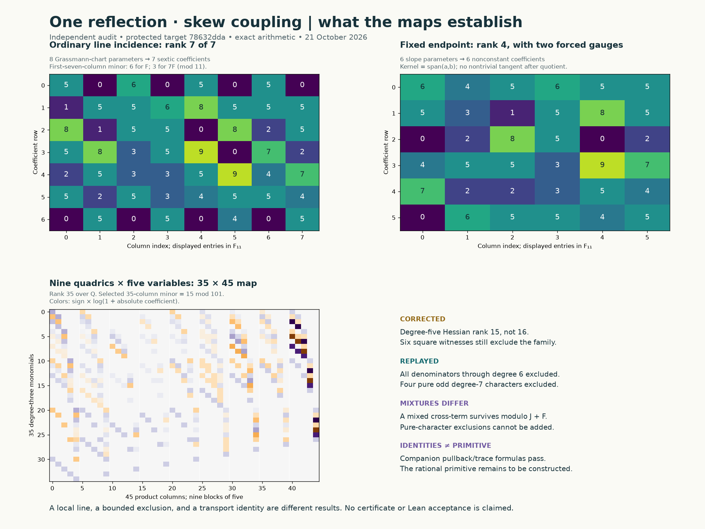

# One-reflection-skew: focused mathematical audit

**21 October 2026.** This pass independently reconstructs small calculations,
checks the necessity of the bounded obstruction systems, and separates those
results from the remaining primitive problem. It does not submit a solution.

The important correction is **degree-five Hessian quotient rank 15, not 16**.
The bounded exclusions still pass: all denominator degrees through six, and
each of the four pure odd degree-seven characters. The line matrices and the
newer twisted-companion identities also pass. They do not construct the
required rational primitive. A newly checked mixed cross-term explains why
pure-character exclusions cannot be combined without further equations.



The picture shows the two different finite-field tangent maps and the actual
35-by-45 cubic multiplication map. Its colors encode coefficients, not evidence
for a geometric analogy or a certificate. [Reproducible figure source](../experiments/skew_audit/render.py).

## Pins, provenance, and the exact contract

The isolated notebook checkout began at
[`eaa4f89b1bc333951a18cd0bccbb31b8c3f94671`](https://github.com/rbajaj5/hodge-lab/tree/eaa4f89b1bc333951a18cd0bccbb31b8c3f94671).
Live upstream was pinned at
[`78632ddad42489fe92f14e588f1ed4b8909395dd`](https://github.com/hodge-computer/sextics/tree/78632ddad42489fe92f14e588f1ed4b8909395dd).
The current AGENTS files, contribution instructions, formal README, exact target,
provenance, checks, and `Verify.lean` are saved with Git blob and SHA-256 bindings.
The [complete discussion snapshot](../results/one-reflection-skew-audit-20261021/inputs/live/discussion-127.md)
contains all six top-level comments and zero replies, including edits at retrieval.
It is evidence at that time, not a claim that a live thread can no longer change.

The [protected record](https://github.com/hodge-computer/sextics/blob/78632ddad42489fe92f14e588f1ed4b8909395dd/data/one-reflection-skew/instance.rec)
and its exact JSON terms agree, in variable order
`(X0,X1,X2,Y0,Y1,Y2)`, with `q=1`:

$$F=\sum_{i=0}^2(X_i^6+Y_i^6)+X_0^3X_1Y_0Y_1+X_1^3X_2Y_0Y_1
+\frac17X_0X_1Y_0Y_1(Y_0^2-Y_1^2),\qquad A=X_0^3Y_0^3.$$

No floating-point `render.terms` data is used as an algebraic input.
The target's current record says `open`, `unproved`, and no certificate available.
There is no acceptance file in its pinned target folder.

[`HodgeComputer.Verify`](https://github.com/hodge-computer/sextics/blob/78632ddad42489fe92f14e588f1ed4b8909395dd/formal/lean/HodgeComputer/Verify.lean)
allows every nonzero homogeneous `D` of degree `d`, relatively prime to `F`, all
six components `N_i` homogeneous of degree `d+1`, and unrestricted polynomial `Q`:

$$AD^2-DN(F)+F B_D(N)=F^2Q,\qquad B_D(N)=D\operatorname{div}N-N(D).$$

**Euler normalization is necessary here, not an extra ansatz.** Coprimality
implies `H=(N(F)-AD)/F` is polynomial of degree `d`. Replacing
`N` by `N-H Euler/6` leaves the cleared defect and `Q` unchanged and gives
`N(F)=AD`, `B_D(N)=FQ`. Thus `Q` need not be zero. Its degree, if nonzero, is
automatically `2d-6`; the quotient columns below do not restrict it further.

For homogeneous `L` of degree `d-6`, the denominator gauge must change the
numerator and quotient too:

$$D'=D-FL,\quad N'=N-\frac{AL}{6}\mathrm{Euler},\quad
Q'=Q+N(L)-L\operatorname{div}N+AL^2.$$

Then `N'(F)=AD'` and `B_D'(N')=FQ'`. Coprimality is unchanged; `D'` cannot be
zero for an admissible `D`. The identity is reversible. We give this general
algebraic argument and also check 792 exact basis cases; those cases alone
are not the justification of the general gauge.

## Findings and dispositions

| Finding and exact claim | Pinned evidence and consequence | Correction or remaining obligation |
| --- | --- | --- |
| **Incorrect numerical claim:** degree-five quadratic map has rank 16. | [Pilot prose at the audit base](https://github.com/rbajaj5/hodge-lab/blob/eaa4f89b1bc333951a18cd0bccbb31b8c3f94671/notes/one-reflection-skew-pilot.md), plot line 517, and [post 25](https://github.com/hodge-computer/sextics/discussions/127#discussioncomment-19049585). The computed report already says 15. All 55 residual entries reconstruct identically; six columns vanish, including `F_X0X2`. All six square witnesses pass. | Correct prose and make the figure rank data-derived. The exclusion survives. The upstream comment is unchanged during this pass. |
| **Incorrect representation identification:** odd-degree sectors are characters of the projective quotient. | [Degree-seven note at the audit base](https://github.com/rbajaj5/hodge-lab/blob/eaa4f89b1bc333951a18cd0bccbb31b8c3f94671/notes/one-reflection-skew-degree7.md). The central `-I` acts by `-1` in odd degree. | They form a torsor for those characters; a chosen twist identifies them. Four-bit labels and calculated blocks are unchanged. |
| **Enforcement gap:** `matches_degree6_RREF_identically` was hardcoded `True`. | [Original analysis source](https://github.com/rbajaj5/hodge-lab/blob/45ab8ff61c1af70a30c6cb16ea9a95252d6846d2/experiments/one_reflection_skew_degree7.py). Independent reconstruction verifies the equality, so the present conclusion is not false. | Add an actual equality requirement; an altered equation now fails. Also enforce the strict smoothness bounds in the pilot helper. |
| **Verified scope boundary:** four pure odd families are excluded; their mixed sum is not thereby excluded. | [Post 27](https://github.com/hodge-computer/sextics/discussions/127#discussioncomment-19052407) and the current note's existing scope correction. An exact functional pairs to `-12` with a mixed cross-term while killing every relevant `J+F` column. | Preserve the pure-family qualification. Record the explicit cross-term witness. No counterexample to the bounded exclusions is claimed. |
| **Not an error:** full cubic rank is reported as `35/35`. | The actual map has 45 product columns and 35 rows (or its transpose). We recover it and a legitimate 35-column minor. | Explain shape versus rank versus selected minor. A square minor is valid evidence, not a mistaken map dimension. |
| **Unverified construction:** transport/correspondence identities would yield the target primitive if the stated primitive equation is solved. | [Twisted companions and later addendum](https://github.com/hodge-computer/sextics/discussions/127#discussioncomment-19080252). Formula reconstruction and four packet checkers pass, but no primitive is supplied. | Keep the unresolved primitive, coefficient fields, open conditions, and subsequent ambient lifting explicit. A gap does not prove nonexistence. |

The original pilot report contains support counts for its six square witnesses,
not the full dual vectors. This audit independently constructs and saves those
vectors in [low-and-odd.json](../results/one-reflection-skew-audit-20261021/low-and-odd.json).

## A. The finite-field line and two different tangent maps

Over `F_11`, set `a=(1,0,6,3,2,7)`, `b=(0,1,2,2,0,8)` and `ell=sa+tb`.
Every coefficient of the restricted sextic vanishes. The seven coefficients of
the source, ordered `s^6,...,t^6`, are `(5,10,3,8,0,0,0)`:

$$A|_\ell=s^3(3s+2t)^3.$$

This is nonzero as a polynomial. It vanishes with multiplicity three at
`[0:1]` and `[1:4]`, and is 5 at `[1:0]`. It is not nowhere zero.
The same integer coordinates are not a rational line: `F(a)=165099` over `Q`.

Write `g_i(t)=partial_i F(a+tb)`. In the ordinary Grassmann chart,
`X0=s,X1=t`, and the other four coordinates each have an independent intercept
and slope. The eight derivative columns are the coefficient vectors of
`g_2,tg_2,...,g_5,tg_5`. There are seven sextic coefficient equations.
This **7-by-8** matrix agrees with the displayed matrix in
[comment 19078601](https://github.com/hodge-computer/sextics/discussions/127#discussioncomment-19078601):
rank 7, first-seven-column determinant 6 modulo 11. Scaling to `7F`, as the
older substitution checker does, scales that determinant by `7^7`, giving
**3**, with the same rank. We separately verify all eight derivative columns
by direct substitution over dual numbers.

With endpoint `a` fixed, vary all six slope entries `b_i`. The constant
coefficient is already zero; the other six coefficients differentiate to
`J[r,i]=[t^(r-1)]g_i(t)`, `r=1,...,6`. This is a **6-by-6** map, rank 4.
Rows and columns `0,1,2,3` have determinant 4. Its kernel is exactly
`span(a,b)`: adding a multiple of `a` to `b`, or rescaling `b`, parameterizes
the same projective line. Explicitly, differentiating `F(a+tb)=0` gives
`sum_i b_i g_i(t)=0`, hence **Jb=0**. Euler gives
`sum_i (a_i+t b_i)g_i(t)=6F(a+tb)=0`; subtracting the first identity times `t`
gives **Ja=0**. Independence of `a,b` therefore forces rank at most four.
Thus rank 4 is maximal after those two forced directions are removed. Rank 6 was never available in this unquotiented test.
All six columns are also checked by dual-number substitution.

Ordinary incidence is smooth of local dimension one at this line. Including
the marked point gives a two-dimensional local family. In target chart
`X0=1`, its evaluation derivative is

```text
0 1
3 2
9 2
0 0
6 8
```

It has rank 2 in the target's four-dimensional tangent space. This local
marked-line family does not dominate the target. Neither matrix supplies a
generic-endpoint construction; neither proves global absence of curves.
A lift of the finite-field smooth incidence point would still be separate
from the stronger generic-endpoint and primitive requirements. The proposed
shared interface needs an incidence system over independent endpoint
coefficients with an invertible square Jacobian after the appropriate gauges,
an injective coefficient-ring map, a distinguished nonzero coordinate, and
subsequently a nonzero normal/tangent determinant with commuting derivations.
For an endpoint-dominating family one must verify the endpoint evaluation map
has the required generic image, rather than ask this six-column slope matrix
for impossible rank six. The automatic kernel does not by itself restrict the
endpoint; the separately computed local evaluation map does.

An invalid intercept and a nonkernel slope change produce nonzero restricted
sextics. Conversely, slope gauge changes preserve incidence. The ordinary
kernel kills the first-order term but a straight path in that direction has
a nonzero second-order remainder; a tangent vector is not an exact affine
family. [All matrices, coefficients and controls](../results/one-reflection-skew-audit-20261021/line-audit.json).

## B. Bounded exclusions and their proof obligations

All exclusions here concern the **fixed protected target with q=1**, nonzero
homogeneous denominators relatively prime to `F`, all six numerator components,
and arbitrary `Q`. Computation is rational and conclusions extend to `C`.

| Family actually checked | Historical packet | Fresh scope |
| --- | --- | --- |
| Every denominator, degrees 0–5; no character restriction | [`4bbac5c`](https://github.com/rbajaj5/hodge-lab/tree/4bbac5cafd4bbd4d602606f258c9c26e78c23334/results/one-reflection-skew-pilot) | E1 bounds, degree-five rank 15 and six exact square functionals. |
| Every degree-six denominator; no character restriction | [`2aa95c5`](https://github.com/rbajaj5/hodge-lab/tree/2aa95c5e4754547cdfdc6bf0a08bc8536e0aee05/results/one-reflection-skew-degree6) | Full E1 dual/lift replay, all 28+2 conditional square witnesses, nine necessary quadrics, cubic/quartic identities. |
| Degree seven, each of `0001,0111,1011,1101` separately | [`45ab8ff`](https://github.com/rbajaj5/hodge-lab/tree/45ab8ff61c1af70a30c6cb16ea9a95252d6846d2/results/one-reflection-skew-degree7) | E1 bounds and square cascades for all four; complete final correction reconstruction for `0001`. No mixture exclusion. |

Exact packet hashes and the correspondence to current notebook files are in
[packet-pins.json](../results/one-reflection-skew-audit-20261021/packet-pins.json).
The pilot's later symbolic corrections changed its file bytes; its
`lowDegreeBaseline` remains identical to the historical packet. The degree-six
inputs and degree-seven summary match their historical versions byte-for-byte.

### Why the numerator/correction space is complete

The mixed derivative coefficient bounds are
`(23/7,30/7,1,18/7,18/7,0)`, all strictly below 6. At a nonzero common gradient
zero over `C`, normalize the largest coordinate modulus to one. Its pure
derivative has modulus 6 and cannot be canceled by the mixed terms. Thus the
gradient has only the origin as a common affine zero. The six homogeneous
partials form a regular sequence, so all first syzygies are Koszul.

For denominator degree `d=5,6,7`, compatible corrections are respectively
the linear, quadratic, cubic multiples of the 15 elementary Koszul fields:
dimensions **90,315,840**. There are no second Koszul relations in these
numerator degrees. We do not omit a component or assume the numerator is its
particular lift. Also `B_D(K)` lies in the Jacobian ideal for any `D`, including
non-Jacobian denominator directions, and `F` lies in that ideal by Euler.
Therefore projection modulo the Jacobian ideal gives necessary equations.

Fresh modular augmented ranks for `d=0,...,6` are
`37,132,357,812,1623,2928,4863`. A nonzero minor modulo 101 gives a
characteristic-zero **lower bound** on augmented rank. The regular-sequence
formula gives the exact Jacobian rank; explicit natural lifts attain the
resulting E1 kernel upper bounds `0,0,0,0,0,6,36`.
We do not transfer arbitrary modular inconsistency to characteristic zero.
For degree six we additionally replay **426 exact rational constraints**
against all **4,752 numerator columns**, and **36 independent exact lifts**.
These bounds prove that no non-Jacobian directions are missing in that family.

The 35-parameter degree-six F-gauged Hessian equations include all active
cross terms. Exact duals first force 28 off-diagonal squares to vanish, then
force the two remaining squares in the restricted seven-parameter system.
Over `C`, zero squares imply zero parameters. This order matters: the second
step is conditional on the already proved first step.

### The actual quadrics and multiplication map

On the diagonal family, nine rational functionals annihilate every one of
**2,352** columns: `462` arbitrary `F*S6` quotient columns and `6*315`
Koszul-product columns. This is a relaxation allowing product coefficients
independently; it includes every actual correction. The functionals' values
on all 21 quadratic columns give the nine necessary quadrics. The coefficient
lists are fully recovered in
[diagonal-review.json](../results/one-reflection-skew-audit-20261021/diagonal-review.json),
and agree with the [displayed degree-six equations](one-reflection-skew-degree6.md).

The map is `S1^9 -> S3` in five parameters: **45 products, 35 cubic monomials**.
Our column convention gives a **35-by-45 matrix**; the original row convention
gives its transpose. Rank is 35 over `Q`; the saved selected 35-column minor
is 15 modulo 101. This is a legitimate square minor, not the shape of the full
map. Five exact identities express `a_i^3` as linear multiples of the quadrics;
five fourth-power identities also replay. Hence all parameters vanish over
`C`, leaving only an inadmissible multiple of `F` before gauge removal.
No modular transfer is needed for these rational identities.

### Pure characters versus mixtures

The four odd-sector E1 dimensions **14,9,9,9** are exhausted by their natural
Jacobian lifts. For pure `D`, character projection of `N` preserves the required
equations in the corresponding output character. This justifies using the
matching correction components. In sector `0001`, the complete final
**735-column** correction system includes **91** sector Koszul fields and
**189** quotient directions; its rank is 536. The nine resulting equations
are literally the degree-six equations in the saved order. The other three
pure odd sectors have exact nine-square closures.

For a mixed denominator, `B` is quadratic. Distinct pure squares can cancel
in their common character `chi(A)`, and cross terms occur in
`chi_i+chi_j+chi(A)`. For example,

$$D_1=Y_2^2F_{X_0},\quad D_2=Y_1Y_2F_{X_0},\quad
N_1=AY_2^2e_{X_0},\quad N_2=AY_1Y_2e_{X_0}.$$

Their cross term `B_D1(N2)+B_D2(N1)` has character `1001`.
A saved 173-term rational functional annihilates all **1,274** Jacobian and
**119** quotient columns in that character and pairs to **-12** with the cross
term. It is therefore nonzero even modulo `J+F`.
[Witness and exact pairing checks](../results/one-reflection-skew-audit-20261021/mixed-cross.json).

We also verify the addendum's simple cancellation over `Q(i)`:
`c=lambda e_X2`, `R2=i lambda X2^2` gives
`c^T Hess(f)c+30 R2^2=0` for `f=F|Y2=0`, with both summands nonzero.
An explicit associated E1 lift fails E2; neither this failure nor this one
necessary cancellation decides the corrected mixed family.
The nine non-Jacobian E1 directions in the even sectors are not discarded;
those sectors remain outside this pass's exclusions and their extra lifts
were not independently regenerated here.

## C. Transport, characters, and the missing primitive

In the four-generator sign convention, `chi(A)=1010`, but the projective
volume form transforms by the determinant: `chi(Omega)=1111`.
Thus **`chi(A Omega/F^2)=0101`**. The scalar source has character `1010`: E1 shifts by this character, and
pure-character E2 lands in it. These are distinct from the differential-form
character; mixed E2 terms have the characters described above.

The full `F` is invariant under `Y2 -> -Y2` and simultaneous negation of the
three X coordinates. The Y0/Y1 exchange and negative exchange fail. The complex
interaction involution `(Y0,Y1)->(iY1,-iY0)` has order two and changes full `F`
by `-2(Y0^6+Y1^6)`; it is not a symmetry of the full sextic. On the particular
Fermat cover, the exchange defect is
`alpha X0 X1 (alpha^2+1)yT(y^2-T^2)/7`. A scaled exchange requires both
`c^6=1` and `c^2=-alpha^2`, hence `alpha^6=-1`, not a generic coefficient.
The alternative Y weights `(5,1,5)` give the skew monomials weights 4 and 2.

The standard reflection lift assumes an **odd polynomial source**
`Y2*B(x,Y2^2)`. Our nonzero `A` is even in `Y2`; that construction does not
apply directly. This failure is **not** a refutation of the later twisted
companions. The pinned historical
[why.md](https://github.com/hodge-computer/sextics/blob/5718828cd2733bd29b1f1dc20f507e0918aa4f47/data/one-reflection-skew/why.md)
already distinguishes the failed quotient from the serving correspondence.
The shared [polynomial-curve interface](../results/one-reflection-skew-audit-20261021/inputs/transport/polynomial-curves-interface.md)
also requires generic independent endpoints and nondegeneracy data; the one
finite-field line has not supplied them.

For the newer route, on `Y0=1` set
`(X0,X1,X2,Y1,Y2)=(x,rx,wx,t,z)` and `U=x^2`, `nu=dr wedge dw wedge dt`.
Then `G=z^6+P(U)`, where
`P=aU^3+bU^2+cU+d`, with
`a=1+r^6+w^6`, `b=t(r+r^3w)`, `c=rt(1-t^2)/7`, `d=1+t^6`.
The determinant and projective sign give

$$A\Omega/F^2=-\frac{U^2}{2G^2}\,dU\wedge\nu\wedge dz,$$

and the residue reduction gives `theta=5U^2 dU wedge nu/(72z^11)`.
We check the sign, factor one-half, Hermite exact correction, and the
subsequent correspondence formulas independently.

Let `K=C(r,w,t)` and `B=K[beta]/R`, with

$$R=3a^2\beta^4-4ab\beta^3+6ac\beta^2-12ad\beta+4bd-c^2.$$

Put `M=b-3a beta`, `N=(c-3a beta^2)/2`, `k=N-M beta`, and
`L=beta+3k/M`. On the stated generic open (`a`, discriminants, `M`, `k`,
and required derivatives nonzero), the quartic algebra is finite étale; no
irreducibility assumption is needed. The degree-three companion is
`v^2+M(1+a xi^3)=0`, with `xi=(U+beta)/z^2`, `v=(MU+N)/z^3`.
Its pullback of `omega_E=d xi/(2v)` is `-(U+L)dU/(6z^5)`.
The two pushforwards are `-6M/k omega_E` and `6 beta M/k omega_E`.
The **raw** quartic trace of the serving operators is `6I`; the reconstruction
factor is **1/6**, not a normalized degree-twelve trace. Retaining the twist
avoids the cancellation of opposite choices after untwisting.

At the actual coefficient sample `(r,w,t)=(1,1,2)`,
`disc(P)=-361978181/343`, `3ac-b^2=-166/7`; the quartic is squarefree and coprime
to `M,k`. This verifies the generic-open conditions are not identically empty.
It does not verify every endpoint or specialize a primitive at every point.

The required absolute differential is
`omegaHat=(d xi+xi da/(3a))/(2v)`, with connection
`gamma=da/(3a)+dM/(2M)`. A primitive requires rational functions satisfying

$$\partial_E W+\sum_i(D_iV_i-\gamma_iV_i)=C_\beta.$$

The coefficient derivations include differentiation of the quartic root,
`D_i beta=-(partial_i R)/R'`; the connection terms must remain. All rational
functions, including ones with moving elliptic poles, are permitted by this
formulation. The packet's simpler scalar repair is sufficient, not a bound
on all such functions. Its tangent-lift shortcut has a nonzero divergence
`2209940204/1905584409` at the sample, confirmed by the replay.
Neither a serving action nor a failed shortcut constructs or rules out a
rational primitive. An obtained primitive would still need the ambient
lifting, homogenization, denominator legality, and protected certificate check.

## D. Available packets, replay scope, and publication status

| Source | What is available and what this audit did |
| --- | --- |
| Original rbajaj5 degree-seven packet at `45ab8ff` | Source, summary, and note are available and pinned. `fqlx` reports replaying this packet. This audit independently reconstructs its **four pure odd exclusions**, not every later even-sector or large-export claim. |
| Twisted companions attachment in comment `19080252` | Downloaded **48,403 bytes**, SHA-256 `3901f358ec9f1f46b6f4900cba80aa82160dd50d28e86e766aae826e39a960be`. All 25 `SHA256SUMS` entries checked. All four advertised positive checkers pass; three regenerated JSONs match the archive semantically. Search scripts were not run. Separately, our source-bound checker checks 31 displayed identities/conditions. |
| Round-four attachments in [comment `19057788`](https://github.com/hodge-computer/sextics/discussions/127#discussioncomment-19057788) | All four public links return HTTP 200; approximately 76 MB total. **Not downloaded or replayed.** The degree-24 fixed-denominator ranks, 267 kernel fields, sparse29 dual, rank-eight connection and 416-constant test remain author-reported here. They concern specific denominators/spans, not arbitrary primitives. |
| Later degree-seven addendum in `19080252` | Explicitly says the separate large packet is **not currently attached**. Reported 9,435 equations, 68,085 quadratic columns and 2,274,017 entries were not replayed. Twelve selected checks and sixteen reconstructed columns are author-reported spot checks, not independent verification of the whole export. Reported even-character Gröbner exclusions and branch reductions remain unverified in this audit. |

For the reported degree-24 result, a modular rank lower bound would need the
claimed 267 exact independent kernel fields to provide its characteristic-zero
upper bound. For the reported 416-constant ansatz, a valid 417-square augmented
minor at legal evaluation points would exclude that finite span. We have not
rechecked those fields, matrix bindings, points, or minors. For the later
modular Gröbner claims, the needed integral model, specialization/freeness and
projective argument likewise require the actual packet. Missing data proves
neither validity nor falsity.

Verification and publication are separate: these are exact Python checks and
bounded mathematical deductions. No Lean compilation, protected acceptance
run, rational primitive, or accepted solve is produced by this audit. Credit
to `rbajaj5` for the original bounded packets, `fqlx` for the line/correspondence
and later research, and the upstream authors for the protected framework.
Independent reviewers here are separate AI computational reconstructions,
not independent human referees. No upstream contribution was made; the tally
is unchanged.

## Reproduction, failures, and the next decisive check

```sh
python experiments/skew_audit/run.py
```

This uses Python 3.11.9, SymPy 1.14.0, NumPy and Matplotlib (exact versions in
the receipt). The five algebra/line checks use Python's standard library only.
Each subprocess has a **120-second wall-time bound**, with no extra memory
cap. The runner rejects optimized execution and removes `PYTHONOPTIMIZE` before
launching assertion-dependent archived checkers. It
hash-checks every saved input and six existing packets before calculating.
It downloads only the small companion archive; alternatively supply
`--companion-zip /path/to/one_reflection_skew_twisted_companions.zip`.
The archive is run in a disposable directory after its checksum and file
manifest are checked. It is not vendored here; attribution and links are retained.

[validation.json](../results/one-reflection-skew-audit-20261021/validation.json)
records commands, versions, outputs, timings, negative controls and exact
checker hashes. Wrong residue and trace factors, changed duals/multipliers,
invalid line data, a false smoothness estimate and altered comparison equations
are rejected. The preliminary scratch low/odd invocation had a syntax error;
a scratch gauge derivation was also corrected before any successful receipt.
The first integrated replay passed all mathematical commands but failed in SVG
postprocessing under Windows default decoding. Explicit UTF-8 fixes that
implementation error; the failed receipt is retained. An initial unprivileged
archive fetch failed on network access; the bounded
authorized fetch succeeded. These are development/access failures, not
mathematical counterexamples. No computational timeout is counted as an exclusion.

**Highest-priority unresolved proof obligation:** construct a rational solution
of the full companion primitive equation for the actual protected source.
The smallest decisive check on a proposed solution is to substitute explicit
`W,V_i`, clear denominators, and reduce the single residual
`partial_E W + sum(D_i V_i-gamma_i V_i)-C_beta` modulo both `R(beta)` and
`v^2+M(1+a xi^3)`, checking every coefficient and the denominator conditions.
Zero residual would establish that primitive step; the ambient certificate
would still be a further obligation. For the unpublished bounded-export
claims, the smallest prerequisite is instead release of the exact necessary
equations and their maps from the complete numerator/correction system.
