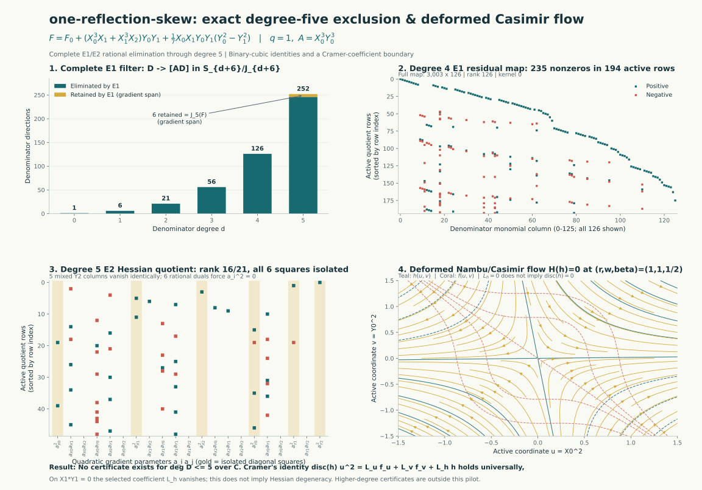

# `one-reflection-skew`: Low-Degree Baseline, Parity Audit, and Binary-Cubic Hessian Obstruction

**Date:** 19 October 2026  
**Instance:** `one-reflection-skew` ($q = 1$, $A = X_0^3 Y_0^3$)  
**Equation:**
$$F = X_0^6 + X_1^6 + X_2^6 + Y_0^6 + Y_1^6 + Y_2^6 + X_0^3 X_1 Y_0 Y_1 + X_1^3 X_2 Y_0 Y_1 + \frac{1}{7} X_0 X_1 Y_0 Y_1 (Y_0^2 - Y_1^2).$$

## 1. Motivation and Curation Audit

Upstream commit `b56894e` introduced three cubic-transfer frontier targets (`one-reflection-skew`, `one-reflection-y2-sector`, and `quadric-contact-residual`). While `one-reflection` was solved at degree $60$ (`3cfd50d`, PR #123) by combining a binary-cubic Hessian construction on $(u, p) = (X_0^2, Y_0 Y_1)$ with the two hidden exchanges $(Y_0, Y_1) \mapsto (\pm Y_1, \pm Y_0)$, the skew perturbation $\frac{1}{7} X_0 X_1 Y_0 Y_1 (Y_0^2 - Y_1^2)$ is odd under both $Y_0 \leftrightarrow Y_1$ and $Y_0 \leftrightarrow -Y_1$.

In [experiments/one_reflection_skew_pilot.py](../experiments/one_reflection_skew_pilot.py) we verify:
- **Smoothness and non-triviality:** the mixed-derivative $\ell_1$ coefficient loads are $(23/7, 30/7, 1, 18/7, 18/7, 0) < 6$, the degree-6 Jacobian span $\operatorname{Span}(Z_i \partial_j F)$ has rank $36$, and adjoining $A = X_0^3 Y_0^3$ raises the rank to $37$.
- **Surviving parity group:** every mixed term of $F$ has parity $(-1, -1, -1, -1)$ under the four sign-flip blocks $\tau_1: (X_0, X_2) \mapsto (-X_0, -X_2)$, $\tau_2: X_1 \mapsto -X_1$, $\tau_3: Y_0 \mapsto -Y_0$, $\tau_4: Y_1 \mapsto -Y_1$. Any product of two of these blocks preserves $F$, as does $\tau_{Y_2}: Y_2 \mapsto -Y_2$. Moreover, the complex exchange $(Y_0, Y_1) \mapsto (i Y_1, -i Y_0)$ fixes both $Y_0 Y_1$ and $Y_0^2 - Y_1^2$ while negating $Y_0^6 + Y_1^6$.

## 2. Complete Exclusion of Denominators of Degree $\le 5$

Using exact rational elimination over $\mathbb{Q}$:
- For $\deg D \in \{1, 2, 3, 4\}$, the necessary first-equation kernel $\ker(D \mapsto A D \bmod J(F))$ has dimension $0$.
- For $\deg D = 5$, $\dim \ker(E_1) = 6$, spanned by the six partial derivatives $\partial_i F$.
- Modulo $J(F)_{10}$, the $21$ quadratic Hessian columns $(1 \text{ if } i=j \text{ else } 2) A \partial_i \partial_j F$ have quotient rank $16/21$ (the five mixed second partials involving $Y_2$ vanish identically because $Y_2$ enters only through $Y_2^6$), and exact row reduction isolates all six diagonal squares $c_i^2 = 0$ ($i = 0, \dots, 5$).

Thus no certificate exists with $\deg D \le 5$ over $\mathbb{C}$, even allowing arbitrary Koszul numerator corrections and nonzero quotient $Q$.

## 3. Universal Binary-Cubic Cramer Identity and 3-Passive-Ratio Obstruction

For any general binary cubic $f(u, v) = c_0 u^3 + c_1 u^2 v + c_2 u v^2 + c_3 v^3$ with Hessian quadratic
$$h(u, v) = \frac{1}{36}(f_{uu} f_{vv} - f_{uv}^2) = (3 c_0 c_2 - c_1^2) u^2 + (9 c_0 c_3 - c_1 c_2) u v + (3 c_1 c_3 - c_2^2) v^2,$$
the three quadratics $(f_u, f_v, h)$ have $3 \times 3$ coefficient determinant $-\operatorname{disc}(h)$ in the basis $(u^2, u v, v^2)$. Cramer's rule supplies a universal identity with coefficients constant in $(u, v)$:
$$\operatorname{disc}(h)\, u^2 = L_u f_u + L_v f_v + L_h h(u, v),$$
where
$$L_u = 27 c_0 c_3^2 - 9 c_1 c_2 c_3 + 2 c_2^3, \quad L_v = 6 c_1^2 c_3 - 9 c_0 c_2 c_3 - c_1 c_2^2, \quad L_h = -2(3 c_1 c_3 - c_2^2),$$
alongside Cayley's syzygy $\operatorname{disc}(h) f^2 - k^2 = \frac{4}{9} h^3$ for $H = h_v \partial_u - h_u \partial_v$ and $k = H(f)/3$.

Setting passive ratios $r = X_1/X_0$, $w = X_2/X_0$, $\beta = Y_1/Y_0$ and active $(u, v) = (X_0^2, Y_0^2)$ writes $F = f(u, v) + Y_2^6$ with
$$c_0 = 1 + r^6 + w^6, \quad c_1 = \beta(r + r^3 w), \quad c_2 = \frac{1}{7} r \beta (1 - \beta^2), \quad c_3 = 1 + \beta^6.$$
Unlike `one-reflection` (where $p = Y_0 Y_1$ absorbs $\beta$ so $c_3 = 2$ is constant), here $c_1$ and $c_2$ share the common factor $r \beta$, so $\operatorname{Res}_\beta(c_1, c_2) = 0$ identically on $r(1 + r^2 w) = 0$ and $h_{vv} = 3 c_1 c_3 - c_2^2$ vanishes on both $X_1 = 0$ and $Y_1 = 0$.

## 4. Scope and Reproduction

- **Script:** [experiments/one_reflection_skew_pilot.py](../experiments/one_reflection_skew_pilot.py)
- **Receipt:** [results/one-reflection-skew-pilot/report.json](../results/one-reflection-skew-pilot/report.json)
- **Limits:** This checkpoint establishes the degree $\le 5$ exclusion and records the 3-passive-ratio binary-cubic degeneration on $X_1 Y_1 = 0$. It does not exclude higher-degree denominators or Fermat-cover constructions.
