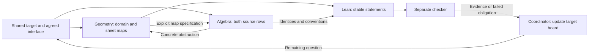

# One-reflection-skew: shared target board

Prepared 24 October 2026. **Status: ready for dispatch; no mathematical run
has started under this board.** This instantiates the
[assured research protocol](assured-research-workflow.md), rather than adding
an autonomous scheduler. Update this board when an authorized batch runs;
preserve its dated outcomes in that batch's note and ledger checkpoint.

## The shared target

The larger objective is the unchanged `one-reflection-skew` problem, with
`q=1`, `A=X_0^3 Y_0^3`, and the protected sextic. Different methods must
address that same problem. Do not replace it with a convenient scalar problem.

**Next bounded team outcome:** construct compatible all-sheet physical-form
maps and the relevant source identities on a common allowed regular domain,
or isolate the first precise obstruction to that proposed construction.
Neither branch alone is a primitive, certificate or accepted solve.

Reuse the [physical trace bridge and its evidence](skew-physical-trace-bridge.md)
at notebook commit `0ddf3af6bca227bbba119d6af8e3e0b102e18254`, including proof
commit `a6cf349bba45ecaaf2f8723479c0e179e97f36bc` and Lean CI
[40087940448](https://github.com/rbajaj5/hodge-lab/actions/runs/40087940448).
The existing physical curve realization, allowed `P[z^-1]` pullbacks,
coefficient embedding, degree-18 scalar algebra and trace are checked inputs.
Keep their original scope; do not replay them merely to fill a worker slot.
Pin the current protected input and any changed dependencies at actual dispatch.

## Assignments and passes

| Owner role | Assignment and output | Receiver and acceptance condition | State |
| --- | --- | --- | --- |
| Coordinator | Pin the problem, agree the common interface, give each worker a budget and owned artifacts | Every worker uses the same target, source revision, domain vocabulary and source convention | Ready, unassigned |
| Geometry lead, in the reused Pro chat | Specify the common allowed regular domain and proposed sheet maps fixing `V=rU` and `z`, with `U_j=V/r_j`; list curve and denominator obligations | Algebra receives explicit formulas and a numbered identity list; checker can identify every assumption | Ready, unassigned |
| Algebra worker | Starting from that interface, derive both source-row pullbacks, signs and factors; return identities or the first concrete nonzero residual | Geometry receives a repairable obstruction, or Lean receives precise statements; a scalar-only cancellation fails this handoff | Ready, unassigned |
| Lean implementer | Reuse the Kähler/exterior and scalar-bridge APIs to formalize the stable construction and identities | Separate checker receives source-bound commands, actual outputs and unresolved hypotheses, with no strengthened claim | Waiting for stable statements |
| Checker, distinct from the artifact author | Check the domain and full stated identities; use focused controls for dropped rows, altered factors, one-sheet substitution and forbidden `G^-1` evaluation where applicable | Coordinator receives executed evidence or a specific counterexample; AI agreement and hash checks alone do not discharge mathematics | Waiting for artifacts |

Roles may be sequential. Do not create five workers to match five rows.
Geometry and algebra can work in parallel after agreeing their interface;
formalization follows a stable candidate. The checker may inspect proposed
assumptions early, but must distinguish that review from an executed replay.



The diagram is a reproducible coordination plan, not evidence that these
maps or identities have been constructed.

## Handoff and progress record

Use a short entry in the batch note, with a link from this board when executed:

```text
Task / owner / pinned parent / owned files:
Output artifact and revision:
Required identity and assumptions:
Receiving role and concrete acceptance check:
State: ready -> active -> delivered -> consumed -> checked -> integrated
       or blocked / rejected / interrupted, with reason
Receiver's use: downstream step enabled, or exact mismatch:
Target condition discharged or route excluded, with scope:
Remaining obstruction and smallest next action:
```

The state sequence is a coordination record, not a theorem-proving rule.
Never mark `consumed` without the receiver's actual use or `checked` without
the appropriate scoped evidence. A completed supporting lemma can be
integrated while the shared target remains open.

Use the protocol's provisional 45-minute batch and per-process limits unless
the user specifies otherwise; set concrete process limits at dispatch. At
15-minute boundaries, inspect the shared obstruction and the queued handoffs.
If an agent has no usable receiver, reassign it to a named missing step or
stop that redundant work. If an artifact fails, preserve it and repair the
smallest affected dependency. Continue independent work within the budget.

## Three coordination checks before dispatch

These are desk walkthroughs of the policy, not new mathematics or simulations.

- A worker supplies only the already-known scalar trace-zero theorem. The
  receiver records it as reused input; the full form/source obligation stays
  open. Do not commission another scalar-trace review as a substitute.
- A proposed map sends the curve equation to zero but tries to evaluate its
  inverse `G^-1`. The handoff fails its domain check; retain the established
  allowed-domain results and request a valid localization/map specification.
- Geometry and algebra deliver compatible formulas, but a Lean process times
  out. Preserve the partial logs and mark it interrupted, not refuted or
  proved. Resume from the smallest unresolved obligation within a new stated
  budget; do not report a completed team result.

Four-form nonvanishing, source-class/cohomology and connection identification,
a rational primitive, global clearing and the legal certificate remain
separate obligations unless actually established. Publishing uses the existing
ledger-first and verified-readback policy. This board changes coordination;
it makes no new contribution or mathematical claim.
