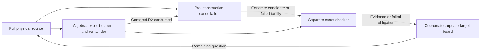

# One-reflection-skew: shared target board

Updated 24 October 2026. **Status: bounded batch complete, target open; Lean benched
at the user's direction.** This instantiates the
[assured research protocol](assured-research-workflow.md), rather than adding
an autonomous scheduler. Update this board when an authorized batch runs;
preserve its dated outcomes in that batch's note and ledger checkpoint.

## The shared target

The larger objective is the unchanged `one-reflection-skew` problem, with
`q=1`, `A=X_0^3 Y_0^3`, and the protected sextic. Different methods must
address that same problem. Do not replace it with a convenient scalar problem.

**Current bounded team outcome:** seek a rational current cancelling the
full physical source. The initial all-sheet-map assignment was redirected
by the user toward the solution. Zero trace is reused context, not the
success criterion. A partial current counts only within its documented scope;
the remaining source must stay explicit.

The [24 October constructive batch](skew-mixed-current-20261024.md) has a
checked centered current `Q` with `B=Div_N(Q)+R2`, regular at generic `t=0`.
`R2` is nonzero. Pro consumed it and proposed a beta current. Separate local
checks confirm its pole trade and nonzero residual. A further inverse repair
and fixed-point t-only exclusion are Pro-reported; their file export failed,
so those additional claims are not locally verified. No primitive or
certificate was found, and no further search is active.

Reuse the [physical trace bridge and its evidence](skew-physical-trace-bridge.md)
at notebook commit `0ddf3af6bca227bbba119d6af8e3e0b102e18254`, including proof
commit `a6cf349bba45ecaaf2f8723479c0e179e97f36bc` and Lean CI
[40087940448](https://github.com/rbajaj5/hodge-lab/actions/runs/40087940448).
The existing physical curve realization, allowed `P[z^-1]` pullbacks,
coefficient embedding, degree-18 scalar algebra and trace are checked inputs.
Keep their original scope; do not replay them merely to fill a worker slot.
Pin the current protected input and any changed dependencies at actual dispatch.

## Assignments and passes

| Owner role | Assignment and output | Receiver and acceptance condition | State |
| --- | --- | --- | --- |
| Coordinator | Pin the target and common interface; integrate the bounded outcome | Same parent, source convention, fixed problem, explicit limits | Actual Goal used; parent `06e88a9`, 45-minute research bound; scoped local evidence integrated |
| Constructive lead, reused Pro chat | Seek mixed `a,v,t` fluxes with `Div_N(Z)=R2` | Return a full candidate or a scoped failed family with exact evidence | Consumed current/corrections; beta candidate checked locally; additional packet delivery failed; search stopped |
| Local algebra worker | Construct current and exact remainder, preserving both rows | Lead consumes a concrete residual; separate checker receives reproducible formulas | Delivered `Q/R2`; 29 checks and 3 mutation controls passed; further search stopped |
| Lean implementer | No assignment in this batch | None until the user restores this role | **Benched** |
| Separate local checker | Check `Y`, direct `Q`, centering, beta operator and pole trade | Coordinator receives executed evidence and explicit limits | Separate 11-, 16-, 7- and 14-check runs saved; counts remain separate; scope review completed |

Roles may be sequential. Do not create five workers to match five rows.
Construction and algebra can work in parallel after agreeing their interface.
Formalization is currently benched. The checker may inspect proposed
assumptions early, but must distinguish that review from an executed replay.



The diagram records the active handoff architecture. Mathematical evidence
is in the linked scripts and receipts; the diagram itself proves nothing.

## Handoff and progress record

Use a short entry in the batch note, with a link from this board when executed:

```text
Task / owner / pinned parent / owned files:
Output artifact and revision:
Required identity and assumptions:
Receiving role and concrete acceptance check:
State: ready -> active -> delivered -> consumed -> checked -> integrated
       or blocked / rejected / interrupted, with reason
Receiver's use: downstream step enabled, or exact mismatch:
Target condition discharged or route excluded, with scope:
Remaining obstruction and smallest next action:
```

The state sequence is a coordination record, not a theorem-proving rule.
Never mark `consumed` without the receiver's actual use or `checked` without
the appropriate scoped evidence. A completed supporting lemma can be
integrated while the shared target remains open.

Use the protocol's provisional 45-minute batch and per-process limits unless
the user specifies otherwise; set concrete process limits at dispatch. At
15-minute boundaries, inspect the shared obstruction and the queued handoffs.
If an agent has no usable receiver, reassign it to a named missing step or
stop that redundant work. If an artifact fails, preserve it and repair the
smallest affected dependency. Continue independent work within the budget.

## Three coordination checks before dispatch

These are desk walkthroughs of the policy, not new mathematics or simulations.

- A worker supplies only the already-known scalar trace-zero theorem. The
  receiver records it as reused input; the full form/source obligation stays
  open. Do not commission another scalar-trace review as a substitute.
- A proposed map sends the curve equation to zero but tries to evaluate its
  inverse `G^-1`. The handoff fails its domain check; retain the established
  allowed-domain results and request a valid localization/map specification.
- Geometry and algebra deliver compatible formulas, but a Lean process times
  out. Preserve the partial logs and mark it interrupted, not refuted or
  proved. Resume from the smallest unresolved obligation within a new stated
  budget; do not report a completed team result.

Four-form nonvanishing, source-class/cohomology and connection identification,
a rational primitive, global clearing and the legal certificate remain
separate obligations unless actually established. Publishing uses the existing
ledger-first and verified-readback policy. This board changes coordination;
it makes no new contribution or mathematical claim.
