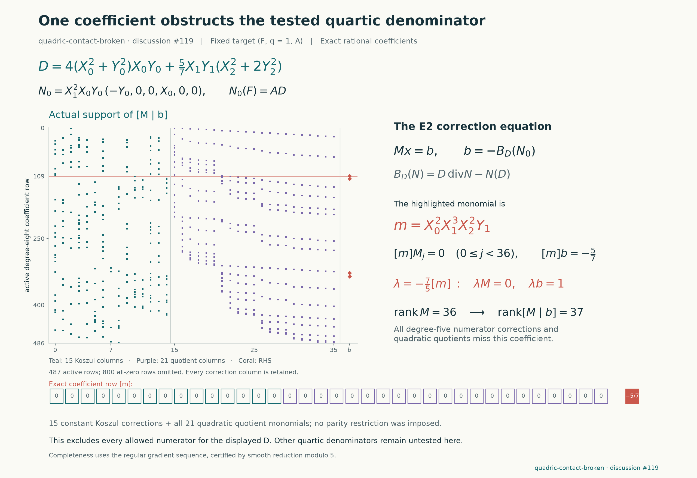

# A quartic repair attempt for `quadric-contact-broken`

**Result:** this particular quartic denominator fails the complete normalized correction test. The first equation is exact, but one coefficient of the second equation cannot be corrected. This is a failed construction, not an exclusion of all quartics or a solution of the instance.

The protected target has $q=1$. Its exact $(F,A)$, motivation and provenance are frozen in [the source snapshot](../results/quadric-contact-pilot/source/instance.rec), with [hashes and provenance](../results/quadric-contact-pilot/target.json). These bytes come from upstream commit `d96911d725077e66a8f10848908be01a643b1714`; a separate upstream diff through `4e920b85e0d45046a9cec2a929502aec0e56679c` contained no target changes. No existing upstream file was edited.

## Construction and complete test

Start from the accepted rotation construction for [`two-reflection-cubic-surface-d2`](https://github.com/hodge-computer/sextics/blob/d96911d725077e66a8f10848908be01a643b1714/data/two-reflection-cubic-surface-d2/solution.md). Write

$$
Q=X_0^2+Y_0^2,\qquad S=X_2^2+2Y_2^2,\qquad t=5/7,
$$
$$
D=4QX_0Y_0+tX_1Y_1S,\qquad
N_0=X_1^2X_0Y_0(-Y_0,0,0,X_0,0,0).
$$

Direct polynomial arithmetic gives

$$
N_0(F)=AD,\qquad
B_D(N_0):=D\mathrm{div}N_0-N_0(D)
=\frac57X_1^3Y_1(X_2^2+2Y_2^2)(X_0^2-Y_0^2).
$$

Thus the new denominator repairs the first equation, but it does not repair the divergence condition. We tested every correction permitted by the [complete Koszul correction criterion](https://github.com/hodge-computer/sextics/blob/d96911d725077e66a8f10848908be01a643b1714/docs/05-computation.md): all 15 constant Koszul fields $K_{ij}=F_j\partial_i-F_i\partial_j$, together with all 21 quadratic coefficients of the quotient $C$. The resulting equation is

$$
\sum_{i<j}c_{ij}B_D(K_{ij})-FC=-B_D(N_0).
$$

This is the full numerator freedom for the fixed $D$: the smooth sextic has a regular sequence of six quintic partial derivatives, and degree-five syzygies are the constant Koszul relations. Smoothness is supplied by the upstream check; independently, the equation reduces modulo five to the Fermat sextic, whose partials have no common projective zero. We do not impose a zero quotient or an additional symmetry restriction.

The denominator $D$ is odd under the global $Y$-sign change. This is a valid general presentation of a rational field. A successful field could be written with even denominator $D^2$ by multiplying numerator and denominator by $D$; this would not change the field. The negative calculation above already allows all 36 coefficient directions, without restricting their parity.

## A single coefficient proves failure

Let

$$
m=X_0^2X_1^3X_2^2Y_1.
$$

Every correction column $B_D(K_{ij})$ and every quotient column $F\cdot z^\alpha$, $|\alpha|=2$, has coefficient zero at $m$. The right side $-B_D(N_0)$ has coefficient $-5/7$. Consequently the functional

$$
\lambda(P)=-\frac75[m]P
$$

annihilates all correction columns and gives one on the right side: the required equation would imply $0=1$.

The complete sparse matrix has 487 supported degree-eight rows and 36 columns; the ambient homogeneous space has 1,287 rows. Its exact rational rank is 36, and the augmented rank is 37. The [proof packet](../results/quadric-contact-pilot/pilot.json) includes every physical column, its source label, the right side and the one-term obstruction functional.



The figure displays actual coefficient occupancy, with the obstructed row and right side highlighted. Its image alone does not establish the rank or obstruction; the exact packet and checks do.

## Reproduction and limits

From the repository root:

```sh
python -S experiments/quadric_contact_pilot.py run
python -S experiments/quadric_contact_pilot.py verify
python -S experiments/check_quadric_contact_pilot.py
python experiments/plot_quadric_contact_pilot.py
```

The worker has a 120-second wall-clock limit; its exact arithmetic completed in approximately 0.02 seconds. The producer and verifier use only Python's standard library, including `Fraction`. [Primary validation](../results/quadric-contact-pilot/validation.json) passes, with altered dual, right-side and matrix coefficients all rejected. The [bounded attempt log](../results/quadric-contact-pilot/attempt.json) is retained. An initial Python conditional-expression typo was corrected before any target calculation; it did not produce a mathematical result.

A [separate standard-library reconstruction](../results/quadric-contact-pilot/independent-validation.json) also passes. It reads the frozen target directly, reconstructs all 36 columns and both residual equations, checks smooth reduction modulo five, verifies the exact ranks and one-coefficient obstruction, and rejects five deliberately altered inputs. The plotting script independently reconstructs the displayed map and checks its source and validation hashes before rendering. These are computational checks of the stated fixed-denominator obstruction; no Lean proof is claimed.

No denominator search beyond this one candidate was performed. No certificate, Lean proof, solve PR or upstream post is claimed by this notebook entry. The next step, if this target is continued, must change the rational-field construction or test a different support rather than counting the exact first equation as a solution.

Credit belongs to the repository's accepted rotation-field construction and complete correction framework, with the initial geometric certificate bridge attributed there to Benjamin E. Diamond. This pilot was prepared with OpenAI Codex assistance; its purpose is to record a reproducible obstruction and avoid repeating the same repair attempt.

## Next-target triage, not an executed search

This pilot was selected because it reduced to 36 linear unknowns. Its
failure does not establish that the entire target is difficult. The
shortest continuation from accumulated data remains `cyclic-triple-fano`:
extend the fixed-fiber calculation to parameter-dependent boundary and
branch equations. For a different new target, `reflection-coupled-fano`
offers a weighted-degree-two curve search with a 12-by-14 twisted
deformation map. On its index-one quotient, a weighted-degree-one
nonconstant curve cannot be free: the tangent direction already requires
anticanonical degree at least two. That rules out a tempting too-small
pilot before running it. The degree-two search has not been executed.

`crossed-ternary-asymmetric` has a known-existence route, but constructing
two elliptic companions and the required transfer would involve more
machinery. These are practical next-step judgments, not a proved ranking
of instance difficulty. All three are among the newly added targets.
