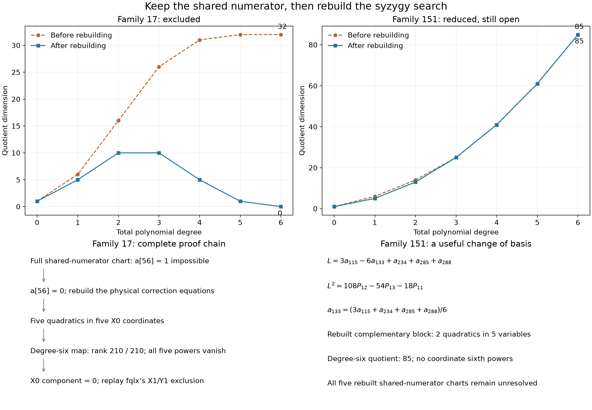

# Shared numerators and rebuilding: family 17 excluded

**17 October 2026.** Family **17**, with characters X0/X1/Y1, is now
excluded. Selected coverage increases from **150/152 to 151/152**.
Family **151** (X1/Y0/Y1) has a new exact linear reduction but remains
unresolved. Holdout is unsolved; this is not a Lean `HasCertificate` proof.



The [interactive cancellation view](../visualizations/remaining-triples-standalone.html)
shows two representative sixth-power identities, the new linear-square
identity, and Koszul boundaries before and after rebuilding. Download the
HTML and open it in a browser. The [SVG](../results/remaining-triples-shared/remaining-triples.svg)
is available for export. All displayed coefficients are checked exactly;
the picture supplements the proof replay rather than replacing it.

## Fixed target and scope

Keep the same upstream snapshot
`b8c4edeb80a82395ec07164caf445cfa43bbbd56`, $q=1$, $A=X_0^3Y_0^3$, and

$$
F=X_0^6+X_1^6+X_2^6+Y_0^6+Y_1^6+Y_2^6
+X_0^3X_1Y_0Y_1+X_1^3X_2Y_1Y_2.
$$

Every existing upstream file is unchanged. The E1 basis, six $FS_1$ gauge
directions, and 152-family selection are those of the preceding packets.
The starting necessary equations are the last stages for families 17 and
151 in `results/eisenbud-linear-strand/certificates.json.gz`, SHA256
`6fb3224ef9ad6dbb7a726d56b9c53ffa39ecdd10f2ba58fba320e7c521ad37b7`.
This is a selection of triples, not all triples among the 138 characters.

The [preceding degree-four tests](eleven-quartic.md) found no coordinate
fourth powers in either surviving full necessary ideal. Those ideals relax
the shared numerator coefficients. Here we reconstruct the actual system

$$
N(F)=AD,\qquad D\operatorname{div}N-N(D)\equiv0\pmod F,
$$

retaining every numerator character allowed by the denominator's stabilizer.
There are 256 compatible Koszul directions and 1,345 coefficient equations
for family 17; for family 151 there are 125 directions and 625 equations.
The stabilizers have orders 6 and 18 respectively. The quotient by $F$ is
unrestricted; no zero-quotient assumption or generic-rank restriction is used.

## Family 17: use the shared equations, then degree six

The surviving X0 coefficients have raw E1 indices
$(42,56,88,102,111,114)$. Exact affine and square-zero propagation in the
normalized chart $a_{56}=1$ yields a contradiction in the full shared system.
The replay checks each row combination and substitution. Since the equations
are homogeneous in the denominator and numerator parameters, this excludes
every point with $a_{56}\ne0$ and therefore proves **$a_{56}=0$ globally**.
The other five charts failed in this first pass; their full traces remain
archived and are superseded by the next argument.

After removing that coordinate, we rebuild the physical correction equations.
Five necessary quadratics involve only the five remaining X0 coefficients.
Their exact graded ranks are:

| Total degree | Map domain | Target dimension | Rank | Quotient dimension |
|---:|---:|---:|---:|---:|
| 2 | 5 | 15 | 5 | 10 |
| 3 | 25 | 35 | 25 | 10 |
| 4 | 75 | 70 | 65 | 5 |
| 5 | 175 | 126 | 125 | 1 |
| 6 | 350 | 210 | 210 | 0 |

Thus the degree-six image fills $S_6$. The packet gives five explicit
identities, with **895 multiplier monomials in total**,

$$
a_i^6=\sum_{j=1}^{5}C_{ij}P_j,
\qquad i\in\lbrace42,88,102,111,114\rbrace,
\qquad \deg C_{ij}=4.
$$

All five coordinates vanish over $\mathbb C$. The entire X0 component is
therefore zero. The residual ten raw denominator/lift pairs are precisely
the X1/Y1 sector excluded in **fqlx's existing family-30 proof**. Both pinned
upstream verifiers are rerun, all source hashes checked, and the target and
ten pairs matched to our model. This completes family 17. The residual pair
result is credited reproduction, not a new pair exclusion.

The rebuilt block has Hilbert values $(1,5,10,10,5,1,0)$ through degree six.
The unreduced six-variable block instead has values
$(1,6,16,26,31,32,32)$ and forces no coordinate fifth or sixth powers.
Increasing the degree alone did not supply this proof; the shared-numerator
constraint and rebuilding were essential to the successful calculation.

## Family 151: a non-coordinate linear vanishing

Let $P_j$ denote the **zero-based** necessary-equation index in family 151's
last stage of the pinned starting packet. Define

$$
L=3a_{115}-6a_{133}+a_{234}+a_{285}+a_{288}.
$$

Direct coefficient multiplication proves the three-row identity

$$
L^2=108P_{12}-54P_{13}-18P_{11}.
$$

Hence $L=0$ over $\mathbb C$. This is not a positivity argument and does not
require real coefficients. We eliminate

$$
a_{133}=(3a_{115}+a_{234}+a_{285}+a_{288})/6.
$$

The denominator/lift basis is changed explicitly: for each retained index
$i$ with coefficient $c_i$ in this replacement, replace
$(D_i,N_i)$ by $(D_i+c_iD_{133},N_i+c_iN_{133})$.
All terms have the same character, and the checker verifies both polynomials
and numerator lifts. This reduces the denominator parameters from 16 to 15.

The rebuilt complementary block contains two quadratics in five variables.
Its quotient dimensions in degrees two through six are **13, 25, 41, 61,
85**; no coordinate powers in these tested degrees are found. All six
original and all five rebuilt complementary-character charts remain
unresolved under the affine/square propagation used here. Their retained
coordinate counts are computational bookkeeping, not dimensions of solution
spaces. Family 151 remains open.

## Bounds, failures, and discovery

The initial plan was saved before execution:
[plan](../results/remaining-triples-shared/plan.json) and
[attempts](../results/remaining-triples-shared/attempts.json).
Each family had a 300-second shared-chart limit and a 60-second small-block
degree-five/six limit, with two concurrent workers. All four jobs completed.
The shared passes took about 29.6 and 9.5 seconds; the block passes about
51.4 and 8.9 seconds. These are local observations, not benchmark comparisons.
Both initial high-degree block searches failed to force coordinate powers.

The subsequent small rebuilds were exploratory follow-ups, not separately
time-limited jobs. Their packets retain the reconstruction/block elapsed time;
for family 151 that timing does not include its later five shared-chart
tests. A short SymPy factorization inspection identified the common linear
factor behind $L^2$. A small exploratory Groebner basis for the rebuilt
family-17 block suggested a sixth-power obstruction. Neither solver output
is used as proof: the exported rational identities and physical reductions
are independently replayed with the standard library.

The row indices, full failed chart traces, unsuccessful strand certificates,
and exact changes of basis are retained. No full free resolution, statistical
phase transition, or unrestricted degree-seven exclusion is claimed.

## Reproduce and check

From the Hodge Lab root, with Python 3.11 or later:

```sh
python -S experiments/reproduce_pair30.py --fetch --output-directory results/remaining-triples-shared/pair30
python -S experiments/check_remaining_triples.py
python -S experiments/check_remaining_triples.py --independent
python -S experiments/plot_remaining_triples.py --check
```

Only the pinned external-packet fetch uses the network. All arithmetic
verification uses `Fraction`, without a CAS or numerical tolerance.
For discovery and visualization production:

```sh
python -S experiments/remaining_triples_shared.py
python -S experiments/remaining_triples_shared.py --rebuild 17
python -S experiments/remaining_triples_shared.py --rebuild 151
python experiments/plot_remaining_triples.py
```

Matplotlib is required only for figure production. Regenerating gzip files
may change their metadata/hash; regenerate the figure data afterward.

Both local proof replays **PASS**, including 222 physical duals, 30,523
correction pairings, 6,365 quadratic pairings, nine inherited power identities,
17 normalized-chart traces with 167 exact inferences, the five sixth-power
identities, and the linear-square identity. Seven deliberate corruptions are
rejected. The second reconstruction uses a different polynomial API and
opposite monic division; it shares the identity replayer. No new independent
agent or human review is claimed. Fresh model instances prevent cached
columns from the old basis being reused after the basis change.

All seven displayed identities are checked exactly; 21 desktop/mobile
layouts and the before/after, family, monomial, tooltip, and state controls
pass. The static PNG and browser screenshots were inspected. The Linux
[`remaining-triples` job passed](https://github.com/rbajaj5/hodge-lab/actions/runs/39031883708/job/117393820401)
at proof commit `5e768a2c1261f12fe124bcf9d62ee768fdd482b6`, including the
pinned external fetch, both exact replays, and the figure-data check.
Its [receipt](../results/remaining-triples-shared/ci-remaining-triples.json)
records all successful steps. Other workflow jobs were still running at
that checkpoint; this is not a claim of full-workflow completion.

## Attribution and next direction

Credit the Sextics authors and certificate framework, the bridge attributed
to Benjamin E. Diamond, Griffiths's residue theory, fqlx's E1/symmetry and
[family-30 proof](https://github.com/hodge-computer/sextics/discussions/44#discussioncomment-18983962),
earlier contributor checks and reductions, and Eisenbud's graded-syzygy
viewpoint. The pinned fqlx source is
[revision d69313fe](https://gist.github.com/fqlx/58c0183e1fdbfc5d42a78d005e1d9bab/d69313fe578843f8341e6ed557c425bc7755c1d7).
Dubedat's operator intuition motivated earlier visualization; no
imaginary-geometry theorem is invoked here. Prepared with OpenAI Codex
assistance on behalf of `rbajaj5`.

The next selected target is the rebuilt family 151. Polynomial multipliers
that eliminate its shared numerator coefficients are a concrete next test;
that follow-up has not been counted as completed. Larger character supports
and higher denominator degrees remain outside this selected-family result.

**Later follow-up:** the [polynomial-multiplier packet](family151-multipliers.md)
completes this proposed test and excludes family 151. The failed searches
reported above remain the outcomes of this earlier checkpoint.
