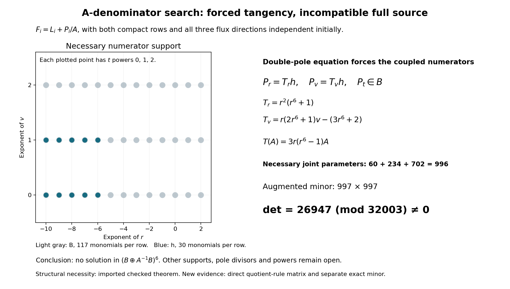

# One-reflection-skew: the A-denominator current search

24 October 2026. **The declared six-component B+B/A family is excluded;
no rational primitive was found.** This bounded batch tests the full physical
compact source with an additional denominator A(r,v), including mixed
cancellation with the old Laurent sector. Lean remains benched. The target
is unchanged; this finite-family exclusion does not settle rational source exactness.

## Inputs and bounded team assignment

- Notebook parent: `aa5a30dff2fd70994c48c484845981c141e77ef9`.
- Upstream dispatch pin: `27f4bb9ad8757e5841f884d9d30124a3c97a847d`.
- Actual Goal started at 16:03:11 UTC, with 45 minutes for research and
  15 minutes for integration. Mathematical processes are limited to
  60 seconds and network operations to 45 seconds.
- The reused [Pro chat](https://chatgpt.com/c/6adb94ec-665c-8325-9a4b-2b4237c63f19)
  is the constructive lead. A local algebra worker supplies the necessary
  pole condition; a distinct checker tests that condition and the eventual
  decisive certificate. The coordinator integrates and publishes.
- Reused completed inputs: the physical source convention, connection,
  Q/R2 and beta calculations, and the preceding Laurent-family exclusion.
  None of those completed calculations is counted as new work here.
- Pinned [connection JSON](../results/skew-physical-source-20261023/inputs/benediamond/packet/one-reflection-skew-followup/inputs/source-rank2-connection.json):
  SHA256 `a86c01f7fed725aac86e958a10f484b9b340765714c5b228513890977a59ce5d`.

The protected source is still `X_0^3 Y_0^3`, with `q=1`. In this note,
**A(r,v) denotes a chart coefficient**, not that protected source polynomial:

\[
A=r^3+r^{-3}+\frac{(rv-1)^6}{r^{15}},\quad
(a,b,c,d)=\left(A,tv,\frac{t(1-t^2)}7,1+t^6\right).
\]

Use the input-column matrices and positive packet residue orientation,
in the ordered compact basis `(dV/nu^5,V dV/nu^5)`. The actual equation is

\[
\sum_{i=r,v,t}(\partial_i+\widetilde N_i)F_i
 =\frac{r^{-4}}{12}M_b e_0,
\qquad
\widetilde N=(A_rM_a,A_vM_a+tM_b,N_t),
\]
\[
N_t=vM_b+c'M_c+d'M_d.
\]

All three fluxes are two-vectors. Both output rows, all derivatives and
the moving coefficient term `A_v M_a` remain present. Coefficients are
rational functions of the physical coordinates `(r,v,t)`, on the common
open chart excluding their denominators. They are not arbitrary functions
of the fibre coordinates in the entire sextic function field.

## The requested family and an explicit enlargement

Let

\[
 B=\operatorname{span}_{\mathbb Q}
 \{r^m v^n t^k:-10\le m\le2,\ 0\le n,k\le2\}.
\]

The requested starting test allows each of the six scalar current
components in `B/A`: 117 monomials per component, 702 coefficients.
Differentiation includes `-P A_r/A^2` and `-P A_v/A^2`; `A_t=0`.
This family does not contain the preceding Laurent family B. In fact
`B intersect (B/A)={0}`: if nonzero L and A L both belonged to B, then
`deg_v(A L)=6+deg_v(L)>2`, a contradiction.

After receiving the checked structural reduction below, Pro explicitly
enlarged the test to **B + B/A in every component**. This permits mixed
cancellations between the old and new sectors. It starts with 1,404
independent coefficients and contains the requested family. No numerator
degree or additional divisor was silently introduced.

## Why the new pole forces tangency

The source-bound [local proof and reproducible checks](../results/skew-A-denominator-audit-20261024/algebra/HANDOFF.txt)
give

\[
R_a=\operatorname{Res}_{a=0}(M_a\,da)
=\begin{pmatrix}0&-c/(6b)\\0&-1/3\end{pmatrix},
\qquad \det(R_a-I)=\frac43.
\]

The other coefficient-direction matrices and the source have no a-pole
at the generic boundary away from `b Delta=0`. For the new sector
`F_i=P_i/A`, its order-two pole has coefficient

\[
(R_a-I)(A_rP_r+A_vP_v).
\]

The old Laurent sector has at most a simple pole and cannot cancel it.
Thus every solution, and every homogeneous kernel element, must satisfy
`A_rP_r+A_vP_v=0 modulo A`, componentwise.

This is a generic divisor argument, not substitution of a singular point
into the ordinary chart. The change `w=(rv-1)/r^2` gives
`r^3 A=w^6+r^6+1`. Eisenstein at `r^2+1` proves irreducibility over Q;
the derivative `6r^5` gives smoothness on `r!=0`. The physical `Delta|a=0`
has v-degree three and is nonzero on this v-degree-six divisor. The
handoff explains the primality, localization and degree arguments;
the scripts check their polynomial identities, not a Lean theorem.

Solving the complete degree-at-most-two tangency equations gives

\[
(P_r,P_v)=(T_r,T_v)h,
\quad T_r=r^2(r^6+1),\quad
T_v=r(2r^6+1)v-(3r^6+2).
\]

The two entries of T are coprime in the Laurent polynomial ring, so h
has no hidden rational denominator. Extreme powers of r and the leading
v term force exactly

\[
h\in\operatorname{span}_{\mathbb Q}
\{r^m v^n t^k:-10\le m\le-6,\ 0\le n\le1,\ 0\le k\le2\}^2.
\]

Consequently there are 60 coefficients for h and 234 for P_t: **294**
possible new-sector coefficients. Adding the unchanged 702 Laurent
coefficients gives **996**. The saved sparse 702-by-294 injection records
this necessary restriction. It is not a kernel-dimension computation or
an exclusion by itself.

For the separate matrix implementation, put `ell=3r(r^6-1)`. The exact
identity `T(A)=ell A` and `div(T)-ell=7r^7+6r` give

\[
\operatorname{Div}_{\widetilde N}
\left(\frac{T_rh}{A},\frac{T_vh}{A},\frac{P_t}{A}\right)
=\frac1A\left[
\left(T_r\partial_r+T_v\partial_v+(7r^7+6r)I
+\ell A M_a+tT_vM_b\right)h
+(\partial_t+N_t)P_t\right].
\]

This retains the full operator and source normalization. It provides a
different implementation from differentiating each quotient directly.

## Structural checks and a preserved failed computation

The final local structural run passed 20 exact checks and two sign
controls in 2.141 seconds. Its earlier 16-check version is preserved as
history and is not added to the final count. The separate structural
audit also confirmed the reciprocal rules, pole matrix, complete
tangency equations and support endpoints.

The first separate checker attempted unnecessary monomial-by-monomial
symbolic expansion and reached its internal 58-second watchdog. Its
exit-124 log and receipt are preserved. The receipt's `timeout:false`
means that the outer 60-second subprocess timeout did not fire; it does
not mean that the internal watchdog did not stop the calculation. The
replacement verifies the generic reciprocal identities and uses Leibniz.
That timeout is not evidence of a mathematical obstruction.

## Full-search certificate

The new augmented 997-by-997 minor has determinant **26947 modulo 32003**,
for the 996 necessary joint-family coefficients and the actual source
column. Pro's author constructed columns by differentiating the quotients
directly; its separate checker used the reduced operator above.

The matrix uses the entire equation multiplied by A: old Laurent columns
are scaled by A, tangent columns have no outer 1/A, P_t uses
`partial_t+N_t`, and the right side is `A*r^-4*M_b*e0/12`. This common
nonzero scaling on the sampled chart does not change solvability.

The mathematical implication of a verified nonzero minor is precise.
Good reduction makes this a nonzero rational minor in characteristic zero,
so the source is outside the span of the 996 columns. A hypothetical
solution in the original 1,404-parameter family must satisfy the pole
condition and hence belong to that necessary subspace. Thus the conclusion
excludes the full declared **B + B/A** family, including the requested B/A
family and mixed cancellations with B. This is not an inference from a
possibly deficient modular coefficient rank alone. The same argument
also closes the homogeneous-kernel issue within this family.

## Delivered evidence, local replay and visualization

The new [Pro note](skew-A-denominator-20261024.md) and its 54-file payload
are preserved byte-for-byte. The downloaded ZIP has SHA256
`cb6b509c748d253b48a9f4b97cb38ffdae8afadc0b1c4e7dbaf5eac04cdf9b66`.
The [import record](../results/skew-A-denominator-audit-20261024/pro-delivery/import-validation.json)
checks the archive and every payload hash. This binding check is separate
from executing the mathematics. Shared files were integrated by the
coordinator; no patch was blindly applied.

| Execution | Checked scope and result |
| --- | --- |
| Local algebra worker | Final 20 exact structural checks and two sign controls; 2.141 seconds. Readable primality/UFD/support reasoning and sparse injection retained. |
| Separate local structural checker | Independent reciprocal identities, complete tangency equations, generic divisor and support checks; 1.391 seconds. No matrix search. |
| Pro constructive lead | New 1,056-by-997 joint matrix, direct quotient differentiation; 3.127 seconds. |
| Pro's separate AI checker | All 1,052,832 entries and 528 sample-domain records reconstructed; modular Bareiss determinant 26947; seven controls; 3.777 seconds. |
| Separate local decisive-minor checker | All 994,009 entries in the first 997 rows reconstructed at 499 points; normalized Gaussian determinant 26947; 4.485 seconds. |

The [local matrix audit](../results/skew-A-denominator-audit-20261024/checker/joint-minor.json)
uses independently authored rational-polynomial evaluation, symbolic
coefficient Jacobians and monomial derivatives, and the reduced tangent
operator. It checks good denominators and the exact connection pin. Removing
the denominator-derivative correction changes a tested entry from 846 to
357 and is detected. This local audit checks the decisive minor, not the
remaining 59 rows of Pro's larger matrix; it does not run Pro's checker
script or add a new exploratory search. Its [README](../results/skew-A-denominator-audit-20261024/checker/README.md)
retains reproduction commands and each evidence type separately.

Pro also ran its [standalone verifier](../results/skew-A-denominator-20261024/reproduce_minor.py)
in 3.294 seconds to check that the exported plain-text program regenerates
the determinant from the connection JSON alone. That packaging replay is
not an additional independent mathematical result. Pro's statement that
none of its mathematical processes timed out applies to its own executions;
the local structural-checker timeout described above remains separately recorded.

A coordinator handoff wrote `Delta|a=0=b^2(c^2-4bd)`, the negative of the
literal packet convention. Pro identified this transcription error; the
local matrix audit confirms **`Delta|a=0=b^2(4bd-c^2)`** directly from the
JSON. The zero divisor, degree argument and pole restriction are unchanged.
The actual calculations use the pinned JSON; historical receipts and
messages are not rewritten to hide the correction.

The [generator](../results/skew-A-denominator-20261024/render.py) reads frozen
receipts and retains input/output hashes. The coordinator inspected the
final PNG: labels, support points, equations and finite-family limitation
are readable without overlap. The first rendering failed on an unsupported
math-text command; the second had a legend/caption overlap. Both attempts,
their logs and available outputs are retained. The picture displays the
parameter restriction and certificate; it is not a proof of the structural
theorem or general nonexistence.

Mathematical work closed at **16:20:09 UTC**, 16 minutes 58 seconds after
Goal activation and within the 45-minute bound. Pro stopped new construction
at 16:11:10 UTC; the later local decisive replay completes the team's
mathematical checking. Subsequent work is binding, integration and normal
publication within the 15-minute integration allowance.

The [integration receipt](../results/skew-A-denominator-audit-20261024/integration-validation.json)
binds the frozen payloads, source pins, saved minor bytes and unchanged parent
ledger. These are publication checks, separate from the mathematical executions.

## Limits

No rational primitive has been constructed. Other numerator bounds,
higher powers of A, discriminant or other pole divisors, and general
fibre-dependent corrections are outside this test. No generic rank-17
solvability theorem, fibre-exact lift, global clearing, homogeneous
certificate or accepted solve follows. The next construction would have
to escape the family excluded here; this result does not identify a
successful replacement. No Lean files were written or Lean processes run
in this batch.

Credit fqlx for the compact connection, benediamond for the physical cover
and earlier reductions, and Benjamin E. Diamond and hodge.computer
contributors for the fixed target and framework. These constructions and
checks are AI-assisted work for Ravi Bajaj. No independent human review
or Lean/kernel execution is claimed. No upstream action is part of this
batch; Posts 1–29 and the contribution tally remain unchanged.
