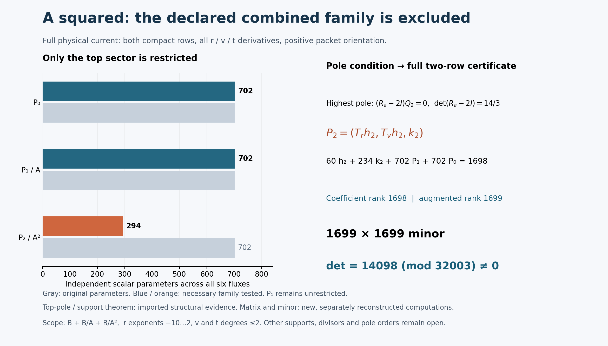

# One-reflection-skew: the square-denominator current search

24 October 2026. **The declared six-component family B+B/A+B/A² is excluded over Q.**
No primitive was found. The search includes mixed cancellation with both
previously tested sectors; only the top pole sector is forced tangent.
Lean stays benched.

## Run card and reused evidence

- Actual Goal activated at 16:32:00 UTC; research deadline 17:17:00 UTC.
  The bounds are 45 minutes for research, 15 for integration, 60 seconds
  per mathematical process and 45 seconds per network operation.
- Notebook parent: `fc4f38a338b47addf62d1bf699783302285378fe`.
- Fresh upstream head: `27f4bb9ad8757e5841f884d9d30124a3c97a847d`.
- The existing [Pro chat](https://chatgpt.com/c/6adb94ec-665c-8325-9a4b-2b4237c63f19)
  is the constructive lead. A local algebra worker supplies necessary pole
  constraints, and a separate local checker checks new evidence. The
  coordinator owns integration and publication.
- Reuse [checkpoint 148's source, tangency and support proof](skew-A-denominator-audit-20261024.md),
  the completed Laurent exclusion, Q/R2, beta, curve and trace work. Those
  executions are not repeated or counted as new checks.
- [Connection JSON](../results/skew-physical-source-20261023/inputs/benediamond/packet/one-reflection-skew-followup/inputs/source-rank2-connection.json)
  SHA256: `a86c01f7fed725aac86e958a10f484b9b340765714c5b228513890977a59ce5d`.

The decisive question is whether the additional pole order permits the
missing full-source cancellation within an explicit finite family. A
successful candidate requires an exact rational identity; an exclusion
requires a sound rank or kernel argument. A timeout settles neither.

## Full equation and family

Here A is the chart coefficient, not the protected source polynomial
`X_0^3 Y_0^3`. The target still has `q=1`. Write

\[
A=r^3+r^{-3}+(rv-1)^6/r^{15},\qquad
(a,b,c,d)=(A,tv,t(1-t^2)/7,1+t^6).
\]

In the packet's positive residue orientation and ordered input-column
basis `(dV/nu^5,V dV/nu^5)`, the equation is

\[
\operatorname{Div}_{\widetilde N}F
=\sum_{i=r,v,t}(\partial_i+\widetilde N_i)F_i
=\frac{r^{-4}}{12}M_b e_0,
\quad
\widetilde N=(A_rM_a,A_vM_a+tM_b,N_t),
\]
\[
N_t=vM_b+c'M_c+d'M_d.
\]

Both output rows and all three physical directions remain. The currents
have rational coefficients in `(r,v,t)` on the common regular open of the
pinned expressions. They are not arbitrary fibre-dependent sextic forms.

For
\[
B=\operatorname{span}_{\mathbb Q}
\{r^m v^n t^k:-10\le m\le2,\ 0\le n,k\le2\},
\]
the requested starting family is `(B/A^2)^6`. Pro explicitly enlarged it to
\[
\boxed{(B+B/A+B/A^2)^6},\qquad F=P_0+P_1/A+P_2/A^2.
\]
This retains possible cancellation between all three sectors. They form a
direct sum: after multiplication by A squared, the highest v degrees in
`A^2 P0`, `A P1`, and `P2` are separated because `deg_v A=6` and
`deg_v B<=2`. The original family therefore has 2,106 parameters.

## The new pole condition, with lower-sector coupling retained

Reuse the earlier generic divisor and tangent-module proof. Its residue is
\[
R_a=\begin{pmatrix}0&-c/(6b)\\0&-1/3\end{pmatrix}.
\]
For `P2/A^2`, the new highest pole is
\[
A^{-3}(R_a-2I)(A_rP_{2,r}+A_vP_{2,v}),\qquad
\det(R_a-2I)=14/3.
\]
The lower sectors cannot cancel this pole. Thus only P2 is forced into the
previously established bounded tangent module:
\[
(P_{2,r},P_{2,v},P_{2,t})=(T_rh,T_vh,k),
\]
\[
T_r=r^2(r^6+1),\qquad
T_v=r(2r^6+1)v-(3r^6+2),\qquad
\ell=3r(r^6-1),\quad T(A)=\ell A.
\]
Each component of h has r exponents -10 through -6, v degree at most 1
and t degree at most 2; each component of k belongs to B. This gives
60+234=294 top-sector parameters. All 702 parameters of P0 and all 702
of P1 remain available, giving the **1,698-parameter necessary family**.

The squared denominator changes the reduced scalar term to
`div(T)-2 ell=4r^7+9r`. Define
\[
W_2(h,k)=
\left[T_r\partial_r+T_v\partial_v+(4r^7+9r)I
+\ell A M_a+tT_vM_b\right]h+(\partial_t+N_t)k.
\]
Then the entire equation, multiplied by A squared, becomes
\[
A^2\operatorname{Div}_{\widetilde N}P_0
+A\operatorname{Div}_{\widetilde N}P_1
-(A_rP_{1,r}+A_vP_{1,v})+W_2(h,k)
=A^2\frac{r^{-4}}{12}M_b e_0.
\]

This formula retains the quotient corrections, `A_v M_a`, both compact
rows and the full t connection. In particular, the next pole condition is
\[
(R_a-I)(A_rP_{1,r}+A_vP_{1,v})+W_2|_{A=0}=0.
\]
It is **not valid to require P1 to be tangent separately**. Its pole may
cancel the remaining top-sector pole. The full matrix keeps that coupling.

## A stronger local constraint that the search did not need

The [local algebra handoff](../results/skew-A2-denominator-audit-20261024/algebra/HANDOFF.txt)
also proves that the second compact component of h must be divisible by v.
Set `x=rv-1`. The normal-flux image for P1 has remainder support only in
`x^0,x^1,x^2,x^5`. At A=0 the second row of W2 is
\[
\left[T\cdot\partial+2r^7+19r/2+(3r^6+2)/(2v)\right]h_1
+(\partial_t-1/(2t))k_1.
\]
Only the v-constant part of h1 contributes the forbidden x cubed and
x fourth coefficients through `1/v`; their nonzero opposite coefficients
force that part to vanish. The generic inverse computation is in the
quotient by `x^6+r^18+r^12`; it introduces no new divisor in the current
ansatz. The characteristic-zero divisor assumptions are inherited from
the previous proof, not newly established by point sampling.

This further necessary condition removes 15 parameters, giving 1,683.
It was delivered and separately checked, but **Pro did not use it**: the
larger 1,698-parameter test was decisive. Its proof and sparse injection
are preserved as a separate result, not a dependency of that exclusion.
Other coupled restrictions were not solved symbolically.

## Verification and publication

The new matrix has 1,698 coefficient columns and one source column. Its
first 1,699 rows have augmented determinant **14098 modulo 32003**.
All evaluation denominators are units at the selected points, so the
corresponding rational minor is nonzero. Its coefficient matrix has only
1,698 columns. A rational-function identity would specialize at every such
point, so no current in the necessary family solves the equation. Combined
with the highest-pole theorem, this excludes the entire original
2,106-parameter sum. Unknown rational coefficients need not reduce modulo
the prime for this argument. Full coefficient rank also closes the kernel
issue; no rank-deficient modular gap is promoted to an exclusion.

Evidence is kept separate by execution and scope:

| Execution | New evidence | Wall time |
| --- | --- | --- |
| Pro constructive lead | Direct quotient-rule columns; ranks 1698/1699 | 11.505 s |
| Pro separate checker | All 2,986,842 entries of the 1758-by-1699 matrix and 879 domain records; modular Bareiss determinant 14098; ten mutation controls | 16.519 s |
| Local decisive checker | Independently regenerated all 2,886,601 entries of the 1699-square minor at 850 points; normalized Gaussian determinant 14098; two derivative-error controls | 16.344 s |
| Local structural workers | Fourteen exact algebra checks and three controls, plus separate reciprocal and projection checks | Each process below 60 s |

The local decisive checker does not claim the remaining 59 sample rows.
Its regeneration preceded receipt of the Pro matrix. A subsequent byte/data
comparison binds those already checked entries to the delivered CSV; that
comparison is not a further mathematical replay. The additional local
v-divisibility result above is unused by the decisive matrix.

The [original Pro note](skew-A2-denominator-20261024.md),
[author/checker receipts](../results/skew-A2-denominator-20261024/RUN.md),
[local reproduction commands and limits](../results/skew-A2-denominator-audit-20261024/checker/README.md),
and [local algebra receipt](../results/skew-A2-denominator-audit-20261024/algebra/check-01/result/validation.json)
retain their separate source bindings. Pro's 16.127-second standalone
export-verifier run is a packaging replay, not another independent result.
No old determinant, Lean build or CI run was repeated.

The [figure generator](../results/skew-A2-denominator-20261024/render.py)
reads the saved receipts. The coordinator inspected the final PNG: labels,
bounds and determinant are legible without overlap. Gray bars show the
original sectors; colored bars show the necessary family. The figure does
not prove general nonexistence. The first render's overlapping annotation,
source and output are preserved alongside the corrected second render.

## Failed routes, transfer and stopping rule

No mathematical process in this batch failed or timed out. The unsuccessful
attempt is the declared current family itself, now exactly excluded. Pro's
Git source retrieval failed once at the sandbox proxy, then two bounded
fetch routes timed out. The read-only GitHub connector recovered the exact
parent objects with verified Git hashes; see the original
[transport record](../results/skew-A2-denominator-20261024/transport.json).
Those are access failures, not mathematical counterexamples.

Browser download clicks initially produced no local artifact. A captured
download event retrieved the original archive; the split-packet fallback
was not used. The archive layout has a `payload/` directory; the receiver's
initial layout assumption was corrected, then all original payload bytes
were verified against the ZIP and manifest. The archive SHA256 is
`1c254f651668fc2633d338f848f0de8d45162d0c3fd1b80dc48ccde1f16c7d8c`.
All 50 Pro payload files are preserved unchanged. The
[archive and import receipts](../results/skew-A2-denominator-audit-20261024/pro-delivery)
record this binding. Hash checks do not establish mathematical content.

Pro stopped mathematical work at 16:38:51 UTC. The coordinator closed the
research phase at 16:47:29 UTC after the independent minor check, 15 minutes
29 seconds after Goal activation. Integration has a 17:02:29 UTC deadline.
No subsequent search was started. This notebook commit packages the checked
bounded outcome, visualization, failed routes and limits. The final remote
push and readback are separately verified by the coordinator; this note's
commit permalink supplies its publication identity.

## Limits and attribution

No primitive, full-source exactness theorem, fibre-exact lift, trace-and-
clearing replay, homogeneous certificate or accepted solve is claimed.
Changing the numerator support, using further pole divisors or orders,
or allowing arbitrary rational or fibre-dependent currents is outside this
finite family. A completed bounded batch does not solve the Hodge target.

Credit fqlx for the compact connection, benediamond for the physical cover
and earlier reductions, and Benjamin E. Diamond and hodge.computer
contributors for the fixed target and framework. These constructions and
checks are AI-assisted work for Ravi Bajaj; they are not independent human
reviews or Lean/kernel executions. No upstream action is part of this batch.
Posts 1–29 and the contribution tally remain unchanged.
