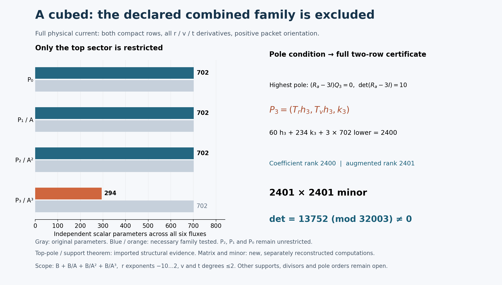

# One-reflection-skew: the cube-denominator current search

24 October 2026. **The declared six-component family B+B/A+B/A²+B/A³ is excluded over Q.**
No primitive was found.
Lean is benched. The target remains the unchanged `q=1`, protected source
`X_0^3 Y_0^3` problem. Here A denotes the chart coefficient instead.

## Run card

The actual Goal began at 16:58:06 UTC, with a 17:43:06 UTC research deadline,
then at most 15 minutes for integration. Mathematical processes have a
60-second limit; network operations have a 45-second limit. Reuse the
[existing Pro chat](https://chatgpt.com/c/6adb94ec-665c-8325-9a4b-2b4237c63f19)
as constructive lead, a local algebra worker for the new pole order and a
separate local checker for the decisive result. The coordinator integrates
the notebook; no upstream post is part of this batch.

- Notebook parent: `2dff6afddab993a216ba3f262197ae69aeb9143a`.
- Fresh upstream head: `27f4bb9ad8757e5841f884d9d30124a3c97a847d`.
- Literal [connection input](../results/skew-physical-source-20261023/inputs/benediamond/packet/one-reflection-skew-followup/inputs/source-rank2-connection.json)
  SHA256: `a86c01f7fed725aac86e958a10f484b9b340765714c5b228513890977a59ce5d`.
- Reuse the [A-denominator divisor, tangency and support arguments](skew-A-denominator-audit-20261024.md)
  and [A-squared outcome](skew-A2-denominator-audit-20261024.md), including
  their original scopes. Prior source transport, curve, trace, Q/R2, beta,
  Laurent searches and Lean receipts are not rerun or counted as new work.

The question is whether the next pole order permits full-source cancellation
inside the declared finite family. A candidate requires an exact rational
identity; an exclusion requires a valid characteristic-zero rank argument.
A process timeout proves neither.

## Equation, bounds and mixed cancellation

Use the positive packet residue convention and ordered compact input basis
`(dV/nu^5,V dV/nu^5)`. Set

\[
A=r^3+r^{-3}+(rv-1)^6/r^{15},\qquad
(a,b,c,d)=(A,tv,t(1-t^2)/7,1+t^6).
\]
The full equation is
\[
\operatorname{Div}_{\widetilde N}F
=\sum_{i=r,v,t}(\partial_i+\widetilde N_i)F_i
=S=\frac{r^{-4}}{12}M_b e_0,
\]
\[
\widetilde N=(A_rM_a,A_vM_a+tM_b,N_t),\qquad
N_t=vM_b+c'M_c+d'M_d.
\]
All three physical derivatives and both output rows remain. Although A has
no t dependence, the full t connection is retained.

With
\[
B=\operatorname{span}_{\mathbb Q}
\{r^m v^n t^k:-10\le m\le2,\ 0\le n,k\le2\},
\]
Pro explicitly enlarged the requested `(B/A^3)^6` family to
\[
\boxed{(B+B/A+B/A^2+B/A^3)^6},\qquad
F=P_0+P_1/A+P_2/A^2+P_3/A^3.
\]
These are constant rational coefficients in the displayed monomial bases,
not arbitrary rational functions multiplying those bases. The four sectors
are independent: after multiplication by A cubed their leading v-degree
bands are 18–20, 12–14, 6–8 and 0–2. The original dimension is **2,808**.

## New highest pole; lower sectors stay free

The reused generic-divisor residue is
\[
R_a=\begin{pmatrix}0&-c/(6b)\\0&-1/3\end{pmatrix}.
\]
The order-four pole has coefficient
`(R_a-3I)(A_r P3r+A_v P3v)`. The new determinant is **10**, so P3 alone
must lie in the previously proved bounded tangent module:
\[
(P_{3,r},P_{3,v},P_{3,t})=(T_rh,T_vh,k),\quad
T_r=r^2(r^6+1),\quad T_v=r(2r^6+1)v-(3r^6+2).
\]
Each h component has r exponents -10 through -6, v degree at most 1 and
t degree at most 2. Each k component belongs to B. This gives 60+234=294
top parameters. The **2,106 lower parameters remain free**, giving a
**2,400-parameter necessary family**. This pole comparison is on the generic
A=0 boundary with the earlier divisor assumptions, not an ordinary-point
substitution into the rational current.

Write `ell=3r(r^6-1)`, so `T(A)=ell A`. The new scalar term is
`tau3=div(T)-3 ell=r^7+12r`. Define
\[
W_3=[T_r\partial_r+T_v\partial_v+(r^7+12r)I
+\ell A M_a+tT_vM_b]h+(\partial_t+N_t)k.
\]
For `Qj=A_r Pjr+A_v Pjv`, the entire A-cubed-scaled equation is
\[
A^3\operatorname{Div}_{\widetilde N}P_0
+A^2\operatorname{Div}_{\widetilde N}P_1-AQ_1
+A\operatorname{Div}_{\widetilde N}P_2-2Q_2+W_3=A^3S.
\]
The next pole remains coupled: `(R_a-2I)Q2+W3|A=0=0`. Requiring P2 to
be tangent separately would lose possible cancellation and is not done.
Nor is the previous A-squared secondary divisibility condition imposed.
The [local algebra handoff](../results/skew-A3-denominator-audit-20261024/algebra/HANDOFF.txt)
records the new calculation and exact injection, preserving all lower
coefficients. Seven new exact checks and two mutation controls passed;
separate reciprocal/residue checks retain their own counts.

## Decisive check and visualization

The fixed specification used prime 32003 and Python `random.Random` seed
2026102458. It takes successive nonzero-coordinate triples, skipping any
point where A, the literal discriminant or a connection denominator vanishes.
Rows are the two output components at each point. Columns are h3 (60),
k3 (234), P2 (702), P1 (702), P0 (702), then the positive source. The lead
saved 2,460 rows at 1,230 admissible points.

The **first 2,401 rows** have augmented determinant
\[
\boxed{13752\pmod{32003}\ne0.}
\]
All input denominators are units at these points. Thus the rational minor
is nonzero over Q, while there are only 2,400 coefficient columns. A rational
identity would hold at every such evaluation, which is impossible. Unknown
constant coefficients need not have denominators prime to 32003 for this
argument. Combined with the necessary top-pole reduction, it excludes the
original 2,808-parameter sum and hence the requested pure B/A³ subfamily.
There is no inference from a deficient modular rank or an unhandled kernel.

| Execution | Evidence | Process time |
| --- | --- | --- |
| Pro lead | Direct full-current columns, coefficient/augmented ranks 2400/2401 | 31.73 s |
| Pro separate checker | 5,906,460 entries and 1,230 domain records independently reconstructed | 7.59 s |
| Pro separate checker, determinant phase | Exact modular Bareiss determinant 13752; 12 controls across its checks | 38.94 s |
| Local separate checker | 5,764,801 entries in the decisive minor at 1,201 points; exact FLINT determinant 13752; three new mutations detected | 4.453 s |
| Local algebra worker | Seven exact order-three identities and two mutation controls | 2.109 s |
| Local separate structural checks | Three reciprocal identities, residue and tau3 checks; two wrong-order controls | 8.359 s |

The local minor was regenerated from the predeclared specification before
the checker received Pro's numerical result or matrix. It uses a separately
written rational-polynomial evaluator and symbolic physical derivatives;
the determinant backend is `python-flint 0.9.0`, not a newly authored
elimination algorithm. Only the decisive first 2,401 rows are claimed by
that local replay. The Pro checker retains its broader entry count and
different determinant implementation.

The [original Pro note](skew-A3-denominator-20261024.md),
[Pro execution packet](../results/skew-A3-denominator-20261024/), and
[local checker commands and limits](../results/skew-A3-denominator-audit-20261024/checker/README.md)
retain their separate provenance. No prior determinant, Lean build or CI
run is replayed. The later delivered-CSV comparison is an artifact binding,
not another mathematical computation.

The [generator](../results/skew-A3-denominator-20261024/render.py) reads
the frozen receipts. The coordinator inspected the PNG: its labels, source
convention, counts and scope are legible without overlap. The bars show the
original and necessary parameters; the picture itself is not a proof.
A [local fallback figure](../results/skew-A3-denominator-audit-20261024/local-figure/render-01/A3-receipt-summary.png)
was prepared during the transfer failure from the existing receipts only.
It was not needed as the primary figure and adds no mathematical result.

## Handoffs, failed attempts and limits

The structural handoff was consumed by Pro's 2,400-parameter search. Pro's
fixed column/sample specification was consumed by the local checker, which
returned the matching determinant. The coordinator then integrates the
unchanged evidence, shared board and append-only ledger. This records actual
handoff use, not a count of agent agreement.

No mathematical process failed or timed out. The unsuccessful mathematical
attempt is the declared family, now exactly excluded. Pro used its cached
`fc4f38a` checkout, read current-parent inputs through the connector and
verified the unchanged connection bytes. It did not materialize the newer
parent or retry the known failed Git routes. The coordinator integrated onto
the actual pinned `2dff6af` parent; the imported source pins were checked
against that Git commit. No fabricated parent-plus-payload tree is used.

Two original-archive browser attempts timed out (45 and 30 seconds), with
no local file. The small review bundle downloaded successfully, followed by
eight binary slices of the original ZIP. Reassembly verified all part hashes,
the original 14,745,256-byte length and SHA256
`68ad4cd8e28733d42629588179b4f5ed31d458354dfb6a951b1c6844484d22d0`.
All **46 original payload files** were imported byte-for-byte. The
[transfer receipt](../results/skew-A3-denominator-audit-20261024/transfer-recovery.json)
and [archive/import receipts](../results/skew-A3-denominator-audit-20261024/pro-delivery/)
separate transport failures from mathematical failure. A receiver status
label typo (`SHA356`) was corrected to `SHA256` before publication; hash
computations and original payload bytes were unaffected.

The subsequent [IO-only binding receipt](../results/skew-A3-denominator-audit-20261024/checker/packet-binding.json)
verifies all 5,764,801 frozen minor entries, all 2,400 basis labels and the
first 1,201 point/domain records against the delivered CSV and inputs, in
0.735 seconds. The checker README and initial freeze retain their historical
pending-delivery state; a separate addendum records this completed binding.
No determinant or coefficient calculation was rerun. The independently
generated uint16 minor is also retained as a reproducible artifact.

The coordinator closed mathematics at **17:05:14 UTC**, 7 minutes 8 seconds
after Goal activation and inside the 45-minute budget. The integration
deadline is 17:20:14 UTC. After that closure, only file bindings, presentation,
ledger integration and publication checks are performed. The remote push
and readback are verified separately; this note's commit supplies the
published identity.

The changed condition is now precise: adding the third A-pole order, even
with every bounded lower sector available, did not cancel the source. The
full residual remains. Any further construction must escape an explicitly
excluded restriction; this result supplies no evidence that simply increasing
the pole order again will produce a primitive.

No general rational-current obstruction, full primitive, source exactness,
fibre-exact lift, global clearing, homogeneous certificate, new Lean build
or accepted solve is claimed. Other numerator supports, other poles and
unbounded rational or fibre-dependent currents remain outside this batch.
Completing its bounded Goal does not solve the Hodge target.

Credit fqlx for the compact connection and source formulation, benediamond
for the physical cover and earlier reductions, and Benjamin E. Diamond and
the hodge.computer contributors for the fixed problem and framework. This
is AI-assisted research for Ravi Bajaj. Separate computational implementations
are not independent human reviews. Posts 1–30 and the contribution tally
remain unchanged at 30 discussion contributions, one closed maintenance PR
and zero accepted authored solves.
