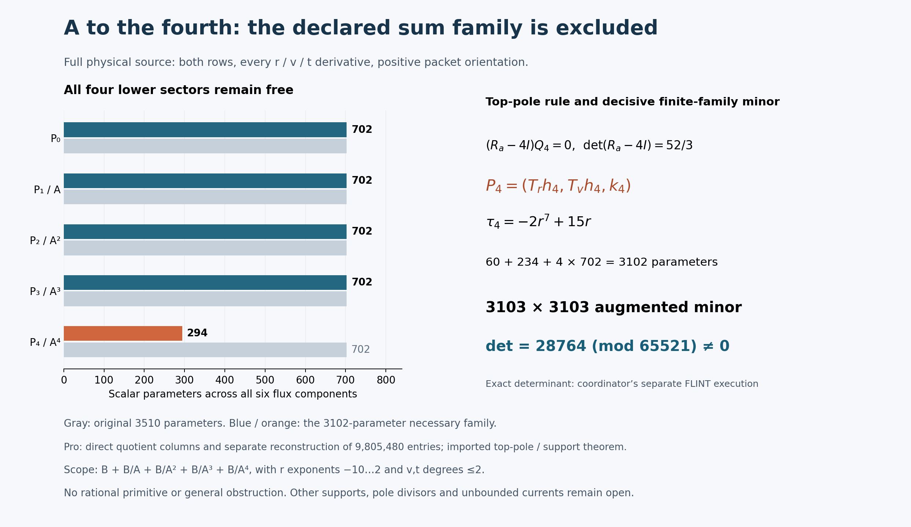

# One-reflection-skew: the fourth-power denominator current search

24 October 2026. **The declared bounded six-component family through A^-4
is excluded over Q. No primitive was found.**
The protected target remains `q=1`, source `X_0^3 Y_0^3`. Throughout this
note A denotes the separate physical chart coefficient. Lean is benched.
Publication for this batch is Hodge Lab only.

## Run card and reused inputs

The actual Goal started at **17:20:39 UTC**, with a research deadline of
18:05:39 UTC and at most 15 minutes afterward for integration. Individual
mathematical processes have 60-second limits; network operations have
45-second limits. The [existing Pro chat](https://chatgpt.com/c/6adb94ec-665c-8325-9a4b-2b4237c63f19)
is constructive lead. A local algebra worker supplies the new highest-pole
identity, a separate local checker tests the decisive result, and the
coordinator alone integrates shared notebook files.

- Notebook parent: `a773c34804b3d0e1e6db2e1b6e31d89f3c3455cf`.
- Fresh upstream head: `27f4bb9ad8757e5841f884d9d30124a3c97a847d`.
- Literal [connection JSON](../results/skew-physical-source-20261023/inputs/benediamond/packet/one-reflection-skew-followup/inputs/source-rank2-connection.json)
  SHA256: `a86c01f7fed725aac86e958a10f484b9b340765714c5b228513890977a59ce5d`.
- Reused results: [A-divisor, tangent module and support argument](skew-A-denominator-audit-20261024.md),
  [A-squared exclusion](skew-A2-denominator-audit-20261024.md), and
  [A-cubed exclusion](skew-A3-denominator-audit-20261024.md).

The discriminating question is whether adding the fourth A-pole order,
with all bounded lower sectors retained, permits cancellation of the actual
full source. A candidate requires an exact rational identity; an exclusion
requires a valid rational inconsistency certificate. A timeout establishes
neither. Prior source transport, trace, curve, Q/R2, beta and Lean receipts
are reused with their original scopes rather than replayed.

## Complete current and bounds

Use the positive packet orientation and compact basis `(dV/nu^5,V dV/nu^5)`.
Set

\[
A=r^3+r^{-3}+(rv-1)^6/r^{15},\quad
(a,b,c,d)=(A,tv,t(1-t^2)/7,1+t^6).
\]

The full equation is

\[
\operatorname{Div}_{\widetilde N}F
=\sum_{i=r,v,t}(\partial_i+\widetilde N_i)F_i
=S=\frac{r^{-4}}{12}M_b e_0,
\]

where `Ntilde=(A_r M_a,A_v M_a+t M_b,N_t)` and
`N_t=v M_b+c' M_c+d' M_d`. Both compact rows and all physical derivatives,
including the full t connection, remain present.

Let `B=span_Q{r^m v^n t^k:-10<=m<=2,0<=n,k<=2}`. The requested pure
`(B/A^4)^6` family is explicitly enlarged to

\[
F=P_0+P_1/A+P_2/A^2+P_3/A^3+P_4/A^4,
\qquad P_j\in B^6.
\]

These are constant rational coefficients in the displayed monomial basis,
not arbitrary rational coefficient functions. The five sectors give 3,510
independent parameters: after multiplication by A^4 their leading v-degree
bands are 24–26, 18–20, 12–14, 6–8 and 0–2.

## Fourth-order pole and lower-sector coupling

The imported generic-divisor residue is

\[
R_a=\begin{pmatrix}0&-c/(6b)\\0&-1/3\end{pmatrix}.
\]

The new order-five pole gives `(R_a-4I)Q4=0 mod A`, with determinant
**52/3**. Thus only P4 is restricted to the reused bounded tangent module:

\[
(P_{4,r},P_{4,v},P_{4,t})=(T_rh,T_vh,k),\quad
T_r=r^2(r^6+1),\quad T_v=r(2r^6+1)v-(3r^6+2).
\]

Each h component has r exponents -10 through -6, v degree at most 1 and
t degree at most 2; each k component belongs to B. This leaves 294 top
parameters and **all 2,808 lower parameters**, hence 3,102 necessary
parameters. The leading-pole comparison is at the generic prime smooth
A=0 divisor away from b*Delta=0, with the earlier divisor and support
arguments imported. The ordinary evaluation chart requires nonzero
r, A, Delta and all literal connection denominators.

Writing `ell=3r(r^6-1)`, the new scalar term is
`tau4=div(T)-4ell=-2r^7+15r`. Define

\[
W_4=[T_r\partial_r+T_v\partial_v+(-2r^7+15r)I
+\ell A M_a+tT_vM_b]h+(\partial_t+N_t)k.
\]

For `Qj=A_r Pjr+A_v Pjv`, the complete scaled equation is

\[
A^4\operatorname{Div}P_0+A^3\operatorname{Div}P_1-A^2Q_1
+A^2\operatorname{Div}P_2-2AQ_2
+A\operatorname{Div}P_3-3Q_3+W_4=A^4S.
\]

The next pole remains coupled: `(R_a-3I)Q3+W4|A=0=0`. In particular,
the previous A-cubed exclusion applies when P4=0; with nonzero P4 the
lower sectors must cancel `S-Div(P4/A^4)`, which is a different source.
No independent tangency or old secondary projection is imposed on them.

The local algebra worker checked seven new exact identities and three
sign/order mutation controls in a 2.453-second process. These include the
scaled equation and the injection retaining every lower coefficient;
the completed divisor/support proofs are reused, not newly executed.

## Exact certificate and separate execution

Pro declared prime **65521**, Python `random.Random` seed **2026102469**,
and 1,580 admissible sample triples before exposing a numerical result.
Successive `randrange(1,p)` draws supply r,v,t; points with vanishing A,
Delta or a literal connection denominator are rejected. Output rows are
compact row 0 then row 1. Columns are h4 (60), k4 (234), P3, P2, P1, P0
(702 each), then the positive source. Within each sector, use direction
where applicable, compact input row, then increasing r,v,t exponents.

The fixed decisive minor is the **first 3,103 rows**, in original order.
The separate local checker reconstructed all **9,628,609 entries**, using
1,552 admissible points, before receiving Pro's numerical result. Its
exact determinant is

\[
\boxed{\det=28764\pmod{65521}\ne0.}
\]

All input denominators are units at these integer-lifted points. Therefore
the rational augmented minor is nonzero. With only 3,102 coefficient
columns, the necessary evaluations are inconsistent over Q. Combined with
the highest-pole necessity, this excludes the original 3,510-parameter sum
and its pure B/A^4 subfamily. Unknown constant coefficients need not have
denominators prime to 65521; the argument uses a nonzero rational minor,
not reduction of a hypothetical solution. No deficient modular rank or
unaccounted homogeneous kernel is used as an exclusion argument.

The [local checker](../results/skew-A4-denominator-audit-20261024/checker/)
uses its separately authored rational-polynomial evaluator and symbolic
physical Jacobian, with exact `flint.nmod_mat.det` from python-flint 0.9.0.
It reuses its existing evaluator rather than Pro's implementation. The
single mathematical child took **6.438 seconds**, with three deliberate
operator mutations detected and new determinant, tau4 and reciprocal-rule
controls. Its saved report retains the pending-delivery status at execution;
any later comparison with Pro's files is recorded separately as artifact
binding, not another mathematical replay.

## Visualization, handoffs, failed attempts and limits

The full target remains open. This is a finite-family exclusion, not a
general obstruction to rational currents. Larger numerator supports,
other pole divisors, higher A powers and arbitrary rational or
fibre-dependent currents lie outside it. No primitive, source exactness,
global clearing, homogeneous certificate, new Lean build or accepted solve
is claimed. The unsuccessful mathematical attempt is the declared A^4
family; completing this bounded Goal does not solve the Hodge target.

Pro constructed a **3,160 by 3,103** matrix by direct quotient derivatives
in **9.30 seconds**. Its separate worker reconstructed all **9,805,480
entries**, 1,580 sample/domain records and the basis order from the literal
source and reduced operator in **8.94 seconds**, retaining **17 mutation
controls**. These counts remain separate from the local decisive-minor
reconstruction. Pro did not execute a new determinant: FLINT was unavailable
after one bounded installation repair, and that setup route was stopped.
Its finite-family conclusion uses the explicitly attributed local exact
determinant. The worker also reduced c' modulo the prime before NumPy
multiplication to prevent overflow, before executing the successful matrix
run. No mathematical process failed or timed out. The two unsuccessful
FLINT setup attempts (the requested wheel, then one index repair) and a
wrong board-path lookup are retained separately from mathematical checks.

Pro used cached checkout `fc4f38a` with current-parent read-only connector
reads, distinguishing it from the actual integration parent `a773c34`.
The connection bytes remain pinned. No fabricated complete parent tree or
expected Git tree is claimed. The coordinator integrates against the actual
Git parent and preserves every original received payload byte.

Mathematics closed at **17:26:37 UTC**, 5 minutes 58 seconds after Goal
activation. The integration deadline is 17:41:37 UTC. Remaining work is
artifact binding, presentation and normal notebook publication; no further
search, mathematical replay or pole-order refinement is started.

The [original Pro note](skew-A4-denominator-20261024.md) and
[execution packet](../results/skew-A4-denominator-20261024/) preserve all
**60 original payload files** byte-for-byte. Eleven downloaded binary
slices reassembled to the 20,142,445-byte original ZIP, SHA256
`8abdf70cb3861435a6b284e57cefdfac0a9f8f58db82cf0ec7d018aa86a843a9`.
The original manifest SHA256 is
`8f3802ae7110e45f6a7e8ef79fc8419424683cb84d0df8c6fc8cac47946117e3`.
The small review ZIP omitted only the large matrix; the complete import
has no such omission. No download failed. The coordinator corrected two
receiver assumptions about explicit `parts/` and `payload/` manifest
prefixes; their failed assertions and premature missing-archive extraction
are recorded as integration failures, not mathematical results.

The [generator](../results/skew-A4-denominator-20261024/render.py) reads
frozen receipts. The coordinator inspected the final PNG: the counts,
formula, attribution and limits are legible without overlap. Gray bars
show the original parameters; the colored bars show that only P4 is
restricted. The first render and its caption-spacing correction are
preserved. Neither this figure nor its hash supplies a mathematical proof.

The structural handoff was consumed by Pro's direct construction; Pro's
fixed specification was consumed by the independent local checker. The
**0.375-second IO-only comparison** verified every one of the 9,628,609
decisive entries, all 3,102 basis labels and the first 1,552 point/domain
records against the delivered files, with matching file hashes. No
coefficient, derivative or determinant was recomputed. It is recorded in the
[binding addendum](../results/skew-A4-denominator-audit-20261024/checker/BINDING-ADDENDUM.md).
The original pending-delivery receipts remain unchanged as history.

This batch makes no upstream post, reply, edit or PR. Posts 1–30 and the
tally remain unchanged: **30 discussion contributions, one closed
maintenance PR and zero accepted authored solves**. The latest upstream
post remains [today's earlier A-squared update](https://github.com/hodge-computer/sextics/discussions/127#discussioncomment-19167075).

Credit fqlx for the compact connection and source formulation, benediamond
for the physical cover and earlier reductions, and Benjamin E. Diamond and
the hodge.computer contributors for the fixed problem and framework.
This is AI-assisted research for Ravi Bajaj; separate computational
implementations are not independent human reviews.
