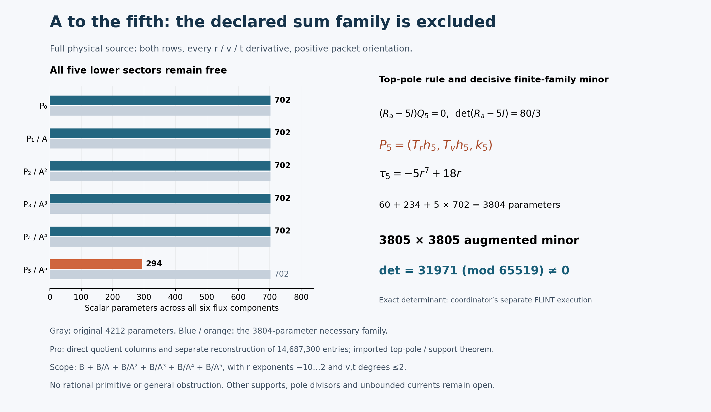

# One-reflection-skew: bounded A-fifth current family

24 October 2026 EDT. **The declared six-component sum family is excluded
by the coordinator's independently reconstructed nonzero augmented minor.**
Pro constructed the direct-quotient matrix and a separate AI worker rebuilt
every entry from the literal connection. The determinant is a coordinator
execution; delivered-file matching is a separate IO-only integration step.
No rational primitive was found.

## Run card, pins and ownership

The bounded question was whether the additional A^-5 sector permits full
two-row source cancellation with the fixed numerator box, allowing every
lower sector to participate. A candidate requires an exact rational identity;
an exclusion requires a nonzero rational augmented minor or another valid
kernel-aware argument. A deficient modular rank gap is insufficient.

The actual Goal belongs to the coordinator. It started at 13:38:19 EDT /
17:38:19 UTC, with research deadline 14:23:19 EDT / 18:23:19 UTC. Mathematical
processes have a 60-second limit, network operations a 45-second limit, and
integration at most 15 minutes after mathematical closure. Mathematics
closed at **13:42:22 EDT / 17:42:22 UTC**; integration deadline is
13:57:22 EDT / 17:57:22 UTC. Subsequent activity is packaging and presentation.

Actual integration parent: `ce22ec3a0636e9c2dbe7e90e1a36ae63f5f4b44a`.
Cached execution checkout: `fc4f38a338b47addf62d1bf699783302285378fe`.
Current-parent AGENTS, shared board and connection were read through the
read-only GitHub connector. Their snapshots match the Git blob hashes;
the cached and live connection bytes agree, SHA256
`a86c01f7fed725aac86e958a10f484b9b340765714c5b228513890977a59ce5d`.
The upstream dispatch pin remains the coordinator-supplied
`27f4bb9ad8757e5841f884d9d30124a3c97a847d`. No newer full parent was
materialized and no combined Git tree is claimed. The added-file manifest
is the integration contract.

Pro owns only this note and `results/skew-A5-denominator-20261024/`.
The coordinator owns shared README, ledger, board and publication. No worker
Git stage/commit/push, Lean, upstream post/reply/edit/PR or shared-file edit
occurred. Posts 1–30 and tally 30/1/0 remain unchanged by this worker.
Completed source, divisor, tangent/support, normalization and A–A4 checks,
Q/R2, beta, trace and Lean are reused evidence; no old mathematics was rerun.
Known failed Git and FLINT-install routes were not retried.

## Exact six-component family

Let

\[
B=\operatorname{span}_{\mathbf Q}\{r^m v^n t^k:
-10\le m\le2,\quad 0\le n,k\le2\},\qquad
A=r^3+r^{-3}+(rv-1)^6/r^{15}.
\]

Before computation, the requested pure (B/A^5)^6 family was explicitly
enlarged to

\[
\boxed{(B+B/A+B/A^2+B/A^3+B/A^4+B/A^5)^6},\qquad
F=\sum_{j=0}^{5} P_j/A^j.
\]

Coefficients in these finite bases are constant rationals. The original
dimension is **4212**. Multiplying an input relation by A^5 gives possible
nonzero leading v-degree bands 30–32, 24–26, 18–20, 12–14, 6–8 and 0–2.
Descending by leading degree proves directness of the sectors. Input
independence alone does not prove operator injectivity.

The unchanged full equation is

\[
\sum_{i=r,v,t}(\partial_i+\widetilde N_i)F_i=S,
\qquad S=\frac{r^{-4}}{12}M_b e_0,
\qquad \widetilde N=(A_rM_a,A_vM_a+tM_b,N_t),
\]
\[
(a,b,c,d)=(A,tv,t(1-t^2)/7,1+t^6),\qquad
N_t=vM_b+c'M_c+d'M_d.
\]

Both compact rows, ordered input columns e0,e1, positive packet orientation
and all r,v,t derivatives remain. The top quotient corrections are
-5*A_r/A^6 and -5*A_v/A^6. A_t=0, but the full N_t is present. A is the
chart coefficient, distinct from protected source X0^3Y0^3; q remains 1.
The established common-localization boundary is preserved. Scalar trace
zero is not full-source exactness or a primitive.

Allowed current poles are r=0 and A=0, with A-order at most 5. Evaluation
also avoids Delta=0 and every literal connection denominator. Nonzero v,t
samples do not introduce v or t denominators into the ansatz. No inverse
A_r is used.

## Imported highest-pole restriction; lower sectors free

At the generic A=0 divisor, reuse

\[
R_a=\begin{pmatrix}0&-c/(6b)\\0&-1/3\end{pmatrix},\qquad
\det(R_a-5I)=80/3.
\]

With Qj=A_r*Pj_r+A_v*Pj_v, the highest pole is (Ra-5I)Q5. Thus only P5
must be tangent. The reused bounded tangent/support theorem gives

\[
P_5=(T_rh_5,T_vh_5,k_5),\quad
T_r=r^2(r^6+1),\quad T_v=r(2r^6+1)v-(3r^6+2).
\]

Each h5 component has 30 monomials, m=-10,...,-6, n=0,1, k=0,1,2.
Each k5 component has the original 117 monomials. Therefore the top sector
has **294 parameters**. Every lower sector P4,P3,P2,P1,P0 retains all 702:
**3510 lower parameters remain free**, giving **3804 necessary parameters**.
No lower tangency or previous A4 exclusion is imposed on the changed residual.

For ell=3*r*(r^6-1), T(A)=ell*A and

\[
\tau_5=\operatorname{div}(T)-5\ell=-5r^7+18r,
\]
\[
W_5=[T_r\partial_r+T_v\partial_v+\tau_5I+
\ell A M_a+tT_vM_b]h_5+(\partial_t+N_t)k_5.
\]

The exact scaled equation is

\[
\begin{aligned}
A^5\operatorname{Div}P_0+A^4\operatorname{Div}P_1-A^3Q_1
&+A^3\operatorname{Div}P_2-2A^2Q_2\\
&+A^2\operatorname{Div}P_3-3AQ_3
+A\operatorname{Div}P_4-4Q_4+W_5=A^5S.
\end{aligned}
\]

The next pole is coupled: (Ra-4I)Q4+W5|A=0=0. The coordinator reports
7 new structural identities and 3 controls in 2.250 seconds; reported script
SHA256 is `bad3f26c1f1f07c944024b6acdfa91f0c4953951a3c8f434ebd66b24850e8d8c`.
These are imported executions, not Pro counts. See the
[structural dependency record](../results/skew-A5-denominator-20261024/STRUCTURAL-DEPENDENCY.md).

## Fixed sample matrix and certificate

The [specification](../results/skew-A5-denominator-20261024/MATRIX-SPEC.md)
was visible before computation: prime **65519**, Python random.Random seed
**2026102475**, first **1930** admissible successive nonzero-coordinate triples.
Rows are output row0 then row1. Columns are h5,k5,P4,P3,P2,P1,P0, then the
positive source; within sectors use direction where applicable, input row,
then increasing m,n,k. The full matrix has **3860 rows and 3805 columns**.

The coordinator independently reconstructed the decisive first 3805 rows
before seeing a Pro numeric result: **14,478,025 entries at 1903 admissible
points**. Its exact FLINT computation reports

\[
\boxed{\det(M_{0:3805})=31971\pmod{65519}\ne0.}
\]

Every evaluated denominator is a unit modulo the prime. Hence the
corresponding rational augmented minor is nonzero, while there are only
3804 coefficient columns. A rational identity would hold at every such
sample and would contradict that minor. This argument does not assume
unknown rational solution coefficients reduce modulo the prime.

The minor also proves full rank of the coefficient columns. The imported
highest-pole restriction applies to homogeneous currents, so a hidden kernel
or redundant column in the original family does not invalidate the argument.
Together the restriction and minor exclude the entire original 4212-parameter
sum, including the requested pure B/A^5 subfamily. A deficient modular rank
gap would not suffice; no such inference is used.

## Executions and evidence boundaries

| Executor and phase | Wall/process time | Result |
| --- | ---: | --- |
| Pro lead, direct quotient construction |15.374 s|Full 3860×3805 matrix; exit 0 |
| Separate Pro AI checker, literal-source reconstruction |13.007 s|All 14,687,300 entries, 1930 RNG/domain records, basis/rejection order and 19 controls; exit 0 |
| Coordinator's separate local checker, reported |11.656 s|3805-square determinant 31971; 3 controls; no timeout |
| Coordinator's local algebra worker, reported |2.250 s|7 identities and 3 controls |

Pro's checker uses a restricted integer AST, the reduced W5 and
exponent-lowered derivatives, without importing the author's direct-column
implementation. Its 19 controls cover top order 5→4, omitted top r/v
quotient terms, quotient sign, every P4/P3/P2/P1 r/v quotient omission,
the A_v chain, all three N_t terms, source 1/12/sign and k5 t derivative.
Both Pro mathematical processes run with -O, explicit fail-closed exceptions
and a 60-second watchdog. All original sources, snapshots, commands,
versions, stdout/stderr, exits and timings are preserved. No new mathematical
failure, timeout, repair, backend setup or determinant attempt occurred.
The unsuccessful object is the declared current family, not an interrupted run.

Coordinator determinant backend: python-flint 0.9.0, exact nmod_mat.det.
Reported script SHA256:
`83f4b0e432d20fc769100f57c13c5909db9327bbe3b799024537394f2bb49404`.
Reported report SHA256:
`3ead7fda7eb606548b1b12604324a781ab452fb38395f13e112cfe631c36437f`.
Frozen local minor NPY SHA256:
`10dcc8f2d407fb8098eab61fa1f36eeed9ecfc495000f2eb79a99268f760c3b4`.
These coordinator-owned files are not Pro executions or copied into this
packet. Their report is recorded in
[coordinator-reported.json](../results/skew-A5-denominator-20261024/coordinator-reported.json).
Separate computational implementations are not independent human reviews.

## Delivery, figure and remaining scope

The full matrix is raw row-major little-endian uint16, no header, shape
**(3860,3805)**, **29,374,600 bytes**. Its SHA256 is
`63a48714c2f7a7ce3a20829540a8573607b5ced164b2203922604e60d9fa342e`.
The inputs.json SHA256 is
`518c96338bbafe294cbbba12d38299c3efb9c22c5daf681f3738972ebe44173a`.
It contains every sample/domain and basis record. The
[reproduction instructions](../results/skew-A5-denominator-20261024/RUN.md)
use fresh directories; no extra replay was executed for packaging.

The [generator](../results/skew-A5-denominator-20261024/render.py) reads
frozen receipts and records input/output hashes. The PNG was inspected:
the six sector bars, top-only restriction, imported determinant attribution
and scope are legible. It is a picture of the actual finite family and
certificate, not a proof of a general obstruction or transient CI status.

The remaining integration step is **IO-only comparison** of delivered
decisive entries and domain/basis records with the coordinator's frozen
local data. The optional
[matrix-binding helper](../results/skew-A5-denominator-20261024/bind_local_minor.py)
checks the two matrix hashes and every decisive entry only; the coordinator
separately binds domain/basis records. Neither receiver comparison has been
executed in Pro. It must not be counted as another determinant calculation.

The original archive includes all added payload bytes. The small review
archive omits only the bulky matrix and records its hash; numbered binary
slices reconstruct the immutable full ZIP. Root MANIFEST.sha256 paths begin
with `payload/`; verify from the unpacked archive root, then apply the
contents of payload/ to the repository. No repository/cache/submodule dump
or fabricated combined Git tree is included.

The target remains open. An actual cancelling current must escape a
restriction of this exact family. Other numerator supports, other justified
pole divisors, higher powers, unbounded rational currents and fibre-dependent
currents are outside the exclusion. No further search was started. No
full-source exactness, rational primitive, cohomology identification, global
clearing, homogeneous certificate, Lean theorem or accepted solve is claimed.

Credit fqlx for the compact connection and source formulation, benediamond
for the physical cover and earlier reductions, and Benjamin E. Diamond and
hodge.computer contributors for the fixed problem and framework. This is
AI-assisted research for Ravi Bajaj. Hodge Lab integration/publication is
the coordinator's work and remains distinct from these local executions.
