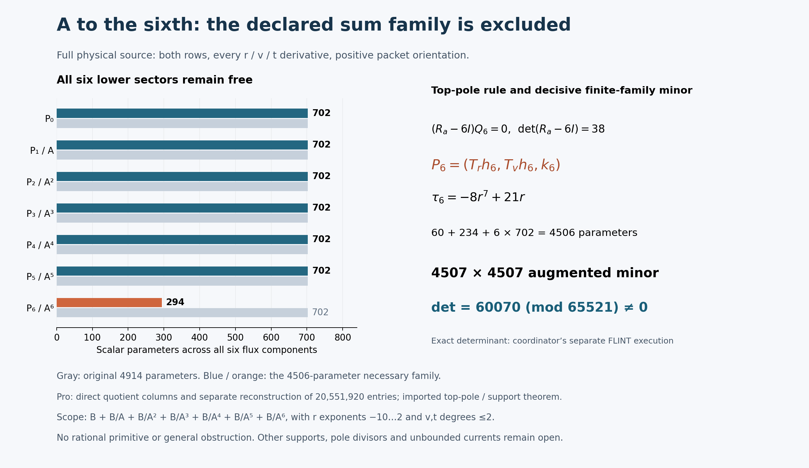

# One-reflection-skew: bounded A-sixth current family

24 October 2026 EDT. **The declared six-component sum family is excluded
by the coordinator's independently reconstructed nonzero augmented minor.**
Pro constructed the direct-quotient matrix; a separate AI worker rebuilt
every entry from the literal connection. The determinant is a coordinator
execution. Delivered-file matching is a separate IO-only integration step.
No rational primitive was found.

## Run card, source pins and ownership

The bounded question was whether adding the A^-6 sector permits cancellation
of the full two-row physical source with the fixed numerator box and every
lower sector available. A candidate requires an exact rational identity.
An exclusion requires a nonzero rational augmented minor or another valid
kernel-aware argument; a deficient modular rank gap is insufficient.

The actual Goal belongs to the coordinator. It started at 13:54:10 EDT /
17:54:10 UTC, with research deadline 14:39:10 EDT / 18:39:10 UTC.
Mathematical processes have a 60-second limit, network operations a 45-second
limit, and at most one repair of an unchanged failure is allowed. Mathematics
closed at **13:56:56 EDT / 17:56:56 UTC**. The 15-minute integration window
ends at 14:11:56 EDT / 18:11:56 UTC. Later activity is presentation and packaging.

Actual integration parent: `a5087f7601b0d5047c55add75b5c020251b8a09b`.
Cached execution checkout: `fc4f38a338b47addf62d1bf699783302285378fe`.
Current-parent AGENTS, target board and connection were read through the
working read-only GitHub connector. Their saved bytes match the Git blob
hashes. The cached and live connection bytes agree, SHA256
`a86c01f7fed725aac86e958a10f484b9b340765714c5b228513890977a59ce5d`.
The upstream dispatch pin remains the coordinator-supplied
`27f4bb9ad8757e5841f884d9d30124a3c97a847d`; Pro did not refetch upstream.
No newer full parent was materialized and no combined Git tree is claimed.

Pro owns only this note and `results/skew-A6-denominator-20261024/`.
The coordinator owns shared README, ledger, board and publication. No worker
Git stage/commit/push, Lean, upstream action or shared-file edit occurred.
Posts 1–30 and tally 30/1/0 remain unchanged by this worker. Prior source,
divisor, tangent-module/support, normalization, Q/R2, beta, trace and A–A5
results retain their original scopes and were not rerun. Failed Git and
FLINT-install routes were not retried.

## Family and full physical equation

Let

\[
B=\operatorname{span}_{\mathbf Q}\{r^m v^n t^k:
-10\le m\le2,\quad 0\le n,k\le2\},\qquad
A=r^3+r^{-3}+(rv-1)^6/r^{15}.
\]

The declared family is

\[
\boxed{(B+B/A+B/A^2+B/A^3+B/A^4+B/A^5+B/A^6)^6},
\qquad F=\sum_{j=0}^{6}P_j/A^j.
\]

These finite bases have constant rational coefficients. The original
dimension is **4914**. After multiplying a relation by A^6, its possible
nonzero leading v-degree bands are 36–38, 30–32, 24–26, 18–20, 12–14,
6–8 and 0–2. Descending by degree proves directness of the input sectors;
that alone does not establish operator injectivity.

The full equation remains

\[
\sum_{i=r,v,t}(\partial_i+\widetilde N_i)F_i=S,
\qquad S=\frac{r^{-4}}{12}M_b e_0,
\qquad\widetilde N=(A_rM_a,A_vM_a+tM_b,N_t),
\]
\[
(a,b,c,d)=(A,tv,t(1-t^2)/7,1+t^6),\qquad
N_t=vM_b+c'M_c+d'M_d.
\]

Both compact rows, ordered input columns e0,e1, positive packet orientation
and all physical r,v,t derivatives remain. The top quotient corrections
are -6*A_r/A^7 and -6*A_v/A^7. A_t=0, but the full N_t is retained.
This A is the chart coefficient, distinct from protected source X0^3Y0^3;
q remains 1. The established common-localization boundary is unchanged.
Scalar trace zero is not full-source exactness or a primitive.

Allowed current poles are r=0 and A=0, with A-order at most 6. Evaluation
also avoids Delta=0 and every literal connection denominator. Sampling
nonzero v,t introduces no additional ansatz denominators. No inverse A_r
is used.

## Imported top-only restriction

At the reused generic A=0 divisor,

\[
R_a=\begin{pmatrix}0&-c/(6b)\\0&-1/3\end{pmatrix},\qquad
\det(R_a-6I)=38.
\]

Set Qj=A_r*Pj_r+A_v*Pj_v. The highest pole is (Ra-6I)Q6, forcing only
P6 tangent. The reused bounded tangent/support theorem gives

\[
P_6=(T_rh_6,T_vh_6,k_6),\quad
T_r=r^2(r^6+1),\quad T_v=r(2r^6+1)v-(3r^6+2).
\]

Each h6 component has 30 monomials with m=-10,...,-6, n=0,1, k=0,1,2.
Each k6 component has the original 117 monomials. The top contributes
**294 parameters**. Every lower sector P5,P4,P3,P2,P1,P0 retains all 702:
**4212 lower coefficients remain free**, yielding **4506 necessary parameters**.
No lower tangency or old exclusion is imposed on a changed residual.

With ell=3*r*(r^6-1), T(A)=ell*A and

\[
\tau_6=\operatorname{div}(T)-6\ell=-8r^7+21r,
\]
\[
W_6=[T_r\partial_r+T_v\partial_v+\tau_6I+
\ell A M_a+tT_vM_b]h_6+(\partial_t+N_t)k_6.
\]

The exact scaled equation is

\[
\begin{aligned}
A^6\operatorname{Div}P_0+A^5\operatorname{Div}P_1-A^4Q_1
&+A^4\operatorname{Div}P_2-2A^3Q_2\\
&+A^3\operatorname{Div}P_3-3A^2Q_3
+A^2\operatorname{Div}P_4-4AQ_4\\
&+A\operatorname{Div}P_5-5Q_5+W_6=A^6S.
\end{aligned}
\]

The next pole remains coupled: (Ra-5I)Q5+W6|A=0=0.
The coordinator reports seven new exact checks and three sign/order controls
in 7.250 seconds, with an exact 4914×4506 injection. Reported algebra script
SHA256 is `642e1ff19774630891bb9e18d51d10f11d7aacc25b30651e3a6839cb88b62d2b`.
These are imported executions, not Pro counts. The
[structural dependency record](../results/skew-A6-denominator-20261024/STRUCTURAL-DEPENDENCY.md)
identifies their downstream use.

## Fixed matrix and certificate

The [specification](../results/skew-A6-denominator-20261024/MATRIX-SPEC.md)
was visible before numeric results: prime **65521**, Python random.Random
seed **2026102486**, first **2280** admissible nonzero-coordinate triples.
Rows are e0 then e1. Columns are h6,k6,P5,P4,P3,P2,P1,P0, then the positive
source; order within sectors is direction where applicable, input row, m,n,k.
The full matrix is **4560×4507**.

The coordinator independently reconstructed the first **4507 rows**, before
receiving Pro's matrix or numeric result: **20,313,049 entries at 2254
admissible points**. Its exact local determinant reports

\[
\boxed{\det(M_{0:4507})=60070\pmod{65521}\ne0.}
\]

Every evaluated denominator is a unit modulo the prime. Therefore the
corresponding rational augmented minor is nonzero, while there are only
4506 coefficient columns. A rational identity would hold at every such
evaluation and contradict the minor. This does not require reducing unknown
rational solution coefficients modulo 65521.

The minor also establishes full coefficient rank. The imported highest-pole
restriction applies to homogeneous currents, so no hidden kernel or redundant
column in the original family invalidates exclusion. Together the minor and
necessary restriction exclude the entire 4914-parameter family, including
the pure B/A^6 subfamily. No deficient modular rank inference is used.

## Executed checks and boundaries

| Executor and phase | Wall/process time | Result |
| --- | ---: | --- |
| Pro lead, direct quotient construction |19.428 s|4560×4507 matrix; exit 0 |
| Separate Pro AI checker, literal-source reconstruction |18.319 s|All 20,551,920 entries, 2280 domain/sample records, basis/rejection order and 21 controls; exit 0 |
| Coordinator's separate local checker, reported |12.438 s|4507-square determinant 60070; 3 controls; no timeout |
| Coordinator's local algebra worker, reported |7.250 s|7 exact checks and 3 controls |

Pro's checker uses a restricted integer AST, reduced W6 and exponent-lowered
derivatives, without importing the author's direct-column implementation.
Its 21 controls cover top order 6→5, omitted top r/v quotient terms, quotient
sign, every P5/P4/P3/P2/P1 r/v quotient omission, the A_v chain, all three
N_t terms, source 1/12/sign and k6 t derivative. Both Pro mathematical
processes use -O and explicit fail-closed exceptions with 60-second watchdogs.
All sources, snapshots, commands, versions, stdout/stderr, exits and timings
are retained. No mathematical failure, timeout, repair, backend setup or
determinant attempt occurred. The failed construction is the declared finite
family, not an interrupted calculation.

Coordinator determinant backend: python-flint 0.9.0, exact nmod_mat.det.
Reported checker script SHA256:
`c6e087f7e7f4de30ac85a56d957fb6b6289bf0b0991f85f7c0b5991192752984`.
Reported report SHA256:
`e76ec5b025e4b60e1cff69539b3cc9030f366ebf32e58d7ca55d2764f9bf0d5a`.
Frozen local minor NPY SHA256:
`c12a14314359c8ba92f967238cf55e4d88e89b01b160e0af8be8039e8bea9817`.
Those coordinator-owned files are not copied here or claimed as Pro
executions. The relay is preserved in
[coordinator-reported.json](../results/skew-A6-denominator-20261024/coordinator-reported.json).
Separate AI implementations are not independent human reviews.

## Delivery, visualization and remaining step

The full matrix is raw row-major little-endian uint16, no header, shape
**(4560,4507)**, **41,103,840 bytes**. SHA256:
`a9dc98a238c3fabc1d19f7fded3ea59c69f836e8c20c9824dafeab3597f45838`.
Inputs.json SHA256:
`9bf8f320d34d485987866280c3f7925e0d4d1502e48462f2642a96ecf977d627`.
It records every domain/sample, rejection and basis label. This seed yielded
no rejected points. [RUN.md](../results/skew-A6-denominator-20261024/RUN.md)
provides fresh-directory reproduction commands; no extra replay was run.

The [generator](../results/skew-A6-denominator-20261024/render.py) reads frozen
receipts and records input/output hashes. The PNG is inspected before
delivery. It shows the seven sectors, top-only restriction, separate
determinant attribution and finite scope; the picture itself is not a proof
or transient CI status.

The remaining integration step is **IO-only matching** of delivered decisive
entries and domain/basis records to the coordinator's frozen data. The
[optional helper](../results/skew-A6-denominator-20261024/bind_local_minor.py)
checks the exact two matrix hashes and every decisive entry only. The
coordinator separately binds domain/basis records. These receiver checks
are not executed in Pro and must not be counted as determinant reruns.

The immutable original ZIP includes every added payload byte. The small
review ZIP omits only the bulky matrix and records its exact hash. Numbered
parts, each at most 2,000,000 bytes, reconstruct the full original archive.
Full-manifest paths begin with `payload/`; verify from the unpacked archive
root, then apply the contents of payload/ to the repository. No repository,
cache, expanded submodule or fabricated combined Git tree is supplied.

No further search or review round followed the relevant passes. The larger
target remains open: a cancelling current must escape a restriction of this
exact finite family. Other numerator supports, other justified divisors,
higher powers, unbounded rational currents and fibre-dependent currents are
outside this exclusion. No full-source exactness, primitive, cohomology
identification, global clearing, certificate, Lean theorem or accepted solve
is claimed.

Credit fqlx for the compact connection and source formulation, benediamond
for the physical cover and earlier reductions, and the hodge.computer
contributors for the fixed problem and framework. This is AI-assisted work
for Ravi Bajaj. Coordinator integration and Hodge Lab publication remain
distinct from these worker executions.
