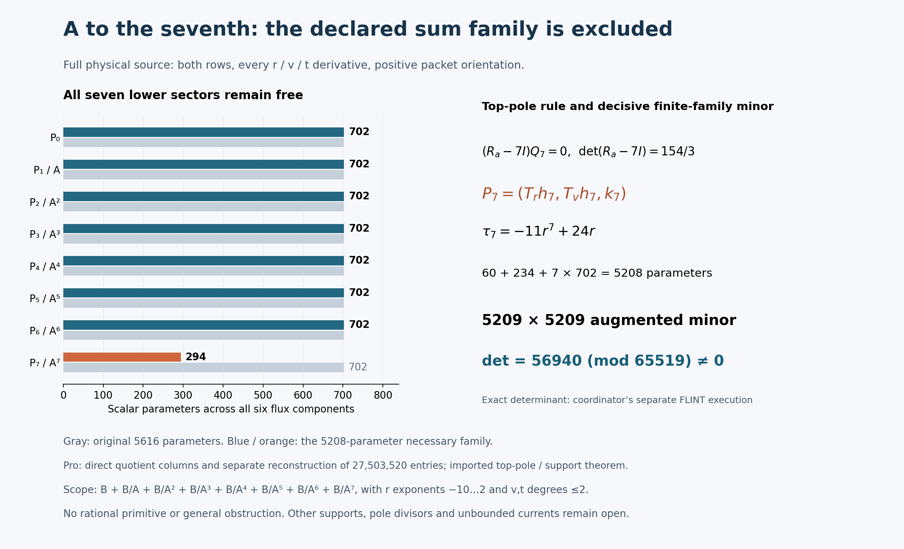

# One-reflection-skew: bounded A-seventh full-current family

24 October 2026, America/New_York. **The declared rational-constant family is
excluded by the coordinator's independently reconstructed nonzero augmented
minor.** Pro constructed the full direct-quotient matrix and a separate AI
worker reconstructed every entry from the literal connection. The exact
determinant is a coordinator execution; matching the delivered bytes to its
frozen minor is a separate IO-only integration step. No primitive was found.

## Run card and provenance

Question: does the seventh-power A denominator permit cancellation of the
full two-row physical source within the stated numerator box, retaining all
lower sectors? An exact rational current would require a full rational
identity. Exclusion requires a sound augmented-minor argument that accounts
for kernels; a deficient modular rank gap alone would not suffice.

The actual Goal is coordinator-owned, activated at **2:08:45 p.m. EDT /
18:08:45 UTC**, with research deadline **2:53:45 p.m. EDT / 18:53:45 UTC**.
Mathematical children are limited to 60 seconds, network operations to 45
seconds, and an unchanged failed approach permits at most one justified
repair. Mathematics closed at **2:13:01 p.m. EDT / 18:13:01 UTC**. The
15-minute integration window ends at **2:28:01 p.m. EDT / 18:28:01 UTC**.
Subsequent work is documentation, visualization and packaging.

Integration parent: `030d13b75270f6ad1a774e9c11321038fe6305e9`.
Actual cached execution checkout: `fc4f38a338b47addf62d1bf699783302285378fe`.
Current-parent AGENTS, board and connection were read through the working
read-only GitHub connector; snapshots match their Git blob hashes. The
cached connection and live-parent bytes agree, SHA256
`a86c01f7fed725aac86e958a10f484b9b340765714c5b228513890977a59ce5d`.
The coordinator supplied freshly verified upstream pin
`27f4bb9ad8757e5841f884d9d30124a3c97a847d`; Pro did not refetch upstream.
No newer full checkout or combined Git tree is claimed. See
[source-pins.json](../results/skew-A7-denominator-20261024/source-pins.json).

Only this note and `results/skew-A7-denominator-20261024/` are worker-owned.
No shared README, ledger or board edits, Git stage/commit/push, Lean or
upstream action occurred. Posts 1–30 and tally 30/1/0 remain unchanged by
this worker. Source, divisor, tangent-module/support, normalization, Q/R2,
beta, trace and A–A6 results were reused with their original scope, not
rerun. Known failed Git or FLINT setup routes were not retried.

## Exact family and physical operator

Let

\[
B=\operatorname{span}_{\mathbf Q}\{r^m v^n t^k:
-10\le m\le2,\quad0\le n,k\le2\},\qquad
A=r^3+r^{-3}+(rv-1)^6/r^{15}.
\]

The requested pure denominator family is explicitly enlarged to

\[
\boxed{(B+B/A+B/A^2+B/A^3+B/A^4+B/A^5+B/A^6+B/A^7)^6},
\qquad F=\sum_{j=0}^{7}P_j/A^j.
\]

Coefficients in these bases are **rational constants**. The original family
has **5616 scalar parameters**. Multiplying a relation by A^7 gives possible
leading v-degree bands 42–44, 36–38, 30–32, 24–26, 18–20, 12–14, 6–8 and
0–2. Descending by degree proves directness of the input sectors. This
input statement alone does not establish injectivity of the differential
operator.

The unchanged equation is

\[
\sum_{i=r,v,t}(\partial_i+\widetilde N_i)F_i=S,
\quad S=\frac{r^{-4}}{12}M_be_0,
\quad\widetilde N=(A_rM_a,A_vM_a+tM_b,N_t),
\]
\[
(a,b,c,d)=(A,tv,t(1-t^2)/7,1+t^6),\qquad
N_t=vM_b+c'M_c+d'M_d.
\]

Both compact rows, ordered input columns e0,e1, positive packet orientation
and every physical r,v,t derivative are retained. Top quotient corrections
are -7*A_r/A^8 and -7*A_v/A^8. A_t=0, but all three terms of N_t remain.
This A is the chart coefficient, distinct from the protected source
X0^3Y0^3; q remains 1. The valid common-localization boundary is unchanged.
Scalar trace zero is not full-source exactness or a primitive.

The ansatz allows r=0 and A=0 poles, with A-order at most seven. Evaluation
also avoids Delta=0 and all literal connection denominators. Sampling
nonzero v,t does not introduce new ansatz denominators. No inverse A_r is
used.

## Imported necessary restriction: only the highest sector

At the reused generic A=0 divisor,

\[
R_a=\begin{pmatrix}0&-c/(6b)\\0&-1/3\end{pmatrix},
\qquad\det(R_a-7I)=154/3.
\]

Writing Qj=A_r*Pj_r+A_v*Pj_v, the highest pole forces only P7 tangent.
The reused bounded tangent/support theorem gives

\[
P_7=(T_rh_7,T_vh_7,k_7),\quad T_r=r^2(r^6+1),\quad
T_v=r(2r^6+1)v-(3r^6+2).
\]

Each h7 component has 30 monomials with m=-10..-6, n=0..1, k=0..2;
each k7 component has the original 117 monomials. The top contributes
**60+234=294 parameters**. **All 4914 lower coefficients in P6 through P0
remain free**, giving **5208 necessary columns**. No lower tangency or
previous exclusion is imposed on the changed residual.

With ell=3*r*(r^6-1) and T(A)=ell*A,

\[
\tau_7=\operatorname{div}(T)-7\ell=-11r^7+24r,
\]
\[
W_7=[T_r\partial_r+T_v\partial_v+\tau_7I+\ell AM_a+tT_vM_b]h_7
+(\partial_t+N_t)k_7.
\]

The exact scaled equation is

\[
A^7\operatorname{Div}P_0+
\sum_{j=1}^{6}\left[A^{7-j}\operatorname{Div}P_j-jA^{6-j}Q_j\right]
+W_7=A^7S.
\]

The next pole stays coupled: (Ra-6I)Q6+W7|A=0=0. The coordinator's new
algebra run reports seven identities, three controls and ten byte bindings
in 2.297 seconds, including the exact 5616×5208 sparse injection. These are
imported executions. Their hashes and downstream use are in
[STRUCTURAL-DEPENDENCY.md](../results/skew-A7-denominator-20261024/STRUCTURAL-DEPENDENCY.md).

## Fixed matrix and finite-family certificate

The [specification](../results/skew-A7-denominator-20261024/MATRIX-SPEC.md)
was visible before numerical results: prime **65519**, Python random.Random
seed **2026102497**, first **2640** admissible nonzero-coordinate triples.
Rows are compact row0 then row1. Columns are h7,k7,P6,P5,P4,P3,P2,P1,P0,
then positive source, in the declared direction/input-row/m/n/k order.
The full augmented matrix is **5280×5209**, with **27,503,520 entries**.

The coordinator independently reconstructed the first **5209 rows**, before
seeing Pro's matrix or numerical result: **27,133,681 entries at 2605
admissible points**. Its exact FLINT computation reports

\[
\boxed{\det(M_{0:5209})=56940\pmod{65519}\ne0.}
\]

All evaluated denominators are units modulo this prime. Therefore the
corresponding rational evaluated augmented minor is nonzero. There are only
5208 coefficient columns, so a rational identity cannot hold at these
evaluations. This argument does not require reducing unknown rational
solution coefficients modulo 65519.

The minor also proves full coefficient rank, removing any hidden operator
kernel or column redundancy from the tested necessary family. The imported
highest-pole restriction applies to homogeneous currents too. Together these
facts exclude the original 5616-parameter family, including pure B/A^7.
No conclusion is drawn from a deficient modular rank.

## Executions and attribution

| Executor | Time | Executed outcome |
| --- | ---: | --- |
| Pro lead, direct quotient construction |25.996 s wall|5280×5209 matrix; exit0 |
| Separate Pro AI checker, literal-source reconstruction |26.800 s wall|All 27,503,520 entries, 2640 sample/domain records, basis/rejection sequence and 23 controls; exit0 |
| Coordinator local checker, reported |18.563 s|Exact 5209-square determinant56940; 3 controls; no timeout |
| Coordinator algebra worker, reported |2.297 s process;0.187 s algebra|7 identities,3 controls,10 byte bindings |

The separate Pro checker uses a restricted integer AST, reduced W7 and
exponent-lowered derivatives, without importing the lead's direct-column
implementation. Its 23 controls cover top7→6, top r/v quotient omissions,
quotient sign, every P6..P1 r/v quotient omission, the A_v connection chain,
all three N_t terms, source1/12/sign and k7 t derivative. Both Pro processes
use -O, fail-closed exceptions and 60-second watchdogs. Exact sources,
commands, versions, stdout/stderr, exits, timings and hashes are preserved.
No mathematical failure, timeout, repair, backend setup or determinant
attempt occurred here. The unsuccessful construction is this finite family,
not an interrupted calculation.

Coordinator determinant backend: python-flint0.9.0 exact nmod_mat.det.
Reported script SHA256:
`07ddcf92422a9147799d31bfc623f54c81f9df498f2421f0953eb9b2c09725e0`.
Reported report SHA256:
`9ab4f9b0617984a5780e5e042f5b660bd86c4dfb0395df24e4a5a411dc655526`.
Reported decisive uint16 array SHA256:
`8f4a48490018861c4599e08ae1e6da0e279b874c260e96d6350af74110f81b28`.
The array container was not specified in the relay; its hash alone does
not identify raw versus NPY format. These original coordinator-owned files
are not in this packet or counted as Pro runs. See
[coordinator-reported.json](../results/skew-A7-denominator-20261024/coordinator-reported.json).
Separate AI implementations are not independent human reviews.

## Artifacts, visualization and remaining obligation

Full matrix: headerless row-major little-endian uint16, shape **(5280,5209)**,
**55,007,040 bytes**, SHA256
`7ab80831f8757663bc208ecb4a391509ab18080b0a6f776d0a4b57695c9e2230`.
Inputs.json SHA256:
`4d67271f1607894a72afab28a39d3ee0e2e1752da414f3e85b6b32f418ee4ded`.
It includes every point/domain, rejection and basis label. This seed yielded
no rejected points. Fresh-directory commands and delivery conventions are in
[RUN.md](../results/skew-A7-denominator-20261024/RUN.md).

The [generator](../results/skew-A7-denominator-20261024/render.py) reads frozen
receipts, saves input/output hashes and has an inspected PNG. It shows the
eight sectors, top-only restriction, separate determinant attribution and
finite scope. The image itself is not mathematical evidence or a CI status.

The smallest remaining integration action is **IO-only matching** of delivered
decisive matrix entries and basis/domain records to the coordinator's frozen
data, followed by coordinator-owned shared-file integration and publication.
The optional binding script computes no determinant. This receiver-side
matching is pending in Pro and must be recorded separately from mathematical
reconstruction.

The original ZIP retains every added payload byte. The review ZIP omits only
the bulky matrix and records its exact hash. Numbered binary parts, each at
most 2,000,000 bytes, reconstruct the original archive. Root manifest paths
begin `payload/`: verify from the unpacked root and apply only payload contents.
No repository/cache dump, expanded submodule or fabricated Git tree is supplied.

No second mathematics or review round followed the relevant passes. The larger
target remains open. Any next cancelling current must escape a restriction
of this exact finite family; other supports, justified divisors, higher
powers, unbounded rational currents and fibre-dependent currents remain
outside the exclusion. No source exactness, primitive, cohomology identification,
global clearing, legal certificate, Lean theorem or accepted solve is claimed.

Credit fqlx for the compact connection/source formulation, benediamond for the
physical cover and earlier reductions, and hodge.computer contributors for the
fixed problem and framework. This is AI-assisted work for Ravi Bajaj.
