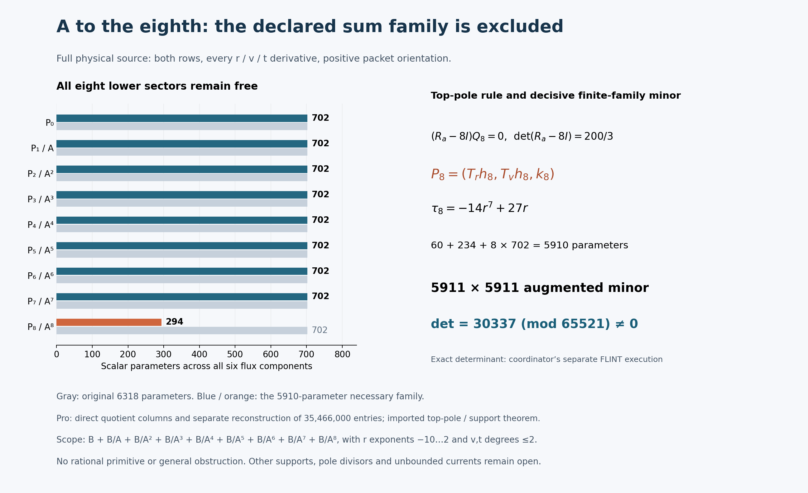

# One-reflection-skew: bounded A-eighth full-current family

24 October 2026, America/New_York. **The declared rational-constant family is
excluded by the coordinator's independently reconstructed nonzero augmented
minor.** Pro constructed the full direct-quotient matrix, and a separate AI
worker independently reconstructed every entry. The exact determinant is a
coordinator execution; delivered-file matching to its frozen minor is a separate
IO-only integration step. No rational primitive was found.

## Run card, pins and ownership

Question: can the eighth-power A denominator cancel the full two-row physical
source within the stated numerator box, allowing every lower sector to
participate? A candidate would require a full rational identity. Exclusion
requires a sound augmented-minor or other kernel-aware argument; a deficient
modular rank gap alone would not suffice.

The actual Goal is coordinator-owned. It began at **2:24:57 p.m. EDT /
18:24:57 UTC**, with research deadline **3:09:57 p.m. EDT /19:09:57 UTC**.
Mathematical child processes are capped at60 seconds; network operations at45
seconds; an unchanged failed approach allows at most one justified repair.
Mathematics closed at **2:29:12 p.m. EDT /18:29:12 UTC**. The15-minute
integration window ends at **2:44:12 p.m. EDT /18:44:12 UTC**. Subsequent work
is documentation, visualization and packaging.

Integration parent: `c6e2e54f957eeeaa97cabc7a26df6d81ffd759ee`.
Actual cached execution checkout: `fc4f38a338b47addf62d1bf699783302285378fe`.
Current-parent AGENTS, target board and connection were fetched through the
working read-only connector and saved with verified Git blob hashes. Cached
and live connection bytes agree, SHA256
`a86c01f7fed725aac86e958a10f484b9b340765714c5b228513890977a59ce5d`.
The coordinator supplied freshly verified upstream pin
`27f4bb9ad8757e5841f884d9d30124a3c97a847d`; Pro did not refetch upstream.
No newer complete checkout or combined Git tree is claimed. See
[source-pins.json](../results/skew-A8-denominator-20261024/source-pins.json).

Only this note and `results/skew-A8-denominator-20261024/` are worker-owned.
There were no shared README/ledger/board edits, Git stage/commit/push, Lean
or upstream actions. Posts1–30 and tally30/1/0 remain unchanged by this worker.
Source, divisor, bounded tangent/support, normalization, Q/R2, beta, trace and
A–A7 results retain their original scopes and were not rerun. Failed Git or
FLINT setup routes were not retried.

## Full family and operator

\[
B=\operatorname{span}_{\mathbf Q}\{r^m v^n t^k:
-10\le m\le2,\quad0\le n,k\le2\},\qquad
A=r^3+r^{-3}+(rv-1)^6/r^{15}.
\]

The explicitly declared sum family is

\[
\boxed{(B+B/A+B/A^2+B/A^3+B/A^4+B/A^5+B/A^6+B/A^7+B/A^8)^6},
\qquad F=\sum_{j=0}^{8}P_j/A^j.
\]

All coefficients in these finite bases are **rational constants**. The original
family has **6318 parameters**. After multiplying a relation by A^8, the
possible nonzero leading v-degree bands are48–50,42–44,36–38,30–32,24–26,
18–20,12–14,6–8,0–2. Descending by degree establishes directness of the input
sectors. This does not by itself prove injectivity of the differential operator.

The full physical equation remains

\[
\sum_{i=r,v,t}(\partial_i+\widetilde N_i)F_i=S,
\quad S=\frac{r^{-4}}{12}M_be_0,
\quad\widetilde N=(A_rM_a,A_vM_a+tM_b,N_t),
\]
\[
(a,b,c,d)=(A,tv,t(1-t^2)/7,1+t^6),\qquad
N_t=vM_b+c'M_c+d'M_d.
\]

Both compact output rows, ordered input columns e0,e1, positive packet
orientation and all physical r,v,t derivatives remain. Top quotient terms
are -8*A_r/A^9 and -8*A_v/A^9. A_t=0, but all three N_t terms are retained.
This A is the chart coefficient, distinct from protected source X0^3Y0^3;
q remains1. The valid common-localization boundary is preserved. Scalar
trace zero is not full-source exactness or a primitive.

The ansatz permits r=0 and A=0 poles, with A-order at most eight. Evaluations
also avoid Delta=0 and literal connection denominator zeros. Sampling nonzero
v,t does not add v/t poles to the ansatz. No inverse A_r is used.

## Imported top-only necessary restriction

At the reused generic A=0 divisor,

\[
R_a=\begin{pmatrix}0&-c/(6b)\\0&-1/3\end{pmatrix},
\qquad\det(R_a-8I)=200/3.
\]

Set Qj=A_r*Pj_r+A_v*Pj_v. The highest pole forces **only P8** tangent.
The reused bounded tangent/support theorem supplies

\[
P_8=(T_rh_8,T_vh_8,k_8),\quad
T_r=r^2(r^6+1),\quad T_v=r(2r^6+1)v-(3r^6+2).
\]

Each h8 component has30 monomials,m=-10..-6,n=0..1,k=0..2; each k8
component has117 original B monomials. The top contributes **60+234=294**.
Every lower P7 through P0 retains all702 coefficients: **5616 lower
coefficients free**, for **5910 necessary columns**. No lower tangency or
prior family exclusion is imposed on the changed residual.

With ell=3*r*(r^6-1) and T(A)=ell*A,

\[
\tau_8=\operatorname{div}(T)-8\ell=-14r^7+27r,
\]
\[
W_8=[T_r\partial_r+T_v\partial_v+\tau_8I+\ell AM_a+tT_vM_b]h_8
+(\partial_t+N_t)k_8.
\]

The scaled equation is

\[
A^8\operatorname{Div}P_0+
\sum_{j=1}^{7}[A^{8-j}\operatorname{Div}P_j-jA^{7-j}Q_j]+W_8=A^8S.
\]

The next pole remains coupled:(Ra-7I)Q7+W8|A=0=0. The coordinator reports
seven new checks and three controls in2.235 seconds process/0.219 seconds
algebra, with exact6318×5910 sparse injection. Algebra checker SHA256:
`b74eb6bd383d55e7c699866974e27e28196dc36c2db62c28507452ed4fbddfd2`.
Injection SHA256:
`32dcdb1291e8ee2cc2703978f95a2b62d8e9a6d5295b8db48c6c37e5a10040a2`.
These are imported coordinator executions, not Pro counts. See
[STRUCTURAL-DEPENDENCY.md](../results/skew-A8-denominator-20261024/STRUCTURAL-DEPENDENCY.md).

## Fixed matrix and exclusion certificate

The [fixed specification](../results/skew-A8-denominator-20261024/MATRIX-SPEC.md)
was declared visibly before numerical results: prime **65521**, Python
random.Random seed **2026102508**, first **3000** admissible nonzero-coordinate
triples. Rows are compact0 then1; columns are h8,k8,P7,P6,P5,P4,P3,P2,P1,P0,
positive source, in the declared direction/input-row/m/n/k order. The full
matrix is **6000×5911**, with **35,466,000 entries**.

The coordinator independently reconstructed the first **5911 rows**, before
seeing Pro's matrix or numerical result: **34,939,921 entries at2956 points**.
Its exact FLINT execution reports

\[
\boxed{\det(M_{0:5911})=30337\pmod{65521}\ne0.}
\]

All evaluated denominators are units modulo this prime. Thus the corresponding
rational evaluated augmented minor is nonzero. There are only5910 coefficient
columns, so a rational identity would contradict this minor. The argument does
not require reducing unknown rational solution coefficients modulo65521.

The nonzero augmented minor also establishes full coefficient rank. The
imported highest-pole restriction applies to homogeneous currents, so no
hidden operator kernel or redundant column invalidates the exclusion.
Together these facts exclude the original6318-parameter family, including
the pure B/A^8 subfamily. No deficient modular rank inference is used.

## Executed checks, attribution and limits

| Executor | Time | Actual outcome |
| --- | ---: | --- |
| Pro lead,direct quotient construction |34.722s wall|6000×5911 matrix,exit0 |
| Separate Pro AI checker,literal-source reconstruction |32.315s wall|All35,466,000 entries,3000 domains,basis/rejection order,25controls,exit0 |
| Coordinator local checker,reported |26.781s|Exact5911-square determinant30337,3controls,no timeout |
| Coordinator algebra worker,reported |2.235s process/0.219s algebra|7exact checks,3controls,exact necessary injection |

The Pro reconstruction uses a restricted integer AST,reducedW8 and
exponent-lowered derivatives without importing the author's direct-column
implementation. Its25 controls cover top8→7,top r/v quotient omissions,
quotient sign,every P7..P1 r/v quotient omission,the A_v chain,all three N_t
terms,source1/12/sign and k8 t derivative. Both mathematical processes ran
under -O with fail-closed exceptions and60-second watchdogs. Sources,runner
snapshots,commands,versions,stdout/stderr,exits,timings and hashes are saved.
No mathematical failure,timeout,repair,determinant attempt or backend setup
occurred here. One orchestration call was aborted before dispatch; no code
ran,and its operations were reissued. That is not a mathematical failure.

Coordinator determinant backend:python-flint0.9.0 exact nmod_mat.det.
Reported script SHA256:
`a3ddd2085a67c1081ff1c38807cee17e29c23698fdd7b1f49c00395572fbdaf1`.
Reported report SHA256:
`a9cbcfece3df8b8cd9c1813d685dbb0ad193838292b4212029f6c9c149fb92ff`.
Frozen NPY container SHA256:
`1c41301ad2a113d530bbd3b13c4ee004ac22fb55219b8bab99ae9850d46ac9e6`.
Those original files are coordinator-owned and not copied here or counted
as Pro executions. The relay is in
[coordinator-reported.json](../results/skew-A8-denominator-20261024/coordinator-reported.json).
Separate AI implementations are not independent human reviews.

## Delivery, visualization and next step

Full matrix:headerless row-major little-endian uint16,shape **(6000,5911)**,
**70,932,000 bytes**,SHA256
`760a3e5cc7c7e0e941a482f2f554cf372f5145371ebf48ff5498300af20da9b3`.
Inputs.json SHA256:
`1e635a3e0c6e5be593ce954e638bd37f2453b882110d7da41ce268709772d9c4`.
It includes all samples/domains,rejections and basis labels. There were no
rejected points for this seed. [RUN.md](../results/skew-A8-denominator-20261024/RUN.md)
contains fresh-directory reproduction commands; integration needs no extra replay.

The [generator](../results/skew-A8-denominator-20261024/render.py) reads frozen
receipts and records input/output hashes. Its PNG is inspected before delivery.
It depicts all nine sectors,top-only restriction,determinant attribution and
finite scope; it is not itself proof or a transient CI status.

The smallest remaining integration step is **IO-only comparison** of delivered
decisive entries and basis/domain records to the coordinator's frozen data.
The optional helper binds both exact matrix hashes and all decisive entries
without reconstruction or determinant execution. Pro has not run it; the
coordinator's frozen NPY is not available here. The coordinator owns shared
integration and normal Hodge Lab publication.

The complete original ZIP preserves every added payload byte. The small
review ZIP omits only the bulky matrix and records its exact hash. Numbered
binary parts<=2,000,000 bytes reconstruct the original ZIP. Root full-manifest
paths begin `payload/`; verify from unpacked archive root and apply payload
contents only. No repository/cache/submodule dump or fabricated Git tree is
included. The original scripts,receipts and result bytes remain immutable.

No second mathematics or review round followed the relevant passes. The full
source remains unsolved outside this finite family. A next cancelling current
must escape a restriction of this exact space. Other numerator supports,
other justified pole divisors,higher powers,unbounded rational currents and
fibre-dependent currents are outside this exclusion. No source exactness,
primitive,cohomology identification,global clearing,certificate,Lean theorem
or accepted solve is claimed.

Credit fqlx for the compact connection/source formulation,benediamond for
the physical cover and earlier reductions,and hodge.computer contributors
for the fixed target and framework. This is AI-assisted work for Ravi Bajaj.
